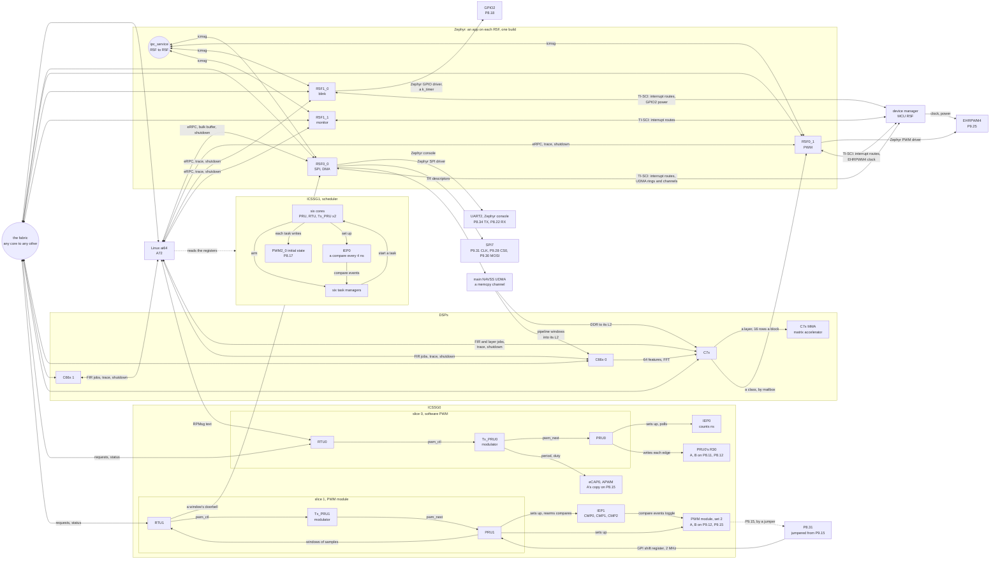
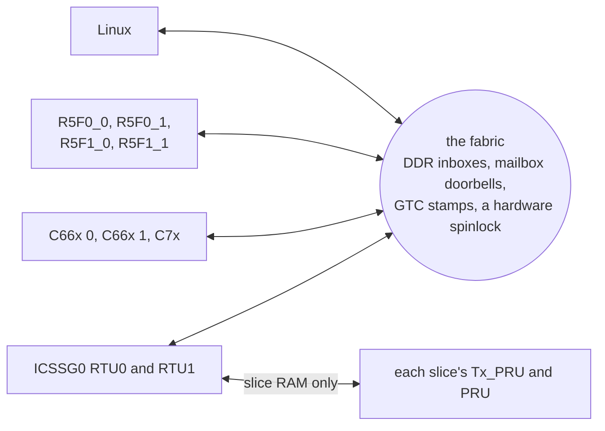
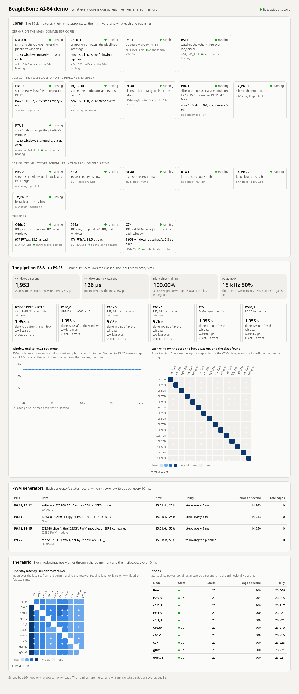
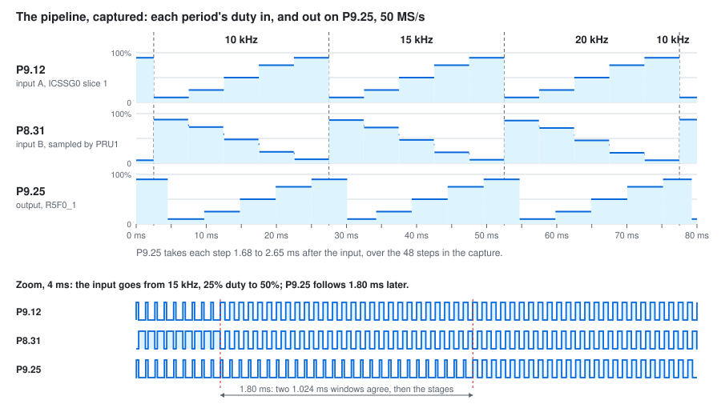

# BeagleBone AI-64: Linux, Zephyr, PRU, RTU, Tx_PRU, and DSPs together

A starting point for BeagleBone AI-64 (TI TDA4VM / J721E) projects that use its heterogeneous cores:

- **Linux** on the Cortex-A72s runs `ai64`, one program that drives the demo.
- **Zephyr** runs on all four main-domain Cortex-R5F cores, R5F0_0, R5F0_1, R5F1_0, and R5F1_1 (R5F, then the cluster, then the core): an app for each, in `zephyr/r5/<core>/`, on code they share, and one `west build --sysbuild` makes all four ([Four Zephyr apps, one build](zephyr/r5/README.md)). R5F0_0 writes SPI7, and moves data with a channel of the SoC's UDMA; R5F0_1 drives a PWM on P9.25 with the SoC's EHRPWM4, which the pipeline below takes over once it runs; R5F1_0 makes a square wave on P8.18 from a kernel timer; R5F1_1 watches the other three. They call each other through Zephyr's `ipc_service`, so any core takes a request for SPI or the PWM and passes it on to the one whose job it is. Each answers function calls from Linux too (eRPC over RPMsg). Their drivers get clocks, power, and interrupt routes from the board's device manager over TI-SCI, which a small polled mailbox driver carries on these cores ([Zephyr and the device manager](zephyr/r5/README.md#zephyr-and-the-device-manager-ti-sci)).
- **ICSSG0 makes PWM three ways** ([PWM, three ways](pru/README.md#icssg0-pwm-three-ways)): slice 0 in software, its PRU writing its pins at times it polls from IEP0; slice 1 with the ICSSG's own PWM module, on IEP1 compare events; and the ICSSG's eCAP in APWM mode, which copies slice 0's A onto P8.15, given only a period and duty by slice 0's Tx_PRU. Each slice makes a complementary pair, A and B: B is high while A is low, except for 1 µs of dead band where both are low. Like P9.25, both start stepping through 10, 15, and 20 kHz, and at each through 10, 25, 50, 75, and 90% duty, a step every 5 ms. In each slice the RTU talks to the rest of the SoC, the Tx_PRU modulates the duty, and the PRU makes the edges. RTU0 talks to Linux over RPMsg; RTU1 only over shared memory.
- **ICSSG1 runs a port of TI's open-pru [`multicore_scheduler`](https://github.com/TexasInstruments/open-pru/tree/main/examples/multicore_scheduler)** on all six of its cores: IEP0 compares start a task on each core in turn, 4 ns apart, and each task sets a header pin high or low ([The multicore scheduler](pru/README.md#icssg1-the-multicore-scheduler)).
- **The two C66x DSPs and the C7x DSP** log through their remoteproc trace buffers, which Linux follows, and run FIR filter jobs that Linux hands them through shared memory. The C7x also runs an int8 neural-network layer on its Matrix Multiply Accelerator, fed by its Streaming Engines: 256 rows in under 2 µs, about 250 times as fast as one A72 core ([The C7x's MMA](dsp/README.md#the-c7xs-matrix-multiply-accelerator)), with its input brought into its L2 SRAM by R5F0_0's DMA ([R5F0_0's DMA](zephyr/r5/README.md#r5f0_0s-dma-the-udma)).
- **The pipeline** takes a signal in on one header pin and out on another, through five kinds of core, with no Linux in the path ([The pipeline](docs/pipeline.md#the-pipeline-p831-to-p925)). ICSSG0 PRU1 samples P8.31 at 2 MHz with its GPI shift register, and RTU1 stamps each 1.024 ms window, a new one every 512 µs; R5F0_0's UDMA moves each window into the L2 SRAM of one C66x or the other, in turn; the C66x takes its FFT; the C7x's MMA classifies the spectrum, with a layer Linux trains at startup; and R5F0_1 sets P9.25 to match. A jumper wire from P9.15 gives it ICSSG0's stepping PWM to listen to: it names every one of the 15 steps right, and P9.25 plays the pattern back about 1.5 ms later.
- **The fabric** joins these cores, and Linux, directly to each other: R5F to R5F, DSP to DSP, DSP to R5F, any of them to the ICSSG0 slices, and back. Every core pings every other one, R5F0_0 sends a message round all of them, and Linux can send one along any route, so that, say, the C7x passes it to a C66x that has ICSSG0 RTU1 change its PWM. Each message is stamped with the SoC's shared clock, so Linux shows the one-way latency of all 90 paths ([The fabric](docs/fabric.md)).
- **A web page** on the board shows all of it live: every core's state, the pipeline's stages and score, the PWM generators, and the fabric's latencies, read from shared memory twice a second ([The web page](#the-web-page)).

The ICSSG firmware is laid out the way TI's [open-pru](https://github.com/TexasInstruments/open-pru) projects are: `pru/pwm/` and `pru/multicore_scheduler/`, a directory per core with its own makefile and linker script, shared sources and a memory map per project ([The ICSSG firmware](pru/README.md#the-icssg-firmware)). In ICSSG0 **the RTU talks, and the PRU and Tx_PRU keep time**: the RTU is the slice's only link to the rest of the SoC, and the PRU and Tx_PRU only touch their slice's own RAM, so nothing elsewhere on the chip can stretch their timing. ICSSG1 keeps TI's design, where every core runs a task.



Each arrow goes from a core to what it controls or talks to; the label says how. Linux also loads and starts every core here through remoteproc, which the diagram leaves out. The four R5Fs each run a Zephyr app of their own, on shared code, built together with sysbuild, and talk to each other through Zephyr's `ipc_service`. The fabric joins Linux, the R5Fs, the DSPs, and both ICSSG0 RTUs directly to each other, so any of them can reach either slice, not only Linux. RTU1 takes requests only over the fabric; RTU0 takes them over RPMsg too. What the fabric is made of, and how far into a slice it reaches:



Each link is small and easy to copy into your own project. [How it works](#how-it-works) walks through them. The MCU-domain R5F cores are left alone: they run the board's device manager.

The demo runs on the BeagleBoard Debian image, plus a one-time install script. A Yocto (Poky) configuration in `yocto/` builds the demo into an image of its own, which has been built and tested on the board. Both images run Linux 6.18, but different kernels: BeagleBoard's on Debian, TI's on Yocto ([Two 6.18 kernels](docs/kernels.md#two-618-kernels)).

## What you need

- A BeagleBone AI-64, a microSD card (16 GB or more), and a 5 V supply for it.
- A network link to it: Ethernet to your LAN, or the USB-C port, which brings up a USB network adapter on the PC.
- A Linux PC with `git`, `ssh`, `rsync`, `xz`, and either `podman` or `docker`. Every compiler runs in a container, so you don't install any toolchains.
- About 6 GB of free disk on the PC: roughly 3 GB of container images plus 2 GB of fetched sources. The first build takes 10–20 minutes, mostly downloading. Later builds take seconds to a minute.
- Network access from the PC to GitHub, git.ti.com, software-dl.ti.com, and Docker Hub. git.ti.com is only for the PRU Software Support Package.
- A jumper wire from P9.15 to P8.31, for the pipeline. Without it the rest of the demo runs the same, the pipeline says it found nothing to train on, and P9.25 keeps its own steps.
- Optional: a logic analyzer, to watch SPI7, the four PWM generators, the pipeline, and the multicore scheduler on the header ([Probe the pins](#probe-the-pins)); and a 3.3 V USB-serial adapter on P8.34 (TX) and P8.22 (RX), to read the Zephyr console.

Get the code:

```
git clone https://github.com/kevinacahalan/BeagleBoneAI64-linux-zephyr-pru-c7x-c66x-demo.git
cd BeagleBoneAI64-linux-zephyr-pru-c7x-c66x-demo
```

Every command below runs from this directory unless it says "on the board".

## Quick start: BeagleBoard Debian

### 1. Flash the card and log in

Download [BeagleBone AI-64 Debian 13.7 IoT, v6.18 k3](https://www.beagleboard.org/distros/bbai64-debian-13-7-2026-10-09-iot-v6-18-x-k3), the file `bbai64-debian-13.7-iot-v6.18-k3-arm64-2026-10-09-10gb.img.xz`. A fresh image has no login until you give it one. Pick either way:

- **BeagleBoard Imager** (easiest). Choose the image, and in its settings set a user name, a password, and your SSH public key. Imager writes them for you.
- **By hand.**
  1. Write the image: `xz -dc bbai64-debian-*.img.xz | sudo dd of=/dev/sdX bs=4M conv=fsync status=progress`. Replace `/dev/sdX` with your card. Check it with `lsblk` first: `dd` overwrites whatever you give it.
  2. Mount the card's `BOOT` partition.
  3. Add these lines to the end of `sysconf.txt`, with your own values. The board applies them on first boot and then clears the password from the file.

     ```
     user_name=debian
     user_password=choose-a-password
     user_authorized_key=ssh-ed25519 AAAA... you@pc
     hostname=bbai64
     ```

     The key line is the contents of your `~/.ssh/id_ed25519.pub`. Run `ssh-keygen -t ed25519` if you don't have one. With the key in place, the build steps below don't keep asking for a password.

Put the card in the board and power it. With a card in the slot the board boots from it; the console prints `Trying to boot from MMC1`. If yours boots its eMMC instead, hold the BOOT button while you apply power.

A fresh card reboots twice on its own before it stays up: the first boot applies `sysconf.txt` and grows the root partition, and the second resizes the filesystem. Give it about three minutes. Then log in over the network:

```
ssh debian@bbai64.local
```

Below, `USER@BOARD` means that login, for example `debian@bbai64.local`. You'll also need its password for `sudo` on the board. If `.local` names don't resolve on your PC, use the address your router gave the board. Over the USB-C cable the board is `192.168.7.2`.

The serial console is UART0 on the 3-pin debug header, 115200 8N1 (`ttyS2` on the board), if SSH doesn't come up.

### 2. Build on the PC

```
./beagle-linux/scripts/build.sh
AI64_SSH=USER@BOARD ./beagle-linux/scripts/build.sh kmod
./beagle-linux/scripts/build.sh bundle
```

- **The first command** builds `ai64`, the overlay, the twelve ICSSG images, the four Zephyr R5F images, and the two DSP images.
- **`kmod`** builds the two patched kernel modules for the kernel running on your board. It asks the board for its kernel version over SSH, and the first time it copies that kernel's headers with `rsync`. The board must be up and reachable. [Why two patched modules](docs/kernels.md#why-debian-needs-two-patched-modules) explains why they're needed.
- **`bundle`** gathers everything into `out/ai64-beagle/`.

### 3. Install on the board and reboot

```
scp -r out/ai64-beagle USER@BOARD:
ssh -t USER@BOARD 'sudo ./ai64-beagle/install-beagle.sh && sudo reboot'
```

It asks for your `sudo` password on the board. `install-beagle.sh` makes the setup survive reboots:
- It installs `ai64`, `ai64-demo`, and the firmware for every core.
- It installs the patched `pru_rproc` and `ti_k3_r5_remoteproc` modules so the kernel loads them at boot.
- It adds the demo overlay to the default boot entry, and takes off the stock P9.25 PWM overlay, which muxes the same pin. The original is saved as `extlinux.conf.ai64-bak`.
- It adds a udev rule so the `dialout` group can use `/dev/rpmsg*`.
- It installs `tmux` with apt if the image doesn't have it. The stock IoT image doesn't. This needs the board to reach the internet; over Ethernet it usually can. If it can't, the script says so and carries on.

Nothing of the demo starts at boot: every core stays off until `ai64-demo` starts it, so the whole demo starts and stops in one place. The R5F images go in as `/lib/firmware/ai64_r5f0_0.elf` and so on, not under the kernel's default names (`j7-main-r5f0_0-fw`), so the kernel does not boot them either. An earlier version started the ICSSG cores from a service; `install-beagle.sh` removes it.

Give the board about 30 seconds to reboot, then log back in.

### 4. Run the demo

On the board:

```
ai64-demo --tmux
```

- It asks for your `sudo` password once.
- It restarts the four R5F cores, the twelve ICSSG cores, and the DSPs with the installed firmware, then opens a tmux session with fourteen windows: `linux`, `r5f0_0`, `r5f0_1`, `r5f1_0`, `r5f1_1` (Zephyr on each R5F core), `rtu0` (ICSSG0 RTU0), `pwm`, `sched`, `c66x0`, `c66x1`, `c7x`, `fabric`, `pipe`, and `web`, which serves [the web page](#the-web-page) on port 8064. Before it stops each R5F and DSP, it asks the core to go idle ([why](dsp/README.md#restarting-the-c7x)), and it stops the pipeline until the `linux` window starts it again. The `fabric` window is about 100 columns wide, and `pipe` about 130.
- [What you should see](#what-you-should-see) shows the output of a passing run, and [Commands](#commands) lists what you can type in the `linux` window.

tmux keys: Ctrl+b then w lists the windows to pick from; Ctrl+b then n and p go to the next and previous; Ctrl+b then 0–9 goes straight to one of the first ten. Detach, leaving the demo running, with Ctrl+b then d. Come back with `ai64-demo --attach --tmux`.

To stop the demo, run `tmux kill-session -t ai64`. That closes the windows; the cores keep running until the next `ai64-demo` restarts them, or the board reboots. Typing `quit` in the `linux` window only ends that window.

Without tmux, plain `ai64-demo` prints all fourteen windows on one console instead. There, `quit` or Ctrl+C stops the whole demo.

### After you change the code

- **`ai64` or any core's firmware:** rebuild with `build.sh`, run `build.sh bundle`, copy the bundle, and run `install-beagle.sh` again. No reboot is needed: the next `ai64-demo` restarts every core with the new firmware.
- **The overlay:** the same steps, then reboot. Pin mux only changes at boot.
- **After the board's kernel is upgraded** (for example by `apt upgrade`): run `build.sh kmod` again, then `bundle`, `install-beagle.sh`, and reboot. The patched modules only fit the kernel they were built for.

## What you should see

On startup the `linux` window runs a short script. In order, it:

1. pings RTU0;
2. asks Zephyr on R5F0_0 to `say` something, check a `chunk` of the bulk buffer, and write `spi`;
3. asks R5F0_1 to start P9.25's `steps`, and RTU0 for its `status`;
4. asks Zephyr on each other R5F core to `say` something;
5. asks R5F1_0, which has no SPI, to write `spi`, which it passes to R5F0_0;
6. asks the monitor, R5F1_1, for every core's `status`;
7. has R5F0_0 `dma` a layer's input into the C7x for its MMA;
8. starts the pipeline, training the C7x's layer on 3 s of P8.31 and handing P9.25 to it.

Each `Linux -> X` line is a command Linux sent, and the indented lines under it are the answers, which also show in that core's own window. A passing run, one block per window:

```
== linux
Each line "Linux -> X" is a command Linux sent; the indented lines under it are
the answers, which also show in that core's own window.
Linux -> ICSSG0 RTU0: ping
  Linux sent "ping" to ICSSG0 RTU0, and it echoed it
Linux -> R5F0_0 (Zephyr): say hello from linux
  R5F0_0: say "hello from linux": it replied "Zephyr on R5F0_0 got: hello from linux"
Linux -> R5F0_0 (Zephyr): chunk bulk-hello
  R5F0_0: chunk: the bulk buffer matched (seq 1, 10 bytes, crc c959d039)
Linux -> R5F0_0 (Zephyr): spi
  R5F0_0: spi "hello": it replied "Zephyr on R5F0_0: spi wrote 5 bytes"
Linux -> R5F0_1 (Zephyr): steps 5
  R5F0_1: steps: P9.25 (EHRPWM4 output B) steps 10, 15, 20 kHz x 10-90% duty, 5 ms a step
Linux -> ICSSG0 RTU0: status
  software PWM on P8.11 (A) and P8.12 (B) now: period 66664 ns, A high 59996 ns, dead band 1000 ns, 84571 periods, 0 late edges
  hardware PWM on P8.15 (eCAP0, a copy of A) now: period 66664 ns, high 59996 ns, 87125 periods
Linux -> R5F0_1 (Zephyr): say hello from linux
  R5F0_1: say "hello from linux": it replied "Zephyr on R5F0_1 got: hello from linux"
Linux -> R5F1_0 (Zephyr): say hello from linux
  R5F1_0: say "hello from linux": it replied "Zephyr on R5F1_0 got: hello from linux"
Linux -> R5F1_1 (Zephyr): say hello from linux
  R5F1_1: say "hello from linux": it replied "Zephyr on R5F1_1 got: hello from linux"
Linux -> R5F1_0 (Zephyr): spi via r5f1_0
  R5F1_0: spi "via r5f1_0": it replied "Zephyr on R5F1_0: passed spi to R5F0_0, which wrote 10 bytes (323 us)"
Linux -> R5F1_1 (Zephyr): status
  R5F1_1: status: Zephyr on R5F1_1: monitor: pinging the other R5F cores every 100 ms, 84 rounds
    R5F0_0: round trip 79.96 us (76.93 to 90.41), 0 of 84 lost; SPI7: 2 writes, 10 bytes
    R5F0_1: round trip 78.18 us (75.65 to 82.45), 0 of 84 lost; P9.25: stepping every 5 ms, now 20000 Hz at 90% duty
    R5F1_0: round trip 82.81 us (77.45 to 95.36), 0 of 84 lost; P8.18: 17010 toggles, every 500 us; last 1000 off by -2280 to 2240 ns, mean 0; worst 14535 ns
Linux -> R5F0_0 (Zephyr): dma
  R5F0_0: dma: its UDMA copied 16384 bytes from DDR to the C7x's L2 in 33.7 us (486 MB/s; the R5F reading them itself: 5466.3 us), then the C7x's MMA ran the layer: 2536 cycles, 3.6 us round trip; all match the A72
Linux: the pipeline, P8.31 to P9.25 (ai64 pipe start)
pipeline: P8.31 -> ICSSG0 PRU1 and RTU1 -> R5F0_0's UDMA -> C66x 0 and 1's FFT -> C7x's MMA -> R5F0_1 -> P9.25
training: 3.0 s of windows of P8.31, each labelled with the step the input was on
  4528 windows, 300 to 309 a class; 1344 across a step left out
  the int8 layer, checked here on the same windows: 4528 of 4528 right (100.0%), shift 9
the C7x has the weights; R5F0_1 sets P9.25 to each window's class (ai64 pipe shows the score)
linux window ready. commands: r5fX_Y say|status|spi|pwm|steps ... | r5f0_0 chunk|dma ... | rtu0 pwm|steps|sweep|dead|status|<text> | pipe [start|stop] | help

== r5f0_0 (each R5F core's window shows the calls Linux made to it)
R5F0_0 window: Linux calls Zephyr on R5F0_0 over eRPC, on /dev/rpmsg1
R5F0_0: say "hello from linux": it replied "Zephyr on R5F0_0 got: hello from linux"
R5F0_0: chunk: the bulk buffer matched (seq 1, 10 bytes, crc c959d039)
R5F0_0: spi "hello": it replied "Zephyr on R5F0_0: spi wrote 5 bytes"
R5F0_0: dma: its UDMA copied 16384 bytes from DDR to the C7x's L2 in 33.6 us (487 MB/s; the R5F reading them itself: 5445.7 us), then the C7x's MMA ran the layer: 2488 cycles, 4.0 us round trip; all match the A72

== rtu0
rtu0 window: Linux and ICSSG0 RTU0 over RPMsg, on /dev/rpmsg5
software PWM on P8.11 (A) and P8.12 (B) runs request 3, now period 66664 ns, A high 6664 ns
Linux -> rtu0: ping
Linux sent "ping" to ICSSG0 RTU0, and it echoed it
Linux -> rtu0: status
software PWM on P8.11 (A) and P8.12 (B) now: period 50000 ns, A high 5000 ns, dead band 1000 ns, 90899 periods, 0 late edges
hardware PWM on P8.15 (eCAP0, a copy of A) now: period 50000 ns, high 5000 ns, 96665 periods

== pwm (every 10 s, what each PWM generator's core reports)
pwm window ready: every 10 s, what each PWM generator's core reports it runs
(read from shared memory; "now" is whichever step it was on)
P8.11 + P8.12  software PWM: ICSSG0 slice 0, PRU0 sets the pins at the times it reads from IEP0
  stepping: 10, 15, 20 kHz, at each 10, 25, 50, 75, 90% duty, 5 ms a step
  now: 15.001 kHz, 75.0% duty
  P8.11 (A) high 49996 ns of each 66664 ns period, from 40 ns in
  P8.12 (B) high 14628 ns: A inverted, but low for 1000 ns of dead band either side of A's pulse
  14996 periods/s, 0 late edges (the latest edge 24 ns late)
P8.15          hardware PWM: ICSSG0's eCAP0 in APWM mode, a copy of P8.11 (A) that Tx_PRU0 sets
  stepping: 10, 15, 20 kHz, at each 10, 25, 50, 75, 90% duty, 5 ms a step
  now: 15.001 kHz, 75.0% duty
  P8.15 high 49996 ns of each 66664 ns period
  14996 periods/s, counted from the eCAP's period flag
P9.12 + P9.15  hardware PWM: ICSSG0 slice 1, the ICSSG's PWM module toggles the pins on IEP1 compares
  stepping: 10, 15, 20 kHz, at each 10, 25, 50, 75, 90% duty, 5 ms a step
  now: 15.001 kHz, 75.0% duty
  P9.12 (A) high 49996 ns of each 66664 ns period, from 40 ns in
  P9.15 (B) high 14628 ns: A inverted, but low for 1000 ns of dead band either side of A's pulse
  14990 periods/s, 0 late edges
P9.25          hardware PWM: the SoC's EHRPWM4, output B, set by Zephyr on R5F0_1 (Zephyr's PWM driver)
  following the pipeline: the class the C7x finds on P8.31 (ai64 pipe)
  now: 10.000 kHz, 50.0% duty
  P9.25 high 50000 ns of each 100000 ns period

== pipe (every 10 s, each stage of the pipeline and R5F0_1's score)
pipeline (running, P9.25 follows): stage                        windows/s   latency mean/max us  work mean/max us  lost   err
  ICSSG0 RTU1  stamps the window               1953.1        0.0 /      8.0       2.3 /    21.9     0     0
  R5F0_0       UDMA into C66x L2               1953.1       22.0 /     82.1      10.8 /    69.3     0     0
  C66x 0       FFT, even windows                976.5      109.0 /    168.1      88.5 /    90.7     0     0
  C66x 1       FFT, odd windows                 976.6      109.0 /    164.2      88.5 /    90.8     0     0
  C7x          MMA layer, class                1953.1      112.0 /    329.0       0.8 /     1.5     0     0
  R5F0_1       P9.25                           1953.1      125.5 /    355.9       3.7 /    70.7     0     0
  newest window 299187: 20 kHz 75%, score 54 against 44; P9.25 holds 20 kHz 75%, set 28433 times (29477 classes waited for a second window)
  score: 15063 right, 0 wrong (100.00%), 4468 across a step, in 10.0 s; since training 214122 right, 0 wrong

== sched (ICSSG1's schedule every 10 s)
sched window ready, ICSSG1's schedule every 10 s
ICSSG1 multicore scheduler: IEP0 period 100 ns, +4 ns a tick (the 250 MHz core clock)
  PRU0     IEP0 CMP7  at     4 ns  sets P8.17 high  task manager on
  PRU1     IEP0 CMP2  at     8 ns  sets P8.17 low   task manager on
  RTU1     IEP0 CMP3  at    12 ns  sets P8.17 high  task manager on
  RTU0     IEP0 CMP4  at    16 ns  sets P8.17 low   task manager on
  Tx_PRU1  IEP0 CMP5  at    20 ns  sets P8.17 low   task manager on
  Tx_PRU0  IEP0 CMP6  at    24 ns  sets P8.17 high  task manager on
  P8.17 (PWM2_0's initial state) read high 79% of 100000 samples, 41664 changes seen

== c66x0 (c66x1 is the same, with DNUM 1 and the odd windows)
4d80800000.dsp trace (ai64-c66x.elf), 2048 bytes at 0x4d80815480
hello from the c66x, DNUM 0
pipeline: FFT stage up, even windows
c66x up 10 s
c66x up 20 s

== c7x
64800000.dsp trace (ai64-c7x.elf), 2048 bytes at 0xa8100000
hello from the c7x, DNUM 1024, MMU on, L1DCFG 4, L2CFG 2
c7x up 10 s
c7x up 20 s
```

- **The `pwm` window** shows what each generator's own core says it is running, read from shared memory. It does not measure the pins. Each generator starts as two lines: its pins, then whether it is software or hardware PWM and what makes the edges. The values are a snapshot of whichever step the generator was on at that moment, so they change every 10 s. `periods/s` averages the three frequencies over the 10 s, so it reads about 15000.
- **A and B** on each ICSSG0 slice form a complementary pair: B is high while A is low, except for 1000 ns either side of A's pulse, where both are low (the dead band, which keeps a half bridge's two switches from ever being on together). So B's high time is the period less A's, less two dead bands, less the 40 ns that A starts into each period. [Probe the pins](#probe-the-pins) draws it.
- **The R5F round trips** are R5F1_1 pinging each other core over `ipc_service` every 100 ms: a request into the peer's buffer and a mailbox doorbell, through the peer's icmsg work queue and its request thread, and the reply back the same way, about 80 µs. The `dma` line's copy is R5F0_0's UDMA moving 16 KiB; the R5F's own time for the same bytes is that slow because it reads them through an uncached mapping, which is how it shares the buffer with Linux.
- **The `pipe` window** has a line per stage: how many windows it passed on a second, the time from the window's last sample on P8.31 until the stage was done with it, and the time the stage itself spent; then R5F0_1's score against the step the input was really on. The pipeline runs 1953 windows a second: 2048 samples each, at 2 MHz, a new one every 1024 samples. P9.25 has its class about 126 µs after a window ends. It changes P9.25 only once two windows in a row agree, so the pin follows about 1.5 ms behind the input; [The pipeline](docs/pipeline.md#the-pipeline-p831-to-p925) has why. `across a step` counts windows that straddle one of the input's steps, which have no single right answer and are not scored.
- **RTU0's `runs request` line** comes when PRU0 starts running the last request. An ICSSG0 RTU keeps counting requests across restarts, so the number is not always the same.

The `fabric` window, the latency of every core to every other, is in [The fabric](docs/fabric.md). The `/dev/rpmsg` numbers in the window headers can differ on your board. `sched` reads P8.17's state over the bus, far slower than the tasks change it, so its share is a rough one; [The multicore scheduler](pru/README.md#icssg1-the-multicore-scheduler) has what the schedule does.

The other three R5F cores have no console UART. Each logs into its remoteproc trace buffer instead:

```
$ ai64 trace 5d00000.r5f
*** Booting Zephyr OS build a915b2f12675 ***
I: pwm: Zephyr set P9.25 (EHRPWM4_B) stepping 10, 15, 20 kHz x 10-90% duty, every 5 ms
I: eRPC server waiting on rpmsg
I: tisci: mailbox interrupt routed, router 213 input 433 -> output 228
I: tisci: mailbox interrupt routed, router 213 input 397 -> output 229
I: link to R5F0_0 up
I: link to R5F1_0 up
I: ai64 r5f0_1 hello
I: pipe: P9.25 from the C7x's classes, on its doorbell
I: fabric node 2 up, start 9
I: rpmsg channel rpmsg-raw addr 1024 is up
I: link to R5F1_1 up
I: pwm: Linux set P9.25 (EHRPWM4_B) stepping 10, 15, 20 kHz x 10-90% duty, every 5 ms
I: erpc say: Zephyr on R5F0_1 got: hello from linux
```

The first route is Linux's doorbell, the second the other R5F cores'; the `link ... up` lines are its `ipc_service` links coming up as the others boot. R5F1_0 starts with `blink: P8.18 toggles every 500 us`, and R5F1_1 writes the monitor's table into its trace every 10 s. R5F0_0 logs the same kind of lines on its console on P8.34, plus `spi7 hello wrote 5 bytes` at boot, `dma: UDMA channel 44, transmit ring 44, completion ring 744` at its first copy, and a line for each request.

The ICSSG cores write their logs the same way, one or two lines each:

```
$ ai64 trace b006000.rtu
ICSSG0 RTU1 up
ICSSG0 RTU1 is fabric node 9
hardware PWM on P9.12 (A) and P9.15 (B) runs request 14, now period 66664 ns, A high 59996 ns
$ ai64 trace b038000.pru
ICSSG0 PRU1 up: ICSSG PWM2_0 on IEP1, A on P9.12, B on P9.15
sampling P8.31 at 2 MHz, 2048 a window
first period: 100000 ns, duty 10000 ns
$ ai64 trace b104000.rtu
ICSSG1 RTU0 up: its task, on IEP0 CMP4, sets P8.17 low
```

`ai64 trace` takes a core's label from `ai64 cores`, such as `r5f0_1`, `g0rtu1`, or `c7x`, or its remoteproc name, such as `5d00000.r5f`. R5F0_0 has a console UART instead of a trace.

### Commands

Type these in the linux window. The R5F commands start with the core's name, `r5f0_0`, `r5f0_1`, `r5f1_0`, or `r5f1_1`: each R5F core runs its own copy of the app, with its own job. `spi`, `pwm`, and `steps` work on any of them: a core without that job passes the call to the one with it.

| Command | What happens |
| --- | --- |
| `r5fX_Y say <text>` | Zephyr on that core replies `Zephyr on R5FX_Y got: <text>` (eRPC) |
| `r5fX_Y status` | that core's job and how it is doing; on R5F1_1, the monitor, a line for every other core too, with its round trip |
| `r5fX_Y spi [text]` | R5F0_0 writes `text`, or `hello`, on SPI7 (header P9) |
| `r5fX_Y pwm <period_ns> <duty_ns>` | R5F0_1 sets P9.25 (EHRPWM4 output B) to a fixed period and high time, and stops the steps |
| `r5fX_Y steps <ms>` | R5F0_1 steps P9.25 through 10, 15, and 20 kHz, and at each through 10, 25, 50, 75, and 90% duty, `ms` a step; `steps 0` stays on the current step |
| `r5f0_0 chunk <text>` | Linux writes the DDR bulk buffer, and Zephyr checks its CRC |
| `r5f0_0 dma [rows]` | Linux writes an int8 layer's input (`rows` x 64 bytes, 256 rows unless you say) in the bulk buffer; R5F0_0's UDMA copies it into the C7x's L2 SRAM; the C7x runs the layer on its MMA; Linux checks both against the A72 |
| `rtu0 pwm <period_ns> <duty_ns>` | RTU0 sets the software PWM on P8.11 (A) and P8.12 (B), and its eCAP copy of A on P8.15, to a fixed period and A high time, and stops the steps |
| `rtu0 steps <ms>` | the same steps as P9.25, on the same GTC time, made by the slice's Tx_PRU; `steps 0` stops them and goes back to the last fixed period and duty (20 kHz, 25% until there is one) |
| `rtu0 sweep <ms>` | at the period of the last `pwm`, the Tx_PRU sweeps A's high time from its least to its most and back every `ms`; `sweep 0` stops it |
| `rtu0 dead <ns>` | the dead band on each side of A's pulse |
| `rtu0 status` | what PRU0 runs now, how many periods, and how many late edges; and what the eCAP on P8.15 runs |
| `rtu0 <text>` | RTU0 echoes the text |
| `pipe` | one screen of the `pipe` window, and the confusion matrix: each step the input was on against the class the pipeline found |
| `pipe start [seconds]` | train the C7x's layer on that many seconds of P8.31 (3 unless you say), and hand P9.25 to the pipeline; the demo does this at startup |
| `pipe stop` | P9.25 goes back to its own steps, and R5F0_0 stops passing windows on |
| `help`, `quit` | List the commands, or leave |

Periods run from 2000 ns to 1 s. On the ICSSG0 slices every time is a multiple of 4 ns, one IEP count, and every edge stays at least 400 ns from the next on the same pin, so A's high time runs from 400 ns to the period less 440 ns and twice the dead band; the RTU clamps what it is asked for. All four generators start stepping, 5 ms a step; a fixed `pwm` request stops the steps, and `steps <ms>` starts them again. On P9.25, either one also takes the pin back from the pipeline, until the next `pipe start`. The eCAP on P8.15 has no requests of its own: it follows slice 0. Slice 1, the hardware PWM on P9.12 and P9.15, has no RPMsg: `sudo ai64 fabric route g0rtu1 pwm <period_ns> <duty_ns>` (or `steps`, `sweep`, or `dead`) reaches it through the fabric instead, and so can any core on the route.

`ai64-demo` without `--tmux` prints all fourteen windows on one console instead, with each line prefixed `[Linux]`, `[R5F0_0]`, `[R5F0_1]`, `[R5F1_0]`, `[R5F1_1]`, `[RTU0]`, `[PWM]`, `[Sched]`, `[C66x0]`, `[C66x1]`, `[C7x]`, `[Fabric]`, `[Pipe]`, or `[Web]`; the pipe window there is one line every 10 s. Either way it restarts the cores with their firmware first. `--attach` connects to the running cores without restarting them.

`ai64` has more subcommands, which you run in a shell on the board. A `<core>` is a label from `ai64 cores` or a remoteproc name; [`linux-app/README.md`](linux-app/README.md) lists the file each lives in.

| Command | What it does |
| --- | --- |
| `sudo ai64 pads` | checks the pin mux of every demo pin |
| `ai64 cores` | lists every demo core: its label, remoteproc name, firmware, and fabric node |
| `ai64 trace <core>` | follows a core's trace log, for example `ai64 trace r5f0_1` or `ai64 trace g0pru0` |
| `sudo ai64 pwm once`, `sudo ai64 sched once` | prints one sample of the `pwm` or `sched` window |
| `ai64 bench <rpmsg-dev>` | times eRPC calls to one R5F core ([R5F caches](zephyr/r5/README.md#r5f-caches)) |
| `sudo ai64 dsp <core>` | runs FIR jobs on a DSP and checks them against the A72 ([how](dsp/README.md#linux-to-the-dsps-fir-jobs)) |
| `sudo ai64 mma [rows] [runs]` | runs the int8 layer on the C7x's MMA and in plain C ([how](dsp/README.md#the-c7xs-matrix-multiply-accelerator)) |
| `sudo ai64 pipe [once\|start\|stop]` | shows the pipeline, trains and starts it, or stops it ([how](docs/pipeline.md#the-pipeline-p831-to-p925)) |
| `sudo ai64 web [port]` | serves [the web page](#the-web-page) |
| `sudo ai64 shutdown <core>` | asks a core to go idle, before Linux stops it ([why](dsp/README.md#restarting-the-c7x)) |
| `sudo ai64 fabric route <node>... [action]` | sends a message along the cores you name and prints each hop's time; the action is `pwm <period_ns> <duty_ns>`, `steps <ms>`, `sweep <ms>`, or `dead <ns>` ([routes](docs/fabric.md)) |

### The web page

While the demo runs, open `http://<board>:8064/` in a browser on the same network; the `web` window prints the board's addresses. The page is one file, `linux-app/web/index.html`, built into `ai64`, and asks the board for `/status.json` twice a second. It shows:

- **Cores**: each of the 19 demo cores' remoteproc state and firmware, what its job is, what it reports doing, and whether it beats on the fabric.
- **The pipeline**: windows a second, the time from a window's last sample to P9.25 set, the score since training, what P9.25 runs; each stage's rate, latency, and work; that latency over the last 2 minutes; and the confusion matrix.
- **The PWM generators**: what each runs now, and what it was asked for: steps, a sweep, a fixed period, or the pipeline.
- **The fabric**: the one-way latency of every path, and each node's starts, pings, and tally.



`sudo ai64 web [port]` serves it on its own. It only reads: sysfs, and the shared memory the cores publish to, mapped read only. It joins no link and takes no lock, so it changes nothing the demo does. The numbers it sends are the cores' own running totals, and the page works out the rates, over about 3 s. It needs no internet, and it has no password: anyone on the board's network can see it, and no one can change anything through it.

## Probe the pins

All signals are 3.3 V; set a logic analyzer's threshold for 3.3 V logic.

| Signal | Header pins | What you should see |
| --- | --- | --- |
| SPI7, Zephyr on R5F0_0 | P9.28 CS, P9.31 CLK, P9.30 MOSI | `hello` at 1 MHz, mode 0, MSB first, once at startup and again for each `spi` |
| Hardware PWM, EHRPWM4 output B, set by Zephyr on R5F0_1 | P9.25 | the steps below, one output; once the pipeline runs, the steps it hears on P8.31, about 1.5 ms behind P9.12 |
| The pipeline's input, sampled by ICSSG0 PRU1 | P8.31, jumpered from P9.15 | the same as P9.15 |
| Square wave, GPIO2, Zephyr on R5F1_0 | P8.18 | 1 kHz: a kernel timer toggles it every 500 µs |
| Software PWM, ICSSG0 slice 0 | P8.11 A, P8.12 B | the steps below on A; B the complement of A with dead band |
| Hardware PWM, ICSSG0's eCAP0, set by Tx_PRU0 | P8.15 | the same period and high time as P8.11, one output, from the eCAP's own counter (its periods are not in phase with P8.11's) |
| Hardware PWM, the ICSSG PWM module, ICSSG0 slice 1 | P9.12 A, P9.15 B | the same as P8.11 and P8.12, from the PWM module instead of software |
| Multicore scheduler, ICSSG1 | P8.17 | low from 8 to 12 ns and from 16 to 24 ns of every 100 ns, high the rest |
| Zephyr console | P8.34 TX, P8.22 RX | 115200 8N1 |

The pictures here are logic analyzer captures of the board running the demo, started by `ai64-demo` and left at its defaults.


This capture was taken with P9.25 on its own steps, as after `pipe stop`; once the pipeline runs, P9.25 plays the steps back about 1.5 ms late instead (below).

**The steps.** All four PWM generators run the same 15-step program, 5 ms a step, 75 ms in all, then over again: 10 kHz at 10, 25, 50, 75, and 90% duty, then 15 kHz at the same five, then 20 kHz. The program keeps the GTC's time, the SoC's 200 MHz counter: step `n` runs while `GTC / 5 ms` counts `n` modulo 15. Every generator works out from the GTC which step it is on, so all four change step together, however far apart they were started. Each takes a new step at the end of one of its own periods, and their periods are not in phase with each other, so they do not change at the same instant. In the capture above, the three ICSSG0 generators change within 34 µs of each other, and P9.25 from 63 µs before them to 71 µs after: Zephyr sets its step from a 100 µs kernel tick, and the EHRPWM takes it at the end of its period. The 15 kHz period is 66,664 ns, the nearest multiple of 4 ns, on the ICSSG0 slices.

**A and B.** On P8.11/P8.12 and on P9.12/P9.15, B is not simply A inverted. In a period of `P` ns with A high for `D` ns and a dead band of `d` ns (1000 ns):


- A rises 40 ns into each period (an IEP compare at count 0 never fires, so both slices start there) and is high for `D`.
- B rises `d` after A falls, and falls `d` before the period ends, so both pins are low for `d` after A's pulse and for `d` + 40 ns before the next one.
- B's high time is `P − D − 2d − 40`: at 20 kHz and 25% duty, A is high 12,500 ns and B 35,460 ns. The `pwm` window prints both.
- P8.15 and P9.25 run the same `P` and `D` as A, each from a counter of its own, so their periods start wherever their counters do. They have no B.

That is what a half bridge's gate drive needs: the two switches are never on together. The software slice's edges wander by a few tens of ns, the time PRU0 takes to see IEP0 pass an edge time; the hardware slice's edges are exact to the 4 ns IEP count. Over the 96 periods of one 20 kHz, 25% step at 250 MS/s, slice 0's A was high 12,476 to 12,524 ns and its dead band 988 to 1,020 ns; slice 1's were 12,496 to 12,500 ns and 1,000 to 1,004 ns, within the analyzer's 4 ns sample.

In an earlier capture P9.25's period was 8 ns too long at every step, 50,008 ns at 20 kHz: one count of EHRPWM4's 125 MHz clock. Zephyr's EHRPWM driver wrote the period's count to TBPRD, but counting up the EHRPWM's period is TBPRD + 1 counts. `zephyr/patches/` now fixes that, and P9.25's period matches the ICSSG0 generators' to within 0.04 ns at all three frequencies.

**The pipeline.** P9.25 takes each of the input's steps 1.18 to 1.75 ms after P9.12 does, 1.47 ms in the middle, and makes no step the input did not.



Most of the delay is the windows: a 1.024 ms window has to be mostly the new step before it names it, and P9.25 waits for the next window, 512 µs on, to agree. With windows end to end, the next was a whole window on, and P9.25 was 1.7 to 2.8 ms behind. The cores take about 127 µs of it, from a window's last sample to R5F0_1 having its class; the EHRPWM then starts the new period and duty at the end of its current period. P8.31 is B, so its duty runs the other way from P9.12's.

**P8.17** changes every 4 ns, the ICSSG core clock, so it needs an analyzer at 500 MS/s or more to resolve; built with `MCS_STEP_NS=1000 MCS_PERIOD_NS=10000` ([The multicore scheduler](pru/README.md#icssg1-the-multicore-scheduler)) it is slow enough for any.


At 500 MS/s the capture resolves the schedule to the analyzer's 2 ns sample: 10.000 million periods a second, each low for 4 and then 8 ns.

**SPI7** sends `hello` once at startup, and whatever `spi` asks for after that. Chip select stays low for the whole transfer, 175 µs for `hello`; the clock starts 3.9 µs after it falls.


An earlier capture showed a 0.96 µs clock: the devicetree said SPI7's clock was 48 MHz, so the driver divided by 48 for 1 MHz, but on this board it is 50 MHz.

**P8.18** toggles every 500 µs from a periodic `k_timer`, so its timing is the R5F kernel's: half periods of 500 µs, within a few µs, with now and then one up to 20 µs off, when another interrupt holds the timer's up. R5F1_0 measures the same thing itself on the GTC, and its `status` line reports it.


Before `zephyr/patches/` fixed Zephyr's DMTimer system timer, one half period in 17 was a whole tick, 94 µs, short: the driver set each next timeout from the moment it ran, not from the tick, so each wakeup was a few µs late, and the lateness added up until the kernel counted two ticks at once.

`PINMUX.md` lists every pin the demo muxes, plus the shorted partner balls it holds off.

## The test bench

The demo was developed on a bench that the PC runs on its own. Going from a build to a freshly written card, a power cycle, a booted board, and a logic analyzer capture needs nobody at the board, except to move a probe:

| Job | Hardware | What the PC does with it |
| --- | --- | --- |
| Power | A USB relay module switching a bench supply's 5 V into P9.05 and P9.06, the board's 5 V input on the header | turns the board off and on |
| microSD | An SDWire3 SD card mux in the board's microSD slot | moves the card to the PC to write an image and read it back, then back to the board |
| Boot console | An FTDI TTL-232R-3V3 cable on the 3-pin debug header | follows U-Boot and the kernel through each boot |
| Zephyr console | A Raspberry Pi Debug Probe's UART on P8.34 and P8.22 | reads R5F0_0's log |
| Network | Ethernet | SSH: copies the bundle in, and runs the demo and the tests |
| Signals | A Saleae Logic Pro 8, wired to the demo's pins through a screw-terminal breakout on P8 and P9 | starts captures and exports them through Logic 2's automation server |

A reflash is: relay off, mux to the PC, write the image and compare the card against it, add the login to `sysconf.txt`, mux to the board, relay on, then watch the console until the login prompt, the first boot's two automatic reboots included. Every signal figure in this README is a Saleae capture that the PC started, of the demo running.


None of this is needed to run the demo: the board, a microSD card, a 5 V supply, and a network link are enough ([What you need](#what-you-need)).

## How it works

Each part of the demo is written up next to its code, and the cross-cutting parts in `docs/`:

| Read | For |
| --- | --- |
| [`zephyr/r5/README.md`](zephyr/r5/README.md) | Zephyr on the four R5F cores: an app per core on shared code; eRPC from Linux; `ipc_service` between the cores; TI-SCI over a polled secure proxy; the mailbox interrupt routes; EHRPWM4, GPIO2, and the UDMA; the caches; and restarting a core |
| [`pru/README.md`](pru/README.md) | The twelve ICSSG cores: how the firmware is laid out, ICSSG0's three ways to make PWM, ICSSG1's port of TI's multicore scheduler, and RTU0's RPMsg |
| [`dsp/README.md`](dsp/README.md) | The C66x and C7x images: their trace logs, Linux's FIR jobs, the C7x's MMU and caches, its Matrix Multiply Accelerator, and stopping a C7x |
| [`docs/fabric.md`](docs/fabric.md) | The fabric: every core, Linux included, talking straight to every other, with one-way latencies on the SoC's shared clock |
| [`docs/pipeline.md`](docs/pipeline.md) | The pipeline from P8.31 to P9.25: each stage, why the windows overlap, and how Linux trains the layer |
| [`docs/kernels.md`](docs/kernels.md) | The Debian and Yocto images' two Linux 6.18 kernels, and the two modules Debian needs patched |
| [`MEMORY.md`](MEMORY.md) | Every shared memory region: its address, who writes it, and how each core caches it |
| [`PINMUX.md`](PINMUX.md) | Every pin the demo muxes, and who muxes it |
| [`linux-app/README.md`](linux-app/README.md) | `ai64`, the Linux side: a file per subcommand |

`ai64 cores` prints every demo core with its remoteproc name, firmware, and fabric node. It is the one list: `ai64-demo` starts the cores from it, and the web page draws its cards from it (`linux-app/cores.c`).

## Testing on a board

`tests/` checks a board from the PC, over SSH, the way the numbers in these documents were checked:

```
AI64_SSH=USER@BOARD tests/run.sh soak 5   # restart the demo 5 times, checking each run
AI64_SSH=USER@BOARD tests/run.sh check    # check the demo as it runs now
AI64_SSH=USER@BOARD tests/run.sh routes   # fabric routes change every PWM generator
```

Each check prints `ok` or `FAIL`, and the test exits non-zero if any failed. [`tests/README.md`](tests/README.md) lists what each one checks.

## Quick start: Yocto image

`yocto/` holds a kas configuration and the `meta-ai64` layer that build the demo into a Poky image. A first build takes about three hours on a 16-thread machine and needs about 150 GB of disk. From the repo root:

```
wget -O kas-container https://raw.githubusercontent.com/siemens/kas/5.5/kas-container
chmod +x kas-container
KAS_BUILD_DIR=yocto/build ./kas-container build yocto/kas/ai64-poky.yml
```

- The machine (`beaglebone-ai64`), kernel, and layers come from TI's `kas/poky-wrynose-config.yml`, and the distro is Poky. That file lives in TI's oe-layersetup repo on git.ti.com; `yocto/layers/meta-ai64/kas/ti-poky-wrynose-config.yml` is a copy of it, with its two templates folded in, so kas does not clone oe-layersetup. The copy names the commit it came from. `yocto/kas/ai64-poky.yml` holds everything of ours on top.
- The kernel is TI's 6.18 (`linux-ti-staging`, 6.18.51), with TI's U-Boot 2026.01: `ai64-poky.yml` sets `TI_PREFERRED_BSP = "ti-6_18"` in place of meta-beagle's default, BeagleBoard's 6.12. It is a different kernel from the Debian image's 6.18; [Two 6.18 kernels](docs/kernels.md#two-618-kernels) has the differences. It has the PRU kick, so `pru_rproc` needs no patch, and it sends `RP_MBOX_SHUTDOWN` before it stops a core, which the Zephyr and DSP images answer. Both trees come from TI's GitHub mirrors, `TexasInstruments/ti-linux-kernel` and `TexasInstruments/ti-u-boot`, because git.ti.com does not always answer.
- Two kernel patches in `yocto/layers/meta-ai64/recipes-kernel/linux/` still let the cores restart. One keeps a stopped R5F core powered, the same change as the Debian module; without it the second `ai64-demo` fails with `module-reset deassert failed, ret = -19`. The other lets a C66x be reset once it has acknowledged the shutdown, because a C66x never reports WFI and the stop otherwise fails with `-ETIMEDOUT`.
- The image leaves out TI's Ethernet firmware (`ti-eth-fw-j721e`), which meta-ti installs by default as R5F0_0's boot firmware. It runs the main-domain CPSW9G switch for TI's J721E EVM. The BeagleBone AI-64's Ethernet port is on the MCU-domain CPSW2G, which Linux drives itself, and the Debian image doesn't ship it either. Left in, the kernel boots it on R5F0_0 at startup, and it does not answer the shutdown request, so `ai64-demo` could not stop the core.
- The image builds `ai64`, the four R5F images, the twelve ICSSG images, the two DSP images, and the overlay itself. You don't need `build.sh` for it.
- Set `KAS_CONTAINER_ENGINE` to `podman` or `docker` if you need to choose one.

Flash the timestamped `yocto/build/deploy-ti/images/beaglebone-ai64/ai64-demo-image-beaglebone-ai64.rootfs-<timestamp>.wic.xz`. The login is `root` with no password, on the serial console or over SSH (dropbear, DHCP on the Ethernet port), and `/root` holds `ai64`, `ai64-demo`, and the firmware. Then `./ai64-demo --tmux`.

On a board, the image with TI's 6.18 ran `ai64-demo` 20 times in a row (15 times with the firmware copied in, 5 from a freshly built image), stopping and starting all 19 demo cores each time, with every core up, the fabric clean after each run, and no kernel errors, and gave the same PWM, fabric, and DSP timings as the Debian image.

`ai64-poky.yml` points the kernel, U-Boot, `ti-linux-firmware` (the boot firmware), and `core-secdev-k3` (image signing) at TI's GitHub mirrors, which carry the commits meta-ti pins. The one fetch left on git.ti.com is the PRU Software Support Package, which TI does not mirror. That server sometimes fails a first request and answers the next; if the fetch fails, run the build again, or copy its clone from another Yocto tree's `downloads/git2/` into `yocto/downloads/git2/`, `.done` file included.

## Build details

`./beagle-linux/scripts/build.sh [target]` builds the container images under `containers/`, then compiles inside them as your own user. It uses podman if installed, otherwise docker; set `AI64_CONTAINER_ENGINE` to pick one.

| Target | Output | Notes |
| --- | --- | --- |
| `linux` | `linux-app/ai64`, `beagle-linux/overlays/*.dtbo` | Debian 13 aarch64 cross compiler. Fetches EmbeddedRPC 1.14.0 and BeagleBoard-DeviceTrees. |
| `pru` | `pru/build/ai64-icssg*.elf`, twelve images from the two projects in `pru/` | TI PRU compiler 2.3.3 and the PRU Software Support Package, cloned from git.ti.com. Prints each image's RAM use. `TRACE=0` builds the PRUs' and Tx_PRUs' trace out. |
| `zephyr` | `build/zephyr/r5fX_Y/zephyr/ai64_r5fX_Y.elf`, all four from one sysbuild build | Zephyr SDK 1.0.1. Zephyr is pinned in `zephyr/west.yml` and checked out at `zephyr/upstream`, with `zephyr/patches/` applied. |
| `dsp` | `dsp/build/ai64-c66x.elf`, `dsp/build/ai64-c7x.elf` | TI C6000 CGT 8.3.12 and C7000 CGT 1.2.0.STS. |
| `kmod` | `beagle-linux/kernel/pru_rproc/pru_rproc.ko`, `beagle-linux/kernel/k3_r5_rproc/ti_k3_r5_remoteproc.ko` | Needs `AI64_SSH`. Reads the kernel version from the board, or from `AI64_KREL`. |
| `bundle` | `out/ai64-beagle/` | Everything `install-beagle.sh` needs. Run it after the other targets. |
| `erpcgen` | `zephyr/erpc/shim/` | Builds erpcgen and regenerates the shim from `zephyr/erpc/ai64.erpc`. Only needed after changing the IDL. |
| `all` (default) | `linux`, `pru`, `zephyr`, and `dsp` | |

### Common problems

**Debian setup**

- **`ssh USER@bbai64.local` doesn't connect.**
  - Give a fresh card its two automatic reboots, about three minutes.
  - Try the address from your router's DHCP list, or the USB-C link at `192.168.7.2`.
  - The serial console (`ttyS2`, 115200) works without any network.
- **`REMOTE HOST IDENTIFICATION HAS CHANGED` after reflashing the card.** The new image has new SSH host keys. Run `ssh-keygen -R bbai64.local` and connect again.
- **`install-beagle.sh` says it could not install tmux.** The board has no internet. Run plain `ai64-demo` instead of `ai64-demo --tmux`, or connect Ethernet and run `install-beagle.sh` again.
- **`install-beagle.sh` says a module `was not built for <kernel>`.** The modules in the bundle were built for a different kernel. Run `AI64_SSH=USER@BOARD ./beagle-linux/scripts/build.sh kmod`, then `bundle`, and copy it again.
- **`ai64-demo` says `RPMsg devices did not show up`.** Look at `dmesg | grep -i -E "remoteproc|rpmsg|kick|vring"` on the board.
  - `.kick method not defined` means the stock `pru_rproc` is loaded; see the last entry below.
  - A missing `/lib/firmware/ai64_r5f0_0.elf` or `ai64-icssg0-rtu0.elf` means `install-beagle.sh` didn't finish; run it again.
- **`ai64 pads` marks an ICSSG pin DIFFERENT, or a PWM pin stays low.** The board booted an older overlay. Run `install-beagle.sh` from a current bundle and reboot.
- **`ai64-demo` says the stock `ti_k3_r5_remoteproc` cannot start an R5F core again.** The patched R5F module is not loaded, usually after a kernel upgrade. Rebuild with `build.sh kmod`, run `bundle`, install, and reboot. Until then a reboot reloads the R5F cores.
- **`dmesg` shows `module-reset deassert failed, ret = -19`.** An R5F core was stopped with the stock module loaded and is now stuck. Power-cycle the board; a reboot from Linux is not always enough.
- **`ai64-demo` says it cannot stop the C7x.** The running C7x image predates the shutdown handler; see [Restarting the C7x](dsp/README.md#restarting-the-c7x). Reboot once to load the new image.
- **`ai64-demo` says `/proc/device-tree/reserved-memory/ai64-fabric@a9000000 is missing`.** The board booted without the demo's overlay, so the fabric's DDR belongs to Linux, and `ai64-demo` will not start cores that would write over it. Run `install-beagle.sh` and reboot, and check the `fdtoverlays` line of the default label in `/boot/firmware/extlinux/extlinux.conf`.
- **`ai64 fabric` says another viewer is running.** Linux is node 0, and only one process can be: close the `fabric` window, or the merged console's `[Fabric]` viewer, first. `ai64 fabric route` works alongside either.
- **P9.25 stays low, or `ai64 pads` marks `0x1a4` DIFFERENT.** R5F0_1 has not booted yet, or another overlay gives ball W26 and EHRPWM4 to Linux, most likely the stock `k3-j721e-beagleboneai64-pwm-epwm4-p9_25.dtbo`. Check the `fdtoverlays` line of the default label in `/boot/firmware/extlinux/extlinux.conf`.

**Builds**

- **"Permission denied" deleting `build/`, `.west/`, or `modules/`.** These files came from a checkout whose containers wrote them as another uid. Clear them once:
  - podman: `podman unshare rm -rf build .west modules bootloader tools zephyr/upstream`
  - docker: `sudo rm -rf` the same paths
- **Don't run `west init -l .` from the repo root.** That puts the workspace in the parent directory. The script runs `west init -l zephyr` instead.
- **`dmesg` shows `Direct firmware load for j7-main-r5f0_0-fw failed with error -2` at boot.** That is expected. The kernel tries to boot each R5F core under its default name, finds nothing, and leaves it off. `ai64-demo` starts them with `ai64_r5f0_0.elf` and so on. The same goes for the C66x and C7x cores.
- **`kmod` fails to copy `/usr/src/linux-headers-...`.** The BeagleBoard image ships the headers for its kernel. If yours doesn't have them, run `sudo apt install linux-headers-$(uname -r)` on the board.
- **`git.ti.com` times out while fetching the PRU Software Support Package.** That server sometimes fails a request and answers the next; `build.sh` tries three times. If all three fail, run the build again later, or clone the package yourself at the commit pinned in `build.sh` into `third_party/pru-software-support-package`.
- **RTU0 never appears, and `dmesg` says `.kick method not defined`.** The stock `pru_rproc` is loaded. This is usually after a kernel upgrade. Rebuild with `build.sh kmod`, run `bundle`, and install again.

## Repository

`LAYOUT.md` is the directory map. `PINMUX.md` is the pin list. `media/` holds the images in this README.

## License

MIT; see `LICENSE`. `beagle-linux/kernel/pru_rproc/` and `beagle-linux/kernel/k3_r5_rproc/` are GPL-2.0-only because they are derived from the Linux drivers. `pru/multicore_scheduler/` is BSD-3-Clause, as TI's open-pru example it is ported from.
