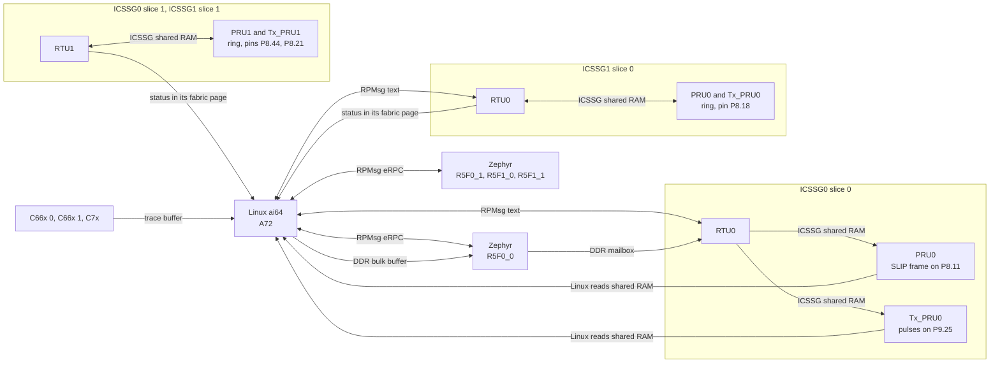
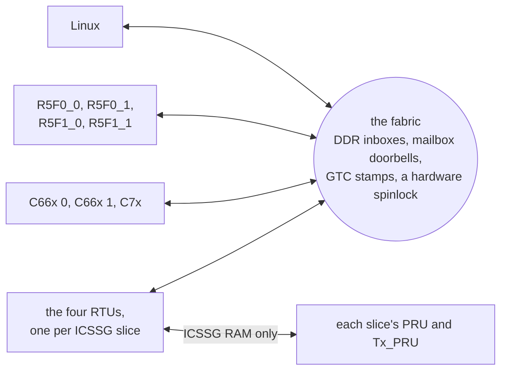

# BeagleBone AI-64: Linux, Zephyr, PRU, RTU, Tx_PRU, and DSPs together

A starting point for BeagleBone AI-64 (TI TDA4VM / J721E) projects that use its heterogeneous cores:

- **Linux** on the Cortex-A72s runs `ai64`, one program that drives the demo.
- **Zephyr** on all four main-domain Cortex-R5F cores answers function calls from Linux (eRPC over RPMsg). R5F0_0 also writes SPI7 and hands commands to the ICSSG0 cores.
- **RTU0** (ICSSG0) takes commands from Linux (RPMsg) and from Zephyr (a shared DDR mailbox), and hands them to the other two ICSSG0 cores.
- **PRU0** (ICSSG0) runs a cycle-counted loop and bit-bangs a UART frame on a header pin.
- **Tx_PRU0** (ICSSG0) sends pulse trains on a header pin through the SoC's GPIO module.
- **The other three ICSSG slices** (ICSSG0 slice 1 and both ICSSG1 slices) each run a ring: the slice's PRU and Tx_PRU pass a token back and forth through their ICSSG's shared RAM, and the PRU toggles a header pin. The slice's RTU reports how fast the ring goes and takes commands for it. ICSSG1 RTU0 talks to Linux over RPMsg; the other two RTUs only through shared memory.
- **The two C66x DSPs and the C7x DSP** log through their remoteproc trace buffers, which Linux follows, and run FIR filter jobs that Linux hands them through shared memory.
- **The fabric** joins all of these cores, and Linux, directly to each other: R5F to R5F, DSP to DSP, DSP to R5F, any of them to the ICSSG slices, and back. Every core pings every other one, R5F0_0 sends a message round all of them, and Linux can send one along any route, so that, say, the C7x passes it to a C66x that has RTU0 pulse a pin. Each message is stamped with the SoC's shared clock, so Linux shows the one-way latency of all 132 paths ([The fabric](#every-core-to-every-other-the-fabric)).

Every ICSSG slice splits its three cores the same way: **the RTU talks, and the PRU and Tx_PRU keep time.** The RTU is the slice's only link to the rest of the SoC. The PRU and Tx_PRU only touch their ICSSG's own RAM, so nothing elsewhere on the chip can stretch their timing; their trace log, in their own RAM, is the one exception, and the build can leave it out ([One core talks, two keep time](#one-core-talks-two-keep-time)).





Each link is small and easy to copy into your own project. [How it works](#how-it-works) walks through them.

The MCU-domain R5F cores are left alone: they run the board's device manager.

It runs on the BeagleBoard Debian image, plus a one-time install script. A Yocto (Poky) configuration in `yocto/` builds the demo into an image of its own, which has been built and tested on the board. Both images run Linux 6.18, but different kernels: BeagleBoard's on Debian, TI's on Yocto ([Two 6.18 kernels](#two-618-kernels)).

## What you need

- A BeagleBone AI-64, a microSD card (16 GB or more), and a 5 V supply for it.
- A network link to it: Ethernet to your LAN, or the USB-C port, which brings up a USB network adapter on the PC.
- A Linux PC with `git`, `ssh`, `rsync`, `xz`, and either `podman` or `docker`. Every compiler runs in a container, so you don't install any toolchains.
- About 6 GB of free disk on the PC: roughly 3 GB of container images plus 2 GB of fetched sources. The first build takes 10–20 minutes, mostly downloading. Later builds take seconds to a minute.
- Network access from the PC to GitHub, git.ti.com, software-dl.ti.com, and Docker Hub. git.ti.com is only for the PRU Software Support Package.
- Optional: a logic analyzer, to watch SPI7, the PRU0 UART, the Tx_PRU0 pulses, and the ring square waves on the header ([Probe the pins](#probe-the-pins)); and a 3.3 V USB-serial adapter on P8.34 (TX) and P8.22 (RX), to read the Zephyr console.

Get the code:

```
git clone https://github.com/kevinacahalan/BeagleBoneAI64-linux-zephyr-pru-c7x-c66x-demo.git
cd BeagleBoneAI64-linux-zephyr-pru-c7x-c66x-demo
```

Every command below runs from this directory unless it says "on the board".

## Quick start: BeagleBoard Debian

### 1. Flash the card and log in

Download [BeagleBone AI-64 Debian 13.7 IoT, v6.18 k3](https://www.beagleboard.org/distros/bbai64-debian-13-7-2026-10-09-iot-v6-18-x-k3), the file `bbai64-debian-13.7-iot-v6.18-k3-arm64-2026-10-09-10gb.img.xz`. A fresh image has no login until you give it one. Pick either way:

- **BeagleBoard Imager** (easiest). Choose the image, and in its settings set a user name, a password, and your SSH public key. Imager writes them for you.
- **By hand.**
  1. Write the image: `xz -dc bbai64-debian-*.img.xz | sudo dd of=/dev/sdX bs=4M conv=fsync status=progress`. Replace `/dev/sdX` with your card. Check it with `lsblk` first: `dd` overwrites whatever you give it.
  2. Mount the card's `BOOT` partition.
  3. Add these lines to the end of `sysconf.txt`, with your own values. The board applies them on first boot and then clears the password from the file.

     ```
     user_name=debian
     user_password=choose-a-password
     user_authorized_key=ssh-ed25519 AAAA... you@pc
     hostname=bbai64
     ```

     The key line is the contents of your `~/.ssh/id_ed25519.pub`. Run `ssh-keygen -t ed25519` if you don't have one. With the key in place, the build steps below don't keep asking for a password.

Put the card in the board and power it. With a card in the slot the board boots from it; the console prints `Trying to boot from MMC1`. If yours boots its eMMC instead, hold the BOOT button while you apply power.

A fresh card reboots twice on its own before it stays up: the first boot applies `sysconf.txt` and grows the root partition, and the second resizes the filesystem. Give it about three minutes. Then log in over the network:

```
ssh debian@bbai64.local
```

Below, `USER@BOARD` means that login, for example `debian@bbai64.local`. You'll also need its password for `sudo` on the board. If `.local` names don't resolve on your PC, use the address your router gave the board. Over the USB-C cable the board is `192.168.7.2`.

The serial console is UART0 on the 3-pin debug header, 115200 8N1 (`ttyS2` on the board), if SSH doesn't come up.

### 2. Build on the PC

```
./beagle-linux/scripts/build.sh
AI64_SSH=USER@BOARD ./beagle-linux/scripts/build.sh kmod
./beagle-linux/scripts/build.sh bundle
```

- **The first command** builds `ai64`, the overlay, the twelve ICSSG images, the four Zephyr R5F images, and the two DSP images.
- **`kmod`** builds the two patched kernel modules for the kernel running on your board. It asks the board for its kernel version over SSH, and the first time it copies that kernel's headers with `rsync`. The board must be up and reachable. [Why two patched modules](#why-debian-needs-two-patched-modules) explains why they're needed.
- **`bundle`** gathers everything into `out/ai64-beagle/`.

### 3. Install on the board and reboot

```
scp -r out/ai64-beagle USER@BOARD:
ssh -t USER@BOARD 'sudo ./ai64-beagle/install-beagle.sh && sudo reboot'
```

It asks for your `sudo` password on the board. `install-beagle.sh` makes the setup survive reboots:
- It installs `ai64`, `ai64-demo`, and the firmware for every core.
- It installs the patched `pru_rproc` and `ti_k3_r5_remoteproc` modules so the kernel loads them at boot.
- It adds the demo overlay to the default boot entry, and takes off the stock P9.25 PWM overlay, which muxes the same pin. The original is saved as `extlinux.conf.ai64-bak`.
- It adds a udev rule so the `dialout` group can use `/dev/rpmsg*`.
- It enables `ai64-icssg0.service`, which starts RTU0, PRU0, and Tx_PRU0 at boot.
- It installs `tmux` with apt if the image doesn't have it. The stock IoT image doesn't. This needs the board to reach the internet; over Ethernet it usually can. If it can't, the script says so and carries on.

The R5F images go in as `/lib/firmware/ai64_r5f0_0.elf` and so on, not under the kernel's default names (`j7-main-r5f0_0-fw`). So the R5F cores stay off at boot until `ai64-demo` starts them.

Give the board about 30 seconds to reboot, then log back in.

### 4. Run the demo

On the board:

```
ai64-demo --tmux
```

- It asks for your `sudo` password once.
- It restarts RTU0, PRU0, Tx_PRU0, the four R5F cores, the nine cores of the other three ICSSG slices, and the DSPs with the installed firmware, then opens a tmux session with fourteen windows: `linux`, `zephyr` (R5F0_0), `rtu0`, `pru0`, `txpru0`, `r5f0_1`, `r5f1_0`, `r5f1_1`, `g1rtu0` (ICSSG1 RTU0), `rings`, `c66x0`, `c66x1`, `c7x`, and `fabric`. Before it stops each R5F and DSP, it asks the core to go idle ([why](#restarting-the-c7x)). The `fabric` window is about 100 columns wide.
- [What you should see](#what-you-should-see) shows the output of a passing run, and [Commands](#commands) lists what you can type in the `linux` window.

tmux keys: switch windows with Ctrl+b then 0–9, or Ctrl+b then n and p for next and previous, or Ctrl+b then w for a list. Detach, leaving the demo running, with Ctrl+b then d. Come back with `ai64-demo --attach --tmux`.

To stop the demo, run `tmux kill-session -t ai64`. Typing `quit` in the `linux` window only ends that window.

Without tmux, plain `ai64-demo` prints all fourteen windows on one console instead. There, `quit` or Ctrl+C stops the whole demo.

### After you change the code

- **`ai64` or any core's firmware:** rebuild with `build.sh`, run `build.sh bundle`, copy the bundle, and run `install-beagle.sh` again. No reboot is needed: the next `ai64-demo` restarts every core with the new firmware.
- **The overlay:** the same steps, then reboot. Pin mux only changes at boot.
- **After the board's kernel is upgraded** (for example by `apt upgrade`): run `build.sh kmod` again, then `bundle`, `install-beagle.sh`, and reboot. The patched modules only fit the kernel they were built for.

## What you should see

On startup the linux window runs a short script. It pings RTU0, then sends `say`, `arm`, `chunk`, `xy 41 83`, and `spi` to Zephyr on R5F0_0, `arm` to RTU0, `say` to each of the other R5F cores, and `status` and `window 65536` (the default, so the pin keeps its frequency) to ICSSG1 RTU0. A passing run, one block per window:

```
== linux
Linux sent "ping" to RTU0
Linux asked Zephyr to say hello from linux
Linux asked Zephyr to say "hello from linux", and it replied "zephyr r5f0_0: hello from linux"
Linux asked Zephyr to arm Tx_PRU0 250000 20
Linux asked Zephyr to check chunk bulk-hello
Linux asked Zephyr to publish X/Y 41 83
Linux asked Zephyr to write SPI7 hello
Linux asked Zephyr to write SPI7 "hello", and it replied "zephyr r5f0_0: spi wrote 5 bytes"
Linux asked RTU0 to arm Tx_PRU0 125000 10
Linux asked Zephyr on R5F0_1 to say hello from linux
Linux asked Zephyr on R5F0_1 to say "hello from linux", and it replied "zephyr r5f0_1: hello from linux"
Linux asked Zephyr on R5F1_0 to say hello from linux
Linux asked Zephyr on R5F1_0 to say "hello from linux", and it replied "zephyr r5f1_0: hello from linux"
Linux asked Zephyr on R5F1_1 to say hello from linux
Linux asked Zephyr on R5F1_1 to say "hello from linux", and it replied "zephyr r5f1_1: hello from linux"
Linux asked ICSSG1 RTU0 for its ring's status
Linux asked ICSSG1 RTU0 for a 65536-lap ring window
linux window ready. commands: zephyr say|arm|chunk|xy|spi ... | r5f0_1|r5f1_0|r5f1_1 say ... | rtu0 xy|arm|<text> | g1rtu0 status|window <laps>|<text> | help

== zephyr
Zephyr window ready on /dev/rpmsg2 (eRPC)
Linux asked Zephyr to say "hello from linux", and it replied "zephyr r5f0_0: hello from linux"
Linux asked Zephyr to arm Tx_PRU0, and it published period 250000 count 20 for RTU0
Linux asked Zephyr to check the chunk, and it matched seq 1 len 10 crc c959d039
Linux asked Zephyr to publish X/Y 41 83, and it sent that pair to RTU0
Linux asked Zephyr to write SPI7 "hello", and it replied "zephyr r5f0_0: spi wrote 5 bytes"

== rtu0
rtu0 window ready on /dev/rpmsg1
sent to rtu0: ping
Linux sent "ping" to RTU0, and RTU0 echoed it
Zephyr asked RTU0 to arm Tx_PRU0, and RTU0 wrote period 250000 count 20 for Tx_PRU0
Zephyr asked RTU0 to publish X/Y, and RTU0 wrote x 41 y 83 seq 1 for PRU0
sent to rtu0: arm 125000 10
Linux asked RTU0 to arm Tx_PRU0, and RTU0 wrote period 125000 count 10 for Tx_PRU0

== pru0
pru0 window ready, X/Y record at 0xb010040, SLIP TX on P8.11
RTU0 published X/Y seq 1 x 41 y 83 for PRU0
PRU0 sent the SLIP frame for seq 1 on P8.11

== txpru0
txpru0 window ready, arm block at 0xb010000, pulses on P9.25
RTU0 armed Tx_PRU0, seq 1 period 250000 count 20
Tx_PRU0 started seq 1, period 250000 cycles
Tx_PRU0 finished seq 1 after 20 pulses on P9.25
RTU0 armed Tx_PRU0, seq 2 period 125000 count 10
Tx_PRU0 started seq 2, period 125000 cycles
Tx_PRU0 finished seq 2 after 10 pulses on P9.25

== r5f0_1 (r5f1_0 and r5f1_1 are the same, with their own names)
Zephyr on R5F0_1 window ready on /dev/rpmsg4 (eRPC)
Linux asked Zephyr on R5F0_1 to say "hello from linux", and it replied "zephyr r5f0_1: hello from linux"

== g1rtu0 (ICSSG1 RTU0, the ring RTU with RPMsg)
g1rtu0 window ready on /dev/rpmsg6
sent to g1rtu0: status
ICSSG1 RTU0: ring run 1, 2504690 laps/s, round trip 67 cycles, window 65536 laps, errors 0
sent to g1rtu0: window 65536
Linux asked ICSSG1 RTU0 for a 65536-lap window, and it wrote control seq 2 for ICSSG1 PRU0
ICSSG1 PRU0 applied control seq 2: its pin on P8.18 now toggles every 65536 laps

== rings (a line per ring every 10 s, from each slice's RTU; run counts the ring's restarts since boot)
ring window ready, a line per ring every 10 s
icssg0 slice 1 (RTU1): run 1, 2.60 M laps/s, round trip 60 cycles (56 to 85), window 65536, P8.44 19.80 Hz, hops PRU 33362532 Tx_PRU 33362533, errors 0
icssg1 slice 0 (RTU0, RPMsg): run 1, 2.50 M laps/s, round trip 66 cycles (56 to 81), window 65536, P8.18 19.11 Hz, hops PRU 30249710 Tx_PRU 30249711, errors 0
icssg1 slice 1 (RTU1): run 1, 2.51 M laps/s, round trip 62 cycles (54 to 78), window 65536, P8.21 19.12 Hz, hops PRU 27546610 Tx_PRU 27546611, errors 0

== c66x0 (c66x1 is the same, with DNUM 1)
4d80800000.dsp trace (ai64-c66x.elf), 2048 bytes at 0x4d808028e0
hello from the c66x, DNUM 0
c66x up 10 s
c66x up 20 s

== c7x
64800000.dsp trace (ai64-c7x.elf), 2048 bytes at 0xa8100000
hello from the c7x, DNUM 1024, MMU on, L1DCFG 4, L2CFG 2
c7x up 10 s
c7x up 20 s
```

The `fabric` window, the latency of every core to every other, is in [The fabric](#every-core-to-every-other-the-fabric). The `/dev/rpmsg` numbers can differ on your board.

The Zephyr console on P8.34 shows the same calls from R5F0_0's side (timestamps trimmed):

```
*** Booting Zephyr OS build v4.5.0-rc2-76-ga915b2f12675 ***
<inf> ai64_r5: eRPC server waiting on rpmsg
<inf> ai64_r5: shm seq 1 cmd hello from zephyr
<inf> ai64_r5: ai64 r5f0_0 hello, shm seq 1
<inf> ai64_r5: spi7 hello wrote 5 bytes
<inf> ai64_r5: shm seq 2 cmd spi hello ok
<inf> ai64_r5: rpmsg channel rpmsg-raw addr 1024 is up
<inf> ai64_r5: erpc say: zephyr r5f0_0: hello from linux
<inf> ai64_r5: shm seq 3 cmd arm 250000 20
<inf> ai64_r5: erpc arm pulses period 250000 count 20
<inf> ai64_r5: chunk seq 1 len 10 crc c959d039
<inf> ai64_r5: shm seq 4 cmd xy 41 83
<inf> ai64_r5: erpc xy x 41 y 83
<inf> ai64_r5: zephyr r5f0_0: spi wrote 5 bytes
```

The other three R5F cores have no console UART. Each logs into its remoteproc trace buffer instead:

```
$ sudo cat /sys/kernel/debug/remoteproc/remoteproc6/trace0
*** Booting Zephyr OS build v4.5.0-rc2-76-ga915b2f12675 ***
I: eRPC server waiting on rpmsg
I: rpmsg channel rpmsg-raw addr 1024 is up
I: ai64 r5f0_1 hello, shm seq 0
I: erpc say: zephyr r5f0_1: hello from linux
```

The ICSSG cores write their logs the same way. `N` is the core's number in `/sys/class/remoteproc`; `cat /sys/class/remoteproc/remoteprocN/name` shows which core it is (`5d00000.r5f` is R5F0_1, `5e00000.r5f` R5F1_0, `5f00000.r5f` R5F1_1, and `b004000.rtu`, `b034000.pru`, `b00a000.txpru` the ICSSG0 slice-0 cores; [The ICSSG rings](#the-icssg-rings) lists the other nine).

### Commands

Type these in the linux window:

| Command | What happens |
| --- | --- |
| `zephyr say <text>` | Zephyr on R5F0_0 replies `zephyr r5f0_0: <text>` (eRPC) |
| `zephyr spi [text]` | Zephyr writes `text`, or `hello`, on SPI7 (header P9) |
| `zephyr arm <period> <count>` | Zephyr asks RTU0, through the mailbox, to have Tx_PRU0 send `count` pulses, one every `period` cycles |
| `zephyr xy <x> <y>` | Zephyr hands X/Y to RTU0, and PRU0 sends it on P8.11 |
| `zephyr chunk <text>` | Linux writes the DDR bulk buffer, and Zephyr checks its CRC |
| `r5f0_1 say <text>` | Zephyr on R5F0_1 replies `zephyr r5f0_1: <text>`. Same for `r5f1_0` and `r5f1_1`. Those three cores have no mailbox, bulk buffer, or SPI, so `arm`, `xy`, `chunk`, and `spi` fail there. |
| `rtu0 xy <x> <y>` | RTU0 publishes X/Y directly, and PRU0 sends it |
| `rtu0 arm <period> <count>` | RTU0 arms Tx_PRU0 directly |
| `rtu0 <text>` | RTU0 echoes the text |
| `g1rtu0 status` | ICSSG1 RTU0 replies with its ring's lap rate, round trip, window, and errors |
| `g1rtu0 window <laps>` | ICSSG1 RTU0 asks its ring's PRU to toggle P8.18 every `laps` laps, from 256 to 16777216, and says when the PRU has |
| `g1rtu0 <text>` | ICSSG1 RTU0 echoes the text |
| `help`, `quit` | List the commands, or leave |

A period is in ICSSG cycles at 250 MHz: 250000 is 1 ms, and the range is 2500 (10 µs) to 250000000 (1 s). The count is at most 100000.

The other two ring RTUs have no RPMsg. `sudo ai64 fabric route g0rtu1 window <laps>` (or `g1rtu1`) reaches them through the fabric instead, and so can any core on the route.

`ai64-demo` without `--tmux` prints all fourteen windows on one console instead, with each line prefixed `[Linux]`, `[R5F0_0]`, `[R5F0_1]`, `[R5F1_0]`, `[R5F1_1]`, `[RTU0]`, `[PRU0]`, `[TxPRU0]`, `[G1RTU0]`, `[Rings]`, `[C66x0]`, `[C66x1]`, `[C7x]`, or `[Fabric]`. Either way it restarts the cores with their firmware first. `--attach` connects to the running cores without restarting them.

`ai64` has a few more subcommands for checking a board: `sudo ai64 shm` prints both shared-RAM records, `sudo ai64 pads` checks the pin mux of every demo pin, `ai64 trace <remoteproc-name>` follows any core's trace log (`ai64 trace 5d00000.r5f`, `ai64 trace b034000.pru`, and so on), `sudo ai64 ring once` prints one sample of the three rings, as their RTUs report them, `ai64 bench <rpmsg-dev>` times eRPC calls to one R5F core, `sudo ai64 dsp <remoteproc-name>` offloads FIR jobs to a DSP ([how](#linux-to-the-dsps-fir-jobs)), `sudo ai64 shutdown <remoteproc-name>` asks a core to go idle before Linux stops it, and `sudo ai64 fabric route <node>... [arm <period> <count> | xy <x> <y> | window <laps>]` sends a message along any cores you name and prints each hop's time ([routes](#every-core-to-every-other-the-fabric)).

## Probe the pins

All signals are 3.3 V. On a Saleae Logic, choose the 1.8 V threshold setting for 3.3 V logic.

| Signal | Header pins | What you see |
| --- | --- | --- |
| Zephyr SPI7 | P9.28 CS, P9.31 CLK, P9.30 MOSI | `hello` at 1 MHz, mode 0, MSB first |
| PRU0 UART | P8.11 | one SLIP frame per X/Y, 115200 8N1, idles high |
| Tx_PRU0 pulses | P9.25 | `count` pulses per arm, high for the first half of each period |
| Zephyr console | P8.34 TX, P8.22 RX | 115200 8N1 |
| Ring square waves | P8.44 (ICSSG0 slice 1), P8.18 (ICSSG1 slice 0), P8.21 (ICSSG1 slice 1) | a toggle every window, 65536 laps by default: about 19.8 Hz, 19.1 Hz, and 19.1 Hz |
| A fabric route's action | P9.25, P8.11, or a ring pin | `ai64 fabric route ... arm`, `xy`, or `window`: the same pulses or frame, or a ring pin at a new frequency, from whichever cores the route passes |

For `xy 41 83`, P8.11 carries `C0 29 00 00 00 53 00 00 00 7A C0`. [PRU0](#pru0-the-slip-frame-on-p811) explains the frame. For the startup script, P9.25 carries 20 pulses 1 ms apart, then 10 pulses 0.5 ms apart. On the bench the periods measured 1000.1–1000.4 µs and 499.9–500.4 µs, SPI7 measured a 1.000 µs clock, and the ring pins measured 19.80 Hz, 19.11 Hz, and 19.12 Hz, which is the lap rate `ai64 ring` reports divided by 131072. The route `c7x g0rtu0 arm 25000 8` put 8 pulses on P9.25, 99.5 to 100.5 µs apart, `xy 41 83` the frame above on P8.11, and `g1rtu1 window 4096` moved P8.21 to 306.0 Hz. `PINMUX.md` lists every pin the demo muxes, plus the shorted partner balls it holds off.

## How it works

### Linux to Zephyr: eRPC over RPMsg

- The R5F image opens the RPMsg channel `rpmsg-raw` at address 1024, which Linux sees as `/dev/rpmsgN`.
- `zephyr/erpc/ai64.erpc` defines the functions Linux can call on Zephyr: `say`, `spiWrite`, `armPulses`, `sendXy`, and `takeChunk`. The generated client and server code is in `zephyr/erpc/shim/`; `zephyr/erpc/regen.sh` regenerates it after you change the IDL.
- Both sides run eRPC's framed transport straight over the RPMsg file descriptor (`linux-app/ai64_erpc_linux.cpp` and `zephyr/r5/src/ai64_erpc.cpp`).

The board files are upstream Zephyr's `beaglebone_ai64/j721e/main_r5f0_0` (and `main_r5f0_1`, `main_r5f1_0`, `main_r5f1_1`), at the Zephyr `main` commit pinned in `zephyr/west.yml`. One app, `zephyr/r5`, builds once per core. `zephyr/r5/boards/` adds what each core needs on top: R5F0_0's overlay adds SPI7, the mailbox, and the bulk buffer; the other three cores' `.conf` files send the log to a RAM console that Linux reads as a trace.

In split mode a cluster's core 1 cannot power up before its core 0, and core 0 cannot power down before core 1. `ai64-demo` starts R5F0_0, R5F1_0, R5F0_1, R5F1_1 in that order and stops them in reverse.

### Linux to Zephyr: the mailbox interrupt

RPMsg rings sit in shared DDR. Each side tells the other "look at the rings" through a TI mailbox FIFO; each R5F core has its own pair of FIFOs. Zephyr's kick to Linux works as is. Linux's kick to Zephyr arrives in the FIFO, but on J721E the mailbox interrupt only reaches the R5F once the device manager routes it through the NAVSS interrupt router, and the upstream board does not ask for that.

So each R5F core asks at boot (`zephyr/r5/src/ai64_tisci.c`). It sends `TISCI_MSG_RM_IRQ_SET` over its own secure proxy threads, polling for the answer, because Zephyr's TI-SCI driver needs a receive interrupt that nothing routes either. The request names the router as both source and destination, with a router input and an output from the core's own range, the way Linux's `ti,sci-intr` and Zephyr PR [#121379](https://github.com/zephyrproject-rtos/zephyr/pull/121379) program it. Each core's numbers are in its board overlay:

| Core | TI-SCI host | Mailbox user | Router 213 input | Router output | VIM input |
| --- | --- | --- | --- | --- | --- |
| R5F0_0 | 35 | `NAVSS0_MAILBOX_1` user 2 | 434 | 196 | 228 |
| R5F0_1 | 37 | `NAVSS0_MAILBOX_1` user 1 | 433 | 228 | 228 |
| R5F1_0 | 40 | `NAVSS0_MAILBOX_2` user 1 | 429 | 260 | 228 |
| R5F1_1 | 42 | `NAVSS0_MAILBOX_2` user 2 | 430 | 292 | 228 |

The overlays also move the board's mailbox interrupt from VIM 256 to 228. If the request fails, the core logs it and its RPMsg thread polls the FIFO once a millisecond instead (`mbox_rx_drain()` in `zephyr/r5/src/main.c`).

### R5F caches

The J721E SoC code maps all of DDR as non-cacheable for the R5F, and leaves both caches off unless `CONFIG_CACHE_MANAGEMENT` is set. The image runs from DDR, so every instruction fetch went to DDR, and an eRPC call took about 1.3 ms.

`zephyr/r5/src/ai64_mpu.c` adds MPU regions at the first init level, before the caches come on: device memory for the peripherals in the low 2 GiB, the TCMs, and the core's 16 MiB carveout as write-through, so that every write still reaches DDR. The vrings, the resource table, the mailbox, and the bulk buffer stay non-cacheable. `prj.conf` turns on `CONFIG_CACHE_MANAGEMENT`.

`ai64 bench <rpmsg-dev> [count]` times eRPC calls. On the bench, an eRPC `say` round trip went from 1263 µs to 85 µs on R5F0_1, R5F1_0, and R5F1_1, and to 160 µs on R5F0_0, which also logs each call on its UART. For comparison, an RPMsg echo from RTU0, which busy-polls, takes 35 µs.

### Linux to Zephyr: the bulk buffer

`zephyr chunk` passes data too large for an RPC argument:
1. Linux writes the bytes into a 64 KiB DDR buffer at `0xA2FEF000` through `/dev/mem`.
2. Linux calls `takeChunk(seq, length, crc)`.
3. Zephyr checks the CRC.

The buffer sits inside the memory Linux already reserves for R5F0_0 (`0xA2000000`-`0xA2FFFFFF`). `zephyr/r5/boards/beaglebone_ai64_j721e_main_r5f0_0.overlay` shrinks the board's DRAM region so that no part of the Zephyr image lands there.

### Zephyr to RTU0: the DDR mailbox

- Zephyr writes a text command such as `xy 41 83` or `arm 250000 20` into a 4 KiB mailbox at `0xA2FFF000`, then increments a sequence number.
- RTU0 polls the sequence number.

The mailbox holds one command and has no acknowledgement. If Zephyr publishes two commands faster than RTU0 polls, RTU0 only sees the second. In practice RTU0 polls far faster than commands arrive. A real design that cares should add a ring buffer or a consumed counter. The layout is in `zephyr/include/ai64_shm.h`, which every core includes.

The R5F's caches are on ([R5F caches](#r5f-caches)), but `ai64_mpu.c` maps the 128 KiB holding the mailbox and the bulk buffer non-cacheable, so Zephyr's writes reach DDR at once and its reads see what Linux and RTU0 wrote. The code still flushes the mailbox after writing it, which costs nothing and keeps it correct if that region is ever made cacheable.

### Linux to RTU0: RPMsg text

- RTU0 announces RPMsg channel `rpmsg-raw` on port 30.
- Linux writes plain text: `ping`, `xy <x> <y>`, or `arm <period> <count>`.
- RTU0 replies with one sentence that names who asked and what it did.
- RTU0 learns Linux's address from the first message it receives, so Linux sends `ping` first. RTU0 can't report anything that Zephyr asks it to do until Linux has sent that first message.
- ICSSG1 RTU0 runs the same channel, from the same code (`pru/include/ai64_rtu_rpmsg.h` and the resource table in `ai64_rsc_rpmsg.h`), and Linux sends it `status` first for the same reason.

### RTU0 to PRU0 and Tx_PRU0: ICSSG shared RAM

RTU0 writes two records into ICSSG0 shared RAM. All three slice-0 cores read that RAM at local address `0x00010000`, and Linux reads it at `0x0B010000`.

| Offset | What | Fields (little-endian `uint32`) |
| --- | --- | --- |
| `0x00` | arm block | `magic`, `seq`, `period_cycles`, `periods`, then Tx_PRU0's `sent`, `applied_seq`, `applied_period`, `done_seq` |
| `0x40` | X/Y record | `magic` (`AI6X`), `seq`, `x`, `y`, `consumed` |

- RTU0 writes the data first and `seq` last.
- PRU0 and Tx_PRU0 act when `seq` changes. PRU0 copies `seq` into `consumed` when it has sent the frame; Tx_PRU0 copies it into `done_seq` when the train ends.
- `ai64 watch pru0` and `ai64 watch txpru0`, the pru0 and txpru0 windows, print a line whenever one of those fields changes.

### PRU0: the SLIP frame on P8.11

- PRU0 doesn't use RPMsg. It polls the X/Y record.
- On a new X/Y, PRU0 sends one SLIP (RFC 1055) frame as UART 8N1 on R30 bit 17, which is header P8.11. The code is in `pru/icssg0/pru0/slip_tx.asm`.
- The ICSSG clock is 250 MHz, and one bit is about 2170 cycles, so the rate is 115200 baud.

| Byte | Value |
| --- | --- |
| 0 | `0xC0` (END) |
| 1–4 | X, least-significant byte first |
| 5–8 | Y, least-significant byte first |
| 9 | XOR of bytes 1–8 |
| 10 | `0xC0` (END) |

If a payload byte is `0xC0`, it goes out as `0xDB 0xDC`. If it is `0xDB`, it goes out as `0xDB 0xDD`.

### Tx_PRU0: pulses on P9.25 through GPIO0

Tx_PRU0 has R30 like the other cores, but on this SoC its R30 does not reach any pad. It reaches P9.25 another way: it is a bus master, so it writes the main GPIO0 module's `SET_DATA` and `CLR_DATA` registers for line 104, which the overlay has muxed to P9.25 and made an output. Each half period is timed with Tx_PRU0's own cycle counter, so the time a bus write takes does not stretch the period.

A train always finishes. An `arm` that arrives during a train starts when the train ends. If more than one arrives, only the newest runs, because the arm block is one slot.

### One core talks, two keep time

The J721E has two ICSSGs with two slices each, and every slice has a PRU, an RTU, and a Tx_PRU: twelve cores. Every slice in the demo splits them the same way.

| Slice | RTU: talks to the rest of the SoC | PRU and Tx_PRU: real-time work |
| --- | --- | --- |
| ICSSG0 slice 0 | RTU0: RPMsg to Linux, the DDR mailbox from Zephyr, the fabric | PRU0 sends SLIP frames on P8.11, Tx_PRU0 pulse trains on P9.25 |
| ICSSG0 slice 1 | RTU1: the fabric only | a ring, and a square wave on P8.44 |
| ICSSG1 slice 0 | RTU0: RPMsg to Linux, and the fabric | a ring, and a square wave on P8.18 |
| ICSSG1 slice 1 | RTU1: the fabric only | a ring, and a square wave on P8.21 |

- **The RTU does everything slow or unpredictable.** It reads and writes DDR, rings mailboxes, takes the hardware spinlock, runs RPMsg, and reads the GTC. How long any of that takes depends on what the rest of the chip is doing.
- **The PRU and Tx_PRU only touch their ICSSG's own RAM**: shared RAM and data RAM, at a fixed few cycles an access. They talk to their RTU through records there, each written by one core and read by the other, and never wait on it. So nothing outside the ICSSG can stretch a pulse or a lap. One exception is forced by the hardware: Tx_PRU0's R30 reaches no pad, so it drives P9.25 with posted writes to the GPIO0 module ([Tx_PRU0](#tx_pru0-pulses-on-p925-through-gpio0)).
- **The trace log is the other exception.** Every core keeps a remoteproc trace buffer in its own data RAM, which Linux reads (`ai64 trace <remoteproc-name>`); writing a line is a few local stores. `TRACE=0 ./beagle-linux/scripts/build.sh pru` builds the trace calls out of the PRUs and Tx_PRUs. The RTUs always keep theirs.
- **Two RTUs talk over RPMsg and two over shared memory only**, so the template has a working example of each. ICSSG0 RTU0 and ICSSG1 RTU0 announce an RPMsg channel, which needs a vring interrupt in the overlay for each and a few KiB of data RAM. ICSSG0 RTU1 and ICSSG1 RTU1 have no RPMsg; Linux and every other core reach them through the fabric. All four are fabric nodes, and all four publish what they know in their fabric page.
- The PRU is the core that drives pins. Its R30 reaches the header through the pad mux, and the RTU's and Tx_PRU's do not, so a slice's pin work belongs on its PRU.

### The ICSSG rings

ICSSG0 slice 1 and both ICSSG1 slices each run a ring. The PRU and Tx_PRU run `pru/ring/main.c` and the RTU runs `pru/ring/rtu.c`, each built once per core:

| Ring | PRU | Tx_PRU | RTU | Fabric node |
| --- | --- | --- | --- | --- |
| ICSSG0 slice 1 | `b038000.pru`, `ai64-icssg0-pru1.elf` | `b00c000.txpru`, `ai64-icssg0-txpru1.elf` | `b006000.rtu`, `ai64-icssg0-rtu1.elf` | 9, `g0rtu1` |
| ICSSG1 slice 0 | `b134000.pru`, `ai64-icssg1-pru0.elf` | `b10a000.txpru`, `ai64-icssg1-txpru0.elf` | `b104000.rtu`, `ai64-icssg1-rtu0.elf`, with RPMsg | 10, `g1rtu0` |
| ICSSG1 slice 1 | `b138000.pru`, `ai64-icssg1-pru1.elf` | `b10c000.txpru`, `ai64-icssg1-txpru1.elf` | `b106000.rtu`, `ai64-icssg1-rtu1.elf` | 11, `g1rtu1` |

**The ring.** A token goes from the PRU to the Tx_PRU and back, through a record in the ICSSG's shared RAM (`struct ai64_ring` in `zephyr/include/ai64_shm.h`). A `stage` field says whose turn it is, and only that core writes the record.

- The PRU sends the lap number, and the Tx_PRU adds a constant to it. The PRU checks what comes back and counts mismatches in `errors`.
- The PRU times each round trip with its cycle counter. A round trip takes about 60 ICSSG cycles, and a ring does about 2.5 to 2.6 million laps a second; the rest of each lap is the PRU's own bookkeeping.
- The PRU leaves its cycle counter running and takes differences. The counter only clears while stopped, and restarting it every lap cost tens of cycles that no lap counted.
- A ring's PRU starts a run by taking the token and zeroing the counts, which is only safe while its Tx_PRU waits for the token. So `ai64-demo` stops the PRU first and starts it last. Each start bumps the record's `run`.
- The PRU toggles one header pin once a window, the same window it publishes `lap_min` and `lap_max` for, so the lap loop itself does no extra work. A window is 65536 laps unless the RTU asks for another number, so at the default the pin's frequency times 131072 is the lap rate. [`PINMUX.md`](PINMUX.md) has the pins.

**The ring's RTU** is the ring's link to everything else:

- Every 10 ms it copies the ring record into the app block of its fabric page (`struct ai64_slice_status`), with the lap rate it measured over the last second. Any core can read it there. The `rings` window, `ai64 ring`, reads those three pages, so Linux never reads the ICSSG.
- It writes the ring's control record, next to the ring record in shared RAM (`struct ai64_ring_ctl`): a window size, then a sequence number. The PRU looks at the sequence number once a window, at the window's end, applies the new size, and copies the number into the ring record as `ctl_ack`. The RTU starts before the PRU and writes the default window, so a restart always begins at 65536 laps.
- It says when the PRU has applied a window, and when the ring's error count grows: in its trace, and to Linux if it has RPMsg.
- It takes a window from a fabric route, `window <laps>`, so any core can set one: `sudo ai64 fabric route g1rtu1 window 4096` makes P8.21 toggle sixteen times as fast. ICSSG1 RTU0 also takes `status` and `window <laps>` from Linux over RPMsg (the `g1rtu0` window).

**What the RTUs cost the rings.** A running RTU still slows its ICSSG's rings a little, though the rings never wait on it. With all three ring RTUs stopped, the ring pins measured 19.95, 19.50, and 19.50 Hz; running, 19.77, 19.11, and 19.12 Hz. That is 0.9% for ICSSG0 slice 1, which shares its ICSSG with one ring RTU, and 2% for each ICSSG1 slice, which shares with two. The RTUs only read the ring record every 10 ms, so this is contention inside the ICSSG, most likely on the interconnect that both the ring's shared-RAM accesses and the RTU's reads of DDR and the mailbox cross; the cause has not been pinned down further. Making each RTU pause 10 µs between passes won back about half of it, and made a message to an RTU up to 10 µs slower, so the RTUs don't pause. Before this split, when the ring went round all three of a slice's cores and its PRU was a fabric node itself, looking at its inbox every 64 laps, the fabric cost ICSSG0 slice 1 8% of its laps, and a message to a ring waited about 20 µs for the PRU to look.

A slice sees its own data RAM at local `0x0000` and the other slice's at `0x2000`, so one linker script per kind of core (`pru/ring/ring_*.cmd`) serves both slices. A ring slice's three cores share the first 4 KiB of their slice's data RAM: the PRU `0x000`–`0x3ff`, the Tx_PRU `0x400`–`0x7ff`, the RTU `0x800`–`0xfff`. In ICSSG0 the upper 4 KiB of slice 1's data RAM is not free: RTU0 and Tx_PRU0 keep their stack and trace buffer there, because their own 2 KiB in slice 0 is full. Moving those into ICSSG0 shared RAM instead, above `0x10000`, broke RTU0: its strings and the ring record were overwritten soon after the ring cores started. In ICSSG1 it is free, and ICSSG1 RTU0 keeps its RPMsg buffers there (`ring_rtu_rpmsg.cmd`). Its code fills all but about 250 bytes of its 8 KiB instruction RAM.

### Every core to every other: the fabric

Every link above goes through Linux, or joins two cores that sit next to each other. The fabric joins every demo core directly to every other one, Linux included: twelve nodes, 132 one-way paths, and no Linux in any of them. One header, `zephyr/include/ai64_fabric.h`, holds the layout and the whole protocol, and every image compiles it: Zephyr with GCC, the DSPs with TI's C6000 and C7000 compilers, the RTUs with clpru, and `ai64` with the Linux compiler. Each image only adds a few lines of glue: how to read the clock, and how it maps the memory.

| Node | Name | Core | When it looks at its inbox |
| --- | --- | --- | --- |
| 0 | `linux` | A72, while `ai64 fabric` runs | every 20 µs or so, between sleeps |
| 1–4 | `r5f0_0`, `r5f0_1`, `r5f1_0`, `r5f1_1` | Zephyr (`zephyr/r5/src/ai64_fabric.c`) | in a thread at the lowest priority, which yields after each pass |
| 5, 6 | `c66x0`, `c66x1` | C66x | every pass of its main loop |
| 7 | `c7x` | C7x | every pass of its main loop |
| 8 | `g0rtu0` | ICSSG0 RTU0 (`pru/icssg0/rtu0/main.c`) | every pass of its main loop, next to its RPMsg and mailbox checks |
| 9–11 | `g0rtu1`, `g1rtu0`, `g1rtu1` | the RTUs of the three ring slices (`pru/ring/rtu.c`) | every pass of its main loop |

The PRUs and Tx_PRUs are not nodes: each slice's RTU talks for them ([One core talks, two keep time](#one-core-talks-two-keep-time)).

**What carries it.** Four pieces of SoC hardware that every one of those cores can reach:

- **DDR**, 128 KiB at `0xA9000000`, in the gap between the C7x's carveout and the IPC region above it. The overlay reserves 1 MiB there (`ai64-fabric@a9000000`, no-map) so that Linux keeps out, and `ai64-demo` refuses to start the cores on a kernel that booted without it. Each node owns an 8 KiB page: its inbox, and the counts it publishes for Linux to read. A spinlock tally follows the pages.
- **Mailbox cluster 11** (`0x31F8B000`) for doorbells. Linux's device tree leaves clusters 5–11 disabled; 5, 6, 8, and 9 hold messages from the device manager's firmware, and 11 is empty. FIFO n is node n's doorbell.
- **The GTC** (`0x00A90000`), the 200 MHz counter Linux's arch timer counts too. Every core reads the same clock, so a latency measured from one core's stamp to another's is real, one way.
- **Hardware spinlock 255** (`0x30E00000`), which no kernel driver uses, for the tally.

**Read your own page, write to the others.** An uncached read costs 0.1 to 0.5 µs, and a write is posted and costs almost nothing. So a node only ever reads its own page. A message goes into the receiver's page, and the stamps a tour collects go straight into its origin's page. The sender then writes its own node number into the receiver's mailbox FIFO, and the receiver, which polls only its FIFO's status register, reads its page when something has arrived. A FIFO holds four doorbells; a sender that finds it full skips the doorbell, and every node also scans its whole inbox once a millisecond.

**A message.** Each inbox has one 64-byte slot for every sender and message class, and only that sender writes it. The sender writes the message, then bumps its count for that class in a word of the receiver's page that only it writes, then rings. The receiver remembers the counts it last saw, so a changed count is a new message, and nothing is ever cleared. Every class allows one message in flight per sender and receiver, so a slot is never overwritten before it is read, and no core ever waits on another:

| Class | Sent by | What it does |
| --- | --- | --- |
| ping | every node, to every other, every 10 ms | carries the sender's GTC stamp and a value. The receiver stamps when it has read it, mixes its node number into the value, and sends it back. |
| pong | the receiver of a ping | the sender checks the value and times the round trip. The receiver's stamp minus the sender's is the one-way latency. A ping with no pong in 50 ms is a timeout, and that peer counts as down until a later ping comes back. |
| tour | R5F0_0, every 10 ms | goes round every node whose pings R5F0_0 sees answered, Linux included while its viewer runs, in an order that keeps changing the kind of core: c66x0, g0rtu0, r5f1_0, c7x, g1rtu0, r5f0_1, c66x1, g0rtu1, r5f1_1, g1rtu1, linux, and home. Each hop stamps it and mixes its number into the value, and R5F0_0 checks the value when the tour comes back. |
| route | `ai64 fabric route`, from Linux | the same as a tour, along the nodes you name and back to Linux. It can carry an action: `arm` or `xy` for ICSSG0 RTU0, so any core on the way can make Tx_PRU0 pulse or PRU0 send its frame, or `window` for a ring RTU, which changes its ring's pin. Its count lives in a word of its own, so routes work while the viewer, also node 0, runs. |

A node that starts takes the counts it finds as already seen, and zeroes its own counters. A message sent to a stopped node is simply lost, and its sender times out, so `ai64-demo` can restart any core while the others keep going.

**The spinlock tally.** Every 10 ms each node takes hardware spinlock 255, adds one to a shared total and one to its own count, and frees the lock. The adds are plain loads and stores to uncached DDR, so without the lock two cores would lose each other's adds. The viewer takes the lock too, and checks that the twelve counts sum to the total.

**Each core's view of the memory.**

| Core | The fabric | The GTC, mailbox, and spinlock |
| --- | --- | --- |
| R5F | MPU region 7, normal non-cacheable (`ai64_mpu.c`) | in the low 2 GiB the MPU maps as device memory |
| C66x | MAR register for `0xA9xxxxxx` cleared, which turns off the XMC prefetch it resets with | the mailbox and spinlock directly. The GTC, below `0x0C000000`, is the C66x's own internal space, so MPAX segment 2 maps a logical page at `0x7FFFF000` onto it (`c66x/main.c`). |
| C7x | 32 level-3 MMU pages, normal non-cacheable (`ai64_c7x_mmu.c`) | the device-memory GiB at `0` |
| RTU | its global address; a message moves in one or two `LBBO`/`SBBO` bursts | the same |
| Linux | `/dev/mem` | `/dev/mem` |

**What you see.** The `fabric` window, `ai64 fabric`, redraws once a second. On the Debian image, with every core running:

```
fabric: one-way latency in us, from the row's node to the column's, over the last 1.0 s
         linux r5f0_0 r5f0_1 r5f1_0 r5f1_1  c66x0  c66x1    c7x g0rtu0 g0rtu1 g1rtu0 g1rtu1
linux        .    5.5    4.0    4.1    4.3    3.7    6.4    2.6    3.6    3.7    3.6    3.5
r5f0_0    50.9      .    4.9    5.0    5.2    4.6    4.1    3.4    4.5    4.6    4.3    4.5
r5f0_1    44.2    7.8      .    5.4    5.6    4.9    4.3    3.5    4.7    4.6    4.8    4.5
r5f1_0    43.1    8.2    5.2      .    5.4    4.7    4.5    3.7    4.6    4.4    4.6    4.4
r5f1_1    45.0    8.3    5.4    5.3      .    4.9    4.4    3.6    4.6    4.6    4.5    4.7
c66x0     46.9    6.2    4.2    4.1    4.4      .    3.5    2.7    3.6    3.5    3.6    3.7
c66x1     48.5    4.8    4.3    4.2    4.3    4.0      .    2.7    3.7    3.5    3.7    3.4
c7x       45.9    4.3    4.0    3.8    4.1    3.4    3.1      .    3.3    3.1    3.3    3.3
g0rtu0    46.0    5.0    4.4    4.6    4.7    4.2    3.7    3.0      .    4.0    3.8    3.8
g0rtu1    44.3    6.8    4.2    4.6    4.6    4.3    3.8    3.0    4.3      .    3.8    3.7
g1rtu0    43.0    6.9    4.5    4.4    5.3    4.3    3.8    3.1    3.8    3.8      .    3.8
g1rtu1    47.3    5.1    4.6    4.6    4.6    4.2    3.7    3.0    4.0    4.0    4.1      .

node    starts   polls/s  pongs/s    rtt us  rtt min to max us timeouts errors  passed/s
linux       23     11583     1100      87.5     80.8 to  125.7        0      0        85
r5f0_0      19    276577     1085      15.5      8.1 to   95.5        0      0         0
r5f0_1      19    380078     1085      12.3      5.1 to   81.1        0      0       100
r5f1_0      19    379741     1085      12.2      5.2 to   93.9        0      0       100
r5f1_1      19    379596     1086      12.5      5.3 to   92.1        0      0       100
c66x0       19    967387     1086      11.3      5.1 to  100.5        0      0       100
c66x1       19    972789     1085      10.8      4.4 to   90.8        0      0       100
c7x         19    876961     1085       9.8      4.3 to   90.9        0      0       100
g0rtu0      22    461828     1085      11.2      5.3 to   16.6        0      0       100
g0rtu1      19    469936     1086      11.3      5.2 to   91.6        0      0       100
g1rtu0      19    439312     1086      11.3      4.9 to   88.5        0      0       100
g1rtu1      19    473258     1086      11.3      4.9 to   96.5        0      0       100

tour from r5f0_0 round every node that answers its pings: 100 laps/s, 101.8 us a lap (58.2 to 152.1), errors 0, timeouts 8
  r5f0_0 >10.3> c66x0 >4.5> g0rtu0 >5.7> r5f1_0 >5.3> c7x >4.1> g1rtu0 >6.0> r5f0_1 >8.1> c66x1 >5.1> g0rtu1 >6.3> r5f1_1 >4.1> g1rtu1 >76.1> linux >4.9> r5f0_0

tally under hardware spinlock 255: 39192 adds, and the 12 counts sum to 39192
```

- **The matrix.** Between any two of the R5Fs, DSPs, and RTUs a message takes 2.5 to 8 µs, reading it included. The C7x, whose main loop is shortest, is the quickest to notice one. Linux sleeps between looks, so a message to it takes 45 to 65 µs.
- **The nodes.** `starts` counts each node's starts since the board booted. `rtt us` is the mean round trip to all of the node's peers, which Linux pulls up; the minimum and maximum are the fastest and slowest single round trips in the last second. `passed/s` is tour hops, one per node per lap.
- **The tour.** Each `>µs>` is one hop, from the last node reading the message to the next reading it. R5F0_0 started before the DSPs and the ICSSG cores in that `ai64-demo` run, so its first tours ran into cores that were restarting: those are the 8 timeouts.
- **The tally.** Every add from all twelve nodes is in the total, so the lock held.

When the ring PRUs were nodes themselves and only looked at their inbox every 64 laps, a message to one took about 20 µs, and a tour lap about 160 µs.

The merged console prints one `[Fabric]` line every 10 s instead (`ai64 fabric lines`).

**A route with an action.** On the board, while the demo runs:

```
$ sudo ai64 fabric route c7x r5f1_1 g1rtu0 c66x1 g0rtu0 arm 25000 8
linux  -> c7x         8.7 us
c7x    -> r5f1_1      6.4 us
r5f1_1 -> g1rtu0      4.7 us
g1rtu0 -> c66x1       8.7 us
c66x1  -> g0rtu0      5.1 us   g0rtu0 armed Tx_PRU0
g0rtu0 -> linux      25.1 us
6 hops, 58.5 us, value ok
```

Tx_PRU0 then sends 8 pulses, 100 µs apart, on P9.25, and RTU0 tells Linux in the `rtu0` window. `xy 41 83` instead of `arm` makes PRU0 send its frame on P8.11. `window <laps>` is for the first ring RTU on the route:

```
$ sudo ai64 fabric route c66x0 g1rtu1 r5f0_1 window 4096
linux  -> c66x0      11.7 us
c66x0  -> g1rtu1      5.5 us   g1rtu1 set its ring's window
g1rtu1 -> r5f0_1     28.0 us
r5f0_1 -> linux       3.2 us
4 hops, 48.4 us, value ok
```

P8.21 then toggles every 4096 laps, at 306 Hz, and ICSSG1 RTU1 logs when its PRU has applied the change (`ai64 trace b106000.rtu`). The hop after an action is slower because the RTU builds and logs a line of text first. Any order of nodes works, a node can appear more than once, and a route without an action just goes round. `sudo ai64 fabric reset` frees the spinlock and zeroes the tally, for a core that was stopped while it held the lock; `ai64-demo` runs it before it starts the cores.

**Restarts.** On each image, `ai64-demo` ran 15 times in a row, stopping and starting all 19 demo cores each time while the others kept talking. Every run came back with all twelve nodes up, about 13,150 pongs a second, no fabric timeouts or errors in the 10 s after, the tally agreeing, and no kernel errors. Routes with `arm` and `xy` gave the same pulses and frame on both.

**What it costs.** Every node except Linux now spins on its inbox, so no core sits in WFI any more. The ring RTUs' polling costs the rings 1 to 2% of their laps ([The ICSSG rings](#the-icssg-rings)). And a core that is always on the bus must not be stopped in the middle of an access: putting a busy R5F in reset on the BeagleBoard kernel wedged the device manager (`ti-sci ... Mbox timedout in resp(caller: k3_r5_rproc_stop ...)`), and the SoC locked up a few seconds later. TI's kernel sends each core `RP_MBOX_SHUTDOWN` first, and the Zephyr app parks in WFI with its interrupts masked; on the BeagleBoard kernel `ai64-demo` now sends it with `ai64 shutdown`, as it already did for the DSPs.

### Restarting an R5F core

The patched `ti_k3_r5_remoteproc` (below) stops a core by holding it in reset, without powering it off. Two things outlive that, and Zephyr's drivers expect a fresh power-up:

- **The VIM**, the core's interrupt controller. Taking an interrupt makes its priority level active until the handler ends it. A core stopped inside a handler leaves that level active, and the VIM then holds back every interrupt at that priority, the system timer's included. The core boots, logs a few lines, and stops dead.
- **The system timer**, a DMTIMER outside the core. It keeps counting, with a match interrupt pending from the last run.

`zephyr/r5/src/ai64_restart.c` runs before the system timer starts. It ends any interrupt left in service, clears the VIM's status, and stops the timer and clears its pending match. Without it, about one restart in six left a core hung, and after many restarts most of them were. With it, 30 restarts of all four cores in a row all came up.

### The DSPs: trace and jobs

Each DSP runs a small image from `dsp/`. It fills in a resource table with one entry, a trace buffer, writes `hello` there, and then logs one line every 10 seconds, timed with the core's cycle counter. When the buffer fills up, the log starts again after the hello line. Besides its own mailbox ([why](#restarting-the-c7x)), a DSP only touches what the [fabric](#every-core-to-every-other-the-fabric) uses. The C66x images set up no cache; the C7x image turns on its MMU and caches first ([below](#the-c7x-mmu-and-caches)).

| Core | remoteproc | Image | Where it runs | Boot address |
| --- | --- | --- | --- | --- |
| C66x 0 | `4d80800000.dsp` | `ai64-c66x.elf` | its own L2 SRAM, local `0x00800000` | `0x00800000` (1 KiB aligned) |
| C66x 1 | `4d81800000.dsp` | `ai64-c66x.elf` | its own L2 SRAM, local `0x00800000` | `0x00800000` |
| C7x | `64800000.dsp` | `ai64-c7x.elf` | its DDR carveout, `0xa8200000` | `0xa8200000` (2 MiB aligned) |

Both C66x cores run the same image: each sees its own L2 SRAM at `0x00800000`, and `DNUM` tells them apart. The C66x images run from L2 SRAM, and only reach DDR for the fabric, because the board's device tree crosses the two C66x DDR carveouts: `4d80800000.dsp` gets `memory@a7000000` for DMA but `memory@a6100000` for firmware, and `4d81800000.dsp` the other way round.

The compilers are TI's C6000 CGT 8.3.12 and C7000 CGT 1.2.0.STS, the newest versions TI serves without a login (`containers/dsp-cgt/`).

The windows read the trace buffers with `ai64 trace`. It finds the buffer from the resource table in the core's firmware file, and reads it through `/dev/mem`, so it needs neither root nor debugfs.

### Linux to the DSPs: FIR jobs

Each DSP polls a 64 KiB job block in its own L2 SRAM (`dsp/include/ai64_dsp_job.h`). Linux writes the filter taps, the input samples, and the job size through `/dev/mem`, then bumps a request number. The DSP runs a 16-bit fixed-point FIR filter, writes the output and its cycle count, and copies the request number into a done field. On a C66x, L1D snoops writes to L2 SRAM from outside, so neither side needs cache maintenance. The C7x maps the block's first 4 KiB, the header both sides poll, non-cacheable, and writes L1D back around each job.

| Core | Job block (Linux address) | Core's own address |
| --- | --- | --- |
| C66x 0 | `0x4d80838000` | `0x00838000` |
| C66x 1 | `0x4d81838000` | `0x00838000` |
| C7x | `0x64800000` | `0x64800000` |

`sudo ai64 dsp <remoteproc-name> [count] [taps] [runs]` sends jobs with random data, checks each output against the same filter run on the A72, and prints the timings:

```
$ sudo ai64 dsp 4d80800000.dsp
4d80800000.dsp: 20 FIR jobs, 4096 samples x 32 taps, all match the A72
  DSP filter 28222 cycles = 20.9 us; A72 waited 21.8 us; empty job 0.9 us
  the same filter on one A72 core: 188.1 us
```

```
$ sudo ai64 dsp 64800000.dsp
64800000.dsp: 20 FIR jobs, 4096 samples x 32 taps, all match the A72
  DSP filter 9177 cycles = 9.2 us; A72 waited 9.7 us; empty job 1.3 us
  the same filter on one A72 core: 199.0 us
```

| Core | 4096 samples × 32 taps | 8192 × 64 |
| --- | --- | --- |
| One A72 core, plain C at `-O2` | about 190 µs | about 790 µs |
| C66x, plain C at `-O3` (before) | 92 µs | 336 µs |
| C66x, `DDOTP4H` intrinsics | 21 µs | 72 µs |
| C7x, one tap per step (before) | 19 µs | 60 µs |
| C7x, `VDOTP2HW` on 128 outputs | 9.2 µs | 26 µs |

Both DSPs run their own path in `ai64_dsp_job.h`, with the plain C loop left for the last few outputs. Each keeps the taps outside and the outputs inside, so one tap load serves many outputs:

- **C66x.** One pass over the outputs per 8 taps, 8 outputs at a time, adding into a table of 32-bit sums. Four aligned 64-bit loads hold 16 samples; shifting them by one to three samples gives each output its 4 samples, and each `DDOTP4H` is two 4-tap dot products. The outputs go in chunks of 2048, so that a chunk's sums and samples stay in the 32 KiB L1D across the passes; without that, 8192 × 64 took 101 µs. With the taps inside instead, each group of 8 outputs paid for starting and ending the tap loop, and 4096 × 32 took 35 µs.
- **C7x.** 128 outputs at a time, two taps per step, with the sums in registers. `VDOTP2HW` multiplies each pair of samples by a pair of taps and adds the two products into one 32-bit lane. A 32-sample load from `x[n + k]` gives the even outputs their pairs for taps `k` and `k + 1`, and the load one sample on gives the odd outputs theirs. With 32 outputs a block, 4096 × 32 took 17.8 µs; 128 spreads the cost of the tap loop. The plain C loop took 225 µs: the compiler vectorizes across the taps, so a 32-tap filter is two vectors per output, and loop overhead costs more than the multiplies. The C7x reads its L2 SRAM much slower than cached DDR, so it copies the input into its own DDR first; without that copy the same job takes 38 µs.

`ai64 dsp` refuses a DSP that is not running. Reading a powered-off DSP's L2 SRAM hangs the SoC.

### The C7x MMU and caches

`dsp/c7x/ai64_c7x_mmu.c` builds identity-mapped page tables and turns the MMU on before anything else runs. It sizes the caches as TI's vision_apps does: L1D all cache (32 KiB), and 64 KiB of the 512 KiB L2 as cache, which leaves 448 KiB of SRAM from `0x64800000`.

| Region | Size | Attributes | Holds |
| --- | --- | --- | --- |
| `0x00000000` | 1 GiB | device | the mailbox and every other peripheral |
| `0x40000000` | 1 GiB | device, apart from the L2 SRAM pages below | |
| `0x64800000` | 4 KiB | normal, non-cacheable | the job block header |
| `0x64801000` | 60 KiB | normal, write-back | the rest of the job block |
| `0xa8000000` | 2 MiB | normal, non-cacheable | the DMA pool, then the trace buffer and resource table at `0xa8100000` |
| `0xa8200000` | 14 MiB | normal, write-back | code, data, stack, and the page tables |
| `0xa9000000` | 128 KiB | normal, non-cacheable | the fabric |

Anything else faults. The register values and their order follow the secure startup in TI's PDK (`ti/csl/arch/c7x/src/Mmu.c`), which flushes no cache and no TLB before the MMU goes on. One difference: the table base goes in `TBR0` as well as `TBR0_S`. With only `TBR0_S`, the core stops the moment the MMU is on, even though the core starts in secure supervisor mode.

The trace buffer and the resource table moved from the code region into the non-cacheable block, because Linux reads them while the core runs. The MMU alone took the plain C loop only from 225 to 194 µs. Almost all of the gain came from the vector code.

### Restarting the C7x

Both kernels' DSP drivers stop a C66x by asserting its local reset. A C71x has no local reset, so the driver powers the whole module off instead, and the device manager only allows that once the core is idle. Otherwise it refuses: `module-reset assert failed (-ENODEV)`, then `can't stop rproc: -19`, and the C7x keeps running.

TI's kernel, the one the Yocto image uses, sends `RP_MBOX_SHUTDOWN` through the core's mailbox before a stop, waits for `RP_MBOX_SHUTDOWN_ACK`, and then for the core to report that it is idle. The BeagleBoard kernel on the Debian image sends nothing. So both DSP images poll their receive FIFO, answer `RP_MBOX_SHUTDOWN` with the ACK, and execute `IDLE` with interrupts off (`dsp/include/ai64_dsp_mbox.h`), and `ai64 shutdown <remoteproc-name>` puts that message in the FIFO from Linux. On the BeagleBoard kernel, `ai64-demo` runs it before it stops each DSP. A C7x running an image without the handler still cannot be stopped; `ai64-demo` says so, and a reboot loads the new image.

The Zephyr images answer the same message, by masking their interrupts and parking in WFI. On the BeagleBoard kernel `ai64-demo` sends it to each R5F too, because a core that is busy on the bus when it is put in reset can wedge the device manager ([what it costs](#every-core-to-every-other-the-fabric)). Neither kernel's R5F driver starts a core again after a stop without the patch that keeps it powered. On TI's kernel, the C66x needs a patch as well: it never reports WFI after it has acknowledged. [Two 6.18 kernels](#two-618-kernels) lists every difference.

### Two 6.18 kernels

The Debian image and the Yocto image both run Linux 6.18, but not the same kernel:

- **BeagleBoard 6.18** (`6.18.55-arm64-k3-r59`), on the Debian image, is BeagleBoard.org's `arm64-k3` build. Its remoteproc and PRU drivers lack the additions TI keeps in its own tree.
- **TI 6.18** (`6.18.51-ti`), on the Yocto image, is TI's staging kernel, branch `ti-linux-6.18.y` of `ti-linux-kernel`, at the commit meta-ti pins. It carries TI's own remoteproc and PRU changes, and the image boots it with TI's U-Boot 2026.01. meta-ti selects both with `TI_PREFERRED_BSP = "ti-6_18"`. meta-beagle's own default for this board is BeagleBoard's TI-based 6.12.

Where they differ for this demo:

| | BeagleBoard 6.18 (Debian) | TI 6.18 (Yocto) |
| --- | --- | --- |
| RPMsg to an ICSSG core | No `.kick` and no vring interrupt in `pru_rproc`, so the RTUs' RPMsg firmware does not start. The patched module adds them back. | Has both. Stock `pru_rproc`. |
| Shutdown request before a stop (`RP_MBOX_SHUTDOWN`) | Sends none. `ai64 shutdown` sends it to each R5F and DSP before `ai64-demo` stops it. | Sends it to every R5F and DSP, then waits for the ACK and for the core to report WFI. |
| Stopping an R5F | Powers the core off, which the device manager refuses. The core is stuck until a power cycle. The patched module keeps it powered. | The same power-off. Patch `0001` in `meta-ai64` keeps it powered. |
| Stopping a C66x | Asserts the local reset. Works as shipped. | Times out waiting for WFI, which a C66x never reports: without patch `0002`, `can't stop rproc: -110` and the core keeps running. The patch resets it once it has acknowledged. |
| Stopping the C7x | Works only after `ai64 shutdown`. | Works as shipped, through the shutdown request. |
| How the fixes get in | Two out-of-tree modules, built against the board's headers and installed in `/lib/modules/<kernel>/updates/`. The kernel marks them with taint flag `O`. Rebuild after every kernel upgrade. | Two patches applied to the kernel source in the Yocto build. |
| Device tree | BeagleBoard-DeviceTrees `v6.18.x`. It adds a pinmux file for BeagleBoard's overlays. | The kernel's own. The remote-core, ICSSG, and carveout nodes are the same as BeagleBoard's. |

Neither device tree gives any ICSSG core a vring interrupt, so on both images the overlay gives ICSSG0 RTU0 and ICSSG1 RTU0 one each, and neither reserves the fabric's DDR, so the overlay does that too. The firmware images, the overlay, and `ai64` are the same for both. `ai64-demo` tells the kernels apart by `-k3-` in `uname -r`, and only runs `ai64 shutdown` on the BeagleBoard one.

### Why Debian needs two patched modules

The BeagleBoard 6.18 kernel needs two fixes for this demo. `build.sh kmod` builds both against the board's own headers, and `install-beagle.sh` puts them in `/lib/modules/<kernel>/updates/`, which the kernel prefers.

**`pru_rproc`.** RPMsg is two ring buffers in shared memory, plus a doorbell in each direction. On a PRU core the Linux-to-PRU doorbell is the remoteproc `.kick` operation, which raises an ICSSG system event; the PRU-to-Linux doorbell is a "vring" interrupt. BeagleBoard's 6.18 `pru_rproc` has neither, and Linux refuses to start RPMsg firmware with `.kick method not defined`. `beagle-linux/kernel/pru_rproc/` is that driver with TI's kick and vring handler added back, the same patch as the PocketBeagle 2 demo, and one more change: a core whose firmware has no RPMsg (every ICSSG core here but the two RTU0s) starts without a vring interrupt. Neither image's J721E device tree has a vring interrupt for any ICSSG core, so the overlay gives each RTU0 one, from its own ICSSG's interrupt controller (system event 20, host interrupt 4).

**`ti_k3_r5_remoteproc`.** The stock driver can start an R5F core once. Stopping it then powers the core module off through the device manager, which refuses (`module-reset assert failed, ret = -19`) and leaves the core stuck in transition. Every later start fails with `module-reset deassert failed, ret = -19` until a power cycle. `beagle-linux/kernel/k3_r5_rproc/` is the 6.18.55 driver with that power-off taken out: stopping a core asserts its reset and leaves it powered, the way TI's kernel handles AM64x cores (TI's 6.18 still powers J721E cores off, hence the Yocto patch). With it, `ai64-demo` can restart all four R5F cores as often as you like.

If you don't need RPMsg on an ICSSG core, a shared-RAM mailbox like PRU0's works with the stock `pru_rproc`. If you start an R5F only once per boot, the stock R5F driver is fine.

### Pin muxing

- **The Linux overlay.** The ICSSG0 pins are set by `beagle-linux/overlays/k3-j721e-beagleboneai64-ai64-demo.dtso`, written with `J721E_IOPAD()` from BeagleBoard-DeviceTrees `ti/k3-pinctrl.h`. That header isn't copied into this repo; `build.sh` fetches a pinned commit. The overlay also carries the two RTU0s' vring interrupts and the GPIO hog for Tx_PRU0's pin.
- **The Zephyr pins.** The SPI7 pins on header P9 are muxed by R5F0_0's Zephyr devicetree overlay, inside `ai64_r5f0_0.elf`; the UART2 console pins by the upstream board file. The other R5F cores use no pins. The R5F can write those pad registers only because Linux has already unlocked them.

The full pin list is `PINMUX.md`.

## Quick start: Yocto image

`yocto/` holds a kas configuration and the `meta-ai64` layer that build the demo into a Poky image. A first build takes about three hours on a 16-thread machine and needs about 150 GB of disk. From the repo root:

```
wget -O kas-container https://raw.githubusercontent.com/siemens/kas/5.5/kas-container
chmod +x kas-container
KAS_BUILD_DIR=yocto/build ./kas-container build yocto/kas/ai64-poky.yml
```

- The machine (`beaglebone-ai64`), kernel, and layers come from TI's `kas/poky-wrynose-config.yml`, and the distro is Poky. That file lives in TI's oe-layersetup repo on git.ti.com; `yocto/layers/meta-ai64/kas/ti-poky-wrynose-config.yml` is a copy of it, with its two templates folded in, so kas does not clone oe-layersetup. The copy names the commit it came from. `yocto/kas/ai64-poky.yml` holds everything of ours on top.
- The kernel is TI's 6.18 (`linux-ti-staging`, 6.18.51), with TI's U-Boot 2026.01: `ai64-poky.yml` sets `TI_PREFERRED_BSP = "ti-6_18"` in place of meta-beagle's default, BeagleBoard's 6.12. It is a different kernel from the Debian image's 6.18; [Two 6.18 kernels](#two-618-kernels) has the differences. It has the PRU kick, so `pru_rproc` needs no patch, and it sends `RP_MBOX_SHUTDOWN` before it stops a core, which the Zephyr and DSP images answer. Both trees come from TI's GitHub mirrors, `TexasInstruments/ti-linux-kernel` and `TexasInstruments/ti-u-boot`, because git.ti.com does not always answer.
- Two kernel patches in `yocto/layers/meta-ai64/recipes-kernel/linux/` still let the cores restart. One keeps a stopped R5F core powered, the same change as the Debian module; without it the second `ai64-demo` fails with `module-reset deassert failed, ret = -19`. The other lets a C66x be reset once it has acknowledged the shutdown, because a C66x never reports WFI and the stop otherwise fails with `-ETIMEDOUT`.
- The image leaves out TI's Ethernet firmware (`ti-eth-fw-j721e`), which meta-ti installs by default as R5F0_0's boot firmware. It runs the main-domain CPSW9G switch for TI's J721E EVM. The BeagleBone AI-64's Ethernet port is on the MCU-domain CPSW2G, which Linux drives itself, and the Debian image doesn't ship it either. Left in, the kernel boots it on R5F0_0 at startup, and it does not answer the shutdown request, so `ai64-demo` could not stop the core.
- The image builds `ai64`, the four R5F images, the twelve ICSSG images, the two DSP images, and the overlay itself. You don't need `build.sh` for it.
- Set `KAS_CONTAINER_ENGINE` to `podman` or `docker` if you need to choose one.

Flash the timestamped `yocto/build/deploy-ti/images/beaglebone-ai64/ai64-demo-image-beaglebone-ai64.rootfs-<timestamp>.wic.xz`. The login is `root` with no password, on the serial console or over SSH (dropbear, DHCP on the Ethernet port), and `/root` holds `ai64`, `ai64-demo`, and the firmware. Then `./ai64-demo --tmux`.

On a board, the image with TI's 6.18 ran `ai64-demo` 15 times in a row, stopping and starting all 19 demo cores each time, with every core up, the fabric clean after each run, and no kernel errors, and gave the same ring, fabric, and DSP timings as the Debian image.

`ai64-poky.yml` points the kernel, U-Boot, `ti-linux-firmware` (the boot firmware), and `core-secdev-k3` (image signing) at TI's GitHub mirrors, which carry the commits meta-ti pins. The one fetch left on git.ti.com is the PRU Software Support Package, which TI does not mirror. That server sometimes fails a first request and answers the next; if the fetch fails, run the build again, or copy its clone from another Yocto tree's `downloads/git2/` into `yocto/downloads/git2/`, `.done` file included.

## Build details

`./beagle-linux/scripts/build.sh [target]` builds the container images under `containers/`, then compiles inside them as your own user. It uses podman if installed, otherwise docker; set `AI64_CONTAINER_ENGINE` to pick one.

| Target | Output | Notes |
| --- | --- | --- |
| `linux` | `linux-app/ai64`, `beagle-linux/overlays/*.dtbo` | Debian 13 aarch64 cross compiler. Fetches EmbeddedRPC 1.14.0 and BeagleBoard-DeviceTrees. |
| `pru` | `pru/build/ai64-icssg*.elf`, twelve images | TI PRU compiler 2.3.3 and the PRU Software Support Package, cloned from git.ti.com. |
| `zephyr` | `build/zephyr-main_r5fX_Y/zephyr/ai64_r5fX_Y.elf`, one per core | Zephyr SDK 1.0.1. Zephyr is pinned in `zephyr/west.yml` and checked out at `zephyr/upstream`. |
| `dsp` | `dsp/build/ai64-c66x.elf`, `dsp/build/ai64-c7x.elf` | TI C6000 CGT 8.3.12 and C7000 CGT 1.2.0.STS. |
| `kmod` | `beagle-linux/kernel/pru_rproc/pru_rproc.ko`, `beagle-linux/kernel/k3_r5_rproc/ti_k3_r5_remoteproc.ko` | Needs `AI64_SSH`. Reads the kernel version from the board, or from `AI64_KREL`. |
| `bundle` | `out/ai64-beagle/` | Everything `install-beagle.sh` needs. Run it after the other targets. |
| `erpcgen` | `zephyr/erpc/shim/` | Builds erpcgen and regenerates the shim from `zephyr/erpc/ai64.erpc`. Only needed after changing the IDL. |
| `all` (default) | `linux`, `pru`, `zephyr`, and `dsp` | |

### Common problems

**Debian setup**

- **`ssh USER@bbai64.local` doesn't connect.**
  - Give a fresh card its two automatic reboots, about three minutes.
  - Try the address from your router's DHCP list, or the USB-C link at `192.168.7.2`.
  - The serial console (`ttyS2`, 115200) works without any network.
- **`REMOTE HOST IDENTIFICATION HAS CHANGED` after reflashing the card.** The new image has new SSH host keys. Run `ssh-keygen -R bbai64.local` and connect again.
- **`install-beagle.sh` says it could not install tmux.** The board has no internet. Run plain `ai64-demo` instead of `ai64-demo --tmux`, or connect Ethernet and run `install-beagle.sh` again.
- **`install-beagle.sh` says a module `was not built for <kernel>`.** The modules in the bundle were built for a different kernel. Run `AI64_SSH=USER@BOARD ./beagle-linux/scripts/build.sh kmod`, then `bundle`, and copy it again.
- **`ai64-demo` says `RPMsg devices did not show up`.** Look at `dmesg | grep -i -E "remoteproc|rpmsg|kick|vring"` on the board.
  - `.kick method not defined` means the stock `pru_rproc` is loaded; see the last entry below.
  - A missing `/lib/firmware/ai64_r5f0_0.elf` or `ai64-icssg0-rtu0.elf` means `install-beagle.sh` didn't finish; run it again.
- **`ai64-demo` says ICSSG1 RTU0's RPMsg channel did not show up**, and `dmesg` says `unable to get vring interrupt`. The board booted an older overlay, without ICSSG1 RTU0's vring interrupt. Run `install-beagle.sh` from a current bundle and reboot.
- **`ai64-demo` says the stock `ti_k3_r5_remoteproc` cannot start an R5F core again.** The patched R5F module is not loaded, usually after a kernel upgrade. Rebuild with `build.sh kmod`, run `bundle`, install, and reboot. Until then a reboot reloads the R5F cores.
- **`dmesg` shows `module-reset deassert failed, ret = -19`.** An R5F core was stopped with the stock module loaded and is now stuck. Power-cycle the board; a reboot from Linux is not always enough.
- **`ai64-demo` says it cannot stop the C7x.** The running C7x image predates the shutdown handler; see [Restarting the C7x](#restarting-the-c7x). Reboot once to load the new image.
- **`ai64-demo` says `/proc/device-tree/reserved-memory/ai64-fabric@a9000000 is missing`.** The board booted without the demo's overlay, so the fabric's DDR belongs to Linux, and `ai64-demo` will not start cores that would write over it. Run `install-beagle.sh` and reboot, and check the `fdtoverlays` line of the default label in `/boot/firmware/extlinux/extlinux.conf`.
- **`ai64 fabric` says another viewer is running.** Linux is node 0, and only one process can be: close the `fabric` window, or the merged console's `[Fabric]` viewer, first. `ai64 fabric route` works alongside either.
- **The txpru0 window shows no pulses, or `ai64 pads` marks `0x1a4` DIFFERENT.** Another overlay is muxing ball W26, most likely the stock `k3-j721e-beagleboneai64-pwm-epwm4-p9_25.dtbo`. Check the `fdtoverlays` line of the default label in `/boot/firmware/extlinux/extlinux.conf`.

**Builds**

- **"Permission denied" deleting `build/`, `.west/`, or `modules/`.** These files came from a checkout whose containers wrote them as another uid. Clear them once:
  - podman: `podman unshare rm -rf build .west modules bootloader tools zephyr/upstream`
  - docker: `sudo rm -rf` the same paths
- **Don't run `west init -l .` from the repo root.** That puts the workspace in the parent directory. The script runs `west init -l zephyr` instead.
- **`dmesg` shows `Direct firmware load for j7-main-r5f0_0-fw failed with error -2` at boot.** That is expected. The kernel tries to boot each R5F core under its default name, finds nothing, and leaves it off. `ai64-demo` starts them with `ai64_r5f0_0.elf` and so on. The same goes for the C66x and C7x cores.
- **`kmod` fails to copy `/usr/src/linux-headers-...`.** The BeagleBoard image ships the headers for its kernel. If yours doesn't have them, run `sudo apt install linux-headers-$(uname -r)` on the board.
- **`git.ti.com` times out while fetching the PRU Software Support Package.** That server sometimes fails a request and answers the next; `build.sh` tries three times. If all three fail, run the build again later, or clone the package yourself at the commit pinned in `build.sh` into `third_party/pru-software-support-package`.
- **RTU0 never appears, and `dmesg` says `.kick method not defined`.** The stock `pru_rproc` is loaded. This is usually after a kernel upgrade. Rebuild with `build.sh kmod`, run `bundle`, and install again.

## Repository

`LAYOUT.md` is the directory map. `PINMUX.md` is the pin list. `media/` holds the images in this README.

## License

MIT; see `LICENSE`. `beagle-linux/kernel/pru_rproc/` and `beagle-linux/kernel/k3_r5_rproc/` are GPL-2.0-only because they are derived from the Linux drivers.
