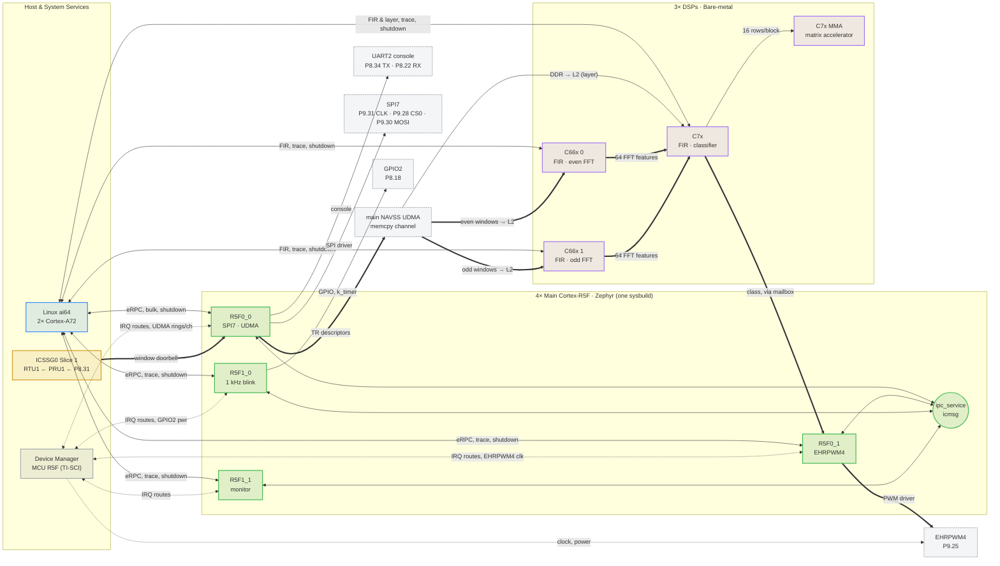
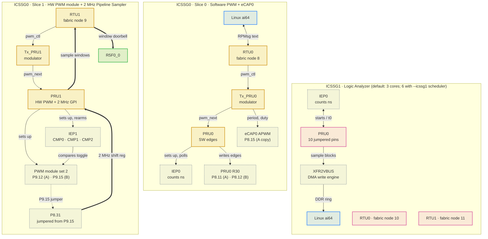
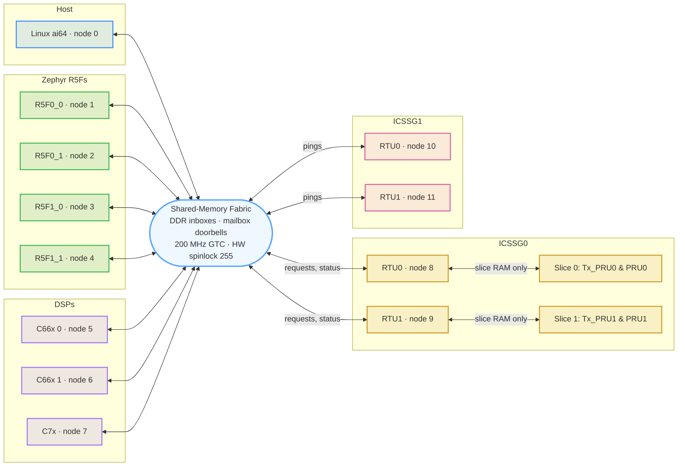
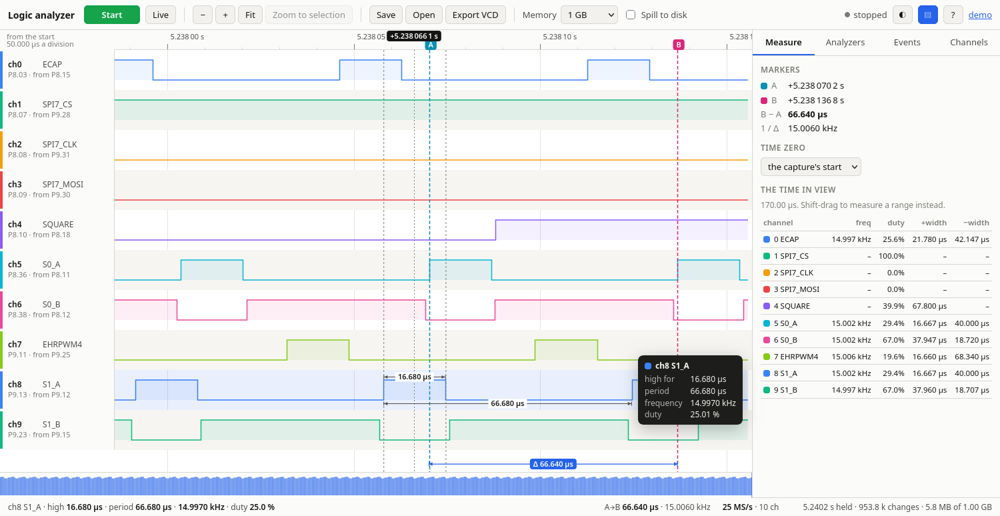
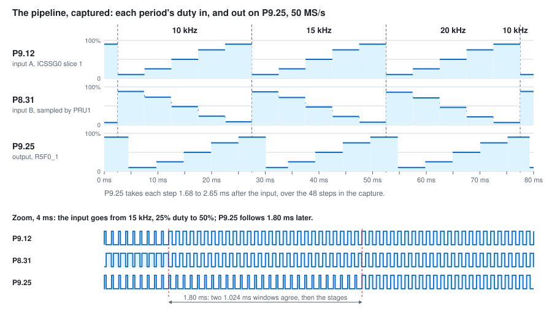
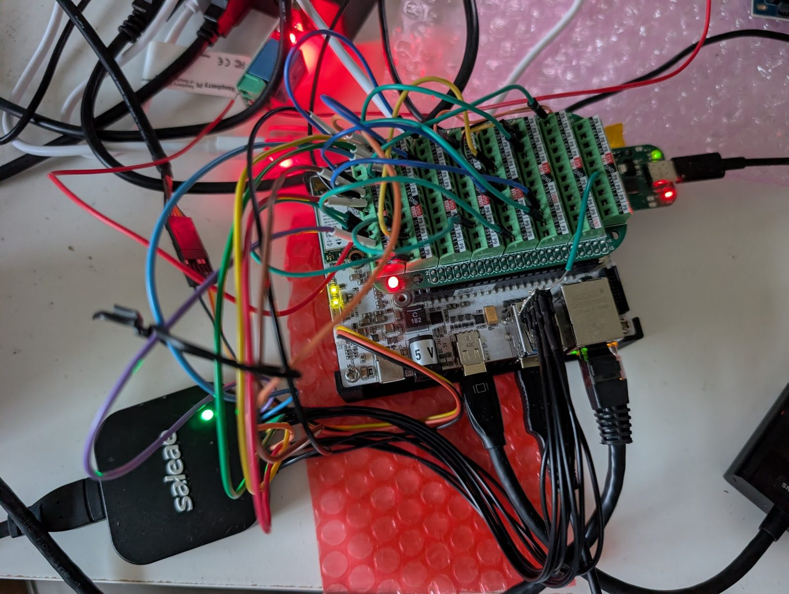

# BeagleBone AI-64: Linux, Zephyr, PRU, RTU, Tx_PRU, and DSPs Together

The BeagleBone AI-64's TI TDA4VM (J721E) packs **23 cores of seven kinds**: two Cortex-A72s, six Cortex-R5Fs, two C66x DSPs, a C7x DSP with a Matrix Multiply Accelerator (MMA), and twelve PRU/RTU/Tx_PRU cores across two ICSSGs. Most projects only ever use the A72s because booting, connecting, and cleanly restarting the rest is scattered across TI manuals, kernel patches, and forum posts.

This repository brings up **19 of the coprocessors alongside Linux 6.18** (BeagleBoard Debian or a custom Yocto image)—all four main-domain R5Fs, all three DSPs, and all twelve ICSSG cores—with small, self-contained examples documented next to their code so you can lift just the pieces you need:

- **Repeatable boot & restart from Linux** — start and stop every core cleanly via `remoteproc` as many times as you want, with no power cycle required.
- **Direct cross-core messaging** — RPMsg and eRPC from Linux, Zephyr `ipc_service` between R5Fs, and **the fabric**: shared-memory inboxes, mailbox doorbells, and 200 MHz GTC timestamps linking any core directly to any other (132 paths, zero Linux in the loop).
- **Real peripherals & accelerators** — Zephyr SPI7, EHRPWM4, GPIO2, and UDMA on the R5Fs; FIR filters, 2048-pt FFTs, and an int8 MMA neural-network layer (~250× faster than an A72 core) on the DSPs; and three flavors of hardware-timed PWM on ICSSG0.
- **A 5-core-type real-time pipeline** — a signal enters on `P8.31`, gets sampled at 2 MHz by a PRU, moved by R5F0_0's UDMA, FFT'd across both C66x DSPs, classified on the C7x's MMA, and played back on `P9.25` by R5F0_1 ~1.5 ms later, with zero Linux in the path.
- **Live web dashboard & built-in 10-channel logic analyzer** — inspect every core, pipeline stage, and fabric latency in your browser (`:8064`), or use ICSSG1 as a 125 MS/s logic analyzer with a live browser viewer (`:8064/la`) and an MCP server (`:8065/mcp`) for AI agents.


**Jump to:** [Cores at a glance](#the-19-cores-at-a-glance) · [Architecture](#architecture) · [Quick start (Debian)](#quick-start-beagleboard-debian) · [Web UI & logic analyzer](#web-ui--logic-analyzer) · [Commands](#commands) · [Probe the pins](#probe-the-pins) · [Yocto](#yocto-image) · [Testing](#testing-on-a-board) · [Documentation](#documentation) · [Security](#security)

---

## The 19 cores at a glance

| Cores | Role in this demo | Details |
| --- | --- | --- |
| **2× Cortex-A72** (Linux 6.18) | `ai64` & `ai64-demo`: boots/restarts all cores, runs interactive CLI, serves web UI & MCP | [`linux-app/`](linux-app/README.md) |
| **4× Main Cortex-R5F** (Zephyr) | One sysbuild app, four images: `R5F0_0` (SPI7 + UDMA), `R5F0_1` (EHRPWM4 on `P9.25`), `R5F1_0` (1 kHz square wave on `P8.18`), `R5F1_1` (IPC monitor) | [`zephyr/r5/`](zephyr/r5/README.md) |
| **ICSSG0** (2 PRU, 2 RTU, 2 Tx_PRU) | PWM three ways (software, ICSSG PWM module, eCAP0 APWM) with 1 µs dead band, plus the pipeline's 2 MHz `P8.31` sampler | [`pru/`](pru/README.md) |
| **ICSSG1** (default: PRU0 + 2 RTUs) | PRU0 runs the 10-channel, up to 125 MS/s logic analyzer; RTU0/RTU1 are fabric nodes (PRU1 & Tx_PRUs stay stopped/free) | [`pru/logic_analyzer/`](pru/logic_analyzer/README.md) |
| **ICSSG1** (`--icssg1 scheduler`: all 6) | Optional swap: runs TI's `open-pru` multicore scheduler across all 6 cores | [`extra-demos/`](extra-demos/README.md) |
| **2× C66x DSP** | Linux FIR jobs, plus alternating even/odd 2048-point FFTs for the pipeline | [`dsp/`](dsp/README.md) |
| **C7x DSP + MMA** | Linux FIR jobs, plus int8 neural-network classification on the MMA (256 rows in < 2 µs) | [`dsp/`](dsp/README.md#the-c7xs-matrix-multiply-accelerator) |

- **16 active by default, 19 with `--icssg1 scheduler`:** the default `ai64-demo` runs 4 R5Fs + 3 DSPs + 6 ICSSG0 + 3 ICSSG1 = **16 coprocessors** (leaving ICSSG1's PRU1, Tx_PRU0, and Tx_PRU1 free). Running `ai64-demo --icssg1 scheduler` activates all **19**.
- **MCU-domain R5Fs (2 cores):** untouched—they run TI's device manager (DM) firmware.

<details>
<summary><strong>New to TI TDA4VM / PRU terminology?</strong> Click for a 1-minute glossary.</summary>

- **ICSSG (Industrial Communication Subsystem, Gigabit):** a real-time coprocessor block with dedicated RAM, nanosecond timers (**IEP**), and single-cycle pin I/O (`R30` output / `R31` input). Each ICSSG has two **slices**, and each slice has three 250 MHz 32-bit deterministic cores: a **PRU** (Programmable Real-time Unit), an **RTU** (auxiliary PRU), and a **Tx_PRU** (transmit PRU). Two ICSSGs = 12 cores.
- **R5F:** Arm Cortex-R5F real-time microcontroller core. Four sit in the main domain (running Zephyr here); two sit in the MCU domain (running the board's device manager).
- **Zephyr:** open-source RTOS; each main-domain R5F runs its own image built from one `west build --sysbuild`.
- **remoteproc:** Linux framework (`/sys/class/remoteproc/`) for loading firmware into coprocessors and starting/stopping them.
- **RPMsg & eRPC:** RPMsg is Linux's shared-memory ring + mailbox channel to a remoteproc core. eRPC runs typed RPC function calls over RPMsg.
- **Mailbox:** SoC hardware FIFO block used as inter-core doorbells (write a word → trigger an interrupt or poll hit on another core).
- **Device manager & TI-SCI:** firmware on the MCU R5F that manages SoC clocks, power, and interrupt routing, plus the message protocol (`TI-SCI`) cores use to request them.
- **GTC:** the SoC's global 200 MHz counter readable by every core, enabling true one-way cross-core latency measurements.

</details>

---

## Architecture

Every core has its own block below. The system is split into three views so each diagram stays readable at full size without dropping any core, peripheral, or link:

- **Thick arrows (`==>`)** trace the 5-core-type real-time pipeline (`P8.31` → `P9.25`).
- **Solid arrows (`-->` / `<-->`)** show host control, IPC, slice internals, and peripheral ownership.
- **Dashed arrows (`-.->`)** show TI-SCI service requests to the MCU device manager and the `P9.15` → `P8.31` jumper wire.
- Linux also loads and restarts every coprocessor via `remoteproc` (omitted for clarity).

### 1. Host, Zephyr R5Fs, DSPs & real-time pipeline



### 2. ICSSG0 (PWM three ways & sampler) & ICSSG1 (logic analyzer)



### 3. The shared-memory fabric (12 nodes, 132 paths)

`RTU1` takes requests only over the fabric; `RTU0` accepts both fabric and RPMsg. In ICSSG0, the fabric stops at the RTUs so nothing on the SoC can perturb `Tx_PRU`/`PRU` timing.



Three design principles tie the system together:

1. **The 5-core-type pipeline ([`docs/pipeline.md`](docs/pipeline.md)):** jumper `P9.15` → `P8.31` to feed ICSSG0's 15-step PWM (10/15/20 kHz × 10–90% duty, changing every 5 ms) back into the board. ICSSG0 `PRU1` samples `P8.31` at 2 MHz into overlapping 1.024 ms windows (1,953 windows/s), `RTU1` timestamps them on the GTC, `R5F0_0`'s UDMA copies even/odd windows into `C66x 0`/`C66x 1` L2 SRAM for 2048-pt FFTs, the `C7x` MMA classifies each spectrum with weights trained by Linux at startup, and `R5F0_1` drives `P9.25` to match (~126 µs compute latency, ~1.5 ms pin-to-pin, 100% accuracy on steady steps).
2. **The direct fabric ([`docs/fabric.md`](docs/fabric.md)):** 12 nodes (Linux, 4 R5Fs, 3 DSPs, both ICSSG0 RTUs, both ICSSG1 RTUs) communicating through dedicated DDR inboxes, mailbox cluster 11 doorbells, GTC timestamps, and hardware spinlock 255. Every node pings every other, `R5F0_0` runs a multi-hop tour across all core families, and `ai64 fabric route` can send custom multi-hop actions (e.g., Linux → C7x → C66x → ICSSG0 RTU1 PWM).
3. **Deterministic ICSSG split ([`pru/README.md`](pru/README.md)):** in ICSSG0, **the RTU talks while the PRU and Tx_PRU keep time**. Only the RTU touches DDR, mailboxes, or RPMsg; the PRU and Tx_PRU touch only slice-local RAM (save one GTC read per period on the Tx_PRU, away from edges), keeping hardware edges jitter-free. In ICSSG1, `PRU0` streams directly to DDR via its slice's background `XFR2VBUS` engine without ever stalling on memory.

---

## Quick start: BeagleBoard Debian

### Prerequisites

- **Hardware:** BeagleBone AI-64, microSD card (16 GB+), 5 V / 3 A supply (barrel jack or USB-C), and Ethernet or USB-C link (`192.168.7.2` over USB-C).
- **Host Linux PC:** `git`, `ssh`, `rsync`, `xz`, and either `podman` or `docker` (every compiler runs in containers—no toolchains to install). Needs ~6 GB free disk (~3 GB images + ~2 GB fetched sources) and access to GitHub, `git.ti.com`, `software-dl.ti.com`, and Docker Hub. First build takes 10–20 min; incremental builds take seconds to a minute.
- **Jumper wires:**
  - **1 wire (`P9.15` → `P8.31`)** feeds the real-time pipeline. Without it, everything else still runs and `P9.25` runs its own steps.
  - **10 optional wires** loop the demo's own outputs into ICSSG1's built-in logic analyzer ([wiring table](pru/logic_analyzer/README.md#the-channels)).
  - Optional: external logic analyzer or 3.3 V USB-serial adapter on `P8.34` (TX) / `P8.22` (RX) for `R5F0_0`'s Zephyr console.

> [!WARNING]
> All BeagleBone AI-64 header pins—including the logic analyzer inputs—are **3.3 V logic only**. Connecting 5 V signals can permanently damage the SoC.

Clone the repository on your PC (all host commands run from this directory):

```bash
git clone https://github.com/kevinacahalan/BeagleBoneAI64-linux-zephyr-pru-c7x-c66x-demo.git
cd BeagleBoneAI64-linux-zephyr-pru-c7x-c66x-demo
```

### 1. Flash Debian and log in

Download [BeagleBone AI-64 Debian 13.7 IoT, v6.18 k3](https://www.beagleboard.org/distros/bbai64-debian-13-7-2026-10-09-iot-v6-18-x-k3) (`bbai64-debian-13.7-iot-v6.18-k3-arm64-2026-10-09-10gb.img.xz`). Fresh images have no default login—use **BeagleBoard Imager** (recommended) to flash the card and configure your username, password, hostname, and SSH public key.

<details>
<summary>Flashing manually with <code>dd</code> and <code>sysconf.txt</code></summary>

1. Verify your card device with `lsblk`, then write the image:
   ```bash
   xz -dc bbai64-debian-*.img.xz | sudo dd of=/dev/sdX bs=4M conv=fsync status=progress
   ```
2. Mount the card's first (`BOOT`) partition (e.g. `sudo mount /dev/sdX1 /mnt`) and append to `sysconf.txt` (applied and password-cleared on first boot):
   ```ini
   user_name=debian
   user_password=choose-a-password
   user_authorized_key=ssh-ed25519 AAAA... you@pc
   hostname=bbai64
   ```
   *(Paste your `~/.ssh/id_ed25519.pub` so subsequent SSH/rsync commands don't prompt repeatedly.)*
3. Unmount (`sudo umount /mnt`).

</details>

Insert the SD card and power on (hold the `BOOT` button on power-up if your board boots from eMMC instead). A fresh card **reboots twice automatically** (~3 minutes) while applying `sysconf.txt` and resizing the root filesystem. Then verify SSH:

```bash
ssh debian@bbai64.local
```

*(Substitute your `USER@BOARD` below—use your router's DHCP IP or `192.168.7.2` over USB-C if `.local` does not resolve. Debug serial console is `ttyS2`, 115200 8N1 on the 3-pin debug header.)*

### 2. Build on the PC

```bash
./beagle-linux/scripts/build.sh
AI64_SSH=USER@BOARD ./beagle-linux/scripts/build.sh kmod
./beagle-linux/scripts/build.sh bundle
```

1. **`build.sh`** compiles `ai64`, the device-tree overlay, 15 ICSSG images, 4 Zephyr R5F images, and 2 DSP images inside containers.
2. **`kmod`** fetches kernel headers from the running board over SSH (`rsync`) and builds the two patched kernel modules (`pru_rproc`, `ti_k3_r5_remoteproc`; [why](docs/kernels.md#why-debian-needs-two-patched-modules)) plus the `ai64_la` module.
3. **`bundle`** packages everything into `out/ai64-beagle/`.

### 3. Install on the board and reboot

```bash
scp -r out/ai64-beagle USER@BOARD:
ssh -t USER@BOARD 'sudo ./ai64-beagle/install-beagle.sh && sudo reboot'
```

`install-beagle.sh` installs `ai64`, `ai64-demo`, all firmware (`/lib/firmware/ai64*`), the kernel modules, the device-tree overlay (disabling the conflicting stock `P9.25` PWM overlay, backing up `extlinux.conf.ai64-bak`), a udev rule for `dialout` access to `/dev/rpmsg*`, and `tmux` (if online). Nothing auto-starts at boot—`ai64-demo` owns every core's lifecycle. Wait ~30 seconds for reboot, then SSH back in.

### 4. Run the demo

On the board:

```bash
ai64-demo --tmux
```

This prompts once for `sudo`, cleanly restarts every core with its installed firmware, and opens a 15-window `tmux` session (`linux`, `r5f0_0`–`r5f1_1`, `rtu0`, `pwm`, `la`, `c66x0`, `c66x1`, `c7x`, `fabric`, `pipe`, `web`, `mcp`). Wait for the startup self-test and 3 s pipeline training to print `linux window ready. commands: ...`.

- **No tmux / single console:** run plain `ai64-demo` (all streams prefixed `[Linux]`, `[R5F0_0]`, etc.; `quit` or `Ctrl+C` exits).
- **Re-attach without restarting cores:** `ai64-demo --attach --tmux`.
- **Swap ICSSG1 to TI's multicore scheduler:** `ai64-demo --icssg1 scheduler` (or `--icssg1 off`).
- **tmux basics:** `Ctrl+b w` (window list), `Ctrl+b n`/`p` (next/prev), `Ctrl+b 0–9` (jump), `Ctrl+b d` (detach leaving demo running), `tmux kill-session -t ai64` (close session; cores keep running until next `ai64-demo` or reboot).

**What a passing run shows:** `RTU0` echoes RPMsg, all 4 R5Fs answer eRPC, `R5F1_0` forwards SPI7 to `R5F0_0` over `ipc_service` (~80 µs R5F round trips), `R5F0_0`'s UDMA copies 16 KiB to `C7x` L2 in ~34 µs (~486 MB/s) and the MMA matches the A72 in < 4 µs, the pipeline trains to 100% and tracks all 15 steps at 1,953 windows/s (~126 µs compute latency, 0 wrong), and both ICSSG0 PWM slices report 0 late edges. See **[Sample Output](docs/sample-output.md)** for full multi-window logs and `ai64 trace` examples.

#### After you change code

| What changed | Steps | Reboot needed? |
| --- | --- | --- |
| `ai64` or any core firmware | `build.sh` → `build.sh bundle` → `scp` → `install-beagle.sh` | No (next `ai64-demo` reloads firmware) |
| Device-tree overlay | Same as above | **Yes** (pinmux applies at boot) |
| Board kernel (`apt upgrade`) | `AI64_SSH=... build.sh kmod` → `bundle` → `scp` → `install-beagle.sh` | **Yes** (`.ko` must match kernel) |

Hit a snag? Check **[Troubleshooting](docs/troubleshooting.md)**.

---

## Web UI & logic analyzer

While `ai64-demo` is running, the board exposes three local endpoints (no internet required):

| Endpoint | What it provides |
| --- | --- |
| **`http://<board>:8064/`** | Live system dashboard (`/status.json` @ 2 Hz): all 19 core states, pipeline throughput/latency/confusion matrix, PWM generators, and 12-node fabric latency matrix (screenshot at top). |
| **`http://<board>:8064/la`** | Live 10-channel logic analyzer viewer streamed over WebSocket (`/la/stream`): hover pulse/period measurements, edge-snapping A/B markers, SPI/UART/I²C protocol decoders, `.lacap` save/open, VCD export, and rate/channel control. |
| **`http://<board>:8065/mcp`** | Streamable HTTP [MCP](https://modelcontextprotocol.io) server (`ai64 mcp`) so Claude Code or any MCP client can set rates, trigger captures, measure timing, and decode SPI/UART directly on hardware. |



Stand-alone servers: `sudo ai64 web [port]` and `sudo ai64 mcp [port]`. See [`pru/logic_analyzer/README.md`](pru/logic_analyzer/README.md) for wiring, rates (up to 62.5 MS/s all-channel live streaming via `/dev/ai64-la`, or 125 MS/s burst capture), and MCP tool reference.

---

## Commands

### Interactive `linux` window commands

`r5fX_Y` accepts `r5f0_0`, `r5f0_1`, `r5f1_0`, or `r5f1_1`. Commands `spi`, `pwm`, and `steps` work on *any* R5F—cores without that peripheral forward the call over `ipc_service`.

| Command | Action |
| --- | --- |
| `r5fX_Y say <text>` | eRPC echo from that R5F core |
| `r5fX_Y status` | Core status (`r5f1_1` prints IPC round trips and stats for all other R5Fs) |
| `r5fX_Y spi [text]` | `R5F0_0` writes `text` (default `hello`) on SPI7 |
| `r5fX_Y pwm <period_ns> <duty_ns>` | `R5F0_1` sets `P9.25` (EHRPWM4_B) to a fixed period/high time (stops steps & takes pin from pipeline) |
| `r5fX_Y steps <ms>` | `R5F0_1` runs the 15-step PWM sequence (`steps 0` freezes current step) |
| `r5f0_0 chunk <text>` | Writes DDR bulk buffer and verifies CRC on `R5F0_0` |
| `r5f0_0 dma [rows]` | UDMA copies `rows × 64` B (default 256) to `C7x` L2, runs MMA layer, verifies against A72 |
| `rtu0 pwm <period_ns> <duty_ns>` | Sets ICSSG0 slice 0 software PWM (`P8.11`/`P8.12`) and `eCAP0` (`P8.15`) |
| `rtu0 steps <ms>` / `sweep <ms>` / `dead <ns>` | GTC-synced 15-step sequence, duty sweep, or dead-band width on slice 0 |
| `rtu0 status` / `rtu0 <text>` | Slice 0 + `eCAP0` status, or RPMsg text echo |
| `pipe` / `pipe start [sec]` / `pipe stop` | Show pipeline stats + confusion matrix, retrain & attach `P9.25`, or detach `P9.25` |
| `help` / `quit` | List commands or close the `linux` window |

*Timing bounds:* ICSSG0 periods run 2,000 ns–1 s in 4 ns IEP steps (400 ns min spacing per pin); `P9.25` EHRPWM4 goes down to 16 ns. To control ICSSG0 slice 1 (`P9.12`/`P9.15`, which intentionally has no RPMsg), route through the fabric: `sudo ai64 fabric route g0rtu1 pwm <period_ns> <duty_ns>`.

### Standalone `ai64` CLI subcommands

Run in any shell on the board (`<core>` is a label from `ai64 cores` like `r5f0_1`, `g0rtu1`, `c7x`, or a remoteproc name; full list in [`linux-app/README.md`](linux-app/README.md)):

| Command | Purpose |
| --- | --- |
| `ai64 cores` / `sudo ai64 pads` | List all demo cores (remoteproc, firmware, fabric node) / verify every demo pin's mux |
| `ai64 trace <core>` | Follow a core's remoteproc trace buffer via `/dev/mem` |
| `sudo ai64 fabric route <node>... [action]` | Send a timed multi-hop route and optionally run `pwm`/`steps`/`sweep`/`dead` on a PWM node |
| `sudo ai64 pipe [once\|start\|stop]` | Inspect, train/start, or stop the pipeline |
| `sudo ai64 la mode \| measure \| rate \| capture` | Configure logic analyzer rate/channels, measure signals, or record triggered VCD files |
| `sudo ai64 dsp <core>` / `sudo ai64 mma [rows] [runs]` | Run & verify FIR jobs on C66x/C7x or benchmark the C7x MMA vs plain C |
| `sudo ai64 pwm once` / `ai64 bench <rpmsg-dev>` | Snapshot all PWM generators / benchmark eRPC round-trip latency |
| `sudo ai64 web [port]` / `sudo ai64 mcp [port]` | Run the web UI or MCP server standalone |

---

## Probe the pins

All header signals are **3.3 V logic**. You can verify them with an external logic analyzer or with ICSSG1's built-in analyzer ([channel wiring](pru/logic_analyzer/README.md#the-channels)).

| Signal | Header pins | Expected waveform |
| --- | --- | --- |
| SPI7 (`R5F0_0`, Zephyr) | `P9.28` CS, `P9.31` CLK, `P9.30` MOSI | `hello` at 1 MHz, mode 0, MSB first (at boot and on `spi`) |
| Hardware PWM, EHRPWM4_B (`R5F0_1`) | `P9.25` | 15-step program, or pipeline replay ~1.5 ms behind `P9.12` |
| Pipeline input (`ICSSG0 PRU1`) | `P8.31` (jumpered from `P9.15`) | Same waveform as `P9.15` |
| Square wave (`R5F1_0`, GPIO2) | `P8.18` | 1 kHz (500 µs half-period `k_timer`) |
| Software PWM (`ICSSG0` slice 0) | `P8.11` (A), `P8.12` (B) | 15-step complementary pair with 1 µs dead band |
| Hardware PWM, `eCAP0` (`ICSSG0` Tx_PRU0) | `P8.15` | Copy of `P8.11` period/duty, own counter phase |
| Hardware PWM, ICSSG module (`ICSSG0` slice 1) | `P9.12` (A), `P9.15` (B) | Hardware-timed complementary pair with 1 µs dead band |
| Zephyr UART2 console (`R5F0_0`) | `P8.34` TX, `P8.22` RX | 115200 8N1 |



See **[Probing & Signal Captures](docs/probing.md)** for all five Saleae Logic Pro 8 captures (15-step GTC sync, complementary dead-band timing, pipeline tracking, SPI7, and `P8.18` jitter histogram) plus the Zephyr EHRPWM4/DMTimer/SPI7 timing bugs they uncovered. See [`PINMUX.md`](PINMUX.md) for the complete ball/mux map.

---

## Yocto image

`yocto/` provides a `kas` configuration and the `meta-ai64` layer to build a self-contained Poky image on TI's Linux 6.18 (`linux-ti-staging`) with `ai64`, `ai64-demo`, all 21 firmware images, `ai64_la`, and the overlay pre-installed (no `build.sh` needed; ~3 h / ~150 GB on first build):

```bash
wget -O kas-container https://raw.githubusercontent.com/siemens/kas/5.5/kas-container
chmod +x kas-container
KAS_BUILD_DIR=yocto/build ./kas-container build yocto/kas/ai64-poky.yml
```

Flash `yocto/build/deploy-ti/images/beaglebone-ai64/ai64-demo-image-beaglebone-ai64.rootfs-<timestamp>.wic.xz`, log in as `root` (no password), and run `ai64-demo --tmux`. See **[`yocto/README.md`](yocto/README.md)** for flashing commands, kernel patch details, and GitHub mirror notes, and **[`docs/kernels.md`](docs/kernels.md)** for how Debian's 6.18 and TI's 6.18 differ.

---

## Build targets

`./beagle-linux/scripts/build.sh [target]` builds container images from `containers/` and compiles inside them as your user (uses `podman` if present, else `docker`; override with `AI64_CONTAINER_ENGINE`).

| Target | Outputs | Toolchain / Notes |
| --- | --- | --- |
| `all` *(default)* | `linux`, `pru`, `zephyr`, `dsp` | Full firmware + userspace build |
| `linux` | `linux-app/ai64`, `beagle-linux/overlays/*.dtbo` | Debian 13 aarch64 cross-compiler; fetches EmbeddedRPC 1.14.0 & BeagleBoard-DeviceTrees |
| `pru` | 15 ELFs in `pru/build/` (6 PWM, 3 LA, 6 MCS) | TI PRU CGT 2.3.3 + PRU-SSP (`TRACE=0` strips PRU/Tx_PRU traces) |
| `zephyr` | `build/zephyr/r5fX_Y/zephyr/ai64_r5fX_Y.elf` | Zephyr SDK 1.0.1, single sysbuild (`zephyr/west.yml` + `zephyr/patches/`) |
| `dsp` | `dsp/build/ai64-c66x.elf`, `dsp/build/ai64-c7x.elf` | TI C6000 CGT 8.3.12 & C7000 CGT 1.2.0.STS |
| `kmod` | `pru_rproc.ko`, `ti_k3_r5_remoteproc.ko`, `ai64_la.ko` | Requires `AI64_SSH` (or `AI64_KREL`) to match the board's kernel |
| `bundle` | `out/ai64-beagle/` | Packages all build outputs for `install-beagle.sh` |
| `erpcgen` | `zephyr/erpc/shim/` | Regenerates eRPC shims after editing `zephyr/erpc/ai64.erpc` |

---

## Testing on a board

`tests/` runs automated checks against a live board over SSH (each check prints `ok`/`FAIL` and exits non-zero on failure; details in [`tests/README.md`](tests/README.md)):

```bash
AI64_SSH=USER@BOARD tests/run.sh check    # verify running demo (all cores, pipeline, fabric, DSPs, LA, MCP)
AI64_SSH=USER@BOARD tests/run.sh soak 5   # restart demo 5×, check every run + dmesg for errors
AI64_SSH=USER@BOARD tests/run.sh routes   # exercise multi-hop fabric routes to every PWM generator
AI64_SSH=USER@BOARD tests/run.sh stress   # stress-test logic analyzer down to 16 ns (62.5 MHz) & 125 MS/s
```

<details>
<summary><strong>Automated hardware test bench</strong> (optional — how this repo was developed and verified)</summary>

None of this hardware is required to run the demo, but every capture and soak test in this repository was automated hands-free from a Linux PC using:
- **Power:** USB relay switching 5 V onto `P9.05`/`P9.06`
- **microSD:** SDWire3 SD card mux (reflash, verify, inject `sysconf.txt`, switch back to board)
- **Consoles:** FTDI TTL-232R-3V3 on the boot debug header + Raspberry Pi Debug Probe UART on `P8.34`/`P8.22`
- **Network & Signals:** Ethernet SSH + Saleae Logic Pro 8 via a P8/P9 screw-terminal breakout driven through Logic 2's automation API



</details>

---

## Documentation

| Document | Covers |
| --- | --- |
| [`zephyr/r5/README.md`](zephyr/r5/README.md) | Zephyr on the 4 R5Fs: sysbuild, eRPC, `ipc_service`, TI-SCI polled secure proxy, mailbox routing, EHRPWM4/GPIO2/UDMA, caches, clean restarts |
| [`pru/README.md`](pru/README.md) | All 12 ICSSG cores: open-pru layout, ICSSG0's 3 PWM implementations, and RTU0 RPMsg |
| [`pru/logic_analyzer/README.md`](pru/logic_analyzer/README.md) | ICSSG1 10-channel logic analyzer: jumpers, `XFR2VBUS` DDR ring, sample rates, web viewer, MCP server, `ai64 la` |
| [`dsp/README.md`](dsp/README.md) | C66x & C7x firmware: trace buffers, FIR jobs, C7x MMU/caches, MMA int8 accelerator, safe C7x shutdown |
| [`docs/fabric.md`](docs/fabric.md) | Direct 12-node shared-memory fabric, protocol, and measured one-way GTC latencies |
| [`docs/pipeline.md`](docs/pipeline.md) | `P8.31` → `P9.25` 5-core-type pipeline: overlapping windows, UDMA, FFT, MMA classification, training |
| [`docs/kernels.md`](docs/kernels.md) | BeagleBoard 6.18 vs TI 6.18 kernels, why Debian needs two patched modules, and `ai64_la` |
| [`docs/probing.md`](docs/probing.md) | All 5 Saleae hardware captures, dead-band math, and Zephyr timing bug fixes |
| [`docs/sample-output.md`](docs/sample-output.md) | Full passing multi-window terminal transcript and `ai64 trace` output |
| [`docs/troubleshooting.md`](docs/troubleshooting.md) | Common setup, kernel module, overlay, runtime, and build issues |
| [`yocto/README.md`](yocto/README.md) | Building, flashing, and customizing the `meta-ai64` Poky Linux 6.18 image |
| [`linux-app/README.md`](linux-app/README.md) | `ai64` subcommand and source file map |
| [`MEMORY.md`](MEMORY.md) · [`PINMUX.md`](PINMUX.md) · [`LAYOUT.md`](LAYOUT.md) | Shared-memory address & cache map, complete header pinmux table, and repository directory map |

---

## Security

> [!WARNING]
> **Bench use only.** This demo intentionally opens interfaces without authentication for convenient lab development. Do not expose it on an untrusted network without locking it down.

- **Ports 8064 (web UI) and 8065 (MCP) bind to all interfaces** with no password. Anyone on the network can view core states and logic analyzer captures, and change the analyzer's rate/channels via `/la/stream` (whose WebSocket does not check `Origin`, so any browser tab on the LAN could reach it).
- **MCP server (`:8065`):** saves captures to `/tmp/ai64-la-capture.vcd`. It checks `Origin` against its own host address, which blocks ordinary cross-origin pages but not DNS rebinding or `Origin: null` (e.g. sandboxed iframes). Set `AI64_MCP_TOKEN` in its environment to require `Authorization: Bearer <token>` ([MCP docs](pru/logic_analyzer/README.md#mcp-the-analyzer-for-an-agent)).
- **`/dev/mem` and root privileges:** `install-beagle.sh` and `ai64-demo` grant `/usr/bin/ai64` `CAP_SYS_RAWIO` (`setcap`) and set `/dev/mem` to `0660` so members of `kmem` can read/write demo shared memory. Changing analyzer rate/channels restarts ICSSG1 `PRU0` via `remoteproc` (root-only), and `/dev/ai64-la` is root-only. On the Yocto image, everything runs as `root`.
- **RPMsg devices:** `ai64-demo` runs `chmod a+rw` on the R5F and ICSSG0 RTU0 `/dev/rpmsg*` devices (until those cores restart) so any local user can message them.
- **Hardening for non-bench networks:** firewall ports 8064/8065 (or omit the `web`/`mcp` windows), set `AI64_MCP_TOKEN`, and remove the `chmod` lines in `beagle-linux/scripts/ai64-demo`.

---

## License

MIT — see [`LICENSE`](LICENSE). Exceptions:
- `beagle-linux/kernel/pru_rproc/` and `beagle-linux/kernel/k3_r5_rproc/` are **GPL-2.0-only** (derived from Linux kernel drivers).
- `extra-demos/icssg1-multicore-scheduler/` is **BSD-3-Clause** (ported from TI's `open-pru` example).
