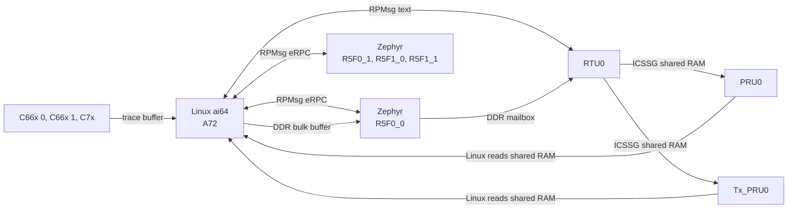

# BeagleBone AI-64: Linux, Zephyr, PRU, RTU, Tx_PRU, and DSPs together

A starting point for BeagleBone AI-64 (TI TDA4VM / J721E) projects that use its heterogeneous cores:

- **Linux** on the Cortex-A72s runs `ai64`, one program that drives the demo.
- **Zephyr** on all four main-domain Cortex-R5F cores answers function calls from Linux (eRPC over RPMsg). R5F0_0 also writes SPI7 and hands commands to the ICSSG0 cores.
- **RTU0** (ICSSG0) takes commands from Linux (RPMsg) and from Zephyr (a shared DDR mailbox), and hands them to the other two ICSSG0 cores.
- **PRU0** (ICSSG0) runs a cycle-counted loop and bit-bangs a UART frame on a header pin.
- **Tx_PRU0** (ICSSG0) sends pulse trains on a header pin through the SoC's GPIO module.
- **The two C66x DSPs and the C7x DSP** log through their remoteproc trace buffers, which Linux follows, and run FIR filter jobs that Linux hands them through shared memory.



Each link is small and easy to copy into your own project. [How it works](#how-it-works) walks through them.

The MCU-domain R5F cores are left alone: they run the board's device manager. [What is not here yet](#what-is-not-here-yet) lists what comes next.

It runs on the BeagleBoard Debian image, plus a one-time install script. A Yocto (Poky) configuration in `yocto/` builds the demo into an image of its own, which has been built and tested on the board.

## What you need

- A BeagleBone AI-64, a microSD card (16 GB or more), and a way to power it. On the test bench the board takes 5 V on header pins P9.05/P9.06.
- A network link to it: Ethernet to your LAN, or the USB-C port, which brings up a USB network adapter on the PC.
- A Linux PC with `git`, `ssh`, `rsync`, `xz`, and either `podman` or `docker`. Every compiler runs in a container, so you don't install any toolchains.
- About 6 GB of free disk on the PC: roughly 3 GB of container images plus 2 GB of fetched sources. The first build takes 10–20 minutes, mostly downloading. Later builds take seconds to a minute.
- Network access from the PC to GitHub, git.ti.com, software-dl.ti.com, and Docker Hub.
- Optional: a logic analyzer, to watch SPI7, the PRU0 UART, and the Tx_PRU0 pulses on the header ([Probe the pins](#probe-the-pins)); and a 3.3 V USB-serial adapter on P8.34 (TX) and P8.22 (RX), to read the Zephyr console.

Get the code:

```
git clone https://github.com/kevinacahalan/BeagleBoneAI64-linux-zephyr-pru-c7x-c66x-demo.git
cd BeagleBoneAI64-linux-zephyr-pru-c7x-c66x-demo
```

Every command below runs from this directory unless it says "on the board".

## Quick start: BeagleBoard Debian

### 1. Flash the card and log in

Download [BeagleBone AI-64 Debian 13.7 IoT, v6.18 k3](https://www.beagleboard.org/distros/bbai64-debian-13-7-2026-10-09-iot-v6-18-x-k3), the file `bbai64-debian-13.7-iot-v6.18-k3-arm64-2026-10-09-10gb.img.xz`. A fresh image has no login until you give it one. Pick either way:

- **BeagleBoard Imager** (easiest). Choose the image, and in its settings set a user name, a password, and your SSH public key. Imager writes them for you.
- **By hand.**
  1. Write the image: `xz -dc bbai64-debian-*.img.xz | sudo dd of=/dev/sdX bs=4M conv=fsync status=progress`. Replace `/dev/sdX` with your card. Check it with `lsblk` first: `dd` overwrites whatever you give it.
  2. Mount the card's `BOOT` partition.
  3. Add these lines to the end of `sysconf.txt`, with your own values. The board applies them on first boot and then clears the password from the file.

     ```
     user_name=debian
     user_password=choose-a-password
     user_authorized_key=ssh-ed25519 AAAA... you@pc
     hostname=bbai64
     ```

     The key line is the contents of your `~/.ssh/id_ed25519.pub`. Run `ssh-keygen -t ed25519` if you don't have one. With the key in place, the build steps below don't keep asking for a password.

Put the card in the board and power it. With a card in the slot the board boots from it; the console prints `Trying to boot from MMC1`. If yours boots its eMMC instead, hold the BOOT button while you apply power.

A fresh card reboots twice on its own before it stays up: the first boot applies `sysconf.txt` and grows the root partition, and the second resizes the filesystem. Give it about three minutes. Then log in over the network:

```
ssh debian@bbai64.local
```

Below, `USER@BOARD` means that login, for example `debian@bbai64.local`. You'll also need its password for `sudo` on the board. If `.local` names don't resolve on your PC, use the address your router gave the board. Over the USB-C cable the board is `192.168.7.2`.

The serial console is UART0 on the 3-pin debug header, 115200 8N1 (`ttyS2` on the board), if SSH doesn't come up.

### 2. Build on the PC

```
./beagle-linux/scripts/build.sh
AI64_SSH=USER@BOARD ./beagle-linux/scripts/build.sh kmod
./beagle-linux/scripts/build.sh bundle
```

- **The first command** builds `ai64`, the overlay, the three ICSSG0 images, the four Zephyr R5F images, and the two DSP images.
- **`kmod`** builds the two patched kernel modules for the kernel running on your board. It asks the board for its kernel version over SSH, and the first time it copies that kernel's headers with `rsync`. The board must be up and reachable. [Why two patched modules](#why-debian-needs-two-patched-modules) explains why they're needed.
- **`bundle`** gathers everything into `out/ai64-beagle/`.

### 3. Install on the board and reboot

```
scp -r out/ai64-beagle USER@BOARD:
ssh -t USER@BOARD 'sudo ./ai64-beagle/install-beagle.sh && sudo reboot'
```

It asks for your `sudo` password on the board. `install-beagle.sh` makes the setup survive reboots:
- It installs `ai64`, `ai64-demo`, and the firmware for every core.
- It installs the patched `pru_rproc` and `ti_k3_r5_remoteproc` modules so the kernel loads them at boot.
- It adds the demo overlay to the default boot entry, and takes off the stock P9.25 PWM overlay, which muxes the same pin. The original is saved as `extlinux.conf.ai64-bak`.
- It adds a udev rule so the `dialout` group can use `/dev/rpmsg*`.
- It enables `ai64-icssg0.service`, which starts RTU0, PRU0, and Tx_PRU0 at boot.
- It installs `tmux` with apt if the image doesn't have it. The stock IoT image doesn't. This needs the board to reach the internet; over Ethernet it usually can. If it can't, the script says so and carries on.

The R5F images go in as `/lib/firmware/ai64_r5f0_0.elf` and so on, not under the kernel's default names (`j7-main-r5f0_0-fw`). So the R5F cores stay off at boot until `ai64-demo` starts them.

Give the board about 30 seconds to reboot, then log back in.

### 4. Run the demo

On the board:

```
ai64-demo --tmux
```

- It asks for your `sudo` password once.
- It restarts RTU0, PRU0, Tx_PRU0, the four R5F cores, and the DSPs with the installed firmware, then opens a tmux session with eleven windows: `linux`, `zephyr` (R5F0_0), `rtu0`, `pru0`, `txpru0`, `r5f0_1`, `r5f1_0`, `r5f1_1`, `c66x0`, `c66x1`, and `c7x`. Before it stops each DSP, it asks the DSP to go idle, which the C7x needs ([why](#restarting-the-c7x)).
- [What you should see](#what-you-should-see) shows the output of a passing run, and [Commands](#commands) lists what you can type in the `linux` window.

tmux keys: switch windows with Ctrl+b then 0–9, or Ctrl+b then n and p for next and previous, or Ctrl+b then w for a list. Detach, leaving the demo running, with Ctrl+b then d. Come back with `ai64-demo --attach --tmux`.

To stop the demo, run `tmux kill-session -t ai64`. Typing `quit` in the `linux` window only ends that window.

Without tmux, plain `ai64-demo` prints all eleven windows on one console instead. There, `quit` or Ctrl+C stops the whole demo.

### After you change the code

- **`ai64` or any core's firmware:** rebuild with `build.sh`, run `build.sh bundle`, copy the bundle, and run `install-beagle.sh` again. No reboot is needed: the next `ai64-demo` restarts every core with the new firmware.
- **The overlay:** the same steps, then reboot. Pin mux only changes at boot.
- **After the board's kernel is upgraded** (for example by `apt upgrade`): run `build.sh kmod` again, then `bundle`, `install-beagle.sh`, and reboot. The patched modules only fit the kernel they were built for.

## What you should see

On startup the linux window runs a short script. It pings RTU0, then sends `say`, `arm`, `chunk`, `xy 41 83`, and `spi` to Zephyr on R5F0_0, `arm` to RTU0, and `say` to each of the other R5F cores. A passing run, one block per window:

```
== linux
Linux sent "ping" to RTU0
Linux asked Zephyr to say hello from linux
Linux asked Zephyr to say "hello from linux", and it replied "zephyr r5f0_0: hello from linux"
Linux asked Zephyr to arm Tx_PRU0 250000 20
Linux asked Zephyr to check chunk bulk-hello
Linux asked Zephyr to publish X/Y 41 83
Linux asked Zephyr to write SPI7 hello
Linux asked Zephyr to write SPI7 "hello", and it replied "zephyr r5f0_0: spi wrote 5 bytes"
Linux asked RTU0 to arm Tx_PRU0 125000 10
Linux asked Zephyr on R5F0_1 to say hello from linux
Linux asked Zephyr on R5F0_1 to say "hello from linux", and it replied "zephyr r5f0_1: hello from linux"
Linux asked Zephyr on R5F1_0 to say hello from linux
Linux asked Zephyr on R5F1_0 to say "hello from linux", and it replied "zephyr r5f1_0: hello from linux"
Linux asked Zephyr on R5F1_1 to say hello from linux
Linux asked Zephyr on R5F1_1 to say "hello from linux", and it replied "zephyr r5f1_1: hello from linux"
linux window ready. commands: zephyr say|arm|chunk|xy|spi ... | r5f0_1|r5f1_0|r5f1_1 say ... | rtu0 xy|arm|<text> | help

== zephyr
Zephyr window ready on /dev/rpmsg2 (eRPC)
Linux asked Zephyr to say "hello from linux", and it replied "zephyr r5f0_0: hello from linux"
Linux asked Zephyr to arm Tx_PRU0, and it published period 250000 count 20 for RTU0
Linux asked Zephyr to check the chunk, and it matched seq 1 len 10 crc c959d039
Linux asked Zephyr to publish X/Y 41 83, and it sent that pair to RTU0
Linux asked Zephyr to write SPI7 "hello", and it replied "zephyr r5f0_0: spi wrote 5 bytes"

== rtu0
rtu0 window ready on /dev/rpmsg1
sent to rtu0: ping
Linux sent "ping" to RTU0, and RTU0 echoed it
Zephyr asked RTU0 to arm Tx_PRU0, and RTU0 wrote period 250000 count 20 for Tx_PRU0
Zephyr asked RTU0 to publish X/Y, and RTU0 wrote x 41 y 83 seq 1 for PRU0
sent to rtu0: arm 125000 10
Linux asked RTU0 to arm Tx_PRU0, and RTU0 wrote period 125000 count 10 for Tx_PRU0

== pru0
pru0 window ready, X/Y record at 0xb010040, SLIP TX on P8.11
RTU0 published X/Y seq 1 x 41 y 83 for PRU0
PRU0 sent the SLIP frame for seq 1 on P8.11

== txpru0
txpru0 window ready, arm block at 0xb010000, pulses on P9.25
RTU0 armed Tx_PRU0, seq 1 period 250000 count 20
Tx_PRU0 started seq 1, period 250000 cycles
Tx_PRU0 finished seq 1 after 20 pulses on P9.25
RTU0 armed Tx_PRU0, seq 2 period 125000 count 10
Tx_PRU0 started seq 2, period 125000 cycles
Tx_PRU0 finished seq 2 after 10 pulses on P9.25

== r5f0_1 (r5f1_0 and r5f1_1 are the same, with their own names)
Zephyr on R5F0_1 window ready on /dev/rpmsg4 (eRPC)
Linux asked Zephyr on R5F0_1 to say "hello from linux", and it replied "zephyr r5f0_1: hello from linux"

== c66x0 (c66x1 is the same, with DNUM 1)
4d80800000.dsp trace (ai64-c66x.elf), 2048 bytes at 0x4d808028e0
hello from the c66x, DNUM 0
c66x up 10 s
c66x up 20 s

== c7x
64800000.dsp trace (ai64-c7x.elf), 2048 bytes at 0xa8204940
hello from the c7x, DNUM 1024
c7x up 10 s
c7x up 20 s
```

The `/dev/rpmsg` numbers can differ on your board.

The Zephyr console on P8.34 shows the same calls from R5F0_0's side (timestamps trimmed):

```
*** Booting Zephyr OS build v4.5.0-rc2-76-ga915b2f12675 ***
<inf> ai64_r5: eRPC server waiting on rpmsg
<inf> ai64_r5: shm seq 1 cmd hello from zephyr
<inf> ai64_r5: ai64 r5f0_0 hello, shm seq 1
<inf> ai64_r5: spi7 hello wrote 5 bytes
<inf> ai64_r5: shm seq 2 cmd spi hello ok
<inf> ai64_r5: rpmsg channel rpmsg-raw addr 1024 is up
<inf> ai64_r5: erpc say: zephyr r5f0_0: hello from linux
<inf> ai64_r5: shm seq 3 cmd arm 250000 20
<inf> ai64_r5: erpc arm pulses period 250000 count 20
<inf> ai64_r5: chunk seq 1 len 10 crc c959d039
<inf> ai64_r5: shm seq 4 cmd xy 41 83
<inf> ai64_r5: erpc xy x 41 y 83
<inf> ai64_r5: zephyr r5f0_0: spi wrote 5 bytes
```

The other three R5F cores have no console UART. Each logs into its remoteproc trace buffer instead:

```
$ sudo cat /sys/kernel/debug/remoteproc/remoteproc6/trace0
*** Booting Zephyr OS build v4.5.0-rc2-76-ga915b2f12675 ***
I: eRPC server waiting on rpmsg
I: rpmsg channel rpmsg-raw addr 1024 is up
I: ai64 r5f0_1 hello, shm seq 0
I: erpc say: zephyr r5f0_1: hello from linux
```

The three ICSSG0 cores write their logs the same way. `N` is the core's number in `/sys/class/remoteproc`; `cat /sys/class/remoteproc/remoteprocN/name` shows which core it is (`5d00000.r5f` is R5F0_1, `5e00000.r5f` R5F1_0, `5f00000.r5f` R5F1_1, and `b004000.rtu`, `b034000.pru`, `b00a000.txpru` the ICSSG0 cores).

### Commands

Type these in the linux window:

| Command | What happens |
| --- | --- |
| `zephyr say <text>` | Zephyr on R5F0_0 replies `zephyr r5f0_0: <text>` (eRPC) |
| `zephyr spi [text]` | Zephyr writes `text`, or `hello`, on SPI7 (header P9) |
| `zephyr arm <period> <count>` | Zephyr asks RTU0, through the mailbox, to have Tx_PRU0 send `count` pulses, one every `period` cycles |
| `zephyr xy <x> <y>` | Zephyr hands X/Y to RTU0, and PRU0 sends it on P8.11 |
| `zephyr chunk <text>` | Linux writes the DDR bulk buffer, and Zephyr checks its CRC |
| `r5f0_1 say <text>` | Zephyr on R5F0_1 replies `zephyr r5f0_1: <text>`. Same for `r5f1_0` and `r5f1_1`. Those three cores have no mailbox, bulk buffer, or SPI, so `arm`, `xy`, `chunk`, and `spi` fail there. |
| `rtu0 xy <x> <y>` | RTU0 publishes X/Y directly, and PRU0 sends it |
| `rtu0 arm <period> <count>` | RTU0 arms Tx_PRU0 directly |
| `rtu0 <text>` | RTU0 echoes the text |
| `help`, `quit` | List the commands, or leave |

A period is in ICSSG cycles at 250 MHz: 250000 is 1 ms, and the range is 2500 (10 µs) to 250000000 (1 s). The count is at most 100000.

`ai64-demo` without `--tmux` prints all eleven windows on one console instead, with each line prefixed `[Linux]`, `[R5F0_0]`, `[R5F0_1]`, `[R5F1_0]`, `[R5F1_1]`, `[RTU0]`, `[PRU0]`, `[TxPRU0]`, `[C66x0]`, `[C66x1]`, or `[C7x]`. Either way it restarts the cores with their firmware first. `--attach` connects to the running cores without restarting them.

`ai64` has a few more subcommands for checking a board: `sudo ai64 shm` prints both shared-RAM records, `sudo ai64 pads` checks the pin mux of every demo pin, `ai64 trace <remoteproc-name>` follows any core's trace log (`ai64 trace 5d00000.r5f`, `ai64 trace b034000.pru`, and so on), `ai64 bench <rpmsg-dev>` times eRPC calls to one R5F core, `sudo ai64 dsp <remoteproc-name>` offloads FIR jobs to a DSP ([how](#linux-to-the-dsps-fir-jobs)), and `sudo ai64 shutdown <remoteproc-name>` asks a core to go idle before Linux stops it.

## Probe the pins

All signals are 3.3 V. On a Saleae Logic, choose the 1.8 V threshold setting for 3.3 V logic.

| Signal | Header pins | What you see |
| --- | --- | --- |
| Zephyr SPI7 | P9.28 CS, P9.31 CLK, P9.30 MOSI | `hello` at 1 MHz, mode 0, MSB first |
| PRU0 UART | P8.11 | one SLIP frame per X/Y, 115200 8N1, idles high |
| Tx_PRU0 pulses | P9.25 | `count` pulses per arm, high for the first half of each period |
| Zephyr console | P8.34 TX, P8.22 RX | 115200 8N1 |

For `xy 41 83`, P8.11 carries `C0 29 00 00 00 53 00 00 00 7A C0`. [PRU0](#pru0-the-slip-frame-on-p811) explains the frame. For the startup script, P9.25 carries 20 pulses 1 ms apart, then 10 pulses 0.5 ms apart. On the bench the periods measured 1000.1–1000.4 µs and 499.9–500.4 µs, and SPI7 measured a 1.000 µs clock. `PINMUX.md` lists every pin the demo muxes, plus the shorted partner balls it holds off.

## How it works

### Linux to Zephyr: eRPC over RPMsg

- The R5F image opens the RPMsg channel `rpmsg-raw` at address 1024, which Linux sees as `/dev/rpmsgN`.
- `zephyr/erpc/ai64.erpc` defines the functions Linux can call on Zephyr: `say`, `spiWrite`, `armPulses`, `sendXy`, and `takeChunk`. The generated client and server code is in `zephyr/erpc/shim/`; `zephyr/erpc/regen.sh` regenerates it after you change the IDL.
- Both sides run eRPC's framed transport straight over the RPMsg file descriptor (`linux-app/ai64_erpc_linux.cpp` and `zephyr/r5/src/ai64_erpc.cpp`).

The board files are upstream Zephyr's `beaglebone_ai64/j721e/main_r5f0_0` (and `main_r5f0_1`, `main_r5f1_0`, `main_r5f1_1`), at the Zephyr `main` commit pinned in `zephyr/west.yml`. One app, `zephyr/r5`, builds once per core. `zephyr/r5/boards/` adds what each core needs on top: R5F0_0's overlay adds SPI7, the mailbox, and the bulk buffer; the other three cores' `.conf` files send the log to a RAM console that Linux reads as a trace.

In split mode a cluster's core 1 cannot power up before its core 0, and core 0 cannot power down before core 1. `ai64-demo` starts R5F0_0, R5F1_0, R5F0_1, R5F1_1 in that order and stops them in reverse.

### Linux to Zephyr: the mailbox interrupt

RPMsg rings sit in shared DDR. Each side tells the other "look at the rings" through a TI mailbox FIFO; each R5F core has its own pair of FIFOs. Zephyr's kick to Linux works as is. Linux's kick to Zephyr arrives in the FIFO, but on J721E the mailbox interrupt only reaches the R5F once the device manager routes it through the NAVSS interrupt router, and the upstream board does not ask for that.

So each R5F core asks at boot (`zephyr/r5/src/ai64_tisci.c`). It sends `TISCI_MSG_RM_IRQ_SET` over its own secure proxy threads, polling for the answer, because Zephyr's TI-SCI driver needs a receive interrupt that nothing routes either. The request names the router as both source and destination, with a router input and an output from the core's own range, the way Linux's `ti,sci-intr` and Zephyr PR [#121379](https://github.com/zephyrproject-rtos/zephyr/pull/121379) program it. Each core's numbers are in its board overlay:

| Core | TI-SCI host | Mailbox user | Router 213 input | Router output | VIM input |
| --- | --- | --- | --- | --- | --- |
| R5F0_0 | 35 | `NAVSS0_MAILBOX_1` user 2 | 434 | 196 | 228 |
| R5F0_1 | 37 | `NAVSS0_MAILBOX_1` user 1 | 433 | 228 | 228 |
| R5F1_0 | 40 | `NAVSS0_MAILBOX_2` user 1 | 429 | 260 | 228 |
| R5F1_1 | 42 | `NAVSS0_MAILBOX_2` user 2 | 430 | 292 | 228 |

The overlays also move the board's mailbox interrupt from VIM 256 to 228. If the request fails, the core logs it and its RPMsg thread polls the FIFO once a millisecond instead (`mbox_rx_drain()` in `zephyr/r5/src/main.c`).

### R5F caches

The J721E SoC code maps all of DDR as non-cacheable for the R5F, and leaves both caches off unless `CONFIG_CACHE_MANAGEMENT` is set. The image runs from DDR, so every instruction fetch went to DDR, and an eRPC call took about 1.3 ms.

`zephyr/r5/src/ai64_mpu.c` adds MPU regions at the first init level, before the caches come on: device memory for the peripherals in the low 2 GiB, the TCMs, and the core's 16 MiB carveout as write-through, so that every write still reaches DDR. The vrings, the resource table, the mailbox, and the bulk buffer stay non-cacheable. `prj.conf` turns on `CONFIG_CACHE_MANAGEMENT`.

`ai64 bench <rpmsg-dev> [count]` times eRPC calls. On the bench, an eRPC `say` round trip went from 1263 µs to 85 µs on R5F0_1, R5F1_0, and R5F1_1, and to 160 µs on R5F0_0, which also logs each call on its UART. For comparison, an RPMsg echo from RTU0, which busy-polls, takes 35 µs.

### Linux to Zephyr: the bulk buffer

`zephyr chunk` passes data too large for an RPC argument:
1. Linux writes the bytes into a 64 KiB DDR buffer at `0xA2FEF000` through `/dev/mem`.
2. Linux calls `takeChunk(seq, length, crc)`.
3. Zephyr checks the CRC.

The buffer sits inside the memory Linux already reserves for R5F0_0 (`0xA2000000`-`0xA2FFFFFF`). `zephyr/r5/boards/beaglebone_ai64_j721e_main_r5f0_0.overlay` shrinks the board's DRAM region so that no part of the Zephyr image lands there.

### Zephyr to RTU0: the DDR mailbox

- Zephyr writes a text command such as `xy 41 83` or `arm 250000 20` into a 4 KiB mailbox at `0xA2FFF000`, then increments a sequence number.
- RTU0 polls the sequence number.

The mailbox holds one command and has no acknowledgement. If Zephyr publishes two commands faster than RTU0 polls, RTU0 only sees the second. In practice RTU0 polls far faster than commands arrive. A real design that cares should add a ring buffer or a consumed counter. The layout is in `zephyr/include/ai64_shm.h`, which every core includes.

On this Zephyr version the R5F's boot code maps all of DDR as inner non-cacheable, so its L1 data cache never holds the mailbox and Zephyr's writes reach DDR at once. The code still flushes the mailbox, so it stays correct if caching is turned on later.

### Linux to RTU0: RPMsg text

- RTU0 announces RPMsg channel `rpmsg-raw` on port 30.
- Linux writes plain text: `ping`, `xy <x> <y>`, or `arm <period> <count>`.
- RTU0 replies with one sentence that names who asked and what it did.
- RTU0 learns Linux's address from the first message it receives, so Linux sends `ping` first. RTU0 can't report anything that Zephyr asks it to do until Linux has sent that first message.

### RTU0 to PRU0 and Tx_PRU0: ICSSG shared RAM

RTU0 writes two records into ICSSG0 shared RAM. All three slice-0 cores read that RAM at local address `0x00010000`, and Linux reads it at `0x0B010000`.

| Offset | What | Fields (little-endian `uint32`) |
| --- | --- | --- |
| `0x00` | arm block | `magic`, `seq`, `period_cycles`, `periods`, then Tx_PRU0's `sent`, `applied_seq`, `applied_period`, `done_seq` |
| `0x40` | X/Y record | `magic` (`AI6X`), `seq`, `x`, `y`, `consumed` |

- RTU0 writes the data first and `seq` last.
- PRU0 and Tx_PRU0 act when `seq` changes. PRU0 copies `seq` into `consumed` when it has sent the frame; Tx_PRU0 copies it into `done_seq` when the train ends.
- `ai64 watch pru0` and `ai64 watch txpru0`, the pru0 and txpru0 windows, print a line whenever one of those fields changes.

### PRU0: the SLIP frame on P8.11

- PRU0 doesn't use RPMsg. It polls the X/Y record.
- On a new X/Y, PRU0 sends one SLIP (RFC 1055) frame as UART 8N1 on R30 bit 17, which is header P8.11. The code is in `pru/icssg0/pru0/slip_tx.asm`.
- The ICSSG clock is 250 MHz, and one bit is about 2170 cycles, so the rate is 115200 baud.

| Byte | Value |
| --- | --- |
| 0 | `0xC0` (END) |
| 1–4 | X, least-significant byte first |
| 5–8 | Y, least-significant byte first |
| 9 | XOR of bytes 1–8 |
| 10 | `0xC0` (END) |

If a payload byte is `0xC0`, it goes out as `0xDB 0xDC`. If it is `0xDB`, it goes out as `0xDB 0xDD`.

### Tx_PRU0: pulses on P9.25 through GPIO0

Tx_PRU0 has R30 like the other cores, but on this SoC its R30 does not reach any pad. It reaches P9.25 another way: it is a bus master, so it writes the main GPIO0 module's `SET_DATA` and `CLR_DATA` registers for line 104, which the overlay has muxed to P9.25 and made an output. Each half period is timed with Tx_PRU0's own cycle counter, so the time a bus write takes does not stretch the period.

A train always finishes. An `arm` that arrives during a train starts when the train ends. If more than one arrives, only the newest runs, because the arm block is one slot.

### Restarting an R5F core

The patched `ti_k3_r5_remoteproc` (below) stops a core by holding it in reset, without powering it off. Two things outlive that, and Zephyr's drivers expect a fresh power-up:

- **The VIM**, the core's interrupt controller. Taking an interrupt makes its priority level active until the handler ends it. A core stopped inside a handler leaves that level active, and the VIM then holds back every interrupt at that priority, the system timer's included. The core boots, logs a few lines, and stops dead.
- **The system timer**, a DMTIMER outside the core. It keeps counting, with a match interrupt pending from the last run.

`zephyr/r5/src/ai64_restart.c` runs before the system timer starts. It ends any interrupt left in service, clears the VIM's status, and stops the timer and clears its pending match. Without it, about one restart in six left a core hung, and after many restarts most of them were. With it, 30 restarts of all four cores in a row all came up.

### The DSPs: trace and jobs

Each DSP runs a small image from `dsp/`. It fills in a resource table with one entry, a trace buffer, writes `hello` there, and then logs one line every 10 seconds, timed with the core's cycle counter. When the buffer fills up, the log starts again after the hello line. The images set up no cache or MMU, and the only peripheral they touch is their mailbox ([why](#restarting-the-c7x)).

| Core | remoteproc | Image | Where it runs | Boot address |
| --- | --- | --- | --- | --- |
| C66x 0 | `4d80800000.dsp` | `ai64-c66x.elf` | its own L2 SRAM, local `0x00800000` | `0x00800000` (1 KiB aligned) |
| C66x 1 | `4d81800000.dsp` | `ai64-c66x.elf` | its own L2 SRAM, local `0x00800000` | `0x00800000` |
| C7x | `64800000.dsp` | `ai64-c7x.elf` | its DDR carveout, `0xa8200000` | `0xa8200000` (2 MiB aligned) |

Both C66x cores run the same image: each sees its own L2 SRAM at `0x00800000`, and `DNUM` tells them apart. The C66x images stay out of DDR because the board's device tree crosses the two C66x DDR carveouts: `4d80800000.dsp` gets `memory@a7000000` for DMA but `memory@a6100000` for firmware, and `4d81800000.dsp` the other way round.

The compilers are TI's C6000 CGT 8.3.12 and C7000 CGT 1.2.0.STS, the newest versions TI serves without a login (`containers/dsp-cgt/`).

The windows read the trace buffers with `ai64 trace`. It finds the buffer from the resource table in the core's firmware file, and reads it through `/dev/mem`, so it needs neither root nor debugfs.

### Linux to the DSPs: FIR jobs

Each DSP polls a 64 KiB job block in its own L2 SRAM (`dsp/include/ai64_dsp_job.h`). Linux writes the filter taps, the input samples, and the job size through `/dev/mem`, then bumps a request number. The DSP runs a 16-bit fixed-point FIR filter, writes the output and its cycle count, and copies the request number into a done field. L2 SRAM is the DSP's own memory, and its L1D cache snoops writes from outside, so neither side needs cache maintenance.

| Core | Job block (Linux address) | Core's own address |
| --- | --- | --- |
| C66x 0 | `0x4d80838000` | `0x00838000` |
| C66x 1 | `0x4d81838000` | `0x00838000` |
| C7x | `0x64800000` | `0x64800000` |

`sudo ai64 dsp <remoteproc-name> [count] [taps] [runs]` sends jobs with random data, checks each output against the same filter run on the A72, and prints the timings:

```
$ sudo ai64 dsp 4d80800000.dsp
4d80800000.dsp: 20 FIR jobs, 4096 samples x 32 taps, all match the A72
  DSP filter 124022 cycles = 91.9 us; A72 waited 92.8 us; empty job 0.9 us
  the same filter on one A72 core: 188.1 us
```

The filter is plain C, built at `-O3` with trip-count pragmas. The C66x runs it in half the A72's time. The C7x takes 225 µs, slower than the A72. Its code and stack are in DDR, and with the MMU off those accesses are most likely uncached. Loading the C7x image into its L2 SRAM instead hung the whole SoC on this kernel. Turning on the C7x MMU and caches, or hand-vectorizing the loop with the C7x's vector types, are the next steps for its speed.
### Restarting the C7x

The 6.18 DSP driver stops a C66x by asserting its local reset. A C71x has no local reset, so the driver powers the whole module off instead, and the device manager only allows that once the core is idle. Otherwise it refuses: `module-reset assert failed (-ENODEV)`, then `can't stop rproc: -19`, and the C7x keeps running.

TI's 6.12 kernel, the one the Yocto image uses, sends `RP_MBOX_SHUTDOWN` through the core's mailbox before a stop, waits for `RP_MBOX_SHUTDOWN_ACK`, and then for the core to report that it is idle. The 6.18 kernel sends nothing. So both DSP images poll their receive FIFO, answer `RP_MBOX_SHUTDOWN` with the ACK, and execute `IDLE` with interrupts off (`dsp/include/ai64_dsp_mbox.h`), and `ai64 shutdown <remoteproc-name>` puts that message in the FIFO from Linux. On the 6.18 kernel, `ai64-demo` runs it before it stops each DSP. A C7x running an image without the handler still cannot be stopped; `ai64-demo` says so, and a reboot loads the new image.

The Zephyr images answer the same message, but neither kernel's R5F driver starts a core again after a stop without the patch that keeps it powered ([Yocto image](#quick-start-yocto-image)). On 6.12, the C66x needs a kernel patch as well: it never reports WFI after it has acknowledged.

### Why Debian needs two patched modules

The BeagleBoard 6.18 kernel needs two fixes for this demo. `build.sh kmod` builds both against the board's own headers, and `install-beagle.sh` puts them in `/lib/modules/<kernel>/updates/`, which the kernel prefers.

**`pru_rproc`.** RPMsg is two ring buffers in shared memory, plus a doorbell in each direction. On a PRU core the Linux-to-PRU doorbell is the remoteproc `.kick` operation, which raises an ICSSG system event; the PRU-to-Linux doorbell is a "vring" interrupt. The 6.18 `pru_rproc` has neither, and Linux refuses to start RPMsg firmware with `.kick method not defined`. `beagle-linux/kernel/pru_rproc/` is that driver with TI's kick and vring handler added back, the same patch as the PocketBeagle 2 demo, and one more change: a core whose firmware has no RPMsg (PRU0 and Tx_PRU0 here) starts without a vring interrupt. The 6.18 J721E device tree has no vring interrupt for any ICSSG core, so the overlay gives RTU0 one (system event 20, host interrupt 4).

**`ti_k3_r5_remoteproc`.** The stock driver can start an R5F core once. Stopping it then powers the core module off through the device manager, which refuses (`module-reset assert failed, ret = -19`) and leaves the core stuck in transition. Every later start fails with `module-reset deassert failed, ret = -19` until a power cycle. `beagle-linux/kernel/k3_r5_rproc/` is the 6.18.55 driver with that power-off taken out: stopping a core asserts its reset and leaves it powered, the way TI's own kernel handles AM64x cores. With it, `ai64-demo` can restart all four R5F cores as often as you like.

If you don't need RPMsg on an ICSSG core, a shared-RAM mailbox like PRU0's works with the stock `pru_rproc`. If you start an R5F only once per boot, the stock R5F driver is fine.

### Pin muxing

- **The Linux overlay.** The ICSSG0 pins are set by `beagle-linux/overlays/k3-j721e-beagleboneai64-ai64-demo.dtso`, written with `J721E_IOPAD()` from BeagleBoard-DeviceTrees `ti/k3-pinctrl.h`. That header isn't copied into this repo; `build.sh` fetches a pinned commit. The overlay also carries RTU0's vring interrupt and the GPIO hog for Tx_PRU0's pin.
- **The Zephyr pins.** The SPI7 pins on header P9 are muxed by R5F0_0's Zephyr devicetree overlay, inside `ai64_r5f0_0.elf`; the UART2 console pins by the upstream board file. The other R5F cores use no pins. The R5F can write those pad registers only because Linux has already unlocked them.

The full pin list is `PINMUX.md`.

## Quick start: Yocto image

`yocto/` holds a kas configuration and the `meta-ai64` layer that build the demo into a Poky image. A first build takes about three hours on a 16-thread machine and needs about 150 GB of disk. From the repo root:

```
wget -O kas-container https://raw.githubusercontent.com/siemens/kas/5.5/kas-container
chmod +x kas-container
KAS_BUILD_DIR=yocto/build ./kas-container build yocto/kas/ai64-poky.yml
```

- The machine (`beaglebone-ai64`), kernel, and layers come from TI's `kas/poky-wrynose-config.yml`, and the distro is Poky. meta-beagle's default kernel for this machine is BeagleBoard's TI-based 6.12. It has the PRU kick, so `pru_rproc` needs no patch, and it sends `RP_MBOX_SHUTDOWN` before it stops a core, which the Zephyr and DSP images answer.
- Two kernel patches in `yocto/layers/meta-ai64/recipes-kernel/linux/` still let the cores restart. One keeps a stopped R5F core powered, the same change as the Debian module; without it the second `ai64-demo` fails with `module-reset deassert failed, ret = -19`. The other lets a C66x be reset once it has acknowledged the shutdown, because a C66x never reports WFI and the stop otherwise fails with `-ETIMEDOUT`.
- The image leaves out TI's Ethernet switch firmware (`ti-eth-fw-j721e`). The kernel would boot it on R5F0_0 at startup, and it does not answer the shutdown request, so `ai64-demo` could not stop the core. The board's Ethernet port does not use it.
- The image builds `ai64`, the four R5F images, the three ICSSG0 images, the two DSP images, and the overlay itself. You don't need `build.sh` for it.
- Set `KAS_CONTAINER_ENGINE` to `podman` or `docker` if you need to choose one.

Flash the timestamped `yocto/build/deploy-ti/images/beaglebone-ai64/ai64-demo-image-beaglebone-ai64.rootfs-<timestamp>.wic.xz`. The login is `root` with no password, on the serial console or over SSH (dropbear, DHCP on the Ethernet port), and `/root` holds `ai64`, `ai64-demo`, and the firmware. Then `./ai64-demo --tmux`.

On the bench, the image ran `ai64-demo` five times in a row with every core up each time, restarted the four R5F cores 20 times in a row, and gave the same eRPC and DSP timings as the Debian image.

The kas file fetches `oe-layersetup` from git.ti.com. If that host does not answer, clone any copy of it at the pinned commit into `yocto/sources/oe-layersetup` first; kas then uses it as is.

## Build details

`./beagle-linux/scripts/build.sh [target]` builds the container images under `containers/`, then compiles inside them as your own user. It uses podman if installed, otherwise docker; set `AI64_CONTAINER_ENGINE` to pick one.

| Target | Output | Notes |
| --- | --- | --- |
| `linux` | `linux-app/ai64`, `beagle-linux/overlays/*.dtbo` | Debian 13 aarch64 cross compiler. Fetches EmbeddedRPC 1.14.0 and BeagleBoard-DeviceTrees. |
| `pru` | `pru/build/ai64-icssg0-{pru0,rtu0,txpru0}.elf` | TI PRU compiler 2.3.3 and the PRU Software Support Package. |
| `zephyr` | `build/zephyr-main_r5fX_Y/zephyr/ai64_r5fX_Y.elf`, one per core | Zephyr SDK 1.0.1. Zephyr is pinned in `zephyr/west.yml` and checked out at `zephyr/upstream`. |
| `dsp` | `dsp/build/ai64-c66x.elf`, `dsp/build/ai64-c7x.elf` | TI C6000 CGT 8.3.12 and C7000 CGT 1.2.0.STS. |
| `kmod` | `beagle-linux/kernel/pru_rproc/pru_rproc.ko`, `beagle-linux/kernel/k3_r5_rproc/ti_k3_r5_remoteproc.ko` | Needs `AI64_SSH`. Reads the kernel version from the board, or from `AI64_KREL`. |
| `bundle` | `out/ai64-beagle/` | Everything `install-beagle.sh` needs. Run it after the other targets. |
| `erpcgen` | `zephyr/erpc/shim/` | Builds erpcgen and regenerates the shim from `zephyr/erpc/ai64.erpc`. Only needed after changing the IDL. |
| `all` (default) | `linux`, `pru`, `zephyr`, and `dsp` | |

### Common problems

**Debian setup**

- **`ssh USER@bbai64.local` doesn't connect.**
  - Give a fresh card its two automatic reboots, about three minutes.
  - Try the address from your router's DHCP list, or the USB-C link at `192.168.7.2`.
  - The serial console (`ttyS2`, 115200) works without any network.
- **`REMOTE HOST IDENTIFICATION HAS CHANGED` after reflashing the card.** The new image has new SSH host keys. Run `ssh-keygen -R bbai64.local` and connect again.
- **`install-beagle.sh` says it could not install tmux.** The board has no internet. Run plain `ai64-demo` instead of `ai64-demo --tmux`, or connect Ethernet and run `install-beagle.sh` again.
- **`install-beagle.sh` says a module `was not built for <kernel>`.** The modules in the bundle were built for a different kernel. Run `AI64_SSH=USER@BOARD ./beagle-linux/scripts/build.sh kmod`, then `bundle`, and copy it again.
- **`ai64-demo` says `RPMsg devices did not show up`.** Look at `dmesg | grep -i -E "remoteproc|rpmsg|kick|vring"` on the board.
  - `.kick method not defined` means the stock `pru_rproc` is loaded; see the last entry below.
  - A missing `/lib/firmware/ai64_r5f0_0.elf` or `ai64-icssg0-rtu0.elf` means `install-beagle.sh` didn't finish; run it again.
- **`ai64-demo` says the stock `ti_k3_r5_remoteproc` cannot start an R5F core again.** The patched R5F module is not loaded, usually after a kernel upgrade. Rebuild with `build.sh kmod`, run `bundle`, install, and reboot. Until then a reboot reloads the R5F cores.
- **`dmesg` shows `module-reset deassert failed, ret = -19`.** An R5F core was stopped with the stock module loaded and is now stuck. Power-cycle the board; a reboot from Linux is not always enough.
- **`ai64-demo` says it cannot stop the C7x.** The running C7x image predates the shutdown handler; see [Restarting the C7x](#restarting-the-c7x). Reboot once to load the new image.
- **The txpru0 window shows no pulses, or `ai64 pads` marks `0x1a4` DIFFERENT.** Another overlay is muxing ball W26, most likely the stock `k3-j721e-beagleboneai64-pwm-epwm4-p9_25.dtbo`. Check the `fdtoverlays` line of the default label in `/boot/firmware/extlinux/extlinux.conf`.

**Builds**

- **"Permission denied" deleting `build/`, `.west/`, or `modules/`.** These files came from a checkout whose containers wrote them as another uid. Clear them once:
  - podman: `podman unshare rm -rf build .west modules bootloader tools zephyr/upstream`
  - docker: `sudo rm -rf` the same paths
- **Don't run `west init -l .` from the repo root.** That puts the workspace in the parent directory. The script runs `west init -l zephyr` instead.
- **`dmesg` shows `Direct firmware load for j7-main-r5f0_0-fw failed with error -2` at boot.** That is expected. The kernel tries to boot each R5F core under its default name, finds nothing, and leaves it off. `ai64-demo` starts them with `ai64_r5f0_0.elf` and so on. The same goes for the C66x and C7x cores.
- **`kmod` fails to copy `/usr/src/linux-headers-...`.** The BeagleBoard image ships the headers for its kernel. If yours doesn't have them, run `sudo apt install linux-headers-$(uname -r)` on the board.
- **`git.ti.com` times out while fetching the PRU Software Support Package.** That server is sometimes slow to answer. Run the build again later, or clone the package yourself at the commit pinned in `build.sh` into `third_party/pru-software-support-package`.
- **RTU0 never appears, and `dmesg` says `.kick method not defined`.** The stock `pru_rproc` is loaded. This is usually after a kernel upgrade. Rebuild with `build.sh kmod`, run `bundle`, and install again.

## What is not here yet

- **A fast C7x.** It runs the FIR job, but from DDR with the MMU off, slower than one A72 core; see [FIR jobs](#linux-to-the-dsps-fir-jobs).

## Repository

`LAYOUT.md` is the directory map. `PINMUX.md` is the pin list. `media/` holds the images in this README.

## License

MIT; see `LICENSE`. `beagle-linux/kernel/pru_rproc/` and `beagle-linux/kernel/k3_r5_rproc/` are GPL-2.0-only because they are derived from the Linux drivers.
