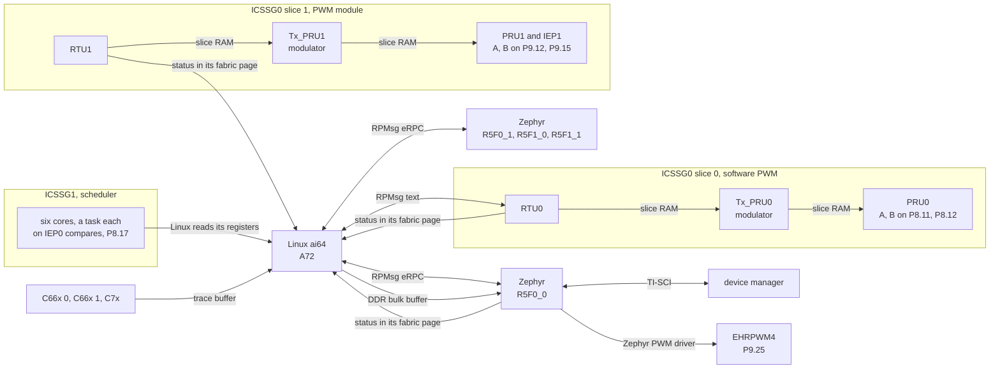
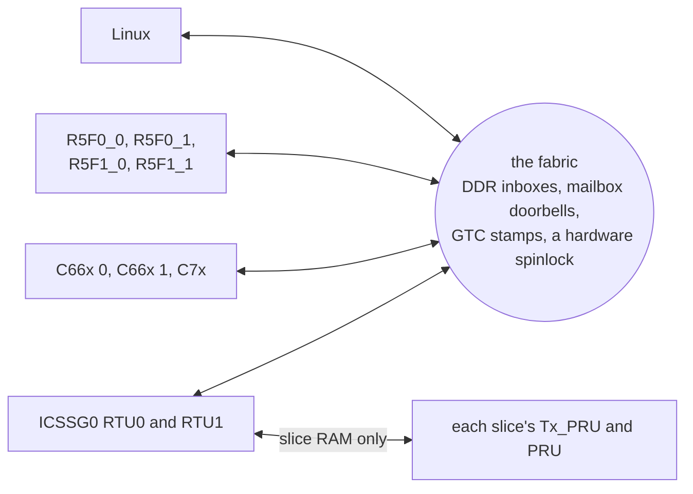

# BeagleBone AI-64: Linux, Zephyr, PRU, RTU, Tx_PRU, and DSPs together

A starting point for BeagleBone AI-64 (TI TDA4VM / J721E) projects that use its heterogeneous cores:

- **Linux** on the Cortex-A72s runs `ai64`, one program that drives the demo.
- **Zephyr** on all four main-domain Cortex-R5F cores answers function calls from Linux (eRPC over RPMsg). R5F0_0 also writes SPI7, and drives a PWM on P9.25 with the SoC's EHRPWM4, through Zephyr's own EHRPWM driver. The driver gets its clock and power from the board's device manager over TI-SCI, which a small polled mailbox driver carries on these cores ([Zephyr and the device manager](#zephyr-and-the-device-manager-ti-sci)).
- **ICSSG0 makes PWM two ways** ([PWM, two ways](#icssg0-pwm-two-ways)): slice 0 in software, its PRU writing its pins at times it polls from IEP0; slice 1 with the ICSSG's own PWM module, on IEP1 compare events. Both make the same complementary pair with dead band. In each slice the RTU talks to the rest of the SoC, the Tx_PRU modulates the duty, and the PRU makes the edges. RTU0 talks to Linux over RPMsg; RTU1 only over shared memory.
- **ICSSG1 runs a port of TI's open-pru [`multicore_scheduler`](https://github.com/TexasInstruments/open-pru/tree/main/examples/multicore_scheduler)** on all six of its cores: IEP0 compares start a task on each core in turn, 4 ns apart, and each task sets a header pin high or low ([The multicore scheduler](#icssg1-the-multicore-scheduler)).
- **The two C66x DSPs and the C7x DSP** log through their remoteproc trace buffers, which Linux follows, and run FIR filter jobs that Linux hands them through shared memory.
- **The fabric** joins these cores, and Linux, directly to each other: R5F to R5F, DSP to DSP, DSP to R5F, any of them to the ICSSG0 slices, and back. Every core pings every other one, R5F0_0 sends a message round all of them, and Linux can send one along any route, so that, say, the C7x passes it to a C66x that has ICSSG0 RTU1 change its PWM. Each message is stamped with the SoC's shared clock, so Linux shows the one-way latency of all 90 paths ([The fabric](#every-core-to-every-other-the-fabric)).

The ICSSG firmware is laid out the way TI's [open-pru](https://github.com/TexasInstruments/open-pru) projects are: `pru/pwm/` and `pru/multicore_scheduler/`, a directory per core with its own makefile and linker script, shared sources and a memory map per project ([The ICSSG firmware](#the-icssg-firmware)). In ICSSG0 **the RTU talks, and the PRU and Tx_PRU keep time**: the RTU is the slice's only link to the rest of the SoC, and the PRU and Tx_PRU only touch their slice's own RAM, so nothing elsewhere on the chip can stretch their timing. ICSSG1 keeps TI's design, where every core runs a task.





Each link is small and easy to copy into your own project. [How it works](#how-it-works) walks through them.

The MCU-domain R5F cores are left alone: they run the board's device manager.

It runs on the BeagleBoard Debian image, plus a one-time install script. A Yocto (Poky) configuration in `yocto/` builds the demo into an image of its own, which has been built and tested on the board. Both images run Linux 6.18, but different kernels: BeagleBoard's on Debian, TI's on Yocto ([Two 6.18 kernels](#two-618-kernels)).

## What you need

- A BeagleBone AI-64, a microSD card (16 GB or more), and a 5 V supply for it.
- A network link to it: Ethernet to your LAN, or the USB-C port, which brings up a USB network adapter on the PC.
- A Linux PC with `git`, `ssh`, `rsync`, `xz`, and either `podman` or `docker`. Every compiler runs in a container, so you don't install any toolchains.
- About 6 GB of free disk on the PC: roughly 3 GB of container images plus 2 GB of fetched sources. The first build takes 10–20 minutes, mostly downloading. Later builds take seconds to a minute.
- Network access from the PC to GitHub, git.ti.com, software-dl.ti.com, and Docker Hub. git.ti.com is only for the PRU Software Support Package.
- Optional: a logic analyzer, to watch SPI7, the three PWM generators, and the multicore scheduler on the header ([Probe the pins](#probe-the-pins)); and a 3.3 V USB-serial adapter on P8.34 (TX) and P8.22 (RX), to read the Zephyr console.

Get the code:

```
git clone https://github.com/kevinacahalan/BeagleBoneAI64-linux-zephyr-pru-c7x-c66x-demo.git
cd BeagleBoneAI64-linux-zephyr-pru-c7x-c66x-demo
```

Every command below runs from this directory unless it says "on the board".

## Quick start: BeagleBoard Debian

### 1. Flash the card and log in

Download [BeagleBone AI-64 Debian 13.7 IoT, v6.18 k3](https://www.beagleboard.org/distros/bbai64-debian-13-7-2026-10-09-iot-v6-18-x-k3), the file `bbai64-debian-13.7-iot-v6.18-k3-arm64-2026-10-09-10gb.img.xz`. A fresh image has no login until you give it one. Pick either way:

- **BeagleBoard Imager** (easiest). Choose the image, and in its settings set a user name, a password, and your SSH public key. Imager writes them for you.
- **By hand.**
  1. Write the image: `xz -dc bbai64-debian-*.img.xz | sudo dd of=/dev/sdX bs=4M conv=fsync status=progress`. Replace `/dev/sdX` with your card. Check it with `lsblk` first: `dd` overwrites whatever you give it.
  2. Mount the card's `BOOT` partition.
  3. Add these lines to the end of `sysconf.txt`, with your own values. The board applies them on first boot and then clears the password from the file.

     ```
     user_name=debian
     user_password=choose-a-password
     user_authorized_key=ssh-ed25519 AAAA... you@pc
     hostname=bbai64
     ```

     The key line is the contents of your `~/.ssh/id_ed25519.pub`. Run `ssh-keygen -t ed25519` if you don't have one. With the key in place, the build steps below don't keep asking for a password.

Put the card in the board and power it. With a card in the slot the board boots from it; the console prints `Trying to boot from MMC1`. If yours boots its eMMC instead, hold the BOOT button while you apply power.

A fresh card reboots twice on its own before it stays up: the first boot applies `sysconf.txt` and grows the root partition, and the second resizes the filesystem. Give it about three minutes. Then log in over the network:

```
ssh debian@bbai64.local
```

Below, `USER@BOARD` means that login, for example `debian@bbai64.local`. You'll also need its password for `sudo` on the board. If `.local` names don't resolve on your PC, use the address your router gave the board. Over the USB-C cable the board is `192.168.7.2`.

The serial console is UART0 on the 3-pin debug header, 115200 8N1 (`ttyS2` on the board), if SSH doesn't come up.

### 2. Build on the PC

```
./beagle-linux/scripts/build.sh
AI64_SSH=USER@BOARD ./beagle-linux/scripts/build.sh kmod
./beagle-linux/scripts/build.sh bundle
```

- **The first command** builds `ai64`, the overlay, the twelve ICSSG images, the four Zephyr R5F images, and the two DSP images.
- **`kmod`** builds the two patched kernel modules for the kernel running on your board. It asks the board for its kernel version over SSH, and the first time it copies that kernel's headers with `rsync`. The board must be up and reachable. [Why two patched modules](#why-debian-needs-two-patched-modules) explains why they're needed.
- **`bundle`** gathers everything into `out/ai64-beagle/`.

### 3. Install on the board and reboot

```
scp -r out/ai64-beagle USER@BOARD:
ssh -t USER@BOARD 'sudo ./ai64-beagle/install-beagle.sh && sudo reboot'
```

It asks for your `sudo` password on the board. `install-beagle.sh` makes the setup survive reboots:
- It installs `ai64`, `ai64-demo`, and the firmware for every core.
- It installs the patched `pru_rproc` and `ti_k3_r5_remoteproc` modules so the kernel loads them at boot.
- It adds the demo overlay to the default boot entry, and takes off the stock P9.25 PWM overlay, which muxes the same pin. The original is saved as `extlinux.conf.ai64-bak`.
- It adds a udev rule so the `dialout` group can use `/dev/rpmsg*`.
- It enables `ai64-icssg.service`, which starts the twelve ICSSG cores at boot.
- It installs `tmux` with apt if the image doesn't have it. The stock IoT image doesn't. This needs the board to reach the internet; over Ethernet it usually can. If it can't, the script says so and carries on.

The R5F images go in as `/lib/firmware/ai64_r5f0_0.elf` and so on, not under the kernel's default names (`j7-main-r5f0_0-fw`). So the R5F cores stay off at boot until `ai64-demo` starts them.

Give the board about 30 seconds to reboot, then log back in.

### 4. Run the demo

On the board:

```
ai64-demo --tmux
```

- It asks for your `sudo` password once.
- It restarts the four R5F cores, the twelve ICSSG cores, and the DSPs with the installed firmware, then opens a tmux session with twelve windows: `linux`, `zephyr` (R5F0_0), `rtu0` (ICSSG0 RTU0), `r5f0_1`, `r5f1_0`, `r5f1_1`, `pwm`, `sched`, `c66x0`, `c66x1`, `c7x`, and `fabric`. Before it stops each R5F and DSP, it asks the core to go idle ([why](#restarting-the-c7x)). The `fabric` window is about 100 columns wide.
- [What you should see](#what-you-should-see) shows the output of a passing run, and [Commands](#commands) lists what you can type in the `linux` window.

tmux keys: switch windows with Ctrl+b then 0–9, or Ctrl+b then n and p for next and previous, or Ctrl+b then w for a list. Detach, leaving the demo running, with Ctrl+b then d. Come back with `ai64-demo --attach --tmux`.

To stop the demo, run `tmux kill-session -t ai64`. Typing `quit` in the `linux` window only ends that window.

Without tmux, plain `ai64-demo` prints all twelve windows on one console instead. There, `quit` or Ctrl+C stops the whole demo.

### After you change the code

- **`ai64` or any core's firmware:** rebuild with `build.sh`, run `build.sh bundle`, copy the bundle, and run `install-beagle.sh` again. No reboot is needed: the next `ai64-demo` restarts every core with the new firmware.
- **The overlay:** the same steps, then reboot. Pin mux only changes at boot.
- **After the board's kernel is upgraded** (for example by `apt upgrade`): run `build.sh kmod` again, then `bundle`, `install-beagle.sh`, and reboot. The patched modules only fit the kernel they were built for.

## What you should see

On startup the linux window runs a short script. It pings RTU0, then sends `say`, `chunk`, `spi`, and `pwm 1000000 250000` (the default: 1 kHz, 25% on P9.25) to Zephyr on R5F0_0, `status` to RTU0, and `say` to each of the other R5F cores. A passing run, one block per window:

```
== linux
Linux sent "ping" to ICSSG0 RTU0
Linux asked Zephyr to say hello from linux
Linux asked Zephyr to say "hello from linux", and it replied "zephyr r5f0_0: hello from linux"
Linux asked Zephyr to check chunk bulk-hello
Linux asked Zephyr to write SPI7 hello
Linux asked Zephyr to write SPI7 "hello", and it replied "zephyr r5f0_0: spi wrote 5 bytes"
Linux asked Zephyr to set P9.25 to 1000000 250000 (period, duty in ns)
Linux asked ICSSG0 RTU0 what its PWM runs
Linux asked Zephyr on R5F0_1 to say hello from linux
Linux asked Zephyr on R5F0_1 to say "hello from linux", and it replied "zephyr r5f0_1: hello from linux"
Linux asked Zephyr on R5F1_0 to say hello from linux
Linux asked Zephyr on R5F1_0 to say "hello from linux", and it replied "zephyr r5f1_0: hello from linux"
Linux asked Zephyr on R5F1_1 to say hello from linux
Linux asked Zephyr on R5F1_1 to say "hello from linux", and it replied "zephyr r5f1_1: hello from linux"
linux window ready. commands: zephyr say|pwm|chunk|spi ... | r5f0_1|r5f1_0|r5f1_1 say ... | rtu0 pwm|dead|sweep|status|<text> | help

== zephyr
Zephyr window ready on /dev/rpmsg1 (eRPC)
Linux asked Zephyr to say "hello from linux", and it replied "zephyr r5f0_0: hello from linux"
Linux asked Zephyr to check the chunk, and it matched seq 1 len 10 crc c959d039
Linux asked Zephyr to write SPI7 "hello", and it replied "zephyr r5f0_0: spi wrote 5 bytes"
Linux asked Zephyr to set P9.25 (EHRPWM4_B) to a 1000000 ns period, 250000 ns high, and it did

== rtu0
rtu0 window ready on /dev/rpmsg5
PRU0's software PWM on P8.11 and P8.12 follows control seq 4: period 50000 ns, duty 12500 ns
sent to rtu0: ping
Linux sent "ping" to ICSSG0 RTU0, and it echoed it
sent to rtu0: status
PRU0's software PWM on P8.11 and P8.12: period 50000 ns, duty 12500 ns, dead 1000 ns, 126812 periods, 0 late edges

== r5f0_1 (r5f1_0 and r5f1_1 are the same, with their own names)
Zephyr on R5F0_1 window ready on /dev/rpmsg3 (eRPC)
Linux asked Zephyr on R5F0_1 to say "hello from linux", and it replied "zephyr r5f0_1: hello from linux"

== pwm (a line per PWM generator every 10 s, from each one's talking core)
pwm window ready, a line per PWM generator every 10 s
software PWM, ICSSG0 slice 0, P8.11 A, P8.12 B: period 50000 ns (20.000 kHz), duty 12500 ns (25.0%), dead 1000 ns, 20000 periods/s, 0 late edges (the latest 24 ns late), request 4
ICSSG PWM, ICSSG0 slice 1, P9.12 A, P9.15 B: period 50000 ns (20.000 kHz), duty 12500 ns (25.0%), dead 1000 ns, 20000 periods/s, 0 late edges, request 2
EHRPWM4, Zephyr on R5F0_0, P9.25: period 1000000 ns (1.000 kHz), duty 250000 ns (25.0%), request 2

== sched (ICSSG1's schedule every 10 s)
sched window ready, ICSSG1's schedule every 10 s
ICSSG1 multicore scheduler: IEP0 period 100 ns, +4 ns a tick (the 250 MHz core clock)
  PRU0     IEP0 CMP7  at     4 ns  sets P8.17 high  task manager on
  PRU1     IEP0 CMP2  at     8 ns  sets P8.17 low   task manager on
  RTU1     IEP0 CMP3  at    12 ns  sets P8.17 high  task manager on
  RTU0     IEP0 CMP4  at    16 ns  sets P8.17 low   task manager on
  Tx_PRU1  IEP0 CMP5  at    20 ns  sets P8.17 low   task manager on
  Tx_PRU0  IEP0 CMP6  at    24 ns  sets P8.17 high  task manager on
  P8.17 (PWM2_0's initial state) read high 79% of 100000 samples, 41664 changes seen

== c66x0 (c66x1 is the same, with DNUM 1)
4d80800000.dsp trace (ai64-c66x.elf), 2048 bytes at 0x4d80806dd8
hello from the c66x, DNUM 0
c66x up 10 s
c66x up 20 s

== c7x
64800000.dsp trace (ai64-c7x.elf), 2048 bytes at 0xa8100000
hello from the c7x, DNUM 1024, MMU on, L1DCFG 4, L2CFG 2
c7x up 10 s
c7x up 20 s
```

The `fabric` window, the latency of every core to every other, is in [The fabric](#every-core-to-every-other-the-fabric). The `/dev/rpmsg` numbers can differ on your board. In the `pwm` window, `request` counts the requests a generator took since it started: `ai64-demo` restarts RTU0 after the R5F cores, so RTU0's count includes the startup script's. `sched` reads P8.17's state over the bus, far slower than the tasks change it, so its share is a rough one; [The multicore scheduler](#icssg1-the-multicore-scheduler) has what a logic analyzer shows.

The other three R5F cores have no console UART. Each logs into its remoteproc trace buffer instead:

```
$ sudo cat /sys/kernel/debug/remoteproc/remoteproc5/trace0
*** Booting Zephyr OS build a915b2f12675 ***
I: eRPC server waiting on rpmsg
I: tisci: mailbox interrupt routed, router 213 input 433 -> output 228
I: ai64 r5f0_1 hello
I: fabric node 2 up, start 20
I: rpmsg channel rpmsg-raw addr 1024 is up
I: erpc say: zephyr r5f0_1: hello from linux
```

R5F0_0 logs the same lines on its console on P8.34, plus `pwm: Zephyr set P9.25 (EHRPWM4_B) to period 1000000 ns, duty 250000 ns` at boot, and again for each request.

The ICSSG cores write their logs the same way, one or two lines each:

```
$ ai64 trace b006000.rtu
ICSSG0 RTU1 up
ICSSG0 RTU1 is fabric node 9
PRU1's ICSSG PWM on P9.12 and P9.15 follows control seq 2: period 50000 ns, duty 12500 ns
$ ai64 trace b038000.pru
ICSSG0 PRU1 up: ICSSG PWM2_0 on IEP1, A on P9.12, B on P9.15
first period: 50000 ns, duty 12500 ns
$ ai64 trace b104000.rtu
ICSSG1 RTU0 up: its task, on IEP0 CMP4, sets P8.17 low
```

`N` in `remoteprocN` is the core's number in `/sys/class/remoteproc`; `cat /sys/class/remoteproc/remoteprocN/name` shows which core it is ([The ICSSG firmware](#the-icssg-firmware) lists the twelve ICSSG cores' names).

### Commands

Type these in the linux window:

| Command | What happens |
| --- | --- |
| `zephyr say <text>` | Zephyr on R5F0_0 replies `zephyr r5f0_0: <text>` (eRPC) |
| `zephyr pwm <period_ns> <duty_ns>` | Zephyr sets EHRPWM4_B on P9.25: the period, and how long it is high in each |
| `zephyr spi [text]` | Zephyr writes `text`, or `hello`, on SPI7 (header P9) |
| `zephyr chunk <text>` | Linux writes the DDR bulk buffer, and Zephyr checks its CRC |
| `r5f0_1 say <text>` | Zephyr on R5F0_1 replies `zephyr r5f0_1: <text>`. Same for `r5f1_0` and `r5f1_1`. Those three cores have no PWM, bulk buffer, or SPI, so `pwm`, `chunk`, and `spi` fail there. |
| `rtu0 pwm <period_ns> <duty_ns>` | RTU0 sets ICSSG0 slice 0's software PWM on P8.11 (A) and P8.12 (B), and says when PRU0 follows |
| `rtu0 dead <ns>` | the dead band on each side of B |
| `rtu0 sweep <ms>` | the Tx_PRU sweeps the duty from its minimum to its maximum and back every `ms`; `sweep 0` stops it |
| `rtu0 status` | what PRU0 runs, how many periods, and how many late edges |
| `rtu0 <text>` | RTU0 echoes the text |
| `help`, `quit` | List the commands, or leave |

Periods run from 2000 ns to 1 s. On the ICSSG0 slices, every edge stays at least 400 ns from the next on the same pin, so the duty runs from 400 ns to the period less 440 ns and twice the dead band; RTU0 clamps what it is asked for, and says what it wrote. Slice 1 has no RPMsg: `sudo ai64 fabric route g0rtu1 pwm <period_ns> <duty_ns>` (or `dead`, or `sweep`) reaches it through the fabric instead, and so can any core on the route.

`ai64-demo` without `--tmux` prints all twelve windows on one console instead, with each line prefixed `[Linux]`, `[R5F0_0]`, `[R5F0_1]`, `[R5F1_0]`, `[R5F1_1]`, `[RTU0]`, `[PWM]`, `[Sched]`, `[C66x0]`, `[C66x1]`, `[C7x]`, or `[Fabric]`. Either way it restarts the cores with their firmware first. `--attach` connects to the running cores without restarting them.

`ai64` has a few more subcommands for checking a board: `sudo ai64 pads` checks the pin mux of every demo pin, `ai64 trace <remoteproc-name>` follows any core's trace log (`ai64 trace 5d00000.r5f`, `ai64 trace b034000.pru`, and so on), `sudo ai64 pwm once` and `sudo ai64 sched once` print one sample of the `pwm` and `sched` windows, `ai64 bench <rpmsg-dev>` times eRPC calls to one R5F core, `sudo ai64 dsp <remoteproc-name>` offloads FIR jobs to a DSP ([how](#linux-to-the-dsps-fir-jobs)), `sudo ai64 shutdown <remoteproc-name>` asks a core to go idle before Linux stops it, and `sudo ai64 fabric route <node>... [pwm <period_ns> <duty_ns> | dead <ns> | sweep <ms>]` sends a message along any cores you name and prints each hop's time ([routes](#every-core-to-every-other-the-fabric)).

## Probe the pins

All signals are 3.3 V. On a Saleae Logic, choose the 1.8 V threshold setting for 3.3 V logic.

| Signal | Header pins | What you see |
| --- | --- | --- |
| Zephyr SPI7 | P9.28 CS, P9.31 CLK, P9.30 MOSI | `hello` at 1 MHz, mode 0, MSB first |
| Zephyr EHRPWM4_B | P9.25 | 1 kHz, 25%, until Linux or a fabric route asks for another |
| Software PWM, ICSSG0 slice 0 | P8.11 A, P8.12 B | 20 kHz; A high 12.5 µs; B its complement, with 1 µs of dead band on each side |
| ICSSG PWM, ICSSG0 slice 1 | P9.12 A, P9.15 B | the same waveform |
| Multicore scheduler, ICSSG1 | P8.17 | low from 8 to 12 ns and from 16 to 24 ns of every 100 ns |
| Zephyr console | P8.34 TX, P8.22 RX | 115200 8N1 |

On the bench, with a Saleae Logic Pro at 100 MS/s (10 ns steps), P9.25 measured a 1,000,051.8 ns period and 250,008.3 ns high, every edge within one 10 ns sample of the next, and 2 kHz after a fabric route asked for it (125,003.9 ns high). P8.11 measured a 50,001.8 ns period, and 5,000.1 ns high after `rtu0 pwm 50000 5000`; its edges move by up to ±30 ns, the polling of the software slice.

| Pins | A high | B high | A falls to B rises | B falls to A rises | Edges |
| --- | --- | --- | --- | --- | --- |
| P8.11, P8.12 (software) | 12,500.2 ns | 35,460.4 ns | 1,000.5 ns | 1,040.6 ns | within ±30 ns |
| P9.12, P9.15 (PWM module) | 12,500.3 ns | 35,461.0 ns | 1,000.3 ns | 1,040.2 ns | within one 10 ns sample |

Both pairs ran a 50,001.8 ns period on the analyzer's clock: the SoC's and the analyzer's oscillators differ by 36 ppm. The dead band before A is 40 ns longer than after it, since a period starts 40 ns in. P8.17, captured alone at 500 MS/s, repeats every 100 ns (±2 ns, one sample) in 99% of periods, as low 4 ns, high 4 ns, low 4 to 8 ns, and high 84 to 88 ns: the steps of PRU1, RTU1, RTU0 and Tx_PRU1, then Tx_PRU0's high until PRU1's next low. A task starts within a core clock (4 ns) of its compare, so steps measure 4 to 6 ns; at 2 ns a sample the analyzer only just resolves them.

`PINMUX.md` lists every pin the demo muxes, plus the shorted partner balls it holds off.

## How it works

### Linux to Zephyr: eRPC over RPMsg

- The R5F image opens the RPMsg channel `rpmsg-raw` at address 1024, which Linux sees as `/dev/rpmsgN`.
- `zephyr/erpc/ai64.erpc` defines the functions Linux can call on Zephyr: `say`, `spiWrite`, `setPwm`, and `takeChunk`. The generated client and server code is in `zephyr/erpc/shim/`; `zephyr/erpc/regen.sh` regenerates it after you change the IDL.
- Both sides run eRPC's framed transport straight over the RPMsg file descriptor (`linux-app/ai64_erpc_linux.cpp` and `zephyr/r5/src/ai64_erpc.cpp`).

The board files are upstream Zephyr's `beaglebone_ai64/j721e/main_r5f0_0` (and `main_r5f0_1`, `main_r5f1_0`, `main_r5f1_1`), at the Zephyr `main` commit pinned in `zephyr/west.yml`. One app, `zephyr/r5`, builds once per core. `zephyr/r5/boards/` adds what each core needs on top: every core's overlay adds its TI-SCI nodes; R5F0_0's also adds SPI7, the bulk buffer, and EHRPWM4; the other three cores' `.conf` files send the log to a RAM console that Linux reads as a trace. `zephyr/patches/` holds one fix to Zephyr itself, which `zephyr/scripts/apply-patches.sh` applies after each `west update` ([EHRPWM4](#zephyr-ehrpwm4-on-p925)).

In split mode a cluster's core 1 cannot power up before its core 0, and core 0 cannot power down before core 1. `ai64-demo` starts R5F0_0, R5F1_0, R5F0_1, R5F1_1 in that order and stops them in reverse.

### Zephyr and the device manager: TI-SCI

The board's device manager, TI's firmware on the MCU R5F, owns the SoC's clocks, power domains, and interrupt routers; every other core asks it over TI-SCI. Zephyr has a TI-SCI driver (`drivers/firmware/tisci`), and on top of it a clock-control driver and a power-domain driver, but it talks to the device manager through a secure-proxy mailbox driver that needs a receive interrupt for each thread and handles threads 0 to 31. On J721E no main secure-proxy interrupt is routed to a main-domain R5F, and these cores' threads are numbered past 31.

`zephyr/r5/src/ai64_sproxy.c` is a mailbox driver for the same secure proxy (`ai64,secure-proxy-poll`, in `zephyr/r5/dts/bindings/`) with no interrupt. A send writes the message to the core's transmit thread, then waits for the answer on its receive thread and hands it to the TI-SCI driver's callback before it returns, which is when the TI-SCI driver starts to wait for it. It waits a fixed number of polls rather than a time, so it also works before the system timer runs. Each core's overlay names its threads and TI-SCI host:

| Core | TI-SCI host | Transmit thread | Receive thread |
| --- | --- | --- | --- |
| R5F0_0 | 35 | 63 | 61 |
| R5F0_1 | 37 | 73 | 71 |
| R5F1_0 | 40 | 83 | 81 |
| R5F1_1 | 42 | 93 | 91 |

With that, Zephyr's own TI-SCI drivers work on these cores unchanged. Two things use them: every core's mailbox interrupt route, below, and R5F0_0's EHRPWM4.

### Linux to Zephyr: the mailbox interrupt

RPMsg rings sit in shared DDR. Each side tells the other "look at the rings" through a TI mailbox FIFO; each R5F core has its own pair of FIFOs. Zephyr's kick to Linux works as is. Linux's kick to Zephyr arrives in the FIFO, but on J721E the mailbox interrupt only reaches the R5F once the device manager routes it through the NAVSS interrupt router, and the upstream board does not ask for that.

So each R5F core asks at boot (`zephyr/r5/src/ai64_tisci.c`), with `tisci_cmd_rm_irq_set()`. The request names the router as both source and destination, with a router input and an output from the core's own range, the way Linux's `ti,sci-intr` and Zephyr PR [#121379](https://github.com/zephyrproject-rtos/zephyr/pull/121379) program it. First it releases the route a previous run left; the device manager refuses that when there was none. Each core's numbers are in its board overlay:

| Core | Mailbox user | Router 213 input | Router output | VIM input |
| --- | --- | --- | --- | --- |
| R5F0_0 | `NAVSS0_MAILBOX_1` user 2 | 434 | 196 | 228 |
| R5F0_1 | `NAVSS0_MAILBOX_1` user 1 | 433 | 228 | 228 |
| R5F1_0 | `NAVSS0_MAILBOX_2` user 1 | 429 | 260 | 228 |
| R5F1_1 | `NAVSS0_MAILBOX_2` user 2 | 430 | 292 | 228 |

The overlays also move the board's mailbox interrupt from VIM 256 to 228. If the request fails, the core logs it and its RPMsg thread polls the FIFO once a millisecond instead (`mbox_rx_drain()` in `zephyr/r5/src/main.c`).

### Zephyr: EHRPWM4 on P9.25

P9.25's ball W26 can be `EHRPWM4_B`, output B of the SoC's EHRPWM4. Zephyr's `ti,am3352-ehrpwm` driver drives it on R5F0_0, and `zephyr/r5/src/ai64_pwm.c` sets it through the PWM API (`pwm_set_dt()` on the `pwms` of `/zephyr,user`): 1 kHz and 25% at boot, then whatever `setPwm` over eRPC or a fabric route's `pwm` action asks for. R5F0_0's overlay describes the rest:

- **Its clock**, through TI-SCI clock control: device 87, clock 0, the same as the Linux device tree's `main_ehrpwm4`.
- **Its power**, through a TI-SCI power domain for device 87, which turns the module on at boot (`CONFIG_POWER_DOMAIN`).
- **Its time-base clock gate**, bit 0 of `CTRLMMR_EPWM4_CTRL` at `0x00104150` (Linux's `ehrpwm_tbclk` 4), through a `ti,control-module` syscon. Zephyr's SoC code unlocks its CTRL_MMR partition at boot.
- **The pins**: W26 in mode 6, and AC4, shorted to it on the header, held off.

The stock Debian image gives EHRPWM4 and W26 to Linux with `k3-j721e-beagleboneai64-pwm-epwm4-p9_25.dtbo`; `install-beagle.sh` takes that overlay off, so that only Zephyr uses them.

The driver had one bug on this board: it handed `clock_control_get_rate()` its `uint64_t` rate as a `uint32_t *`, which leaves the upper half unset, and `pwm_set()` then saw a clock rate in the billions and failed with `-ENOTSUP`. `zephyr/patches/0001-drivers-pwm-ti_am3352_ehrpwm-set-all-64-bits-of-the-rate.patch` fixes it.

Every 10 ms R5F0_0's fabric thread publishes the PWM's `struct ai64_pwm_status` (`zephyr/include/ai64_shm.h`) in its fabric page, as the ICSSG0 RTUs do for their slices, and the `pwm` window shows all three. A fabric route's `pwm` action takes about 120 µs on R5F0_0, because `pwm_set()` asks the device manager for the clock rate each time.

### R5F caches

The J721E SoC code maps all of DDR as non-cacheable for the R5F, and leaves both caches off unless `CONFIG_CACHE_MANAGEMENT` is set. The image runs from DDR, so every instruction fetch went to DDR, and an eRPC call took about 1.3 ms.

`zephyr/r5/src/ai64_mpu.c` adds MPU regions at the first init level, before the caches come on: device memory for the peripherals in the low 2 GiB, the TCMs, and the core's 16 MiB carveout as write-through, so that every write still reaches DDR. The vrings, the resource table, and the bulk buffer stay non-cacheable. `prj.conf` turns on `CONFIG_CACHE_MANAGEMENT`.

`ai64 bench <rpmsg-dev> [count]` times eRPC calls. On the bench, an eRPC `say` round trip went from 1263 µs to 85 µs on R5F0_1, R5F1_0, and R5F1_1, and to 160 µs on R5F0_0, which also logs each call on its UART. For comparison, an RPMsg echo from RTU0, which busy-polls, takes 35 µs.

### Linux to Zephyr: the bulk buffer

`zephyr chunk` passes data too large for an RPC argument:
1. Linux writes the bytes into a 64 KiB DDR buffer at `0xA2FEF000` through `/dev/mem`.
2. Linux calls `takeChunk(seq, length, crc)`.
3. Zephyr checks the CRC.

The buffer sits inside the memory Linux already reserves for R5F0_0 (`0xA2000000`-`0xA2FFFFFF`). `zephyr/r5/boards/beaglebone_ai64_j721e_main_r5f0_0.overlay` shrinks the board's DRAM region so that no part of the Zephyr image lands there. The layout is in `zephyr/include/ai64_shm.h`, which Linux, Zephyr, and the ICSSG cores include.

### Linux to RTU0: RPMsg text

- ICSSG0 RTU0 announces RPMsg channel `rpmsg-raw` on port 30.
- Linux writes plain text: `pwm <period_ns> <duty_ns>`, `dead <ns>`, `sweep <ms>`, or `status`.
- RTU0 replies with one sentence that names who asked and what it did.
- RTU0 learns Linux's address from the first message it receives, so Linux sends `ping` first. RTU0 can't report anything that a fabric route asks it to do until Linux has sent that first message.
- The code is `pru/common/ai64_rtu_rpmsg.h` and the resource table in `pru/common/ai64_rsc_rpmsg.h`.

### The ICSSG firmware

The J721E has two ICSSGs with two slices each, and every slice has a PRU, an RTU, and a Tx_PRU: twelve cores. The firmware is two projects, laid out the way TI's [open-pru](https://github.com/TexasInstruments/open-pru) projects are:

```
pru/
  Makefile             builds both projects
  pru_rules.mak        the rules every core's makefile includes
  common/              headers both projects use: trace, RPMsg, text, ICSSG registers
  pwm/                 ICSSG0
    README.md
    firmware/          pwm_map.h, pwm_ipc.h, and the RTU and Tx_PRU sources
      beaglebone-ai64/icss_g0_<core>_fw/
        main.c         a PRU's own source
        ti-pru-cgt/    makefile, linker.cmd
  multicore_scheduler/ ICSSG1, the same way
```

Each core's makefile names its image, its sources, and its defines, and includes `pru_rules.mak`, as open-pru's do. Each core's `linker.cmd` includes its project's memory map, so the C code and the linker share one set of addresses. After each link the build prints how full each image's RAM is, and fails a region past 95%. Every core builds as PRU silicon version 4, the ICSSG.

| Core | remoteproc | Image | Project, and what it runs |
| --- | --- | --- | --- |
| ICSSG0 RTU0 | `b004000.rtu` | `ai64-icssg0-rtu0.elf` | pwm, slice 0: talks, over RPMsg and the fabric (node 8, `g0rtu0`) |
| ICSSG0 Tx_PRU0 | `b00a000.txpru` | `ai64-icssg0-txpru0.elf` | pwm, slice 0: the modulator |
| ICSSG0 PRU0 | `b034000.pru` | `ai64-icssg0-pru0.elf` | pwm, slice 0: PWM in software |
| ICSSG0 RTU1 | `b006000.rtu` | `ai64-icssg0-rtu1.elf` | pwm, slice 1: talks, over the fabric (node 9, `g0rtu1`) |
| ICSSG0 Tx_PRU1 | `b00c000.txpru` | `ai64-icssg0-txpru1.elf` | pwm, slice 1: the modulator |
| ICSSG0 PRU1 | `b038000.pru` | `ai64-icssg0-pru1.elf` | pwm, slice 1: the ICSSG PWM module |
| ICSSG1, all six | `b134000.pru`, `b138000.pru`, `b104000.rtu`, `b106000.rtu`, `b10a000.txpru`, `b10c000.txpru` | `ai64-icssg1-<core><slice>.elf` | multicore_scheduler |

In ICSSG0, **the RTU talks, and the PRU and Tx_PRU keep time**:

- **The RTU does everything slow or unpredictable.** It reads and writes DDR, rings mailboxes, takes the hardware spinlock, runs RPMsg, and reads the GTC. How long any of that takes depends on what the rest of the chip is doing.
- **The PRU and Tx_PRU only touch their slice's own data RAM** and their ICSSG's own peripherals, at a fixed few cycles an access. They talk to their RTU through records there, each written by one core and read by the others, and never wait on it. So nothing outside the ICSSG can stretch an edge.
- **The trace log is the exception.** Every core keeps a remoteproc trace buffer in its own data RAM, which Linux reads (`ai64 trace <remoteproc-name>`); writing a line is a few local stores. `TRACE=0 ./beagle-linux/scripts/build.sh pru` builds the trace calls out of the PRUs and Tx_PRUs. The RTUs always keep theirs.
- **One RTU talks over RPMsg and one over shared memory only**, so the template has a working example of each. RPMsg needs a vring interrupt in the overlay and a few KiB of data RAM. Both RTUs are fabric nodes, and both publish what they know in their fabric page.

ICSSG1 keeps TI's design instead: every core runs a task, and nothing on it talks. `ai64 sched` reads its registers, and only reads them.

### ICSSG0: PWM, two ways

Both slices make the same waveform, from the same request, with the same modulator. Only the PRU differs. [`pru/pwm/README.md`](pru/pwm/README.md) has the details: the memory map, the four IPC records, and how each core uses them.

| | Slice 0: in software | Slice 1: the ICSSG PWM module |
| --- | --- | --- |
| Pins | A on P8.11, B on P8.12, R30 bits 17 and 16 | A on P9.12 (`PRG0_PWM2_A0`), B on P9.15 (`PRG0_PWM2_B0`) |
| What makes an edge | PRU0 writes R30 when IEP0, polled, reaches the edge's time | IEP1 CMP1 toggles A, CMP2 toggles B; CMP0 ends the period |
| What the PRU does | waits for every edge | after each compare, rearms it for that pin's next edge |
| Timing | within a few tens of nanoseconds; PRU0 counts the edges it was more than 100 ns late for | exact, on the 250 MHz IEP clock |

The waveform is A high for `D` from 40 ns into a period of `P`, and B high from `D + d` after that until `d` before the period ends: B is A's complement with dead band `d` on each side. Both start at 20 kHz, 25%, and 1 µs. The Tx_PRU of each slice passes the requested duty through, or sweeps it up and down every `sweep_ms`.

Two things about the J721E's PWM module took finding out on the board. An IEP compare only fires again once software clears its status bit (AM64x's ICSSG has `PWM_EFC_EN` to do that, and J721E's does not), and in the active state an output only toggles: its active level does nothing, and CMP0 does not bring it back. So each pin has one compare, which PRU1 moves between that pin's rise and its fall as soon as it fires; TI's AM65x PWM firmware works the same way. And the set's trip inputs must be masked: unmasked and unconnected, they keep the set in its trip state, and its pins at Z.

`ai64 pwm` shows both slices running 20,000 periods a second at the defaults, and 50,000 after `fabric route ... g0rtu1 pwm 20000 5000`. With both RTUs and the whole fabric running, the software slice's latest edge was 24 ns late, and neither slice counted a late edge in 25 restarts of the demo.

### ICSSG1: the multicore scheduler

[`pru/multicore_scheduler/`](pru/multicore_scheduler/README.md) is TI's open-pru example `multicore_scheduler`, ported from ICSSG0 of the AM243x LaunchPad to ICSSG1 here. IEP0's CMP0 resets the counter every 100 ns, and on each 4 ns step after it one more compare fires and starts one core's task through that core's task manager: PRU0, PRU1, RTU1, RTU0, Tx_PRU1, Tx_PRU0. Each task sets PWM set 2's initial state high or low; PWM2 runs on IEP1, which nothing starts, so P8.17 (`PRG1_PWM2_A0`) follows it.

The port keeps TI's files, names, and timing. What J721E needed: no clock or pin setup in PRU0, since Linux has done both; and, with no `PWM_EFC_EN`, the compare flags cleared in software. Each task clears its own, each core clears its own once its task manager is on, and PRU0 maps every task's event before it starts IEP0, and clears all six flags once more two periods later. Without those, a compare that fires before its core's task manager sees it leaves a flag nothing clears, and that core's task never runs again. `MCS_STEP_NS` and `MCS_PERIOD_NS`, on the make command line, change the schedule.

`ai64 sched` reads PWM2_0's state over the bus, much slower than the tasks change it, and finds P8.17 high about 79% of the time, against 88% for the schedule. A Saleae Logic Pro at 500 MS/s sees the schedule itself: a 100 ns period, three 4 to 8 ns steps after PRU1's, and high the rest of the time ([Probe the pins](#probe-the-pins)). With `MCS_STEP_NS=1000 MCS_PERIOD_NS=10000`, any analyzer does.

### Every core to every other: the fabric

Every link above goes through Linux, or joins two cores that sit next to each other. The fabric joins every demo core that talks directly to every other one, Linux included: ten nodes, 90 one-way paths, and no Linux in any of them. One header, `zephyr/include/ai64_fabric.h`, holds the layout and the whole protocol, and every image compiles it: Zephyr with GCC, the DSPs with TI's C6000 and C7000 compilers, the RTUs with clpru, and `ai64` with the Linux compiler. Each image only adds a few lines of glue: how to read the clock, and how it maps the memory.

| Node | Name | Core | When it looks at its inbox |
| --- | --- | --- | --- |
| 0 | `linux` | A72, while `ai64 fabric` runs | every 20 µs or so, between sleeps |
| 1–4 | `r5f0_0`, `r5f0_1`, `r5f1_0`, `r5f1_1` | Zephyr (`zephyr/r5/src/ai64_fabric.c`) | in a thread at the lowest priority, which yields after each pass |
| 5, 6 | `c66x0`, `c66x1` | C66x | every pass of its main loop |
| 7 | `c7x` | C7x | every pass of its main loop |
| 8 | `g0rtu0` | ICSSG0 RTU0 (`pru/pwm/firmware/pwm_rtu.c`) | every pass of its main loop, next to its RPMsg check |
| 9 | `g0rtu1` | ICSSG0 RTU1 (the same source) | every pass of its main loop |

The ICSSG0 PRUs and Tx_PRUs are not nodes: each slice's RTU talks for them ([The ICSSG firmware](#the-icssg-firmware)). Nor is ICSSG1, whose six cores all run scheduler tasks. The layout has room for twelve nodes (`AI64_FAB_SLOTS`), so two more can join without moving anything.

**What carries it.** Four pieces of SoC hardware that every one of those cores can reach:

- **DDR**, 128 KiB at `0xA9000000`, in the gap between the C7x's carveout and the IPC region above it. The overlay reserves 1 MiB there (`ai64-fabric@a9000000`, no-map) so that Linux keeps out, and `ai64-demo` refuses to start the cores on a kernel that booted without it. Each node owns an 8 KiB page: its inbox, and the counts it publishes for Linux to read. A spinlock tally follows the pages.
- **Mailbox cluster 11** (`0x31F8B000`) for doorbells. Linux's device tree leaves clusters 5–11 disabled; 5, 6, 8, and 9 hold messages from the device manager's firmware, and 11 is empty. FIFO n is node n's doorbell.
- **The GTC** (`0x00A90000`), the 200 MHz counter Linux's arch timer counts too. Every core reads the same clock, so a latency measured from one core's stamp to another's is real, one way.
- **Hardware spinlock 255** (`0x30E00000`), which no kernel driver uses, for the tally.

**Read your own page, write to the others.** An uncached read costs 0.1 to 0.5 µs, and a write is posted and costs almost nothing. So a node only ever reads its own page. A message goes into the receiver's page, and the stamps a tour collects go straight into its origin's page. The sender then writes its own node number into the receiver's mailbox FIFO, and the receiver, which polls only its FIFO's status register, reads its page when something has arrived. A FIFO holds four doorbells; a sender that finds it full skips the doorbell, and every node also scans its whole inbox once a millisecond.

**A message.** Each inbox has one 64-byte slot for every sender and message class, and only that sender writes it. The sender writes the message, then bumps its count for that class in a word of the receiver's page that only it writes, then rings. The receiver remembers the counts it last saw, so a changed count is a new message, and nothing is ever cleared. Every class allows one message in flight per sender and receiver, so a slot is never overwritten before it is read, and no core ever waits on another:

| Class | Sent by | What it does |
| --- | --- | --- |
| ping | every node, to every other, every 10 ms | carries the sender's GTC stamp and a value. The receiver stamps when it has read it, mixes its node number into the value, and sends it back. |
| pong | the receiver of a ping | the sender checks the value and times the round trip. The receiver's stamp minus the sender's is the one-way latency. A ping with no pong in 50 ms is a timeout, and that peer counts as down until a later ping comes back. |
| tour | R5F0_0, every 10 ms | goes round every node whose pings R5F0_0 sees answered, Linux included while its viewer runs, in an order that keeps changing the kind of core: c66x0, g0rtu0, r5f1_0, c7x, r5f0_1, c66x1, g0rtu1, r5f1_1, linux, and home. Each hop stamps it and mixes its number into the value, and R5F0_0 checks the value when the tour comes back. |
| route | `ai64 fabric route`, from Linux | the same as a tour, along the nodes you name and back to Linux. It can carry an action for the first PWM generator on the way: `pwm <period_ns> <duty_ns>` for ICSSG0 RTU0 or RTU1, or R5F0_0's EHRPWM4, or `dead <ns>` or `sweep <ms>` for either RTU. Its count lives in a word of its own, so routes work while the viewer, also node 0, runs. |

A node that starts takes the counts it finds as already seen, and zeroes its own counters. A message sent to a stopped node is simply lost, and its sender times out, so `ai64-demo` can restart any core while the others keep going.

**The spinlock tally.** Every 10 ms each node takes hardware spinlock 255, adds one to a shared total and one to its own count, and frees the lock. The adds are plain loads and stores to uncached DDR, so without the lock two cores would lose each other's adds. The viewer takes the lock too, and checks that the ten counts sum to the total.

**Each core's view of the memory.**

| Core | The fabric | The GTC, mailbox, and spinlock |
| --- | --- | --- |
| R5F | MPU region 7, normal non-cacheable (`ai64_mpu.c`) | in the low 2 GiB the MPU maps as device memory |
| C66x | MAR register for `0xA9xxxxxx` cleared, which turns off the XMC prefetch it resets with | the mailbox and spinlock directly. The GTC, below `0x0C000000`, is the C66x's own internal space, so MPAX segment 2 maps a logical page at `0x7FFFF000` onto it (`c66x/main.c`). |
| C7x | 32 level-3 MMU pages, normal non-cacheable (`ai64_c7x_mmu.c`) | the device-memory GiB at `0` |
| RTU | its global address; a message moves in one or two `LBBO`/`SBBO` bursts | the same |
| Linux | `/dev/mem` | `/dev/mem` |

**What you see.** The `fabric` window, `ai64 fabric`, redraws once a second. On the Yocto image, with every core running:

```
fabric: one-way latency in us, from the row's node to the column's, over the last 1.0 s
         linux r5f0_0 r5f0_1 r5f1_0 r5f1_1  c66x0  c66x1    c7x g0rtu0 g0rtu1
linux        .    4.2    4.5    3.9    4.4    5.2    3.6    2.6    3.5    3.3
r5f0_0    45.4      .    4.5    4.6    4.8    5.8    4.0    3.2    3.7    3.8
r5f0_1    40.7    5.1      .    5.0    5.4    5.8    4.3    3.3    4.0    3.9
r5f1_0    46.1    5.1    5.2      .    5.3    5.9    4.4    3.2    4.0    4.3
r5f1_1    45.6    5.4    5.2    5.2      .    5.9    4.5    3.4    4.1    4.1
c66x0     46.7    4.2    4.4    4.5    4.3      .    3.6    2.6    3.1    3.3
c66x1     41.3    4.2    3.8    4.0    4.3    5.5      .    2.5    3.3    3.1
c7x       36.7    4.3    3.7    3.7    4.1    5.2    3.0      .    2.9    2.8
g0rtu0    39.1    4.3    4.1    4.3    4.5    5.3    3.9    2.7      .    3.4
g0rtu1    38.2    4.3    4.3    4.4    4.5    5.5    3.8    2.8    3.3      .

node    starts   polls/s  pongs/s    rtt us  rtt min to max us timeouts errors  passed/s
linux       32     13238      900      76.8     58.4 to  192.9        0      0       100
r5f0_0      20    338874      900      14.7      5.2 to   82.6        0      0         0
r5f0_1      20    393392      900      12.7      5.0 to   84.7        0      0       100
r5f1_0      20    392984      900      13.5      5.0 to   83.2        0      0       100
r5f1_1      20    392637      900      13.6      5.1 to   82.7        0      0       100
c66x0       17   1155155      900      13.7      4.9 to   83.3        0      0       100
c66x1       17   1176422      900      11.5      4.4 to   80.7        0      0       100
c7x         17   1041957      900      10.1      4.3 to   78.3        0      0       100
g0rtu0      19    587503      900      11.3      4.6 to   83.2        0      0       100
g0rtu1      19    588491      900      11.3      4.3 to   80.0        0      0       100

tour from r5f0_0 round every node that answers its pings: 100 laps/s, 103.2 us a lap (64.0 to 138.4), errors 0, timeouts 5
  r5f0_0 >16.4> c66x0 >4.3> g0rtu0 >5.3> r5f1_0 >4.3> c7x >5.6> r5f0_1 >9.9> c66x1 >3.8> g0rtu1 >6.9> r5f1_1 >32.7> linux >4.3> r5f0_0

tally under hardware spinlock 255: 25908 adds, and the 10 counts sum to 25908
```

- **The matrix.** Between any two of the R5Fs, DSPs, and RTUs a message takes 2.5 to 6 µs, reading it included. The C7x, whose main loop is shortest, is the quickest to notice one. Linux sleeps between looks, so a message to it takes about 35 to 50 µs.
- **The nodes.** `starts` counts each node's starts since the board booted. `rtt us` is the mean round trip to all of the node's peers, which Linux pulls up; the minimum and maximum are the fastest and slowest single round trips in the last second. `passed/s` is tour hops, one per node per lap.
- **The tour.** Each `>µs>` is one hop, from the last node reading the message to the next reading it. R5F0_0 started before the DSPs and the ICSSG cores in that `ai64-demo` run, so its first tours ran into cores that were restarting: those are the 5 timeouts.
- **The tally.** Every add from all ten nodes is in the total, so the lock held.

The merged console prints one `[Fabric]` line every 10 s instead (`ai64 fabric lines`).

**A route with an action.** On the board, while the demo runs:

```
$ sudo ai64 fabric route c7x r5f1_1 g0rtu1 c66x1 pwm 20000 5000
linux  -> c7x         7.7 us
c7x    -> r5f1_1      5.8 us
r5f1_1 -> g0rtu1      5.9 us   g0rtu1 set its PWM
g0rtu1 -> c66x1      32.8 us
c66x1  -> linux       2.2 us
5 hops, 54.4 us, value ok
```

ICSSG0 slice 1's PWM, on P9.12 and P9.15, then runs at 50 kHz, 25%, and RTU1 logs when PRU1 follows (`ai64 trace b006000.rtu`). The hop after an action is slower because the RTU builds and logs a line of text first. The first PWM generator on the route takes the action, so a route through R5F0_0 sets P9.25:

```
$ sudo ai64 fabric route c66x0 r5f0_0 g0rtu0 pwm 500000 125000
linux  -> c66x0      14.8 us
c66x0  -> r5f0_0      5.2 us   r5f0_0 set its PWM
r5f0_0 -> g0rtu0    124.3 us
g0rtu0 -> linux      24.1 us
4 hops, 168.4 us, value ok
```

P9.25 then runs at 2 kHz, 25%; Zephyr's `pwm_set()` asks the device manager for the clock rate over TI-SCI, which is most of the 124 µs. Any order of nodes works, a node can appear more than once, and a route without an action just goes round. `sudo ai64 fabric reset` frees the spinlock and zeroes the tally, for a core that was stopped while it held the lock; `ai64-demo` runs it before it starts the cores.

**Restarts.** `ai64-demo` ran 10 times in a row on the Debian image and 15 times on the Yocto image, then 5 more on a freshly built Yocto image, stopping and starting all 19 demo cores each time while the others kept talking. Every run came back with all ten nodes up, RTU0 answering over RPMsg, both ICSSG0 PWM slices at 20,000 periods a second with no late edges, all six ICSSG1 tasks firing, no fabric timeouts or errors in the 10 s after, the tally agreeing, and no kernel errors. Routes with `pwm` actions changed the ICSSG PWM and P9.25 the same way on both.

**What it costs.** Every node except Linux now spins on its inbox, so no core sits in WFI any more. The ICSSG0 RTUs' polling does not show in their slices' edges: with both RTUs and the whole fabric running, the software slice's latest edge was 24 ns late. And a core that is always on the bus must not be stopped in the middle of an access: putting a busy R5F in reset on the BeagleBoard kernel wedged the device manager (`ti-sci ... Mbox timedout in resp(caller: k3_r5_rproc_stop ...)`), and the SoC locked up a few seconds later. TI's kernel sends each core `RP_MBOX_SHUTDOWN` first, and the Zephyr app parks in WFI with its interrupts masked; on the BeagleBoard kernel `ai64-demo` now sends it with `ai64 shutdown`, as it already did for the DSPs.

### Restarting an R5F core

The patched `ti_k3_r5_remoteproc` (below) stops a core by holding it in reset, without powering it off. Two things outlive that, and Zephyr's drivers expect a fresh power-up:

- **The VIM**, the core's interrupt controller. Taking an interrupt makes its priority level active until the handler ends it. A core stopped inside a handler leaves that level active, and the VIM then holds back every interrupt at that priority, the system timer's included. The core boots, logs a few lines, and stops dead.
- **The system timer**, a DMTIMER outside the core. It keeps counting, with a match interrupt pending from the last run.

`zephyr/r5/src/ai64_restart.c` runs before the system timer starts. It ends any interrupt left in service, clears the VIM's status, and stops the timer and clears its pending match. Without it, about one restart in six left a core hung, and after many restarts most of them were. With it, 30 restarts of all four cores in a row all came up.

### The DSPs: trace and jobs

Each DSP runs a small image from `dsp/`. It fills in a resource table with one entry, a trace buffer, writes `hello` there, and then logs one line every 10 seconds, timed with the core's cycle counter. When the buffer fills up, the log starts again after the hello line. Besides its own mailbox ([why](#restarting-the-c7x)), a DSP only touches what the [fabric](#every-core-to-every-other-the-fabric) uses. The C66x images set up no cache; the C7x image turns on its MMU and caches first ([below](#the-c7x-mmu-and-caches)).

| Core | remoteproc | Image | Where it runs | Boot address |
| --- | --- | --- | --- | --- |
| C66x 0 | `4d80800000.dsp` | `ai64-c66x.elf` | its own L2 SRAM, local `0x00800000` | `0x00800000` (1 KiB aligned) |
| C66x 1 | `4d81800000.dsp` | `ai64-c66x.elf` | its own L2 SRAM, local `0x00800000` | `0x00800000` |
| C7x | `64800000.dsp` | `ai64-c7x.elf` | its DDR carveout, `0xa8200000` | `0xa8200000` (2 MiB aligned) |

Both C66x cores run the same image: each sees its own L2 SRAM at `0x00800000`, and `DNUM` tells them apart. The C66x images run from L2 SRAM, and only reach DDR for the fabric, because the board's device tree crosses the two C66x DDR carveouts: `4d80800000.dsp` gets `memory@a7000000` for DMA but `memory@a6100000` for firmware, and `4d81800000.dsp` the other way round.

The compilers are TI's C6000 CGT 8.3.12 and C7000 CGT 1.2.0.STS, the newest versions TI serves without a login (`containers/dsp-cgt/`).

The windows read the trace buffers with `ai64 trace`. It finds the buffer from the resource table in the core's firmware file, and reads it through `/dev/mem`, so it needs neither root nor debugfs.

### Linux to the DSPs: FIR jobs

Each DSP polls a 64 KiB job block in its own L2 SRAM (`dsp/include/ai64_dsp_job.h`). Linux writes the filter taps, the input samples, and the job size through `/dev/mem`, then bumps a request number. The DSP runs a 16-bit fixed-point FIR filter, writes the output and its cycle count, and copies the request number into a done field. On a C66x, L1D snoops writes to L2 SRAM from outside, so neither side needs cache maintenance. The C7x maps the block's first 4 KiB, the header both sides poll, non-cacheable, and writes L1D back around each job.

| Core | Job block (Linux address) | Core's own address |
| --- | --- | --- |
| C66x 0 | `0x4d80838000` | `0x00838000` |
| C66x 1 | `0x4d81838000` | `0x00838000` |
| C7x | `0x64800000` | `0x64800000` |

`sudo ai64 dsp <remoteproc-name> [count] [taps] [runs]` sends jobs with random data, checks each output against the same filter run on the A72, and prints the timings:

```
$ sudo ai64 dsp 4d80800000.dsp
4d80800000.dsp: 20 FIR jobs, 4096 samples x 32 taps, all match the A72
  DSP filter 28222 cycles = 20.9 us; A72 waited 21.8 us; empty job 0.9 us
  the same filter on one A72 core: 188.1 us
```

```
$ sudo ai64 dsp 64800000.dsp
64800000.dsp: 20 FIR jobs, 4096 samples x 32 taps, all match the A72
  DSP filter 9177 cycles = 9.2 us; A72 waited 9.7 us; empty job 1.3 us
  the same filter on one A72 core: 199.0 us
```

| Core | 4096 samples × 32 taps | 8192 × 64 |
| --- | --- | --- |
| One A72 core, plain C at `-O2` | about 190 µs | about 790 µs |
| C66x, plain C at `-O3` (before) | 92 µs | 336 µs |
| C66x, `DDOTP4H` intrinsics | 21 µs | 72 µs |
| C7x, one tap per step (before) | 19 µs | 60 µs |
| C7x, `VDOTP2HW` on 128 outputs | 9.2 µs | 26 µs |

Both DSPs run their own path in `ai64_dsp_job.h`, with the plain C loop left for the last few outputs. Each keeps the taps outside and the outputs inside, so one tap load serves many outputs:

- **C66x.** One pass over the outputs per 8 taps, 8 outputs at a time, adding into a table of 32-bit sums. Four aligned 64-bit loads hold 16 samples; shifting them by one to three samples gives each output its 4 samples, and each `DDOTP4H` is two 4-tap dot products. The outputs go in chunks of 2048, so that a chunk's sums and samples stay in the 32 KiB L1D across the passes; without that, 8192 × 64 took 101 µs. With the taps inside instead, each group of 8 outputs paid for starting and ending the tap loop, and 4096 × 32 took 35 µs.
- **C7x.** 128 outputs at a time, two taps per step, with the sums in registers. `VDOTP2HW` multiplies each pair of samples by a pair of taps and adds the two products into one 32-bit lane. A 32-sample load from `x[n + k]` gives the even outputs their pairs for taps `k` and `k + 1`, and the load one sample on gives the odd outputs theirs. With 32 outputs a block, 4096 × 32 took 17.8 µs; 128 spreads the cost of the tap loop. The plain C loop took 225 µs: the compiler vectorizes across the taps, so a 32-tap filter is two vectors per output, and loop overhead costs more than the multiplies. The C7x reads its L2 SRAM much slower than cached DDR, so it copies the input into its own DDR first; without that copy the same job takes 38 µs.

`ai64 dsp` refuses a DSP that is not running. Reading a powered-off DSP's L2 SRAM hangs the SoC.

### The C7x MMU and caches

`dsp/c7x/ai64_c7x_mmu.c` builds identity-mapped page tables and turns the MMU on before anything else runs. It sizes the caches as TI's vision_apps does: L1D all cache (32 KiB), and 64 KiB of the 512 KiB L2 as cache, which leaves 448 KiB of SRAM from `0x64800000`.

| Region | Size | Attributes | Holds |
| --- | --- | --- | --- |
| `0x00000000` | 1 GiB | device | the mailbox and every other peripheral |
| `0x40000000` | 1 GiB | device, apart from the L2 SRAM pages below | |
| `0x64800000` | 4 KiB | normal, non-cacheable | the job block header |
| `0x64801000` | 60 KiB | normal, write-back | the rest of the job block |
| `0xa8000000` | 2 MiB | normal, non-cacheable | the DMA pool, then the trace buffer and resource table at `0xa8100000` |
| `0xa8200000` | 14 MiB | normal, write-back | code, data, stack, and the page tables |
| `0xa9000000` | 128 KiB | normal, non-cacheable | the fabric |

Anything else faults. The register values and their order follow the secure startup in TI's PDK (`ti/csl/arch/c7x/src/Mmu.c`), which flushes no cache and no TLB before the MMU goes on. One difference: the table base goes in `TBR0` as well as `TBR0_S`. With only `TBR0_S`, the core stops the moment the MMU is on, even though the core starts in secure supervisor mode.

The trace buffer and the resource table moved from the code region into the non-cacheable block, because Linux reads them while the core runs. The MMU alone took the plain C loop only from 225 to 194 µs. Almost all of the gain came from the vector code.

### Restarting the C7x

Both kernels' DSP drivers stop a C66x by asserting its local reset. A C71x has no local reset, so the driver powers the whole module off instead, and the device manager only allows that once the core is idle. Otherwise it refuses: `module-reset assert failed (-ENODEV)`, then `can't stop rproc: -19`, and the C7x keeps running.

TI's kernel, the one the Yocto image uses, sends `RP_MBOX_SHUTDOWN` through the core's mailbox before a stop, waits for `RP_MBOX_SHUTDOWN_ACK`, and then for the core to report that it is idle. The BeagleBoard kernel on the Debian image sends nothing. So both DSP images poll their receive FIFO, answer `RP_MBOX_SHUTDOWN` with the ACK, and execute `IDLE` with interrupts off (`dsp/include/ai64_dsp_mbox.h`), and `ai64 shutdown <remoteproc-name>` puts that message in the FIFO from Linux. On the BeagleBoard kernel, `ai64-demo` runs it before it stops each DSP. A C7x running an image without the handler still cannot be stopped; `ai64-demo` says so, and a reboot loads the new image.

The Zephyr images answer the same message, by masking their interrupts and parking in WFI. On the BeagleBoard kernel `ai64-demo` sends it to each R5F too, because a core that is busy on the bus when it is put in reset can wedge the device manager ([what it costs](#every-core-to-every-other-the-fabric)). Neither kernel's R5F driver starts a core again after a stop without the patch that keeps it powered. On TI's kernel, the C66x needs a patch as well: it never reports WFI after it has acknowledged. [Two 6.18 kernels](#two-618-kernels) lists every difference.

### Two 6.18 kernels

The Debian image and the Yocto image both run Linux 6.18, but not the same kernel:

- **BeagleBoard 6.18** (`6.18.55-arm64-k3-r59`), on the Debian image, is BeagleBoard.org's `arm64-k3` build. Its remoteproc and PRU drivers lack the additions TI keeps in its own tree.
- **TI 6.18** (`6.18.51-ti`), on the Yocto image, is TI's staging kernel, branch `ti-linux-6.18.y` of `ti-linux-kernel`, at the commit meta-ti pins. It carries TI's own remoteproc and PRU changes, and the image boots it with TI's U-Boot 2026.01. meta-ti selects both with `TI_PREFERRED_BSP = "ti-6_18"`. meta-beagle's own default for this board is BeagleBoard's TI-based 6.12.

Where they differ for this demo:

| | BeagleBoard 6.18 (Debian) | TI 6.18 (Yocto) |
| --- | --- | --- |
| RPMsg to an ICSSG core | No `.kick` and no vring interrupt in `pru_rproc`, so RTU0's RPMsg firmware does not start. The patched module adds them back. | Has both. Stock `pru_rproc`. |
| Shutdown request before a stop (`RP_MBOX_SHUTDOWN`) | Sends none. `ai64 shutdown` sends it to each R5F and DSP before `ai64-demo` stops it. | Sends it to every R5F and DSP, then waits for the ACK and for the core to report WFI. |
| Stopping an R5F | Powers the core off, which the device manager refuses. The core is stuck until a power cycle. The patched module keeps it powered. | The same power-off. Patch `0001` in `meta-ai64` keeps it powered. |
| Stopping a C66x | Asserts the local reset. Works as shipped. | Times out waiting for WFI, which a C66x never reports: without patch `0002`, `can't stop rproc: -110` and the core keeps running. The patch resets it once it has acknowledged. |
| Stopping the C7x | Works only after `ai64 shutdown`. | Works as shipped, through the shutdown request. |
| How the fixes get in | Two out-of-tree modules, built against the board's headers and installed in `/lib/modules/<kernel>/updates/`. The kernel marks them with taint flag `O`. Rebuild after every kernel upgrade. | Two patches applied to the kernel source in the Yocto build. |
| Device tree | BeagleBoard-DeviceTrees `v6.18.x`. It adds a pinmux file for BeagleBoard's overlays. | The kernel's own. The remote-core, ICSSG, and carveout nodes are the same as BeagleBoard's. |

Neither device tree gives any ICSSG core a vring interrupt, so on both images the overlay gives ICSSG0 RTU0 one, and neither reserves the fabric's DDR, so the overlay does that too. The firmware images, the overlay, and `ai64` are the same for both. `ai64-demo` tells the kernels apart by `-k3-` in `uname -r`, and only runs `ai64 shutdown` on the BeagleBoard one.

### Why Debian needs two patched modules

The BeagleBoard 6.18 kernel needs two fixes for this demo. `build.sh kmod` builds both against the board's own headers, and `install-beagle.sh` puts them in `/lib/modules/<kernel>/updates/`, which the kernel prefers.

**`pru_rproc`.** RPMsg is two ring buffers in shared memory, plus a doorbell in each direction. On a PRU core the Linux-to-PRU doorbell is the remoteproc `.kick` operation, which raises an ICSSG system event; the PRU-to-Linux doorbell is a "vring" interrupt. BeagleBoard's 6.18 `pru_rproc` has neither, and Linux refuses to start RPMsg firmware with `.kick method not defined`. `beagle-linux/kernel/pru_rproc/` is that driver with TI's kick and vring handler added back, the same patch as the PocketBeagle 2 demo, and one more change: a core whose firmware has no RPMsg (every ICSSG core here but ICSSG0 RTU0) starts without a vring interrupt. Neither image's J721E device tree has a vring interrupt for any ICSSG core, so the overlay gives RTU0 one, from ICSSG0's interrupt controller (system event 20, host interrupt 4).

**`ti_k3_r5_remoteproc`.** The stock driver can start an R5F core once. Stopping it then powers the core module off through the device manager, which refuses (`module-reset assert failed, ret = -19`) and leaves the core stuck in transition. Every later start fails with `module-reset deassert failed, ret = -19` until a power cycle. `beagle-linux/kernel/k3_r5_rproc/` is the 6.18.55 driver with that power-off taken out: stopping a core asserts its reset and leaves it powered, the way TI's kernel handles AM64x cores (TI's 6.18 still powers J721E cores off, hence the Yocto patch). With it, `ai64-demo` can restart all four R5F cores as often as you like.

If you don't need RPMsg on an ICSSG core, shared memory, as RTU1 and the ICSSG1 cores use, works with the stock `pru_rproc`. If you start an R5F only once per boot, the stock R5F driver is fine.

### Pin muxing

- **The Linux overlay.** The ICSSG pins are set by `beagle-linux/overlays/k3-j721e-beagleboneai64-ai64-demo.dtso`, written with `J721E_IOPAD()` from BeagleBoard-DeviceTrees `ti/k3-pinctrl.h`. That header isn't copied into this repo; `build.sh` fetches a pinned commit. Each pad hangs on the ICSSG core that drives it or runs its PWM set, so `pru_rproc` applies it when the core probes. The overlay also carries RTU0's vring interrupt.
- **The Zephyr pins.** The SPI7 pins and P9.25's EHRPWM4_B are muxed by R5F0_0's Zephyr devicetree overlay, inside `ai64_r5f0_0.elf`; the UART2 console pins by the upstream board file. The other R5F cores use no pins. The R5F can write those pad registers only because Linux has already unlocked them.

The full pin list is `PINMUX.md`.

## Quick start: Yocto image

`yocto/` holds a kas configuration and the `meta-ai64` layer that build the demo into a Poky image. A first build takes about three hours on a 16-thread machine and needs about 150 GB of disk. From the repo root:

```
wget -O kas-container https://raw.githubusercontent.com/siemens/kas/5.5/kas-container
chmod +x kas-container
KAS_BUILD_DIR=yocto/build ./kas-container build yocto/kas/ai64-poky.yml
```

- The machine (`beaglebone-ai64`), kernel, and layers come from TI's `kas/poky-wrynose-config.yml`, and the distro is Poky. That file lives in TI's oe-layersetup repo on git.ti.com; `yocto/layers/meta-ai64/kas/ti-poky-wrynose-config.yml` is a copy of it, with its two templates folded in, so kas does not clone oe-layersetup. The copy names the commit it came from. `yocto/kas/ai64-poky.yml` holds everything of ours on top.
- The kernel is TI's 6.18 (`linux-ti-staging`, 6.18.51), with TI's U-Boot 2026.01: `ai64-poky.yml` sets `TI_PREFERRED_BSP = "ti-6_18"` in place of meta-beagle's default, BeagleBoard's 6.12. It is a different kernel from the Debian image's 6.18; [Two 6.18 kernels](#two-618-kernels) has the differences. It has the PRU kick, so `pru_rproc` needs no patch, and it sends `RP_MBOX_SHUTDOWN` before it stops a core, which the Zephyr and DSP images answer. Both trees come from TI's GitHub mirrors, `TexasInstruments/ti-linux-kernel` and `TexasInstruments/ti-u-boot`, because git.ti.com does not always answer.
- Two kernel patches in `yocto/layers/meta-ai64/recipes-kernel/linux/` still let the cores restart. One keeps a stopped R5F core powered, the same change as the Debian module; without it the second `ai64-demo` fails with `module-reset deassert failed, ret = -19`. The other lets a C66x be reset once it has acknowledged the shutdown, because a C66x never reports WFI and the stop otherwise fails with `-ETIMEDOUT`.
- The image leaves out TI's Ethernet firmware (`ti-eth-fw-j721e`), which meta-ti installs by default as R5F0_0's boot firmware. It runs the main-domain CPSW9G switch for TI's J721E EVM. The BeagleBone AI-64's Ethernet port is on the MCU-domain CPSW2G, which Linux drives itself, and the Debian image doesn't ship it either. Left in, the kernel boots it on R5F0_0 at startup, and it does not answer the shutdown request, so `ai64-demo` could not stop the core.
- The image builds `ai64`, the four R5F images, the twelve ICSSG images, the two DSP images, and the overlay itself. You don't need `build.sh` for it.
- Set `KAS_CONTAINER_ENGINE` to `podman` or `docker` if you need to choose one.

Flash the timestamped `yocto/build/deploy-ti/images/beaglebone-ai64/ai64-demo-image-beaglebone-ai64.rootfs-<timestamp>.wic.xz`. The login is `root` with no password, on the serial console or over SSH (dropbear, DHCP on the Ethernet port), and `/root` holds `ai64`, `ai64-demo`, and the firmware. Then `./ai64-demo --tmux`.

On a board, the image with TI's 6.18 ran `ai64-demo` 20 times in a row (15 times with the firmware copied in, 5 from a freshly built image), stopping and starting all 19 demo cores each time, with every core up, the fabric clean after each run, and no kernel errors, and gave the same PWM, fabric, and DSP timings as the Debian image.

`ai64-poky.yml` points the kernel, U-Boot, `ti-linux-firmware` (the boot firmware), and `core-secdev-k3` (image signing) at TI's GitHub mirrors, which carry the commits meta-ti pins. The one fetch left on git.ti.com is the PRU Software Support Package, which TI does not mirror. That server sometimes fails a first request and answers the next; if the fetch fails, run the build again, or copy its clone from another Yocto tree's `downloads/git2/` into `yocto/downloads/git2/`, `.done` file included.

## Build details

`./beagle-linux/scripts/build.sh [target]` builds the container images under `containers/`, then compiles inside them as your own user. It uses podman if installed, otherwise docker; set `AI64_CONTAINER_ENGINE` to pick one.

| Target | Output | Notes |
| --- | --- | --- |
| `linux` | `linux-app/ai64`, `beagle-linux/overlays/*.dtbo` | Debian 13 aarch64 cross compiler. Fetches EmbeddedRPC 1.14.0 and BeagleBoard-DeviceTrees. |
| `pru` | `pru/build/ai64-icssg*.elf`, twelve images from the two projects in `pru/` | TI PRU compiler 2.3.3 and the PRU Software Support Package, cloned from git.ti.com. Prints each image's RAM use. `TRACE=0` builds the PRUs' and Tx_PRUs' trace out. |
| `zephyr` | `build/zephyr-main_r5fX_Y/zephyr/ai64_r5fX_Y.elf`, one per core | Zephyr SDK 1.0.1. Zephyr is pinned in `zephyr/west.yml` and checked out at `zephyr/upstream`, with `zephyr/patches/` applied. |
| `dsp` | `dsp/build/ai64-c66x.elf`, `dsp/build/ai64-c7x.elf` | TI C6000 CGT 8.3.12 and C7000 CGT 1.2.0.STS. |
| `kmod` | `beagle-linux/kernel/pru_rproc/pru_rproc.ko`, `beagle-linux/kernel/k3_r5_rproc/ti_k3_r5_remoteproc.ko` | Needs `AI64_SSH`. Reads the kernel version from the board, or from `AI64_KREL`. |
| `bundle` | `out/ai64-beagle/` | Everything `install-beagle.sh` needs. Run it after the other targets. |
| `erpcgen` | `zephyr/erpc/shim/` | Builds erpcgen and regenerates the shim from `zephyr/erpc/ai64.erpc`. Only needed after changing the IDL. |
| `all` (default) | `linux`, `pru`, `zephyr`, and `dsp` | |

### Common problems

**Debian setup**

- **`ssh USER@bbai64.local` doesn't connect.**
  - Give a fresh card its two automatic reboots, about three minutes.
  - Try the address from your router's DHCP list, or the USB-C link at `192.168.7.2`.
  - The serial console (`ttyS2`, 115200) works without any network.
- **`REMOTE HOST IDENTIFICATION HAS CHANGED` after reflashing the card.** The new image has new SSH host keys. Run `ssh-keygen -R bbai64.local` and connect again.
- **`install-beagle.sh` says it could not install tmux.** The board has no internet. Run plain `ai64-demo` instead of `ai64-demo --tmux`, or connect Ethernet and run `install-beagle.sh` again.
- **`install-beagle.sh` says a module `was not built for <kernel>`.** The modules in the bundle were built for a different kernel. Run `AI64_SSH=USER@BOARD ./beagle-linux/scripts/build.sh kmod`, then `bundle`, and copy it again.
- **`ai64-demo` says `RPMsg devices did not show up`.** Look at `dmesg | grep -i -E "remoteproc|rpmsg|kick|vring"` on the board.
  - `.kick method not defined` means the stock `pru_rproc` is loaded; see the last entry below.
  - A missing `/lib/firmware/ai64_r5f0_0.elf` or `ai64-icssg0-rtu0.elf` means `install-beagle.sh` didn't finish; run it again.
- **`ai64 pads` marks an ICSSG pin DIFFERENT, or a PWM pin stays low.** The board booted an older overlay. Run `install-beagle.sh` from a current bundle and reboot.
- **`ai64-demo` says the stock `ti_k3_r5_remoteproc` cannot start an R5F core again.** The patched R5F module is not loaded, usually after a kernel upgrade. Rebuild with `build.sh kmod`, run `bundle`, install, and reboot. Until then a reboot reloads the R5F cores.
- **`dmesg` shows `module-reset deassert failed, ret = -19`.** An R5F core was stopped with the stock module loaded and is now stuck. Power-cycle the board; a reboot from Linux is not always enough.
- **`ai64-demo` says it cannot stop the C7x.** The running C7x image predates the shutdown handler; see [Restarting the C7x](#restarting-the-c7x). Reboot once to load the new image.
- **`ai64-demo` says `/proc/device-tree/reserved-memory/ai64-fabric@a9000000 is missing`.** The board booted without the demo's overlay, so the fabric's DDR belongs to Linux, and `ai64-demo` will not start cores that would write over it. Run `install-beagle.sh` and reboot, and check the `fdtoverlays` line of the default label in `/boot/firmware/extlinux/extlinux.conf`.
- **`ai64 fabric` says another viewer is running.** Linux is node 0, and only one process can be: close the `fabric` window, or the merged console's `[Fabric]` viewer, first. `ai64 fabric route` works alongside either.
- **P9.25 stays low, or `ai64 pads` marks `0x1a4` DIFFERENT.** R5F0_0 has not booted yet, or another overlay gives ball W26 and EHRPWM4 to Linux, most likely the stock `k3-j721e-beagleboneai64-pwm-epwm4-p9_25.dtbo`. Check the `fdtoverlays` line of the default label in `/boot/firmware/extlinux/extlinux.conf`.

**Builds**

- **"Permission denied" deleting `build/`, `.west/`, or `modules/`.** These files came from a checkout whose containers wrote them as another uid. Clear them once:
  - podman: `podman unshare rm -rf build .west modules bootloader tools zephyr/upstream`
  - docker: `sudo rm -rf` the same paths
- **Don't run `west init -l .` from the repo root.** That puts the workspace in the parent directory. The script runs `west init -l zephyr` instead.
- **`dmesg` shows `Direct firmware load for j7-main-r5f0_0-fw failed with error -2` at boot.** That is expected. The kernel tries to boot each R5F core under its default name, finds nothing, and leaves it off. `ai64-demo` starts them with `ai64_r5f0_0.elf` and so on. The same goes for the C66x and C7x cores.
- **`kmod` fails to copy `/usr/src/linux-headers-...`.** The BeagleBoard image ships the headers for its kernel. If yours doesn't have them, run `sudo apt install linux-headers-$(uname -r)` on the board.
- **`git.ti.com` times out while fetching the PRU Software Support Package.** That server sometimes fails a request and answers the next; `build.sh` tries three times. If all three fail, run the build again later, or clone the package yourself at the commit pinned in `build.sh` into `third_party/pru-software-support-package`.
- **RTU0 never appears, and `dmesg` says `.kick method not defined`.** The stock `pru_rproc` is loaded. This is usually after a kernel upgrade. Rebuild with `build.sh kmod`, run `bundle`, and install again.

## Repository

`LAYOUT.md` is the directory map. `PINMUX.md` is the pin list. `media/` holds the images in this README.

## License

MIT; see `LICENSE`. `beagle-linux/kernel/pru_rproc/` and `beagle-linux/kernel/k3_r5_rproc/` are GPL-2.0-only because they are derived from the Linux drivers. `pru/multicore_scheduler/` is BSD-3-Clause, as TI's open-pru example it is ported from.
