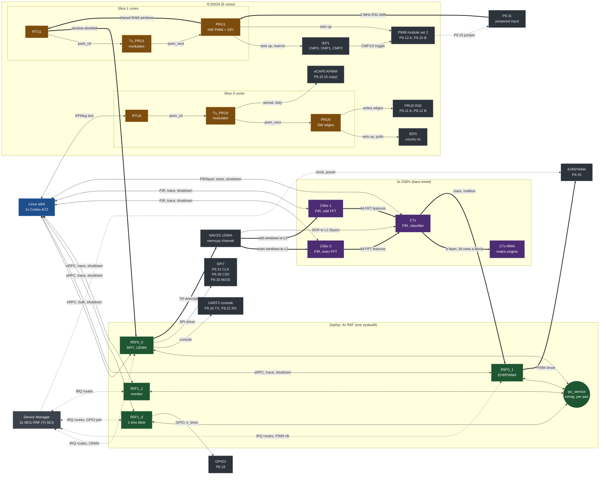
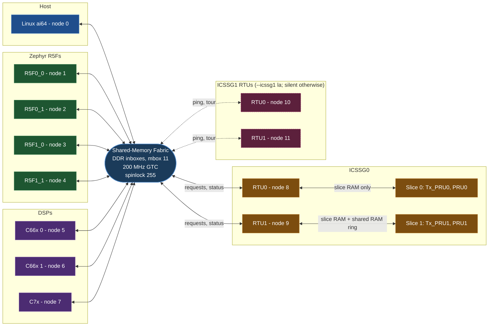
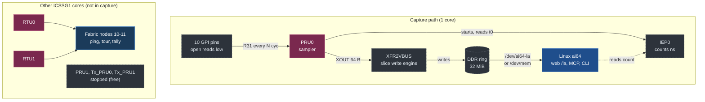
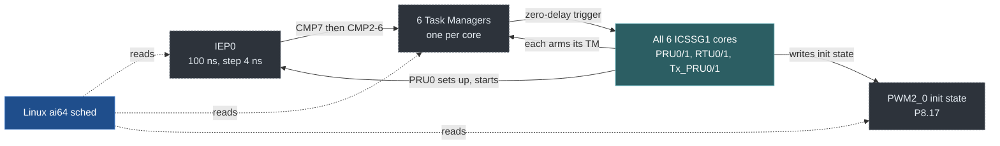

# Architecture

This document holds the full per-core diagrams for the demo. For the high-level overview, see [`README.md`](../README.md#how-it-works).

Every core in the main demo has its own block below. The architecture is organized into three views so nothing is dropped and the ICSSG1 alternatives do not clutter the core demo:

- **Thick arrows (`==>`)** trace the 5-core-type real-time pipeline (`P8.31` → `P9.25`).
- **Solid arrows (`-->` / `<-->`)** show host control, IPC, slice internals, and peripheral ownership.
- **Dashed arrows (`-.->`)** show TI-SCI service requests to the MCU device manager, the `P9.15` → `P8.31` physical jumper, optional links, and read-only polling by Linux.
- Linux also loads and restarts every coprocessor via `remoteproc` (omitted for clarity).

## 1. Main demo architecture

See [The pipeline](pipeline.md), [`zephyr/r5/README.md`](../zephyr/r5/README.md), [`pru/README.md`](../pru/README.md), and [`dsp/README.md`](../dsp/README.md) for per-core details.

## 2. Shared-memory fabric (12 nodes, 132 paths)

`RTU1` takes requests only over the fabric; `RTU0` accepts both fabric and RPMsg. In ICSSG0, the fabric stops at the RTUs so nothing outside ICSSG0 can perturb `Tx_PRU`/`PRU` timing. Nodes 10 and 11 (`ICSSG1 RTU0`/`RTU1`) participate in pings, tours, and the spinlock tally when `--icssg1 la` runs (default) and stay silent with `--icssg1 scheduler` or `off`.

See [The fabric](fabric.md) for the protocol, memory layout, and measured latencies.

## 3. ICSSG1 options (alternative firmware sets)

ICSSG1 is independent of the main demo and runs one of two mutually exclusive firmware sets (or stays stopped with `--icssg1 off`):

### Option A: Logic analyzer (`--icssg1 la`, default — 3 of 6 cores active)

See [`pru/logic_analyzer/README.md`](../pru/logic_analyzer/README.md).

### Option B: TI multicore scheduler (`--icssg1 scheduler` — all 6 cores active)

See [`extra-demos/README.md`](../extra-demos/README.md) and [`extra-demos/icssg1-multicore-scheduler/README.md`](../extra-demos/icssg1-multicore-scheduler/README.md).
