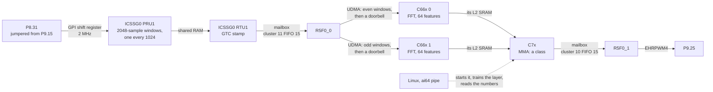

# The pipeline: P8.31 to P9.25

The pipeline is the demo's cores working on one stream of data together, the way an application would: a signal comes in on a header pin, each kind of core does the part it is best at, and the result goes out on another pin, with no Linux in the path. `zephyr/include/ai64_pipe.h` lays it all out; each stage is a few hundred lines. [Probe the pins](../README.md#probe-the-pins) has a capture of it running.

The input is ICSSG0 slice 1's output B, P9.15, by a jumper wire: it steps through 10, 15, and 20 kHz at 10, 25, 50, 75, and 90% duty, a step every 5 ms, on the GTC's time. Those 15 steps are the pipeline's 15 classes, and because the steps keep the GTC's time, every stage's numbers can be checked: R5F0_1 knows which step each window should have been.

| Stage | Core | What it does with each window | Time, window end to done |
| --- | --- | --- | --- |
| Sample | ICSSG0 PRU1 | its GPI shift register takes P8.31 at 2 MHz; PRU1 packs 16 samples at a time into 2048-sample windows (1.024 ms) in ICSSG0's shared RAM, each starting half a window after the last | |
| Stamp | ICSSG0 RTU1 | stamps the window with the GTC, rings R5F0_0's mailbox | within one 8 µs chunk |
| Move | R5F0_0 | its UDMA copies the window into the L2 SRAM of C66x 0 (even windows) or C66x 1 (odd), then the doorbell | 22 µs (11 µs of it the copy) |
| Spectrum | C66x 0 or 1 | a 2048-point FFT; 64 int8 features into the C7x's L2 SRAM | 109 µs (89 µs of it the FFT) |
| Classify | C7x | the features through an int8 layer on the MMA; rings R5F0_1's mailbox; logs the features | 112 µs (0.8 µs of it the MMA) |
| Act | R5F0_1 | sets P9.25 to the class, once two windows agree; keeps score | 126 µs |

The times are the `pipe` window's means. At 1953 windows a second each stage has 512 µs before the next window comes, and each C66x, with every other window, 1.024 ms: time for Linux's FIR jobs too. Over every run on the bench it has named every window inside a step right: 50,000 and more a run, none wrong.

**Why the windows overlap.** A window names a step only once most of it is that step, and P9.25 waits for a second window to agree, so the delay is about a window and a half from wherever the step falls. With a new window every half window, the second one comes 512 µs after the first instead of 1.024 ms: P9.25 follows 1.5 ms behind instead of 2.2. That doubles the FFTs, so the two C66x cores share them, and each does what C66x 0 did alone before.

**ICSSG0 PRU1: the GPI shift register.** In 28-bit shift mode (`GPCFG1`), a PRU's R31 is a shift register that takes `PRG0_PRU1_GPI0` on a clock divided from the 250 MHz core clock, here by 12.5 and by 10: 2 MHz. Bit 0 is the newest sample, and bit 28, Cnt_16, goes high every 16 samples. The hardware times every sample, so PRU1 keeps running its PWM compares (`pru/pwm/`) and only takes a chunk where Cnt_16 rises: R31's low 16 bits, read in the same load. The guide says Cnt_16 clears itself and also sets system event 2 in ICSSG0's INTC; polling that event took six chunks per real one, since it latches again while the bit is still high for its whole sample. So the PRU watches the bit's rising edge instead.

PRU1 writes each chunk twice: into this half window's slot, and into the second half of the slot before. So when 64 chunks are in, the slot before holds a whole window, the newest, in one piece, and R5F0_0 can copy it in one burst. Window *w* is halves *w* and *w* + 1.

**ICSSG0 RTU1: the stamp.** A read of the GTC from a PRU stalls it for a few hundred ns, longer than a PWM edge can wait, so PRU1 only counts chunks. RTU1, the slice's talking core, reads the GTC when it sees a new window, and works back from the chunk PRU1 is on now, 8 µs a chunk: the stamp is right to within a chunk however late RTU1 comes round. Then it rings FIFO 15 of R5F0_0's mailbox (cluster 11, which the fabric and `ipc_service` share; FIFO 15 is free).

**R5F0_0: the move.** The mailbox interrupt wakes a thread (`zephyr/r5/r5f0_0/src/pipe_dma.c`), which copies every window since the last into a ring of four slots in a C66x's L2 SRAM: the even windows to C66x 0's, the odd ones to C66x 1's. One UDMA descriptor does a window: the samples and stamp, then the doorbell ([R5F0_0's DMA](../zephyr/r5/README.md#r5f0_0s-dma-the-udma)).

**C66x 0 and 1: the spectrum** (`dsp/c66x/pipe.c`). Both run the same image, and `DNUM` says which windows are theirs. Each polls the doorbell in its own L2, a cached load, since L1D snoops what the UDMA writes. Each sample becomes 1 or −1, times a Hann window, and goes through a radix-2 float FFT. Feature 0 is the DC, about twice the duty less one; features 1 to 62 are the first 62 bins, 977 Hz apart, as amplitudes. 10, 15, and 20 kHz fall in bins 10, 15, and 20, and a duty other than 50% puts harmonics at their multiples. The FFT first ran its butterflies a group at a time, and took 325 µs: the first stages are 1024 groups of one butterfly, too short for the compiler to pipeline. Each stage as one loop over its 1024 butterflies, from one pair of arrays into the other so that no butterfly waits on another, takes 89.

**The C7x: the class** (`dsp/c7x/pipe.c`). The C66x cores write each window's features into a ring of 16 rows in the C7x's L2 SRAM, in a page the C7x maps non-cacheable, and then the window's number plus one into a word of their own, so every word has one writer. When either word moves on, the C7x runs the whole ring through the int8 layer of `ai64 mma` on its MMA: a block of 16 rows takes the MMA the time one would, 0.8 µs. Each of the first 15 outputs is a class's score; for each new window, in order, the best on its row is its class. It writes each verdict into a ring in DDR, rings FIFO 15 of R5F0_1's mailbox (cluster 10), and copies the features into a log in DDR for training.

**R5F0_1: P9.25** (`zephyr/r5/r5f0_1/src/pipe_pwm.c`). It sets P9.25 to the class's frequency and duty, and changes it only when two windows in a row agree. A window that falls across a step change can match neither step: half a window of 20 kHz at 90% and half of 10 kHz at 10% have the spectrum of 10 kHz at 90% or 10%, and a DC in between, so the layer calls it 10 kHz at 90%. On the Saleae that was a 1 ms blip at three of every 106 step changes. A margin on the score did not catch it, since the layer is not unsure of it; two windows straddle each change, but one is mostly the old step and the other mostly the new, and they do not agree; so waiting for the next one does, for 512 µs more of delay. R5F0_1 takes every window in order, so two in a row really are neighbours. A `pwm` or `steps` request for P9.25 from anyone else takes it back from the pipeline, until the next `pipe start`.

**Training.** `ai64 pipe start` has R5F0_0 pass windows on, reads the C7x's log of every window's features from DDR for 3 s, and labels each with the step the input was on from its GTC stamp, leaving out the ones across a step. The weights are each class's mean features, scaled to the same length, as int8: a window's score for a class is then how well its features line up with that class's. It checks the layer on the same windows in the layer's own int8 arithmetic, picks the shift that keeps the best score under 100, hands the weights to the C7x through DDR, and has R5F0_1 follow. 4,528 windows, 300 a class, train it to 100%.

**Where it lives.**

| What | Where | Written by |
| --- | --- | --- |
| The window ring, 16 slots of 512 bytes, and PRU1's counts | ICSSG0 shared RAM, `0x0b010000` | PRU1 (samples), RTU1 (stamps) |
| The window slots and the doorbell | C66x 0's L2 SRAM, `0x4d80830000`, and C66x 1's, `0x4d81830000` (both local `0x00830000`) | R5F0_0's UDMA |
| The feature rows, and each C66x's newest window | the C7x's L2 SRAM, `0x64810000` | C66x 0 (even rows), C66x 1 (odd rows) |
| The weights and outputs | the C7x's L2 SRAM, `0x64811000` | the C7x |
| The control record, and the weights | DDR, `0xa9090000`, in the fabric's reserved 1 MiB | Linux |
| Each stage's numbers | the same block | that stage |
| The results, and the feature log | the same block | the C7x |
| The score | the same block | R5F0_1 |

To use it for something else, change the ends: PRU1 can sample any of its GPI pins, a sensor's data, or an ADC's bitstream, the C66x cores' features can be any 64 numbers, and the layer any 64 × 64 one. Every stage restarts its numbers when Linux hands over new weights.
