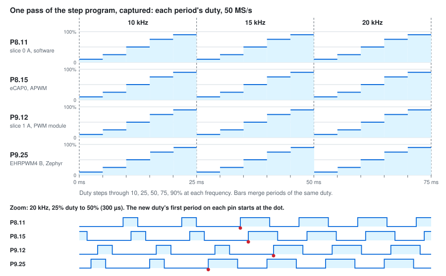
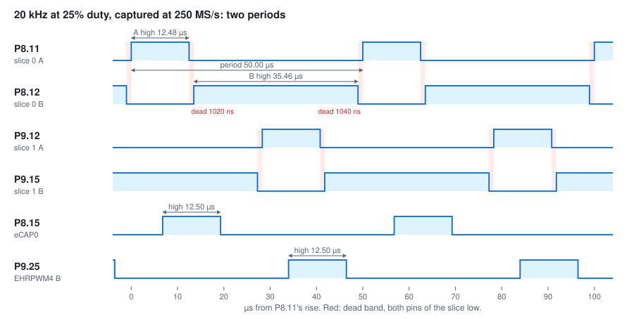
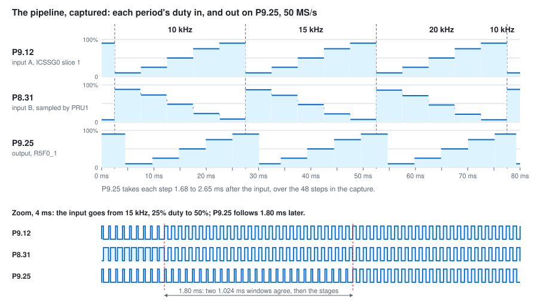
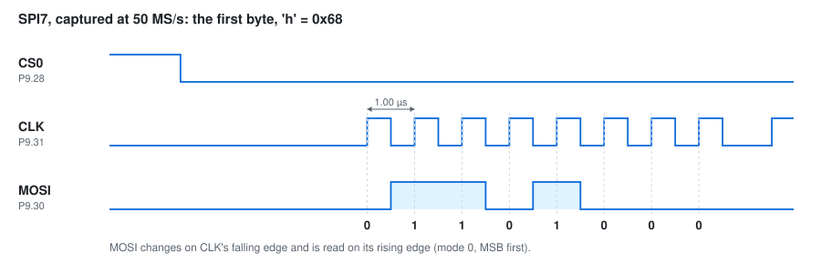
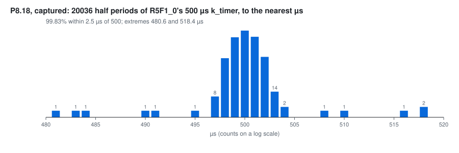

# Probing & Signal Captures

All header signals are **3.3 V logic**; set any external logic analyzer's threshold for 3.3 V.

The board can watch these signals itself through jumpers into ICSSG1's built-in logic analyzer ([channel wiring](../pru/logic_analyzer/README.md#the-channels)), via `ai64 la measure`, the web viewer at `/la`, or the MCP server. Every figure below was captured on a separate Saleae Logic Pro 8 from a board running `ai64-demo` at its defaults.

[`PINMUX.md`](../PINMUX.md) lists every header pin the demo muxes, along with the shorted partner balls it holds off.

## Header signals

| Signal | Header pins | Expected waveform |
| --- | --- | --- |
| SPI7 (`R5F0_0`, Zephyr) | `P9.28` CS, `P9.31` CLK, `P9.30` MOSI | `hello` at 1 MHz, mode 0, MSB first, at startup and on each `spi` command |
| Hardware PWM, EHRPWM4_B (`R5F0_1`, Zephyr) | `P9.25` | 15-step program below; once the pipeline runs, follows `P8.31` ~1.5 ms behind `P9.12` |
| Pipeline input (`ICSSG0 PRU1`) | `P8.31` (jumpered from `P9.15`) | Same waveform as `P9.15` |
| 1 kHz square wave (`R5F1_0`, Zephyr GPIO2) | `P8.18` | 1 kHz square wave toggled every 500 µs from a `k_timer` |
| Software PWM (`ICSSG0` slice 0) | `P8.11` (A), `P8.12` (B) | 15-step program on A; B is complementary with 1 µs dead band |
| Hardware PWM, `eCAP0` (`ICSSG0` Tx_PRU0) | `P8.15` | Same period and high time as `P8.11`, single output, own counter phase |
| Hardware PWM, ICSSG PWM module (`ICSSG0` slice 1) | `P9.12` (A), `P9.15` (B) | Same complementary waveform as `P8.11`/`P8.12`, generated in hardware |
| Zephyr console (`R5F0_0`, UART2) | `P8.34` TX, `P8.22` RX | 115200 8N1 |

## The 15-step PWM program

*Taken with `P9.25` on its own steps (as after `pipe stop`); once the pipeline is running, `P9.25` replays the steps ~1.5 ms late instead.*

All four PWM generators run the same 15-step schedule—5 ms per step, 75 ms per cycle: 10 kHz at 10, 25, 50, 75, and 90% duty, then 15 kHz at the same five duties, then 20 kHz.

The schedule is keyed to the SoC's 200 MHz GTC: step `n` runs while `GTC / 5 ms` equals `n mod 15`. Every generator derives its step from the GTC, so all four stay aligned regardless of start order. Each adopts a new step at the end of its own period (their counters are not phase-locked): in the capture above, the three ICSSG0 generators switch within 34 µs of each other, and `P9.25` switches from 63 µs before to 71 µs after (Zephyr checks the GTC on a 100 µs kernel tick, and EHRPWM4 latches at period end). On the ICSSG0 slices, 15 kHz rounds to 66,664 ns (the nearest 4 ns IEP count).

## Complementary A and B with dead band

On `P8.11`/`P8.12` (slice 0) and `P9.12`/`P9.15` (slice 1), B is not simply A inverted. For a period `P`, A high time `D`, and dead band `d` (default 1000 ns):

- **A** rises 40 ns into each period (an IEP compare at count 0 never fires, so both slices offset by 40 ns) and stays high for `D`.
- **B** rises `d` after A falls and falls `d` before the period ends, keeping both outputs low for `d` after A's pulse and `d + 40 ns` before the next pulse.
- **B's high time** is `P − D − 2d − 40`. At 20 kHz and 25% duty, A is high for 12,500 ns and B for 35,460 ns.
- **`P8.15` and `P9.25`** output the same `P` and `D` as A from independent counters, with no complementary B channel.

This matches half-bridge gate-drive timing so high-side and low-side switches never conduct simultaneously. Over the 96 periods of one 20 kHz / 25% step sampled at 250 MS/s:
- **Slice 0 (software PRU polling IEP0):** A high 12,476–12,524 ns, dead band 988–1,020 ns (tens of ns of polling jitter).
- **Slice 1 (ICSSG hardware PWM module):** A high 12,496–12,500 ns, dead band 1,000–1,004 ns (within one 4 ns sample).

> **Zephyr EHRPWM4 fix:** An earlier capture showed `P9.25`'s period was 8 ns (one 125 MHz tick) too long on every step (`50,008 ns` at 20 kHz) because Zephyr's EHRPWM driver wrote the raw count to `TBPRD` even though count-up mode has period `TBPRD + 1`. Patch `0004` in `zephyr/patches/` fixes this; `P9.25` now matches the ICSSG0 generators within 0.04 ns across all three frequencies.

## The 5-core-type pipeline (`P8.31` to `P9.25`)

`P9.25` reproduces each input step 1.18 to 1.75 ms after `P9.12` (1.47 ms median), with zero false steps.

Most of that delay is windowing and debouncing: a 1.024 ms window must be predominantly the new step before classifying it, and `R5F0_1` waits for the next overlapping window (512 µs later) to agree before changing `P9.25`. (Without 50% window overlap, `P9.25` lagged 1.7 to 2.8 ms.) The actual cross-core compute path takes only ~127 µs from the window's final sample to `R5F0_1` receiving the class; EHRPWM4 then applies the new period and duty at the end of its current cycle. Because `P8.31` is jumpered from `P9.15` (output B), its duty runs inverted relative to `P9.12` (output A). See [The pipeline](pipeline.md).

## SPI7 (`R5F0_0`)

SPI7 transmits `hello` once at boot and whatever text you pass to `spi` afterwards. Chip select stays low for the entire transfer (175 µs for `hello`), with the clock starting 3.9 µs after CS falls.

> **Clock-rate fix:** An earlier capture revealed a 0.96 µs clock instead of 1.00 µs because the devicetree declared SPI7's input clock as 48 MHz (dividing by 48) when the actual clock on the board is 50 MHz.

## 1 kHz square wave (`P8.18`, `R5F1_0`)

`P8.18` toggles every 500 µs from a periodic Zephyr `k_timer`, reflecting the R5F kernel's interrupt latency: 99.83% of half-periods fall within 2.5 µs of 500 µs, with occasional outliers up to ~20 µs when another interrupt delays the timer ISR. `R5F1_0` measures the same jitter itself on the GTC and reports it in `status`.

> **Zephyr DMTimer fix:** Before `zephyr/patches/` (`0002`, `0003`) fixed Zephyr's TI DMTimer system timer, 1 in 17 half-periods was a full tick (~94 µs) short because the driver scheduled each timeout relative to the ISR run time instead of the tick boundary, causing small delays to accumulate until the kernel jumped two ticks at once.
