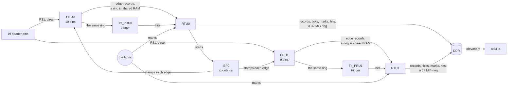
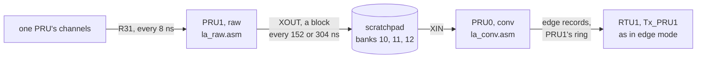
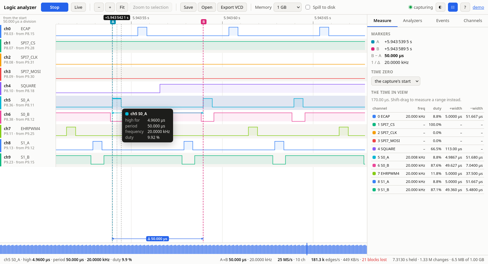
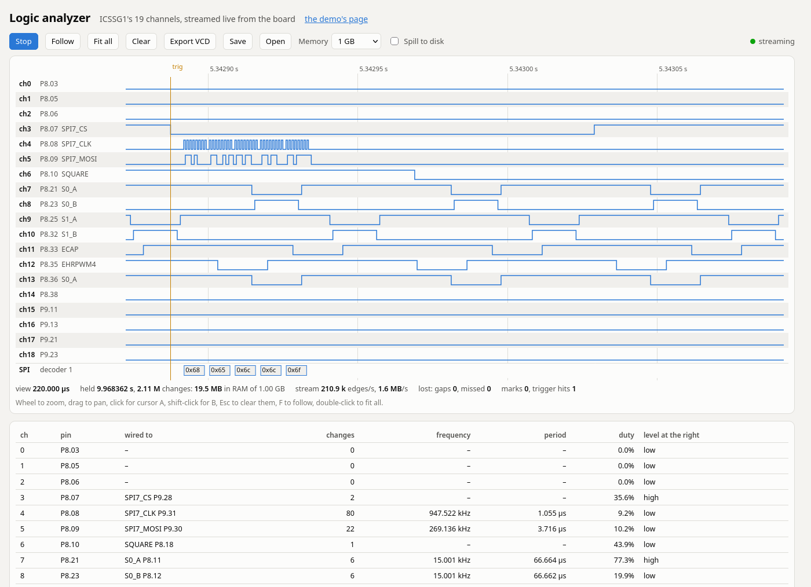

# ICSSG1: a 19-channel logic analyzer

ICSSG1's six cores record every change on 19 header pins, each stamped with the count of IEP0, ICSSG1's nanosecond counter on its 250 MHz clock, and Linux reads the records out of DDR. Jumper wires bring it the demo's own signals: the four PWM generators, SPI7, and the square wave. `ai64 la` then shows what each pin is doing, and `ai64 la capture` writes a VCD file for PulseView or GTKWave.

It records changes, not samples, so how much it writes depends on what the pins do, not on a sample rate: the demo's signals come to about 210,000 edges a second, under 2 MB/s, and it streams 15 million a second into a browser, as fast as a test signal makes one PRU record them. In its usual edge mode every pin is read every 8 ns, but a change less than 48 ns after another on the same PRU waits for it; [raw mode](#raw-mode-every-8-ns-with-no-gap) takes one PRU's channels every 8 ns with no gap at all, so pulses and gaps down to 8 ns come out exact, and the other PRU turns the samples into the same edge records. Each slice's Tx_PRU matches a trigger on the edges as they come, and the RTUs are fabric nodes, so any core in the demo can put a mark on the timeline.

## The channels

The channels are numbered in header pin order: P8 before P9, then by pin number. Each PRU can read only its own GPI pins, so PRU0 has ten of them and PRU1 nine; both stamp with the same IEP0, and Linux merges the two streams by time. `zephyr/include/ai64_la.h` holds the table, and the overlay, `ai64`, and the board tests all use it.

| Ch | Pin | Core, input | The demo's jumper brings | Signal |
| --- | --- | --- | --- | --- |
| 0 | P8.03 | PRU0 GPI19 | | spare |
| 1 | P8.05 | PRU1 GPI12 | | spare |
| 2 | P8.06 | PRU1 GPI13 | | spare |
| 3 | P8.07 | PRU0 GPI14 | P9.28 | SPI7 CS |
| 4 | P8.08 | PRU0 GPI13 | P9.31 | SPI7 CLK |
| 5 | P8.09 | PRU0 GPI16 | P9.30 | SPI7 MOSI |
| 6 | P8.10 | PRU0 GPI15 | P8.18 | the 1 kHz square wave |
| 7 | P8.21 | PRU1 GPI9 | P8.11 | ICSSG0 slice 0, A |
| 8 | P8.23 | PRU1 GPI10 | P8.12 | ICSSG0 slice 0, B |
| 9 | P8.25 | PRU1 GPI14 | P9.12 | ICSSG0 slice 1, A |
| 10 | P8.32 | PRU1 GPI5 | P9.15 or P8.31 | ICSSG0 slice 1, B |
| 11 | P8.33 | PRU1 GPI4 | P8.15 | the eCAP's copy of A |
| 12 | P8.35 | PRU1 GPI3 | P9.25 | EHRPWM4, Zephyr on R5F0_1 |
| 13 | P8.36 | PRU0 GPI7 | P8.21 | slice 0's A again, on the other PRU |
| 14 | P8.38 | PRU0 GPI8 | | spare |
| 15 | P9.11 | PRU0 GPI0 | | spare |
| 16 | P9.13 | PRU0 GPI1 | | spare |
| 17 | P9.21 | PRU1 GPI18 | | spare |
| 18 | P9.23 | PRU0 GPI9 | | spare |

Each pin is in mode 1, `PRG1_PRU<n>_GPI<bit>`, with its pull-down on, so a spare pin reads a steady low. P8.32, P8.33, P8.35, P8.38, and P9.21 each have a second SoC ball, which the overlay holds off. The signals that get compared with each other sit on one PRU, so one read of its pins takes them together: SPI7's three on PRU0, and the PWM generators on PRU1. Channel 13 is the same signal as channel 7 on the other PRU, to measure how far apart the two PRUs see one edge.

**The inputs connect straight to SoC pads.** They take 3.3 V logic only; 5 V on a pin can damage the SoC. The other pins the 19 could have been are taken: P8.18, P8.22, and P8.34 by Zephyr, P8.31 by the pipeline, P8.17 by the multicore scheduler, P8.24 and P9.22 are boot-mode straps, and P9.17, P9.18, P9.24, and P9.26 are the board's I²C4 and I²C6 buses.

## How it works



| Core | Job | Source |
| --- | --- | --- |
| PRU0, PRU1 | Read their pins, and at each change write an edge record: IEP0's count, the new state, and its sequence number. In raw mode one samples, the other converts ([Raw mode](#raw-mode-every-8-ns-with-no-gap)) | `firmware/la_pru.c`, `firmware/la_sample.asm`, `firmware/la_raw.asm`, `firmware/la_conv.asm` |
| RTU0, RTU1 | Copy their PRU's records to its ring in DDR, in bursts, add a tick each millisecond, keep the stream's header up to date; pass the trigger to the Tx_PRU and its hits into the stream; fabric nodes 10 and 11, which put marks in the stream; RTU0 also starts IEP0 | `firmware/la_rtu.c`, `firmware/la_copy.asm` |
| Tx_PRU0, Tx_PRU1 | Read their PRU's records as they come, and match the trigger on that PRU's pins | `firmware/la_txpru.c` |

**The PRU's loop** (`la_sample.asm`) takes two cycles, 8 ns, a pass: read R31 through the PRU's mask, and loop while it matches the last state. On a change it reads IEP0's count and stores the record, time, state, and sequence number, in one store into its ring in ICSSG1's shared RAM. That is all an edge costs it: 11 or 12 cycles from one record's time to the next when the pins keep changing. The sequence number, the bytes written before the record, is what tells a reader the record is new, so the PRU keeps no write count; two copies of the loop take turns, each with its own registers, so an edge needs no move between them either (`la_map.h` has the ring's format). It touches nothing outside ICSSG1, and never waits for its RTU, so nothing else on the chip can slow it.

**The RTU** takes the slow, unpredictable work: DDR, and the GTC, the SoC's shared clock. It finds how many records are new with a binary search on their sequence numbers, and copies them four at a time (`la_copy.asm`): one 64-byte load from shared RAM, the four times and states packed into one 32-byte store to DDR. Each millisecond it adds a tick, which pairs IEP0's count with the GTC and says every pin's state. An edge record holds only IEP0's low 32 bits; Linux finds the rest from the stream's last tick, which is never more than a millisecond away. If the RTU ever fell a whole ring behind its PRU, it would skip to where the PRU is and write a gap record, so a hole in the data is always marked.

**Linux** (`linux-app/la_stream.c`, for `ai64 la` in `la.c` and the web viewer's stream in `la_ws.c`) follows both streams in DDR, unwraps each edge's time, and merges the two by time. Nothing waits for Linux either: a reader that falls a whole 32 MiB ring behind, about 20 s of the demo's signals on PRU1, sees it from the ring's write count and counts what it missed.

`zephyr/include/ai64_la.h` has the record format and the addresses; `firmware/la_map.h` how each slice's data RAM and ICSSG1's shared RAM are split, and the modes; and `firmware/la_ipc.h` the records the slice's cores share.

### Raw mode: every 8 ns with no gap

In edge mode a PRU spends 11 or 12 cycles writing each record, and a change on its pins in that time waits. Raw mode spends none: the PRU only samples, and the other PRU finds the changes.



- **The raw PRU** (`la_raw.asm`) takes R31 through the mask every two cycles, into the next register of 19, and every 19 registers stores the block in one `XOUT` to a scratchpad bank, in turn banks 10, 11, and 12, with the block's number. The instruction between two samples is the `XOUT`, the number's `ADD`, the jump back, or one that does nothing, so the samples are exactly 8 ns apart for as long as it runs. When the channels fit in 16 pins, 0 to 15 or 8 to 23, it takes two samples a register: a block is 304 ns instead of 152.
- **The other PRU** (`la_conv.asm`) is the converter: the J721E's PRUs share their scratchpad banks, which a Tx_PRU or an RTU cannot reach (SPRUJ61, the J721E PRU guide). It loads each block with one `XIN` as it comes, compares each register with the one before, and for each change writes an edge record into the raw PRU's ring: the time of the first sample with the new pins, from the time of the run's first sample and the sample's number. The records are the same as edge mode's, so the RTU, its Tx_PRU and the trigger, Linux, the web page, and the MCP server take them as they are.
- **The other PRU's own channels are not recorded** while it converts: raw mode trades them for speed, as a Saleae trades channels for sample rate.
- **How fast**: a block with no change costs the converter about 26 of its cycles, of 38 at a sample a register or 76 at two; each change, 7 or 9 more. On EHRPWM4 alone it kept up with 6.7 million changes a second at a sample a register, and 10 million at two; faster than that it falls a few blocks behind, and writes a hole record saying how many samples it lost, then the pins at the first sample after, so the hole is marked exactly ([Holes and late edges](#holes-and-late-edges)). The converter has two blocks in hand, about half a microsecond: a burst faster than that for longer than a few microseconds is cut. At EHRPWM4's fastest, 62.5 MHz, the Nyquist rate, it keeps about an eighth of the time, in bursts a few blocks long: in them every period is exactly 16 ns and every high time 8.
- **Accuracy**: slice 1's dead band reads exactly what it is set to, at every step from 1000 ns down to 16 ns, with no spread, every edge alike. Raw mode's times are where edge mode's are, within 4 ns: slice 1's PWM, on a clock the same as IEP0's, kept its phase across the change.

`ai64 la mode raw <ch> ...` sets it, for channels of one PRU, and `ai64 la mode edge` sets it back; so does the web page's Capture section, and the MCP server's `la_mode`. Either restarts both PRUs, a gap of some 50 ms, and the RTUs and readers carry on across it: each new writer's sequence numbers go on from its RTU's.

### Triggers

`ai64 la trigger` sets one: an edge on a channel (`6 rise`, `fall`, or `any`), or the moment some channels come to a pattern (`3=0 4=1`: SPI7's CS low with its clock high, the first clock of a transfer). A trigger takes the channels of one PRU. Linux writes it into that stream's header; the RTU passes it on to its Tx_PRU through their slice's data RAM, and the Tx_PRU, reading the PRU's edge records as fast as they come, writes each hit into its hit ring. The RTU puts each hit in the stream as a trig record, with the time of the edge that met it. So the Tx_PRU never touches DDR either, and a hit is found within microseconds of the edge, with nothing from Linux in between.

`ai64 la capture <seconds> <file> --trigger` waits for the next hit and writes the capture around it, a tenth before and the rest after: the part before comes out of the ring, which already holds it. The `trig` signal in the VCD file changes at each hit. Triggered on SPI7's first clock, a 2 ms capture holds the `spi hello` transfer from its start, and the clock and data decode to `hello`.

### Marks and the fabric

RTU0 and RTU1 are fabric nodes 10 and 11 ([The fabric](../../docs/fabric.md)): they answer every other core's pings, add to the tally, join R5F0_0's tour, and publish their stream's numbers in their fabric page, which the web page shows. A route that brings either of them the `mark` action puts a mark record in its stream, with the route's origin and a 16-bit value, at the time the RTU read it: `ai64 la mark 7`, or a route through other cores first, such as `ai64 fabric route c7x r5f0_1 g1rtu1 mark 42`. A capture shows the marks as a 16-bit signal, `mark`, which holds each value until the next. So whatever a core does can be lined up against the pins, on the same clock. The RTU puts the edges first: it looks at its fabric inbox when its ring is nearly drained, or every 100 µs at the latest, so with the PRUs at millions of edges a second its round trips grow to a few ms, and drop back when they slow down.

**Starting after another firmware set.** A core's task manager keeps its setup when the core stops, and the multicore scheduler leaves IEP0 starting a task on every core every 100 ns. A core stopped in the middle of a task stays in it, and its next yield would return to wherever the old firmware was interrupted. So before `ai64-demo` stops ICSSG1's cores it runs `ai64 la quiet`, which stops IEP0 and maps no event to any task, so each core stops outside one; each analyzer core then turns its own task manager off before anything else (`firmware/la_tm.h`).

## What it measures

Checked against the bench's Saleae Logic Pro 8 at 250 MS/s on P8.11, P9.12, and P9.25 at once, over 2 s: every one of the 184,000 edges the Saleae saw, the analyzer saw too, and 99.9% of them within 14 ns of the Saleae's time, after the two clocks' 34 ppm difference is taken out. The worst was 51 ns, on P9.25: the PRU stamps an edge up to about 50 ns late when it comes while the PRU is still writing the record for another change on its pins. The analyzer reads every period of the demo's generators at exactly its nominal length, 100,000.000, 66,664.000, and 50,000.000 ns averaged over thousands, since IEP0 counts from the same clock they do.

| | The analyzer | The Saleae, earlier ([Probe the pins](../../README.md#probe-the-pins)) |
| --- | --- | --- |
| Slice 1's dead band (hardware PWM) | 996 to 1004 ns | 1000 to 1004 ns |
| Slice 0's dead band (software PWM) | 968 to 1024 ns | 988 to 1020 ns |
| Slice 0's A at 20 kHz, 25% | high 12,472 to 12,532 ns | 12,476 to 12,524 ns |
| The same edge on PRU0 and on PRU1 (ch13 against ch7) | −4 ns apart, half of them; 98% within ±8 ns | |

**How close two edges can be.** Slice 1's hardware PWM puts A's fall and B's rise exactly its dead band apart, both on PRU1, so stepping the dead band down measures it (`fabric route g0rtu1 dead <ns>`). From 200 ns down to 52, the analyzer reads the gap right. Closer than that it reads 44 to 48 ns, or both changes in one record when they fall between two reads of the pins: writing a record takes the PRU 11 or 12 cycles, and a change in that time waits for the next pass. (It took 14 cycles, 56 ns, when the PRU stored a write count after each record.)

### Holes and late edges

Nothing the analyzer cannot keep up with is passed off as signal.

- **A hole** is where records were lost: raw mode's converter fell behind the samples (a hole record, which says where it starts), an RTU fell a ring behind its PRU (a gap record), or a reader fell a ring behind the RTU. Linux's reader turns each into a span on its PRU's channels, from the last edge before to the next record, which holds every pin. A VCD file takes those channels to `x` in a hole; `la measure`, the MCP server's tools, and the web page measure no period, pulse, or a-to-b time across one, and duty over only the time that is known; the page draws a hole as a band marked "no data", and pointing at one says so.
- **A late edge**, in edge mode, came while the PRU was still writing the record for the change before. The PRU's first look at its pins after a record comes straight after the store, and a change there gets `AI64_LA_LATE` (bit 23 of the state, no pin's) in its record (`la_sample.asm`), at no cost to an edge on time. Its time is up to some 50 ns late, and a pulse that came and went in that time is missing, with no hole: a pin that changes twice while the PRU is busy looks unchanged, so the count is a floor. `ai64 la rate`, the `la` window, a capture, and the MCP server count them, and the page's status bar gives them a second, amber once they are 1% of the edges. On EHRPWM4, 1% of edges came late at 5 million edges a second, 8% at 10 million, where the PRU's stores now and then wait on the RTU's reads of shared RAM, and over two thirds at 20 million, where raw mode has every one; the demo's own signals make about 15 a second, where SPI7's clock and data change together.

**How fast.** The demo's PWM generators go no faster than a 2 µs period, 1 million edges a second a pin, but P9.25's is the SoC's EHRPWM4, which makes every edge in hardware, so it takes periods down to 16 ns: the analyzer's fast test signal, on ch12 (PRU1). `ai64 la rate` drains both streams and says how many records a second each RTU copied, how many a reader took and missed, and how close two records came; `tests/run.sh stress` steps EHRPWM4 from 2 µs down to 40 ns with it, and puts the steps back after. Each stage, measured that way:

| Stage | How fast, measured |
| --- | --- |
| PRU | A record every 44 or 48 ns while its pins keep changing: so at most about 21 million a second, a PRU. A square wave faster than that is not recorded faster: the PRU sees one level a pass, and on EHRPWM4 it caught up to 15 million changes a second. |
| RTU, to DDR | Every record PRU1 wrote, 15 million a second, with no gap. Copying a word at a time, as C wrote it, the RTU topped out at 9.2 million and fell behind. |
| Linux's reader | 15 million a second with none missed (`ai64 la rate`). It reads the ring with 64-byte loads: uncached, each costs about 190 ns whatever its size, so 266 MB/s, about 33 million records a second; a word at a time read 21 MB/s. The `la` window, which does more with each edge, keeps up to about 10 million. |
| The web stream | About 2 bytes an edge: 15 million edges a second took 31 MB/s, a quarter of gigabit Ethernet ([The web viewer](#the-web-viewer)). |
| The browser | Firefox took 14 to 15 million changes a second, and at that rate now and then fell behind for a moment: the board's reader for it then skips a ring, and the page marks the gap. |

The limits, then:

- **Time**: an edge's time is within a pass of the loop, 8 ns, of the truth; in edge mode one that comes while the PRU is busy with another edge on its pins can be up to 48 ns late. In raw mode none is late.
- **Short pulses**: in edge mode a pulse shorter than 48 ns, right after another edge on the same PRU, can be missed: the PRU sees a pin's level at its next pass, so a pulse that is over by then leaves no record, and the edge after it comes late, which is counted ([Holes and late edges](#holes-and-late-edges)). In raw mode every pulse of 8 ns or more is there, or in a marked hole.
- **Rate**: in edge mode 15 million edges a second on one PRU, end to end into a browser, with nothing lost, and each PRU can write about 21 million; in raw mode 10 million on the raw PRU's channels with none lost when they fit 16 pins, 6.7 million when they do not.

## Using it

`ai64-demo` starts it on ICSSG1, and opens the `la` window:

```
ICSSG1 logic analyzer, the last 1.000 s; IEP0 at 176.965 s
  PRU0     31861 edges/s, 31905 in all; RTU0 gaps 0 (0 records), reader missed 0, late 0, marks 0, trigger hits 0
  PRU1    179173 edges/s, 179625 in all; RTU1 gaps 0 (0 records), reader missed 0, late 0, marks 0, trigger hits 0

  ch  pin    PRU/GPI  wired to          level  edges/s     frequency   duty
   0  P8.03  0/19     -                 low            0      0.0 Hz     0.0%
   3  P8.07  0/14     SPI7_CS P9.28     high           0      0.0 Hz   100.0%
   4  P8.08  0/13     SPI7_CLK P9.31    low            0      0.0 Hz     0.0%
   6  P8.10  0/15     SQUARE P8.18      high        2002    1.001 kHz   50.0%
   7  P8.21  1/9      S0_A P8.11        high       29925   14.963 kHz   50.0%
   8  P8.23  1/10     S0_B P8.12        low        29925   14.962 kHz   47.0%
   9  P8.25  1/14     S1_A P9.12        high       29924   14.962 kHz   50.1%
  10  P8.32  1/5      S1_B P9.15        low        29924   14.962 kHz   46.9%
  11  P8.33  1/4      ECAP P8.15        high       29926   14.963 kHz   50.1%
  12  P8.35  1/3      EHRPWM4 P9.25     high       29904   14.952 kHz   50.1%
  13  P8.36  0/7      S0_A P8.21        high       29924   14.962 kHz   50.1%
  ...
```

The frequency and duty are over the whole second, so the PWM channels show the average of their steps: 15 kHz, and 50% on A. B's duty is A's complement less the dead band. SPI7 only moves at startup and for each `spi`, so its channels sit still.

`ai64 la measure` goes into each edge. Its pairs, by default:

```
  from each change of a, to the nearest change of b       a rises:  min      med      max      a falls:  min      med      max
  ch7 S0_A -> ch8 S0_B                                      -1048    -1040    -1036             968      988     1024
  ch8 S0_B -> ch7 S0_A                                      -1024     -988     -968            1036     1040     1048
  ch9 S1_A -> ch10 S1_B                                     -1044    -1040    -1036             996     1000     1004
  ch10 S1_B -> ch9 S1_A                                     -1004    -1000     -996            1036     1040     1044
  ch7 S0_A -> ch13 S0_A                                        -4       -4        4              -8       -4        4
```

When A falls, B rises a dead band later: 1000 ns on slice 1, exact in hardware, and 968 to 1024 on slice 0, whose PRU writes its pins in software. When A rises, B fell 1040 ns before: the dead band, and the 40 ns A starts into its period. The last line is one signal on both PRUs: they agree to within a few ns.

| Command | What it does |
| --- | --- |
| `sudo ai64 la [seconds\|once\|lines]` | the `la` window, every second; once; or a line every 10 s for the merged console |
| `sudo ai64 la capture <seconds> <file.vcd\|-> [--trigger]` | records all 19 channels for that long and writes a VCD file, in ns from the start; with `--trigger`, around the next trigger hit |
| `sudo ai64 la measure [seconds] [a:b ...]` | each channel's edges, frequency, period and high time (min, median, max), and duty; and for each pair, the time from a's changes to b's nearest, by default the demo's A/B pairs and ch7 against ch13 |
| `sudo ai64 la mode [edge [ch ...] \| raw <ch> ...]` | each PRU's mode and the channels it records; or sets them: edge, every channel or those given; raw, channels of one PRU every 8 ns with no gap ([Raw mode](#raw-mode-every-8-ns-with-no-gap)) |
| `sudo ai64 la rate [seconds]` | each PRU's records a second as its RTU copied them and as a reader took them, any missed, the closest two records came, and late edges a second ([How fast](#what-it-measures), [Holes and late edges](#holes-and-late-edges)) |
| `sudo ai64 la trigger off \| <ch> rise\|fall\|any \| <ch>=0\|1 ...` | sets the Tx_PRUs' trigger |
| `sudo ai64 la mark <value>` | puts a mark in the stream, through the fabric to RTU0 |
| `sudo ai64 la quiet` | stops IEP0 and every task, before ICSSG1's cores stop; `ai64-demo` runs it |

`ai64-demo --icssg1 scheduler` runs TI's multicore scheduler on ICSSG1 instead ([extra-demos/](../../extra-demos/README.md)), and `--icssg1 off` leaves ICSSG1 stopped.

## The web viewer

While the demo runs, `http://<board>:8064/la` is a logic analyzer in the browser, with nothing to install: the board streams the edges as they come, and the browser keeps them, as a Saleae's software does, so a capture runs until it is stopped or reaches the memory limit at the top of the page (1 GB to start: about 260 million changes), or, with **Spill to disk**, the disk space the browser allows.



The waveforms fill the window, a row per channel in its own color, with the time ruler over them, an overview of the whole capture's activity under them, a side panel, and a status bar.

- **Point at a waveform** to measure the pulse under the pointer: how long it is high or low, the period of the cycle it starts, its frequency, and its duty, in a tooltip and in the status bar. The pulse is drawn bold and its period bracketed. Zoomed out, where many edges share a pixel, it says how many and estimates the frequency from the median time between rising edges, so a burst reads at its own rate.
- **Markers**: a click puts marker A, a right-click marker B; each snaps to an edge within a few pixels and can be dragged. The Measure tab and the status bar give B − A and its frequency, and **time zero** can be the capture's start, the first trigger hit, or marker A.
- **Shift-drag** selects a range: the Measure tab then measures every channel over it (frequency, duty, and the mean high and low widths) instead of over the view, Z zooms to it, and Export VCD saves it.
- **Navigation**: the wheel zooms at the pointer, a drag or a trackpad's sideways swipe pans, double-click fits the whole capture, and the overview strip at the bottom shows where the view is and moves it with a click or a drag. `[` and `]` jump to the previous or next edge on the channel pointed at. **Live** keeps the newest data at the right. The ruler labels times to the digits the zoom resolves.
- **Analyzers**: SPI (chip select active low, any of the four modes, MOSI and MISO), UART (8N1, any baud, inverted or not), and I²C (starts, stops, addresses, data, acknowledges) each add a row under the channels, decoded over the time in view; pointing at a decoded byte gives its value, time, and length, and the Analyzers tab lists them, searchable, a click away.
- **Events**: marks, trigger hits, and gaps are drawn as flags on the ruler and lines down the rows, and listed in the Events tab.
- **Holes and late edges**: a hole is a band across its PRU's channels marked "no data", and nothing is measured across one; the status bar counts late edges a second ([Holes and late edges](#holes-and-late-edges)).
- **Capture**, in the Channels tab: edge mode, with the channels to record, or raw 125 MS/s, with the channels of one PRU, and what each costs and keeps up with; Apply sets it on the board ([Raw mode](#raw-mode-every-8-ns-with-no-gap)), for every viewer, and the status bar says which runs. A channel not recorded is drawn faint and tagged so.
- **Channels**: show or hide each channel, name it, and pick its color; the browser remembers them, and the theme (light or dark) and the side panel.
- **Save** writes the capture to a `.lacap` file, and **Open** reads one back.
- **Spill to disk** moves the oldest blocks of changes into the browser's own disk storage, IndexedDB, when the capture fills the memory limit, and reads them back as they come into view. (The origin private file system would be quicker, but browsers keep it for secure contexts, and this page comes over plain HTTP.)

| Mouse and keys | |
| --- | --- |
| point | a pulse's width, period, frequency, and duty |
| wheel; `Shift` wheel, trackpad | zoom at the pointer; pan |
| drag; `Shift` drag | pan; select a range to measure |
| click, right-click | marker A, marker B: they snap to edges, and drag |
| double-click, `Home`, `F` or `End` | the whole capture; its start; live |
| `[` `]` | the previous or next edge on the channel pointed at |
| `A` `B` | a marker at the pointer |
| `←` `→`, `+` `−` | pan, zoom |
| `Z`, `Esc`, `Space`, `?` | zoom to the selection; clear it, then the markers; start or stop; these keys |



The page is `linux-app/web/la.html`, built into `ai64` like the demo's page. It opens the WebSocket `/la/stream`, and `ai64 web` gives each viewer a thread of its own (`linux-app/la_ws.c`), which reads the rings with a reader of its own and sends the edges in binary messages, the format at the top of `la_ws.c`: each edge a varint of its time since the last edge, in IEP0's 4 ns steps, and the one pin that changed, about 2 bytes where a time and a state took 8. Each channel's changes are kept in blocks of 65,536, each time 4 bytes, an offset in ns from the block's first (a block that would span more than 4.29 s, which only a slow channel's does, keeps 8-byte times instead), and drawing does one binary search per pixel column, so it takes the same time for a hundred edges as for millions. The waveforms draw on one canvas, when the data or the view changes; the pointer, the markers, and the selection on a second canvas over it, so pointing stays smooth while the capture runs.

Measured with Firefox on the PC, over the board's gigabit Ethernet: with EHRPWM4 as the fast test signal ([How fast](#what-it-measures)), the viewer took 10 million edges a second at 20 MB/s with nothing lost, and up to 15 million at 31 MB/s, 2.0 bytes an edge, where now and then it fell behind for a moment and the page marked a gap; it drew 4.2 million changes in 6 ms. Pointing at the demo's signals reads them as the generators make them: S1_A high 33.328 µs of a 66.660 µs period, 15.0015 kHz, at 50% duty; SPI7's clock low 496 ns of a 1.004 µs period. The SPI analyzer reads `hello` from a `spi hello` transfer; with the memory limit at 16 MB and Spill to disk on, 36 s of the demo's signals ran with 15.8 MB in RAM and 15.5 MB on disk (with 8-byte times they had taken 62 MB), Fit read the blocks back, and the 68 MB saved file opened again with every one of its 8.54 million changes. The UART and I²C analyzers, which no signal of the demo's exercises, decode synthetic captures: "Hi!" at 115200 baud, and an I²C write of 0x50 W, 0xa5. Besides the capture mode it only reads: it cannot set the trigger or send a mark, which are `ai64 la`'s and the MCP server's. In raw mode, with EHRPWM4 on ch12 alone, the board's stream for the page kept up with the converter, as `tests/run.sh stress` checks on the board; over Wi-Fi, about 4 MB/s here, a page gets about 2 million edges a second.

## MCP: the analyzer for a model

`ai64 mcp`, which `ai64-demo` starts in its `mcp` window, is an [MCP](https://modelcontextprotocol.io) server for the analyzer, on port 8065 at `/mcp`: the protocol's Streamable HTTP transport, JSON-RPC 2.0 in HTTP POSTs, in C on the board (`linux-app/mcp.c`), with nothing to install. Claude Code, for one, connects with:

```
claude mcp add --transport http ai64-la http://<board>:8065/mcp
```

| Tool | What it does |
| --- | --- |
| `la_channels` | the 19 channels: pin, ball, PRU and GPI bit, and what the demo's jumpers bring |
| `la_status` | a quarter-second look: each PRU's edges a second and totals, gaps, marks, trigger hits, the trigger, and every channel's level |
| `la_measure` | records for some seconds, and for each active channel gives edges, frequency, period and high time (min, median, max), and duty; and for channel pairs, the time from each change of one to the other's nearest |
| `la_capture` | records for some seconds, or around the next trigger hit, and keeps it on the board, also as a VCD file; returns the same summary as `la_measure`, and the marks and hits |
| `la_edges` | the last capture's changes on some channels in a time window, at most a limit a channel |
| `la_decode` | SPI or UART in the last capture |
| `la_mode` | the capture mode, or sets it: edge, or raw on one PRU's channels |
| `la_trigger` | sets the Tx_PRUs' trigger |
| `la_mark` | puts a mark in the stream, through the fabric |

The answers are JSON, as both text and structured content, sized for a model: measurements and windows, not whole captures. Through the MCP Python SDK's own client, a session sets a trigger on SPI7's first clock, captures 2 ms around the next hit while the demo sends `spi hello`, and `la_decode` returns `{"frames":[{"t_ns":195308,"mosi":"68 65 6c 6c 6f","mosi_text":"hello"}]}`. UART decoding has not met a real UART yet: none of the demo's signals on the analyzer's pins is one.

Unlike the web page, it can change something, the trigger and the marks, so it guards itself: it refuses a request whose `Origin` header is not its own address, which keeps a web page elsewhere from reaching it through a browser, and with `AI64_MCP_TOKEN` set in its environment it asks every request for `Authorization: Bearer <token>`. Without a token, anyone on the board's network can use it; it is meant for a bench.

## Build

From the repo root, `./beagle-linux/scripts/build.sh pru` builds this project with the others into `pru/build/ai64-la-<core><slice>.elf`.
