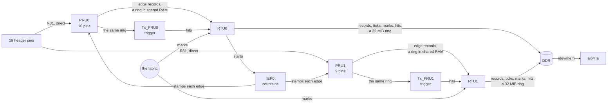

# ICSSG1: a 19-channel logic analyzer

ICSSG1's six cores record every change on 19 header pins, each stamped with the count of IEP0, ICSSG1's nanosecond counter on its 250 MHz clock, and Linux reads the records out of DDR. Jumper wires bring it the demo's own signals: the four PWM generators, SPI7, and the square wave. `ai64 la` then shows what each pin is doing, and `ai64 la capture` writes a VCD file for PulseView or GTKWave.

It records changes, not samples, so how much it writes depends on what the pins do, not on a sample rate: the demo's signals come to about 210,000 edges a second, under 2 MB/s, and it keeps up with 6 million. Each slice's Tx_PRU matches a trigger on the edges as they come, and the RTUs are fabric nodes, so any core in the demo can put a mark on the timeline.

## The channels

The channels are numbered in header pin order: P8 before P9, then by pin number. Each PRU can read only its own GPI pins, so PRU0 has ten of them and PRU1 nine; both stamp with the same IEP0, and Linux merges the two streams by time. `zephyr/include/ai64_la.h` holds the table, and the overlay, `ai64`, and the board tests all use it.

| Ch | Pin | Core, input | The demo's jumper brings | Signal |
| --- | --- | --- | --- | --- |
| 0 | P8.03 | PRU0 GPI19 | | spare |
| 1 | P8.05 | PRU1 GPI12 | | spare |
| 2 | P8.06 | PRU1 GPI13 | | spare |
| 3 | P8.07 | PRU0 GPI14 | P9.28 | SPI7 CS |
| 4 | P8.08 | PRU0 GPI13 | P9.31 | SPI7 CLK |
| 5 | P8.09 | PRU0 GPI16 | P9.30 | SPI7 MOSI |
| 6 | P8.10 | PRU0 GPI15 | P8.18 | the 1 kHz square wave |
| 7 | P8.21 | PRU1 GPI9 | P8.11 | ICSSG0 slice 0, A |
| 8 | P8.23 | PRU1 GPI10 | P8.12 | ICSSG0 slice 0, B |
| 9 | P8.25 | PRU1 GPI14 | P9.12 | ICSSG0 slice 1, A |
| 10 | P8.32 | PRU1 GPI5 | P9.15 or P8.31 | ICSSG0 slice 1, B |
| 11 | P8.33 | PRU1 GPI4 | P8.15 | the eCAP's copy of A |
| 12 | P8.35 | PRU1 GPI3 | P9.25 | EHRPWM4, Zephyr on R5F0_1 |
| 13 | P8.36 | PRU0 GPI7 | P8.21 | slice 0's A again, on the other PRU |
| 14 | P8.38 | PRU0 GPI8 | | spare |
| 15 | P9.11 | PRU0 GPI0 | | spare |
| 16 | P9.13 | PRU0 GPI1 | | spare |
| 17 | P9.21 | PRU1 GPI18 | | spare |
| 18 | P9.23 | PRU0 GPI9 | | spare |

Each pin is in mode 1, `PRG1_PRU<n>_GPI<bit>`, with its pull-down on, so a spare pin reads a steady low. P8.32, P8.33, P8.35, P8.38, and P9.21 each have a second SoC ball, which the overlay holds off. The signals that get compared with each other sit on one PRU, so one read of its pins takes them together: SPI7's three on PRU0, and the PWM generators on PRU1. Channel 13 is the same signal as channel 7 on the other PRU, to measure how far apart the two PRUs see one edge.

**The inputs connect straight to SoC pads.** They take 3.3 V logic only; 5 V on a pin can damage the SoC. The other pins the 19 could have been are taken: P8.18, P8.22, and P8.34 by Zephyr, P8.31 by the pipeline, P8.17 by the multicore scheduler, P8.24 and P9.22 are boot-mode straps, and P9.17, P9.18, P9.24, and P9.26 are the board's I²C4 and I²C6 buses.

## How it works



| Core | Job | Source |
| --- | --- | --- |
| PRU0, PRU1 | Read their pins, and at each change write an edge record: IEP0's count and the new state | `firmware/la_pru.c`, `firmware/la_sample.asm` |
| RTU0, RTU1 | Copy their PRU's records to its ring in DDR, add a tick each millisecond, keep the stream's header up to date; pass the trigger to the Tx_PRU and its hits into the stream; fabric nodes 10 and 11, which put marks in the stream; RTU0 also starts IEP0 | `firmware/la_rtu.c` |
| Tx_PRU0, Tx_PRU1 | Read their PRU's records as they come, and match the trigger on that PRU's pins | `firmware/la_txpru.c` |

**The PRU's loop** (`la_sample.asm`) takes two cycles, 8 ns, a pass: read R31 through the PRU's mask, and loop while it matches the last state. On a change it reads IEP0's count and stores the record, time then state, into its ring in ICSSG1's shared RAM, then the ring's write count. It touches nothing outside ICSSG1, and never waits for its RTU, so nothing else on the chip can slow it.

**The RTU** takes the slow, unpredictable work: DDR, and the GTC, the SoC's shared clock. Each millisecond it adds a tick, which pairs IEP0's count with the GTC and says every pin's state. An edge record holds only IEP0's low 32 bits; Linux finds the rest from the stream's last tick, which is never more than a millisecond away. If the RTU ever fell a whole ring behind its PRU, it would skip to where the PRU is and write a gap record, so a hole in the data is always marked.

**Linux** (`linux-app/la_stream.c`, for `ai64 la` in `la.c` and the web viewer's stream in `la_ws.c`) follows both streams in DDR, unwraps each edge's time, and merges the two by time. Nothing waits for Linux either: a reader that falls a whole 32 MiB ring behind, about 20 s of the demo's signals on PRU1, sees it from the ring's write count and counts what it missed.

`zephyr/include/ai64_la.h` has the record format and the addresses; `firmware/la_map.h` how each slice's data RAM and ICSSG1's shared RAM are split, and `firmware/la_ipc.h` the records the RTU and Tx_PRU share.

### Triggers

`ai64 la trigger` sets one: an edge on a channel (`6 rise`, `fall`, or `any`), or the moment some channels come to a pattern (`3=0 4=1`: SPI7's CS low with its clock high, the first clock of a transfer). A trigger takes the channels of one PRU. Linux writes it into that stream's header; the RTU passes it on to its Tx_PRU through ICSSG1's shared RAM, and the Tx_PRU, reading the PRU's edge records as fast as they come, writes each hit into its hit ring. The RTU puts each hit in the stream as a trig record, with the time of the edge that met it. So the Tx_PRU never touches DDR either, and a hit is found within microseconds of the edge, with nothing from Linux in between.

`ai64 la capture <seconds> <file> --trigger` waits for the next hit and writes the capture around it, a tenth before and the rest after: the part before comes out of the ring, which already holds it. The `trig` signal in the VCD file changes at each hit. Triggered on SPI7's first clock, a 2 ms capture holds the `spi hello` transfer from its start, and the clock and data decode to `hello`.

### Marks and the fabric

RTU0 and RTU1 are fabric nodes 10 and 11 ([The fabric](../../docs/fabric.md)): they answer every other core's pings, add to the tally, join R5F0_0's tour, and publish their stream's numbers in their fabric page, which the web page shows. A route that brings either of them the `mark` action puts a mark record in its stream, with the route's origin and a 16-bit value, at the time the RTU read it: `ai64 la mark 7`, or a route through other cores first, such as `ai64 fabric route c7x r5f0_1 g1rtu1 mark 42`. A capture shows the marks as a 16-bit signal, `mark`, which holds each value until the next. So whatever a core does can be lined up against the pins, on the same clock. The RTU puts the edges first: it looks at its fabric inbox when its ring is nearly drained, or every 100 µs at the latest, so with the PRUs at millions of edges a second its round trips grow to a few ms, and drop back when they slow down.

**Starting after another firmware set.** A core's task manager keeps its setup when the core stops, and the multicore scheduler leaves IEP0 starting a task on every core every 100 ns. A core stopped in the middle of a task stays in it, and its next yield would return to wherever the old firmware was interrupted. So before `ai64-demo` stops ICSSG1's cores it runs `ai64 la quiet`, which stops IEP0 and maps no event to any task, so each core stops outside one; each analyzer core then turns its own task manager off before anything else (`firmware/la_tm.h`).

## What it measures

Checked against the bench's Saleae Logic Pro 8 at 250 MS/s on P8.11, P9.12, and P9.25 at once, over 2 s: every one of the 184,000 edges the Saleae saw, the analyzer saw too, and 99.9% of them within 14 ns of the Saleae's time, after the two clocks' 34 ppm difference is taken out. The worst was 51 ns, on P9.25: the PRU stamps an edge up to about 50 ns late when it comes while the PRU is still writing the record for another change on its pins. The analyzer reads every period of the demo's generators at exactly its nominal length, 100,000.000, 66,664.000, and 50,000.000 ns averaged over thousands, since IEP0 counts from the same clock they do.

| | The analyzer | The Saleae, earlier ([Probe the pins](../../README.md#probe-the-pins)) |
| --- | --- | --- |
| Slice 1's dead band (hardware PWM) | 996 to 1004 ns | 1000 to 1004 ns |
| Slice 0's dead band (software PWM) | 968 to 1024 ns | 988 to 1020 ns |
| Slice 0's A at 20 kHz, 25% | high 12,472 to 12,532 ns | 12,476 to 12,524 ns |
| The same edge on PRU0 and on PRU1 (ch13 against ch7) | −4 ns apart, half of them; 98% within ±8 ns | |

**How close two edges can be.** Slice 1's hardware PWM puts A's fall and B's rise exactly its dead band apart, both on PRU1, so stepping the dead band down measures it (`fabric route g0rtu1 dead <ns>`). From 200 ns down to 64, the analyzer reads the gap right. Below 56 ns it reads 56, or both changes in one record when they fall between two reads of the pins: writing a record takes the PRU 14 cycles, 56 ns, and a change in that time waits for the next pass.

**How fast.** With both ICSSG0 slices at their fastest, a 2 µs period with a 100 ns dead band, PRU1 sees 5 million edges a second and PRU0 1 million: no gap from either RTU, nothing missed by Linux, and every period of a 1 s capture there. The demo's generators go no faster, so the analyzer's own ceiling is higher still. Linux reads the rings with 64-byte loads: uncached, each load costs about 190 ns whatever its size, so 64 bytes at a time read 266 MB/s, about 33 million records a second, where a word at a time read 21 MB/s.

The limits, then:

- **Time**: an edge's time is within a pass of the loop, 8 ns, of the truth; one that comes while the PRU is busy with another edge on its pins can be up to 56 ns late.
- **Short pulses**: a pulse shorter than 56 ns, right after another edge on the same PRU, can be missed: the PRU sees a pin's level at its next pass, so a pulse that is over by then leaves no record.
- **Rate**: 6 million edges a second, both PRUs together, with nothing lost; higher not yet measured.

## Using it

`ai64-demo` starts it on ICSSG1, and opens the `la` window:

```
ICSSG1 logic analyzer, the last 1.000 s; IEP0 at 176.965 s
  PRU0     31861 edges/s, 31905 in all; RTU0 gaps 0 (0 records), reader missed 0, marks 0, trigger hits 0
  PRU1    179173 edges/s, 179625 in all; RTU1 gaps 0 (0 records), reader missed 0, marks 0, trigger hits 0

  ch  pin    PRU/GPI  wired to          level  edges/s     frequency   duty
   0  P8.03  0/19     -                 low            0      0.0 Hz     0.0%
   3  P8.07  0/14     SPI7_CS P9.28     high           0      0.0 Hz   100.0%
   4  P8.08  0/13     SPI7_CLK P9.31    low            0      0.0 Hz     0.0%
   6  P8.10  0/15     SQUARE P8.18      high        2002    1.001 kHz   50.0%
   7  P8.21  1/9      S0_A P8.11        high       29925   14.963 kHz   50.0%
   8  P8.23  1/10     S0_B P8.12        low        29925   14.962 kHz   47.0%
   9  P8.25  1/14     S1_A P9.12        high       29924   14.962 kHz   50.1%
  10  P8.32  1/5      S1_B P9.15        low        29924   14.962 kHz   46.9%
  11  P8.33  1/4      ECAP P8.15        high       29926   14.963 kHz   50.1%
  12  P8.35  1/3      EHRPWM4 P9.25     high       29904   14.952 kHz   50.1%
  13  P8.36  0/7      S0_A P8.21        high       29924   14.962 kHz   50.1%
  ...
```

The frequency and duty are over the whole second, so the PWM channels show the average of their steps: 15 kHz, and 50% on A. B's duty is A's complement less the dead band. SPI7 only moves at startup and for each `spi`, so its channels sit still.

`ai64 la measure` goes into each edge. Its pairs, by default:

```
  from each change of a, to the nearest change of b       a rises:  min      med      max      a falls:  min      med      max
  ch7 S0_A -> ch8 S0_B                                      -1048    -1040    -1036             968      988     1024
  ch8 S0_B -> ch7 S0_A                                      -1024     -988     -968            1036     1040     1048
  ch9 S1_A -> ch10 S1_B                                     -1044    -1040    -1036             996     1000     1004
  ch10 S1_B -> ch9 S1_A                                     -1004    -1000     -996            1036     1040     1044
  ch7 S0_A -> ch13 S0_A                                        -4       -4        4              -8       -4        4
```

When A falls, B rises a dead band later: 1000 ns on slice 1, exact in hardware, and 968 to 1024 on slice 0, whose PRU writes its pins in software. When A rises, B fell 1040 ns before: the dead band, and the 40 ns A starts into its period. The last line is one signal on both PRUs: they agree to within a few ns.

| Command | What it does |
| --- | --- |
| `sudo ai64 la [seconds\|once\|lines]` | the `la` window, every second; once; or a line every 10 s for the merged console |
| `sudo ai64 la capture <seconds> <file.vcd\|-> [--trigger]` | records all 19 channels for that long and writes a VCD file, in ns from the start; with `--trigger`, around the next trigger hit |
| `sudo ai64 la measure [seconds] [a:b ...]` | each channel's edges, frequency, period and high time (min, median, max), and duty; and for each pair, the time from a's changes to b's nearest, by default the demo's A/B pairs and ch7 against ch13 |
| `sudo ai64 la trigger off \| <ch> rise\|fall\|any \| <ch>=0\|1 ...` | sets the Tx_PRUs' trigger |
| `sudo ai64 la mark <value>` | puts a mark in the stream, through the fabric to RTU0 |
| `sudo ai64 la quiet` | stops IEP0 and every task, before ICSSG1's cores stop; `ai64-demo` runs it |

`ai64-demo --icssg1 scheduler` runs TI's multicore scheduler on ICSSG1 instead ([extra-demos/](../../extra-demos/README.md)), and `--icssg1 off` leaves ICSSG1 stopped.

## The web viewer

While the demo runs, `http://<board>:8064/la` is a logic analyzer in the browser, with no software to install: the board streams the edges as they come, and the browser keeps them, as a Saleae's software does, so a capture runs until it is stopped or until it reaches the memory limit chosen at the top of the page (1 GB to start: about 130 million changes).


- **Follow** keeps the newest data at the right; the wheel zooms, a drag pans, and **Fit all** shows the whole capture. Where a pixel column holds more than one change, the viewer draws a block, so a zoomed-out view of millions of edges still says where the activity is.
- **Cursors**: a click puts A, a shift-click B, and the line under the waveforms gives B − A and its frequency.
- **The table** under them measures every channel over the time in view: changes, period and frequency from its rising edges, duty, and its level at the right edge.
- **Marks** (purple), **trigger hits** (amber), and **gaps** (red) are drawn across all the rows.
- **Export VCD** saves the time in view as a VCD file, as `ai64 la capture` does.

The page is `linux-app/web/la.html`, built into `ai64` like the demo's page. It opens the WebSocket `/la/stream`, and `ai64 web` gives each viewer a thread of its own (`linux-app/la_ws.c`), which reads the rings with a reader of its own and sends the edges in binary messages, the format at the top of `la_ws.c`. Each channel's changes are kept as times in growing arrays, 8 bytes each, and drawing does one binary search per pixel column, so it takes the same time for a hundred edges as for millions.

Measured with Firefox on the PC, over the board's gigabit Ethernet: with both ICSSG0 slices at their fastest, the viewer took 6.0 million edges a second, 46 MB/s, for as long as it ran, with nothing lost; it drew 4.2 million changes in 6 ms, and the last 2 s at that rate in 7 ms. Like the rest of the web page it only reads: it cannot set the trigger or send a mark, which are `ai64 la`'s.

## Build

From the repo root, `./beagle-linux/scripts/build.sh pru` builds this project with the others into `pru/build/ai64-la-<core><slice>.elf`.
