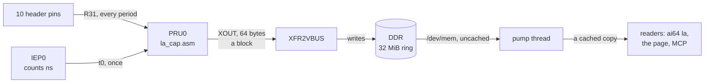

# ICSSG1: a 10-channel logic analyzer

ICSSG1 PRU0 samples 10 header pins at once, at a rate you pick from 125 MS/s down to 1.25 MS/s, with no gap, and writes every sample to a ring in DDR; Linux finds the changes. Jumper wires bring it the demo's own signals: the PWM generators, SPI7, the square wave, and the SoC's EHRPWM4 as a fast test signal. `ai64 la` shows what each pin is doing and writes VCD files for PulseView or GTKWave, a page on the board streams the pins live into a browser, and an MCP server lets Claude Code, or any MCP client, capture, trigger, measure, and decode them.

It works the way a Saleae does: you choose the channels and the sample rate, and the more bytes a second that comes to, the less of it the board can stream live. PRU0 itself never falls behind, whatever the pins do: what it writes depends only on the rate and the channels. The board's reader takes about 150 MB/s out of the ring live, which is every channel at 25 MS/s, or a few channels at 62.5 or 125 MS/s; a capture at a faster setup still comes whole, as long as it fits in the ring, read from it after ([Faster than live](#faster-than-live)). Anything lost is a [marked hole](#holes), never a false level.

## The channels

The channels are PRU0's GPI pins, numbered in header pin order: P8 before P9, then by pin number. `zephyr/include/ai64_la.h` holds the table, and the overlay, `ai64`, and the board tests all use it.

| Ch | Pin | PRU0 input | The demo's jumper brings | Signal |
| --- | --- | --- | --- | --- |
| 0 | P8.03 | GPI19 | P8.15 | the eCAP's copy of slice 0's A |
| 1 | P8.07 | GPI14 | P9.28 | SPI7 CS |
| 2 | P8.08 | GPI13 | P9.31 | SPI7 CLK |
| 3 | P8.09 | GPI16 | P9.30 | SPI7 MOSI |
| 4 | P8.10 | GPI15 | P8.18 | the 1 kHz square wave |
| 5 | P8.36 | GPI7 | P8.11 | ICSSG0 slice 0, A |
| 6 | P8.38 | GPI8 | P8.12 | ICSSG0 slice 0, B |
| 7 | P9.11 | GPI0 | P9.25 | EHRPWM4, Zephyr on R5F0_1: the fast test signal |
| 8 | P9.13 | GPI1 | P9.12 | ICSSG0 slice 1, A |
| 9 | P9.23 | GPI9 | P9.15 | ICSSG0 slice 1, B |

Each pin is in mode 1, `PRG1_PRU0_GPI<bit>`, with its pull-down on, so a pin with nothing on it reads a steady low. P8.38 has a second SoC ball, which the overlay holds off. PRU1's nine GPI pins (P8.05, P8.06, P8.21, P8.23, P8.25, P8.32, P8.33, P8.35, P9.21) stay muxed as its inputs, but nothing samples them: PRU1 is free.

**The inputs connect straight to SoC pads.** They take 3.3 V logic only; 5 V on a pin can damage the SoC.

## How it works



| Core | Job | Source |
| --- | --- | --- |
| PRU0 | starts IEP0, if nothing has; samples its pins at the rate set, packs them into 64-byte blocks, and hands each to XFR2VBUS | `firmware/la_pru.c`, `firmware/la_cap.asm` |
| RTU0, RTU1 | fabric nodes 10 and 11 ([The fabric](../../docs/fabric.md)), nothing else | `firmware/la_rtu.c` |
| PRU1, Tx_PRU0, Tx_PRU1 | free: they stay stopped | |

**PRU0's loop** (`la_cap.asm`) takes R31 through the channels' mask into the next sample of a block, every `period` cycles of its 250 MHz clock: 2 cycles at 125 MS/s, up to 200 at 1.25 MS/s. A block is 15 words of samples, a sample a word, or two a word, or four, by the lane the channels fit ([Rates and lanes](#rates-and-lanes)), and a tag. The instruction after each sample is the block's own work, one at a time: the tag's `ADD`, the address's `ADD` and wrap, a look at XFR2VBUS's status two samples before the end, the branch on it, the `XOUT` after the last sample, the jump back, or one that does nothing; slower rates add a fixed delay after each. So sample n of a run is exactly n periods after the first, whose IEP0 time PRU0 stores before the loop starts.

**XFR2VBUS** (SPRUJ61, the J721E PRU guide, 7.3.1) is a write engine in each ICSSG slice: one `XOUT` of r2 to r19 hands it 64 bytes and a DDR address, and it writes them to DDR on its own, so PRU0 never waits for DDR. It takes one write at a time. If the one before is still going when a block is done, which happens when the SoC holds DDR for a while, PRU0 drops the block rather than wait, and its slot keeps what it held: about once every 100 ms at the fastest setups, a hole of 4 to 13 µs; at 25 MS/s, a block or none in most seconds.

**The ring** is the first 32 MiB of the 64 MiB the overlay reserves at `0xac000000`, a 64-byte slot a block, round again when full. A block's tag is the run's key plus its number: Linux picks a new random key each time it starts PRU0, so a slot an earlier run left, or one PRU0 dropped, never reads as this run's. PRU0 keeps no count: sample k of block n is at t0 + (n × samples a block + k) × the sample time, so Linux knows from IEP0, which it reads directly, which blocks are due. Every rate ran on time to the block, measured over seconds against IEP0.

**Linux** (`linux-app/la_src.c`) maps the ring uncached. One pump thread a process copies each block, 100 µs after it is due, into a cached copy of the ring, and every reader in the process finds the changes in that copy at its own pace: the web page's viewers share one pass over DDR. A word whose samples all equal the last one is passed over whole, so a quiet channel costs little to decode. Uncached, the pump takes about 170 MB/s out of the ring while PRU0 writes to it: `LA_LIVE_BPS`, 150 MB/s, is what a setup may write and still stream live. That is for all the processes reading at once, since each has its own pump: the `la` window, `ai64 web` while a page is open, and the MCP server while it records each read the ring. Two of them at 133 MB/s (one channel at 125 MS/s) fall behind, and what they skip is a hole. A reader decodes a block only from a copy it knows the pump had finished, and had not yet started over again a lap on, so a block the pump wrote over is a hole too, never a mix of two laps.

**Setting it** (`ai64 la mode`, the page, `la_mode`): Linux stops PRU0, writes the channels' mask, the lane, the period, and the new key into PRU0's data RAM (`struct ai64_la_cfg`, `ai64_la.h`), and starts it again, a gap of some 30 ms. IEP0 keeps counting across it. PRU0 keeps its setup across a restart of the demo; at power-up it takes every channel at 25 MS/s.

## Rates and lanes

What a setup writes is the rate times the bytes a sample, and the bytes a sample depend on which channels are on: at 125 and 62.5 MS/s, channels whose GPI bits all fall within 0 to 7 or 8 to 15 take a byte a sample, four to a word; within 0 to 15 or 8 to 23, two bytes; otherwise a whole word. Slower rates always take the whole word: the bytes are few.

| Rate | A sample | Every channel | GPI 0 to 15 or 8 to 23 | GPI 0 to 7 or 8 to 15 | The ring holds, every channel |
| --- | --- | --- | --- | --- | --- |
| 125 MS/s | 8 ns | 533 MB/s | 267 MB/s | 133 MB/s, live | 63 ms |
| 62.5 MS/s | 16 ns | 267 MB/s | 133 MB/s, live | 67 MB/s, live | 126 ms |
| 25 MS/s | 40 ns | 107 MB/s, live | | | 315 ms |
| 12.5 MS/s | 80 ns | 53 MB/s, live | | | 629 ms |
| 6.25 MS/s | 160 ns | 27 MB/s, live | | | 1.26 s |
| 2.5 MS/s | 400 ns | 11 MB/s, live | | | 3.15 s |
| 1.25 MS/s | 800 ns | 5.3 MB/s, live | | | 6.29 s |

Channels 2, 4, 5, and 6 (GPI 13, 15, 7, 8) and others mix: `ai64 la mode`, the page's Capture section, and the MCP server's `la_mode` each say what a setup costs before it is set. A pulse a sample long or more is always there, timed to the sample; a rate at least four times the fastest edge rate you care about reads widths and duty to a quarter of a period or better.

## Faster than live

A setup that writes more than the reader takes live still has every sample in the ring, for as long as the ring holds. So a recording (`linux-app/la_rec.c`: `ai64 la capture`, `la measure`, and the MCP server's tools) at such a setup does not decode live: it waits out its time, then stops PRU0, so the ring holds still, reads its span of the ring whole, and starts PRU0 again. With a trigger, the reader finds the hit live, then does the same. The page's viewers see a pause of about 0.2 s. A recording up to 70% of what the ring holds comes whole this way: 40 ms of every channel at 125 MS/s, 533 MB/s, came with no hole; at 62.5 MS/s, with PRU0's holes only, 4 to 9 µs each. Longer ones are taken live, with holes where the reader skipped.

Finding a trigger's hit needs the changes as they come, so at a setup faster than live a hit can fall where the reader skipped, and the capture waits for the next one, or gives up: on SPI7 at 125 MS/s, 267 MB/s, a 10 s wait missed the one `spi hello` sent in it. Reading the ring through the CPU's cache, with a small kernel module, would take every setup live; that is the next step.

## Triggers

A trigger is an edge on a channel (`rise`, `fall`, or `any`), or the moment some channels come to a pattern (`1=0 2=1`: SPI7's CS low with its clock high, the first clock of a transfer). It is matched in Linux, on every change as the reader finds it (`la_rec.c`). While a recording waits for its hit, it keeps the changes from `pre` seconds back, from the ring's history, so the time before the hit is there when the hit comes. `ai64 la capture 0.002 out.vcd 4 rise pre 0.001` writes 3 ms around the square wave's next rise, the hit at 1 ms; the VCD file's `trig` signal goes high at the hit.

## Holes

Nothing the analyzer misses is passed off as signal. A hole is where blocks of samples were lost: PRU0 dropped them while the SoC held DDR, or the reader fell a ring behind the pump, or the pump behind PRU0. The reader makes each a span, from the sample before to the first sample after, which holds every channel. A VCD file takes every channel to `x` in a hole; `la measure`, the MCP server's tools, and the web page measure no period, pulse, or a-to-b time across one, and duty over only the time that is known; the page draws a hole as a band marked "no data", and the Events tab lists each.

**Starting after another firmware set.** A core's task manager keeps its setup when the core stops, and the multicore scheduler leaves IEP0 starting a task on every core every 100 ns. A core stopped in the middle of a task stays in it, and its next yield would return to wherever the old firmware was interrupted. So before `ai64-demo` stops ICSSG1's cores it runs `ai64 la quiet`, which stops IEP0 and maps no event to any task, so each core stops outside one; each analyzer core then turns its own task manager off before anything else (`firmware/la_tm.h`), and PRU0 starts IEP0 again.

## What it measures

The board tests (`tests/run.sh check`) read, on the board's own signals: the square wave at 1000 Hz; the PWM generators at 15 kHz averaged over their steps; a capture triggered on the square wave's rise with 1 ms of the ring before it; 40 ms of every channel at 125 MS/s, read whole after; and, through the MCP server, a capture triggered on SPI7's chip select that decodes to `hello`. The 1 kHz square wave, which the R5F1_0 makes in software, measures 1,000,000 ns from rise to rise at the median at 25 MS/s, its jitter up to 17 µs either way.

`tests/run.sh stress` takes ch7 alone at 125 MS/s, a byte a sample, live, against EHRPWM4 stepped from 2 µs down to 16 ns, its fastest, 62.5 MHz, the Nyquist rate; then every channel at 125 MS/s, read whole from the ring. On the bench, with ch7 alone, every period comes out exact at every step, 16 ns included, and every high time exact, or a sample short where half the period is no whole number of samples (96 ns of 200, 16 of 40). At 200 ns the reader finds all 10 million edges a second live, with only PRU0's own drops lost.

EHRPWM4 and PRU0 run from the same clock, so an edge falls at the same place among the samples every period: what a run measures repeats exactly, to the sample, and an edge that falls on a sample comes a sample early or late at times. At periods under about 50 ns the pulse through the header and a jumper wire is no longer square where the input switches, and with every channel at 125 MS/s, 533 MB/s into DDR, the odd sample at an edge reads the other way: at 16 ns about 1 edge in 2,500 a sample off, at 48 ns none more than a sample out (periods 40 to 56 ns, 48 at the median). At one byte a sample, 133 MB/s, 16 ns reads clean. That is the signal at the pin, not the sampling, as far as the board can tell: PRU0 never slips a cycle, every edge stays on the same phase over 40 ms; a cross-check on the bench's Saleae at 500 MS/s is still to be done.

`ai64 la rate` reads for a while and says how many blocks a second PRU0 wrote and the reader read, those lost, the changes it found, and how close two came:

```
25 MS/s, channels 0 1 2 3 4 5 6 7 8 9; 1 sample a word, 106.7 MB/s into the ring, which holds 0.315 s; the reader keeps up
PRU0 wrote 1666667 blocks/s (25 MS/s); the reader read 1666109 blocks/s and found 32088 edges/s; blocks lost 0 (dropped by PRU0, or skipped by the reader), times it fell a ring behind 0; closest edges 40 ns apart
```

At 125 MS/s on two channels in two bytes a sample, 267 MB/s, the reader read 2.7 million blocks a second of PRU0's 4.17 million: 173 MB/s.

## Using it

`ai64-demo` starts it on ICSSG1, and opens the `la` window:

```
ICSSG1 logic analyzer, the last 0.994 s; IEP0 at 892.646 s
  25 MS/s, channels 0 1 2 3 4 5 6 7 8 9; 1 sample a word, 106.7 MB/s into the ring, which holds 0.315 s; the reader keeps up
  read 1666667 blocks/s, 32069 edges/s; lost 0 blocks this interval, 0 in all

  ch  pin    GPI  wired to          level  edges/s     frequency   duty
   0  P8.03  19   ECAP P8.15        low            0      0.0 Hz     0.0%
   1  P8.07  14   SPI7_CS P9.28     high           0      0.0 Hz   100.0%
   2  P8.08  13   SPI7_CLK P9.31    low            0      0.0 Hz     0.0%
   3  P8.09  16   SPI7_MOSI P9.30   low            0      0.0 Hz     0.0%
   4  P8.10  15   SQUARE P8.18      low         2000    1.000 kHz   50.0%
   5  P8.36  7    S0_A P8.11        low        30072   15.036 kHz   50.1%
   ...
```

The frequency and duty are over the whole second, so the PWM channels show the average of their steps: 15 kHz, and 50% on A. SPI7 only moves at startup and for each `spi`, so its channels sit still.

| Command | What it does |
| --- | --- |
| `sudo ai64 la [seconds\|once\|lines]` | the `la` window, every second; once; or a line every 10 s for the merged console |
| `sudo ai64 la mode [<rate> [<ch> ... \| all]]` | the rate and channels PRU0 samples, what that writes a second, and how long the ring holds; or sets them: a rate in MS/s (125, 62.5, 25, 12.5, 6.25, 2.5, 1.25), and the channels, all 10 if none |
| `sudo ai64 la capture <seconds> <file.vcd\|-> [<ch> rise\|fall\|any \| <ch>=0\|1 ...] [pre <s>] [wait <s>]` | records the channels for that long and writes a VCD file, in ns from the start; with a trigger, around its next hit, `pre` before it (a tenth of the time, unless given), waiting up to `wait` (30 s) |
| `sudo ai64 la measure [seconds] [a:b ...]` | each channel's edges, frequency, period and high time (min, median, max), and duty; and for each pair, the time from a's changes to b's nearest, by default the demo's PWM A/B pairs |
| `sudo ai64 la rate [seconds]` | blocks a second written and read, lost, the changes found, and the closest two |
| `sudo ai64 la quiet` | stops IEP0 and every task, before ICSSG1's cores stop; `ai64-demo` runs it |

`ai64-demo --icssg1 scheduler` runs TI's multicore scheduler on ICSSG1 instead ([extra-demos/](../../extra-demos/README.md)), and `--icssg1 off` leaves ICSSG1 stopped.

## The web viewer

While the demo runs, `http://<board>:8064/la` is a logic analyzer in the browser, with nothing to install: the board streams the changes as they come, and the browser keeps them, as a Saleae's software does, so a capture runs until it is stopped or reaches the memory limit at the top of the page (1 GB to start), or, with **Spill to disk**, the disk space the browser allows.


The waveforms fill the window, a row per channel in its own color, with the time ruler over them, an overview of the whole capture's activity under them, a side panel, and a status bar.

- **Capture**, in the Channels tab: the sample rate and the channels, as on a Saleae. The rate menu gives what each rate writes for the channels chosen, and marks the ones faster than the board streams live; under it, what the setup samples, how long the ring holds, and whether this page gets every sample. Apply sets it on the board, for every viewer, and the status bar says what runs. A channel not recorded is drawn faint and tagged so.
- **Point at a waveform** to measure the pulse under the pointer: how long it is high or low, the period of the cycle it starts, its frequency, and its duty, in a tooltip and in the status bar. The pulse is drawn bold and its period bracketed. Zoomed out, where many edges share a pixel, it says how many and estimates the frequency from the median time between rising edges.
- **Markers**: a click puts marker A, a right-click marker B; each snaps to an edge within a few pixels and can be dragged. The Measure tab and the status bar give B − A and its frequency, and **time zero** can be the capture's start or marker A.
- **Shift-drag** selects a range: the Measure tab then measures every channel over it (frequency, duty, and the mean high and low widths) instead of over the view, Z zooms to it, and Export VCD saves it.
- **Navigation**: the wheel zooms at the pointer, a drag or a trackpad's sideways swipe pans, double-click fits the whole capture, and the overview strip at the bottom shows where the view is and moves it with a click or a drag. `[` and `]` jump to the previous or next edge on the channel pointed at. **Live** keeps the newest data at the right.
- **Analyzers**: SPI (chip select active low, any of the four modes, MOSI and MISO), UART (8N1, any baud, inverted or not), and I²C (starts, stops, addresses, data, acknowledges) each add a row under the channels, decoded over the time in view; pointing at a decoded byte gives its value, time, and length, and the Analyzers tab lists them, searchable, a click away.
- **Holes**: a band across the channels marked "no data", and nothing is measured across one; the Events tab lists each, and the status bar counts the blocks lost ([Holes](#holes)).
- **Channels**: show or hide each channel, name it, and pick its color; the browser remembers them, and the theme (light or dark) and the side panel.
- **Save** writes the capture to a `.lacap` file, and **Open** reads one back.
- **Spill to disk** moves the oldest blocks of changes into the browser's own disk storage, IndexedDB, when the capture fills the memory limit, and reads them back as they come into view. (The origin private file system would be quicker, but browsers keep it for secure contexts, and this page comes over plain HTTP.)

| Mouse and keys | |
| --- | --- |
| point | a pulse's width, period, frequency, and duty |
| wheel; `Shift` wheel, trackpad | zoom at the pointer; pan |
| drag; `Shift` drag | pan; select a range to measure |
| click, right-click | marker A, marker B: they snap to edges, and drag |
| double-click, `Home`, `F` or `End` | the whole capture; its start; live |
| `[` `]` | the previous or next edge on the channel pointed at |
| `A` `B` | a marker at the pointer |
| `←` `→`, `+` `−` | pan, zoom |
| `Z`, `Esc`, `Space`, `?` | zoom to the selection; clear it, then the markers; start or stop; these keys |


The page is `linux-app/web/la.html`, built into `ai64` like the demo's page. It opens the WebSocket `/la/stream`, and `ai64 web` gives each viewer a thread of its own (`linux-app/la_ws.c`), with a reader of its own on the shared pump, which sends the changes in binary messages, the format at the top of `la_ws.c`: each change a varint of its time since the last, in 4 ns steps, and the one channel that changed, about 2 bytes where a time and a state took 8. Each channel's changes are kept in blocks of 65,536, each time 4 bytes, an offset in ns from the block's first, and drawing does one binary search per pixel column, so it takes the same time for a hundred edges as for millions. The waveforms draw on one canvas, when the data or the view changes; the pointer, the markers, and the selection on a second canvas over it, so pointing stays smooth while the capture runs. Besides the setup, it only reads.

## MCP: the analyzer for a model

`ai64 mcp`, which `ai64-demo` starts in its `mcp` window, is an [MCP](https://modelcontextprotocol.io) server for the analyzer, on port 8065 at `/mcp`: the protocol's Streamable HTTP transport, JSON-RPC 2.0 in HTTP POSTs, in C on the board (`linux-app/mcp.c`), with nothing to install. Claude Code, for one, connects with:

```
claude mcp add --transport http ai64-la http://<board>:8065/mcp
```

| Tool | What it does |
| --- | --- |
| `la_channels` | the 10 channels: pin, ball, and GPI bit, and what the demo's jumpers bring |
| `la_status` | a quarter-second look: the setup, every channel's level and edges a second, and blocks lost |
| `la_mode` | the rate and channels, or sets them; and what every rate costs with those channels: MB/s, how long the ring holds, whether the reader keeps up live |
| `la_measure` | records for some seconds, and for each active channel gives edges, frequency, period and high time (min, median, max), and duty; and for channel pairs, the time from each change of one to the other's nearest; `rate` and `channels` set the setup first |
| `la_capture` | records for some seconds, or around a trigger's next hit (a channel's `rise`, `fall`, or `any` change, or a pattern), with `pre_seconds` from the ring before it, and keeps it on the board, also as a VCD file; returns the same summary as `la_measure`, with its holes; `rate` and `channels` set the setup first |
| `la_edges` | the last capture's changes on some channels in a time window, at most a limit a channel, and the holes in it |
| `la_decode` | SPI or UART in the last capture |

The answers are JSON, as both text and structured content, sized for a model: measurements and windows, not whole captures. Each says the setup it was taken at, and `la_mode`'s notes tell a model how to pick a rate. Through the MCP Python SDK's own client, at 25 MS/s, `la_capture` with `{"trigger": {"channel": 1, "edge": "fall"}, "seconds": 0.002, "pre_seconds": 0.0002}` caught SPI7's chip select falling while the demo sent `spi hello`, and `la_decode` returned `{"frames":[{"t_ns":200000,"mosi":"68 65 6c 6c 6f","mosi_text":"hello"}]}`. UART decoding has not met a real UART yet: none of the demo's signals on the analyzer's pins is one.

Unlike the web page's reader, it can change something, the setup, which every viewer follows, so it guards itself: it refuses a request whose `Origin` header is not its own address, which keeps a web page elsewhere from reaching it through a browser, and with `AI64_MCP_TOKEN` set in its environment it asks every request for `Authorization: Bearer <token>`. Without a token, anyone on the board's network can use it; it is meant for a bench.

## Build

From the repo root, `./beagle-linux/scripts/build.sh pru` builds this project with the others into `pru/build/ai64-la-pru0.elf`, `ai64-la-rtu0.elf`, and `ai64-la-rtu1.elf`.
