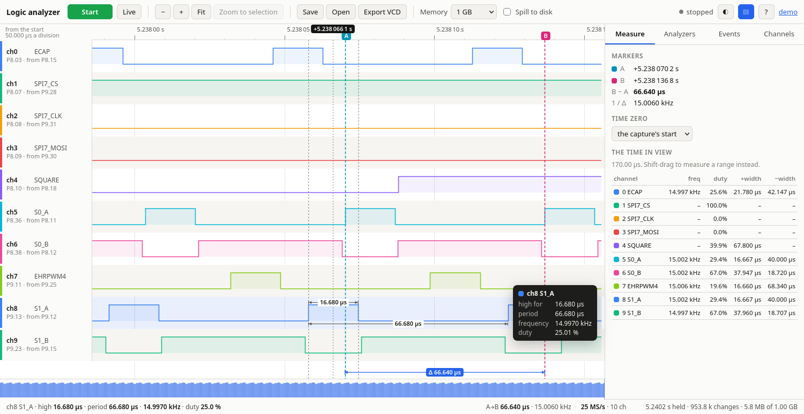
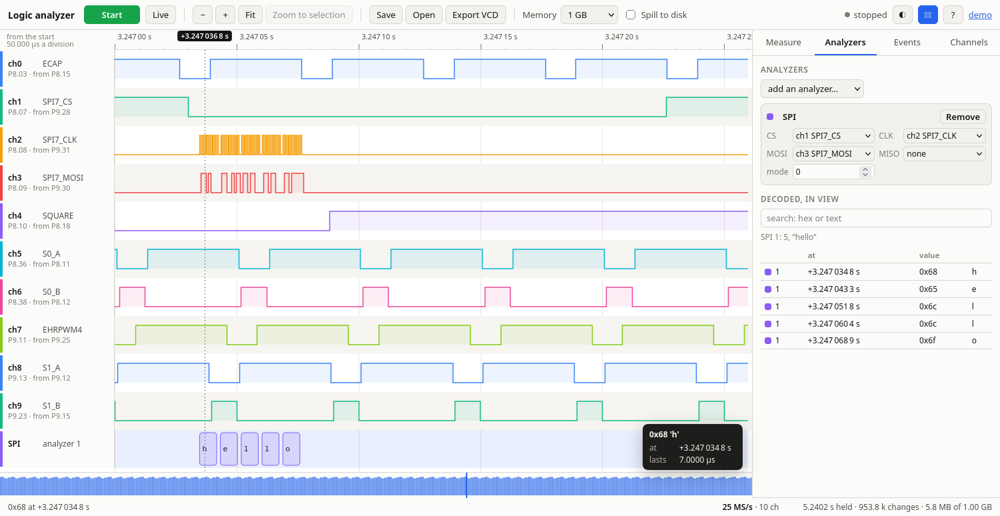
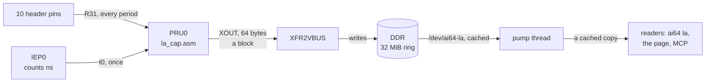

# ICSSG1: a 10-channel logic analyzer

ICSSG1 PRU0 samples 10 header pins at once, at a rate you pick from 125 MS/s down to 1.25 MS/s, with no gaps, and writes every sample to a ring in DDR. Linux finds the changes and serves them three ways:

- **A web viewer** at `http://<board>:8064/la`, which streams the pins live into the browser, with measurements, markers, and SPI, UART, and I²C decoders. There is nothing to install.
- **An MCP server** at `http://<board>:8065/mcp`, so Claude Code or any other MCP client can set the rate, capture around a trigger, measure, and decode.
- **`ai64 la`** on the board, which prints each pin's activity, measures timing, and writes VCD files for PulseView or GTKWave.

Jumper wires bring it the demo's own signals (the PWM generators, SPI7, the square wave, and EHRPWM4 as a fast test signal), so the board can measure itself.

You choose the channels and the sample rate. The more bytes a second that setup writes, the less of it the board can stream live: about 300 MB/s, which is every channel at 62.5 MS/s. A faster setup, up to every channel at 125 MS/s, still captures whole, read back from the ring after ([Faster than live](#faster-than-live)). PRU0 itself never falls behind. Anything lost along the way is a [marked hole](#holes), never a false level.



## Quick start

1. **Wire the jumpers** in the [channel table](#the-channels). Any subset works; a pin with nothing on it reads low.
2. **Start the demo** on the board with `ai64-demo --tmux`. It loads the `ai64_la` kernel module, starts ICSSG1, and opens the `la`, `web`, and `mcp` windows.
3. **Open `http://<board>:8064/la`** in a browser on the same network. The capture starts at once, every channel at 25 MS/s.
4. **Pick a rate and channels** in the Channels tab, then click Apply.
5. **For an agent**, add the MCP server; with Claude Code:

   ```
   claude mcp add --transport http ai64-la http://<board>:8065/mcp
   ```

   Then ask it, for example, to "capture SPI7 when its chip select falls and decode what was sent".

**The inputs connect straight to SoC pads.** They take 3.3 V logic only; 5 V on a pin can damage the SoC.

## The channels

The channels are PRU0's GPI pins, numbered in header order: P8 before P9, then by pin number. `zephyr/include/ai64_la.h` holds the table, which the overlay, `ai64`, and the board tests all use.

| Ch | Pin | PRU0 input | The demo's jumper brings | Signal |
| --- | --- | --- | --- | --- |
| 0 | P8.03 | GPI19 | P8.15 | the eCAP's copy of slice 0's A |
| 1 | P8.07 | GPI14 | P9.28 | SPI7 CS |
| 2 | P8.08 | GPI13 | P9.31 | SPI7 CLK |
| 3 | P8.09 | GPI16 | P9.30 | SPI7 MOSI |
| 4 | P8.10 | GPI15 | P8.18 | the 1 kHz square wave |
| 5 | P8.36 | GPI7 | P8.11 | ICSSG0 slice 0, A |
| 6 | P8.38 | GPI8 | P8.12 | ICSSG0 slice 0, B |
| 7 | P9.11 | GPI0 | P9.25 | EHRPWM4, from Zephyr on R5F0_1: the fast test signal |
| 8 | P9.13 | GPI1 | P9.12 | ICSSG0 slice 1, A |
| 9 | P9.23 | GPI9 | P9.15 | ICSSG0 slice 1, B |

Each pin is in mode 1, `PRG1_PRU0_GPI<bit>`, with its pull-down on, so a pin with nothing on it reads a steady low. P8.38 has a second SoC ball, which the overlay holds off. PRU1's nine GPI pins (P8.05, P8.06, P8.21, P8.23, P8.25, P8.32, P8.33, P8.35, P9.21) stay muxed as its inputs, but nothing samples them: PRU1 is free.

## The web viewer

While the demo runs, `http://<board>:8064/la` is a logic analyzer in the browser. The board streams the changes as they come, and the browser keeps them, so a capture runs until you stop it or it reaches the memory limit in the toolbar (1 GB to start). With **Spill to disk** it can grow to the disk space the browser allows.

The waveforms fill the window: a row per channel in its own color, the time ruler above them, an overview of the whole capture below, a side panel on the right, and a status bar.

- **Capture** (Channels tab): the sample rate and the channels. The rate menu shows what each rate writes for the channels chosen and marks the ones faster than the board streams live; below it, how long the ring holds and whether this page gets every sample. **Apply** sets it on the board, for every viewer. A channel that is not recorded is drawn faint and labelled so.
- **Point at a pulse** to measure it. An arrow just above the trace spans the pulse with its width; an arrow just below spans the whole cycle with its period. A box at the right end of that row gives the high or low time, period, frequency, and duty, and the status bar repeats them. Zoomed out, where many edges share a pixel, the box gives how many there are and estimates the frequency from the median time between rising edges.
- **Markers**: a click puts marker A, a right-click marker B. Each snaps to an edge within a few pixels and can be dragged. The Measure tab and the status bar give B − A and its frequency, and **Time zero** can be the capture's start or marker A.
- **Shift-drag** selects a range. The Measure tab then measures every channel over it (frequency, duty, and the mean high and low widths) instead of over the view; Z zooms to it, and Export VCD saves it.
- **Navigation**: the wheel zooms at the pointer; a drag or a sideways trackpad swipe pans; a double-click fits the whole capture. The overview strip at the bottom shows where the view is, and a click or drag there moves it. `[` and `]` jump to the previous or next edge on the channel pointed at. **Live** keeps the newest data at the right.
- **Analyzers**: SPI (chip select active low, any of the four modes, MOSI and MISO), UART (8N1, any baud, inverted or not), and I²C (starts, stops, addresses, data, and acknowledges). Each adds a row under the channels, decoded over the time in view. Pointing at a decoded byte gives its value, time, and length, and the Analyzers tab lists them, searchable, each a click away. SPI defaults to SPI7 on channels 1 to 3.
- **Holes**: a band across the channels marked "no data". Nothing is measured across one; the Events tab lists each, and the status bar counts the blocks lost ([Holes](#holes)).
- **Channels**: show or hide each channel, name it, and pick its color. The browser remembers these, along with the theme (light or dark) and the side panel.
- **Save** writes the capture to a `.lacap` file, and **Open** reads one back.
- **Spill to disk** moves the oldest blocks of changes into the browser's own disk storage (IndexedDB) once the capture fills the memory limit, and reads them back as they come into view. The origin private file system would be quicker, but browsers only offer it to secure contexts, and this page comes over plain HTTP.

| Mouse and keys | |
| --- | --- |
| point | a pulse's width, period, frequency, and duty |
| wheel; `Shift` wheel, trackpad | zoom at the pointer; pan |
| drag; `Shift` drag | pan; select a range to measure |
| click, right-click | marker A, marker B: they snap to edges, and drag |
| double-click; `Home`; `F` or `End` | the whole capture; its start; live |
| `[` `]` | the previous or next edge on the channel pointed at |
| `A` `B` | a marker at the pointer |
| `←` `→`; `+` `−` or `↑` `↓` | pan; zoom |
| `Z`; `Esc`; `Space`; `?` | zoom to the selection; clear it, then the markers; start or stop; these keys |



**How the page works.** It is one file, `linux-app/web/la.html`, built into `ai64` like the demo's main page. It opens the WebSocket `/la/stream`, and `ai64 web` gives each viewer a thread of its own (`linux-app/la_ws.c`) with its own reader on the shared pump. Changes arrive in binary messages, in the format described at the top of `la_ws.c`: each change is a varint of its time since the last, in 4 ns steps, plus the channel that changed, about 2 bytes a change. The browser keeps each channel's changes in blocks of 65,536 four-byte offsets, and drawing does one binary search per pixel column, so it takes the same time for a hundred edges as for millions. The waveforms are drawn on one canvas when the data or the view changes; the pointer, markers, and selection are drawn on a second canvas over it, so pointing stays smooth while the capture runs. Apart from setting the rate and channels, the page only reads.

## MCP: the analyzer for an agent

`ai64 mcp`, which `ai64-demo` starts in its `mcp` window, is an [MCP](https://modelcontextprotocol.io) server for the analyzer, on port 8065 at `/mcp`. It speaks the protocol's Streamable HTTP transport (JSON-RPC 2.0 in HTTP POSTs), is written in C on the board (`linux-app/mcp.c`), and needs nothing installed.

| Tool | What it does |
| --- | --- |
| `la_channels` | the 10 channels: pin, ball, GPI bit, and what the demo's jumpers bring |
| `la_status` | a quarter-second look: the setup, every channel's level and edges a second, and blocks lost |
| `la_mode` | reads or sets the rate and channels, and gives what every rate costs with those channels: MB/s, how long the ring holds, and whether the reader keeps up live |
| `la_measure` | records for some seconds, then gives each active channel's edges, frequency, period and high time (min, median, max), and duty; for channel pairs, the time from each change of one to the other's nearest. `rate` and `channels` set the setup first |
| `la_capture` | records for some seconds, or around a trigger's next hit (a channel's `rise`, `fall`, or `any` change, or a pattern), with `pre_seconds` of history before it; keeps the capture on the board, also as a VCD file, and returns the same summary as `la_measure` with its holes. `rate` and `channels` set the setup first |
| `la_edges` | the last capture's changes on some channels in a time window, up to a limit per channel, and the holes in it |
| `la_decode` | SPI or UART in the last capture |

Answers are JSON, as both text and structured content, and sized for a model: measurements and windows, not whole captures. Each says the setup it was taken at, and `la_mode`'s notes tell a model how to pick a rate. Through the MCP Python SDK's client, at 25 MS/s, `la_capture` with `{"trigger": {"channel": 1, "edge": "fall"}, "seconds": 0.002, "pre_seconds": 0.0002}` caught SPI7's chip select falling while the demo sent `spi hello`, and `la_decode` returned `{"frames":[{"t_ns":200000,"mosi":"68 65 6c 6c 6f","mosi_text":"hello"}]}`. UART decoding has not yet met a real UART: none of the demo's signals on the analyzer's pins is one.

Unlike the web page, it can change the setup, which every viewer then follows, so it guards itself. It refuses a request whose `Origin` header is not its own address, which keeps a web page elsewhere from reaching it through your browser, and with `AI64_MCP_TOKEN` set in its environment it requires `Authorization: Bearer <token>` on every request. Without a token, anyone on the board's network can use it: it is meant for a bench.

## From the shell

`ai64-demo` starts the analyzer on ICSSG1 and opens the `la` window, which updates every second:

```
ICSSG1 logic analyzer, the last 1.004 s; IEP0 at 5493.118 s
  25 MS/s, channels 0 1 2 3 4 5 6 7 8 9; 1 sample a word, 106.7 MB/s into the ring, which holds 0.315 s; the reader keeps up
  read 1666667 blocks/s, 181567 edges/s; lost 0 blocks this interval, 113 in all

  ch  pin    GPI  wired to          level  edges/s     frequency   duty
   0  P8.03  19   ECAP P8.15        high       29936   14.968 kHz   50.1%
   1  P8.07  14   SPI7_CS P9.28     high           0      0.0 Hz   100.0%
   2  P8.08  13   SPI7_CLK P9.31    low            0      0.0 Hz     0.0%
   3  P8.09  16   SPI7_MOSI P9.30   low            0      0.0 Hz     0.0%
   4  P8.10  15   SQUARE P8.18      high        2000    999.9 Hz    50.0%
   5  P8.36  7    S0_A P8.11        high       29936   14.968 kHz   50.1%
   ...
```

Frequency and duty are over the whole second, so the PWM channels show the average of their steps: 15 kHz, and 50% on A. SPI7 only moves at startup and for each `spi` command, so its channels sit still.

| Command | What it does |
| --- | --- |
| `sudo ai64 la [seconds\|once\|lines]` | the `la` window, every second; once; or a line every 10 s for the merged console |
| `sudo ai64 la mode [<rate> [<ch> ... \| all]]` | shows the rate and channels, what they write a second, and how long the ring holds; or sets them: a rate in MS/s (125, 62.5, 25, 12.5, 6.25, 2.5, 1.25) and the channels, all 10 if none are given |
| `sudo ai64 la capture <seconds> <file.vcd\|-> [<ch> rise\|fall\|any \| <ch>=0\|1 ...] [pre <s>] [wait <s>]` | records the channels for that long and writes a VCD file, in ns from the start; with a trigger, around its next hit, with `pre` seconds before it (a tenth of the time unless given), waiting up to `wait` (30 s) |
| `sudo ai64 la measure [seconds] [a:b ...]` | each channel's edges, frequency, period and high time (min, median, max), and duty; and for each pair, the time from a's changes to b's nearest (by default the demo's PWM A/B pairs) |
| `sudo ai64 la rate [seconds]` | blocks a second written and read, blocks lost, the changes found, and the closest two |
| `sudo ai64 la quiet` | stops IEP0 and every task before ICSSG1's cores stop; `ai64-demo` runs it |

`ai64-demo --icssg1 scheduler` runs TI's multicore scheduler on ICSSG1 instead ([extra-demos/](../../extra-demos/README.md)), and `--icssg1 off` leaves ICSSG1 stopped.

## Rates and lanes

What a setup writes is the rate times the bytes a sample, and the bytes a sample depend on which channels are on. At 125 and 62.5 MS/s, channels whose GPI bits all fall within 0–7 or 8–15 take one byte a sample, four to a word; within 0–15 or 8–23, two bytes; otherwise a whole word. Slower rates always take a whole word, since the bytes are few.

| Rate | A sample | Every channel | GPI 0–15 or 8–23 | GPI 0–7 or 8–15 | The ring holds, every channel |
| --- | --- | --- | --- | --- | --- |
| 125 MS/s | 8 ns | 533 MB/s | 267 MB/s, live | 133 MB/s, live | 63 ms |
| 62.5 MS/s | 16 ns | 267 MB/s, live | 133 MB/s, live | 67 MB/s, live | 126 ms |
| 25 MS/s | 40 ns | 107 MB/s, live | | | 315 ms |
| 12.5 MS/s | 80 ns | 53 MB/s, live | | | 629 ms |
| 6.25 MS/s | 160 ns | 27 MB/s, live | | | 1.26 s |
| 2.5 MS/s | 400 ns | 11 MB/s, live | | | 3.15 s |
| 1.25 MS/s | 800 ns | 5.3 MB/s, live | | | 6.29 s |

"Live" assumes the `ai64_la` module (300 MB/s). Without it the limit is 150 MB/s, so only setups of 133 MB/s or less are live.

The channels' GPI bits are scattered (channels 2, 4, 5, and 6 are GPI 13, 15, 7, and 8), so mixes vary: `ai64 la mode`, the page's Capture section, and `la_mode` each say what a setup costs before you set it. A pulse at least one sample long always shows, timed to the sample. To read widths and duty to a quarter of a period or better, sample at least four times the fastest edge rate you care about.

## How it works



| Core | Job | Source |
| --- | --- | --- |
| PRU0 | starts IEP0 if nothing has; samples its pins at the rate set, packs them into 64-byte blocks, and hands each to XFR2VBUS | `firmware/la_pru.c`, `firmware/la_cap.asm` |
| RTU0, RTU1 | fabric nodes 10 and 11 ([The fabric](../../docs/fabric.md)), nothing else | `firmware/la_rtu.c` |
| PRU1, Tx_PRU0, Tx_PRU1 | free: they stay stopped | |

**PRU0's loop** (`la_cap.asm`) takes R31 through the channels' mask into the next sample of a block every `period` cycles of its 250 MHz clock: 2 cycles at 125 MS/s, up to 200 at 1.25 MS/s. A block is 15 words of samples (one, two, or four samples a word, by the lane; see [Rates and lanes](#rates-and-lanes)) and a tag. The instruction after each sample does one piece of the block's own work: the tag's `ADD`, the address's `ADD` and wrap, a look at XFR2VBUS's status two samples before the end, the branch on it, the `XOUT` after the last sample, the jump back, or a no-op. Slower rates add a fixed delay after each. So sample n of a run is exactly n periods after the first, whose IEP0 time PRU0 stores before the loop starts.

**XFR2VBUS** (SPRUJ61, the J721E PRU guide, 7.3.1) is a write engine in each ICSSG slice. One `XOUT` of r2–r19 hands it 64 bytes and a DDR address, and it writes them on its own, so PRU0 never waits for DDR. It takes one write at a time. If the previous write is still going when a block is done, which happens when the SoC holds DDR for a while, PRU0 drops the block rather than wait, and its slot keeps what it held. At the fastest setups that is about once every 100 ms, a hole of 4 to 13 µs; at 25 MS/s, a block or none in most seconds.

**The ring** is the first 32 MiB of the 64 MiB the overlay reserves at `0xac000000`: a 64-byte slot per block, wrapping when full. A block's tag is the run's key plus its number. Linux picks a new random key each time it starts PRU0, so a slot left by an earlier run, or one PRU0 dropped, never reads as this run's. PRU0 keeps no count: sample k of block n is at t0 + (n × samples per block + k) × the sample time, so Linux knows from IEP0, which it reads directly, which blocks are due. Every rate ran on time to the block, measured over seconds against IEP0.

**Linux** (`linux-app/la_src.c`) maps the ring through `/dev/ai64-la`, a small kernel module in this repo (`beagle-linux/kernel/ai64_la/`) that `ai64-demo` loads.

- The overlay reserves the ring `no-map`, so through `/dev/mem` it maps as Device memory: a bus transaction per load, about 220 MB/s. The module maps it as Normal, cached memory instead, and the reader cleans and invalidates each line (`DC CIVAC`, which Linux lets user space do) just before reading it, since PRU0's writes go to DDR behind the caches: 1.27 GB/s.
- One pump thread per process copies each block, 100 µs after it is due, into a cached copy of the ring. Every reader in the process finds the changes in that copy at its own pace, so all the web page's viewers share one pass over DDR. A word whose samples all equal the last one is skipped whole, so a quiet channel costs little to decode.
- A reader decodes a block only from a copy the pump had finished and had not yet started overwriting a lap later, so a block the pump wrote over becomes a hole, never a mix of two laps.
- A reader keeps up live with 266 MB/s (every channel at 62.5 MS/s), even with 10 million changes a second. At 533 MB/s (every channel at 125 MS/s) it gets through 300 to 380 MB/s, with finding the changes taking most of a core. `LA_LIVE_BPS_CACHED`, 300 MB/s, is what a setup may write and still stream live.
- Each process has its own pump: the `la` window, `ai64 web` while a page is open, and the MCP server while it records. The board has two A72 cores, so two readers keep up at 133 MB/s each, but not at 266.
- Without the module (`ai64-demo` says so), the reader maps the ring through `/dev/mem` and takes about 170 MB/s out of it while PRU0 writes. The live limit is then `LA_LIVE_BPS`, 150 MB/s, and two readers at 133 MB/s fall behind. What a reader skips is a hole.

**Setting it** (`ai64 la mode`, the page, or `la_mode`): Linux stops PRU0; writes the channels' mask, the lane, the period, and the new key into PRU0's data RAM (`struct ai64_la_cfg` in `ai64_la.h`); and starts it again, a gap of about 30 ms. IEP0 keeps counting across it. PRU0 keeps its setup across a restart of the demo; at power-up it takes every channel at 25 MS/s.

**Starting after other firmware.** A core's task manager keeps its setup when the core stops, and TI's multicore scheduler leaves IEP0 starting a task on every core every 100 ns. A core stopped in the middle of a task stays in it, and its next yield would return to wherever the old firmware was interrupted. So before `ai64-demo` stops ICSSG1's cores it runs `ai64 la quiet`, which stops IEP0 and maps no event to any task, so each core stops outside one. Each analyzer core then turns its own task manager off before anything else (`firmware/la_tm.h`), and PRU0 starts IEP0 again.

## Faster than live

A setup that writes more than the reader takes live still has every sample in the ring, for as long as the ring holds them. So a recording at such a setup (`linux-app/la_rec.c`: `ai64 la capture`, `la measure`, and the MCP server's tools) does not decode live. It waits out its time, stops PRU0 so the ring holds still, reads its span of the ring whole, and starts PRU0 again. With a trigger, the reader finds the hit live, then does the same. The page's viewers see a pause of about 0.2 s.

A recording up to 70% of what the ring holds comes back whole this way: 40 ms of every channel at 125 MS/s (533 MB/s) came back with no holes; at 62.5 MS/s, with only PRU0's own holes of 4 to 9 µs. Longer recordings are taken live, with holes where the reader skipped.

Finding a trigger's hit needs the changes as they come, so at a setup faster than live a hit can fall where the reader skipped, and the capture waits for the next one, or gives up. Through `/dev/mem`, on SPI7 at 125 MS/s (267 MB/s), a 10 s wait missed the one `spi hello` sent in it. Through `/dev/ai64-la` that setup is live, and the MCP server's capture triggered on its chip select decodes `hello`. Every channel at 125 MS/s, 533 MB/s, is still faster than live.

## Triggers

A trigger is an edge on a channel (`rise`, `fall`, or `any`), or the moment some channels reach a pattern: `1=0 2=1` is SPI7's CS low with its clock high, the first clock of a transfer. Linux matches it on every change as the reader finds it (`la_rec.c`). While a recording waits for its hit, it keeps the changes from `pre` seconds back, out of the ring's history, so the time before the hit is there when it comes. `ai64 la capture 0.002 out.vcd 4 rise pre 0.001` writes 3 ms around the square wave's next rise, with the hit at 1 ms; the VCD file's `trig` signal goes high at the hit.

## Holes

Nothing the analyzer misses is passed off as signal. A hole is where blocks of samples were lost: PRU0 dropped them while the SoC held DDR, the reader fell a ring behind the pump, or the pump fell behind PRU0. The reader makes each a span, from the sample before to the first sample after, covering every channel.

- A VCD file takes every channel to `x` in a hole.
- `la measure`, the MCP tools, and the web page measure no period, pulse, or A-to-B time across a hole, and compute duty over only the time that is known.
- The page draws a hole as a band marked "no data", and the Events tab lists each.

## What it measures

The board tests (`tests/run.sh check`) read the board's own signals: the square wave at 1000 Hz; the PWM generators at 15 kHz averaged over their steps; a capture triggered on the square wave's rise with 1 ms of the ring before it; 40 ms of every channel at 125 MS/s, read whole afterwards; and, through the MCP server, a capture triggered on SPI7's chip select that decodes to `hello`. The 1 kHz square wave, which R5F1_0 makes in software, measures 1,000,000 ns from rise to rise at the median at 25 MS/s, with jitter up to 17 µs either way.

`tests/run.sh stress` takes ch7 alone at 125 MS/s, one byte a sample, live, against EHRPWM4 stepped from 2 µs down to 16 ns, its fastest: 62.5 MHz, the Nyquist rate. It stops the `la` window's reader first, since without the module two readers at that rate fall behind. Then it takes every channel at 125 MS/s, read whole from the ring. With ch7 alone, every period comes out exact at every step, 16 ns included, and every high time is exact, or one sample short where half the period is not a whole number of samples (96 ns of 200, 16 of 40). At 200 ns the reader finds all 10 million edges a second live, losing only PRU0's own drops.

**A known effect with EHRPWM4.** EHRPWM4 and PRU0 run from the same clock and both switch on its 4 ns grid, so PRU0's samples land at the same place against EHRPWM4's edges every period. That can be right on an edge, inside the input's setup and hold time, and then a high reads a sample long or short, the same way every period. With every channel at 125 MS/s (32 bits a sample) it is worse: at 16 ns the odd edge is a sample off (about 1 in 2,500); at 32 ns nearly every high reads as 8 or 24 ns, and at 48 ns as 24 or 32. That is the sampling against this one signal, not the signal: a separate logic analyzer at 500 MS/s on the same pin shows the high and low times equal (8, 16, and 24 ns, within its 2 ns sample), with ch7 alone or with every channel running. A signal on a clock of its own does not line up with the samples like that. So `stress` asks for the median period to be exact and every period and high time to be within a sample, and takes every channel at 48 ns.

**Against a separate logic analyzer**, on signals from other clocks, the two agree to within a sample:

| Measurement | Separate analyzer, 2 ns a sample | This analyzer, 125 MS/s (8 ns) |
| --- | --- | --- |
| Slice 0's dead band (A falling to B's nearest change), min / median / max | 988 / 992 / 1026 ns | 984 / 992 / 1024 ns |
| The 1 kHz square wave's period, min / median / max | 994,852 / 1,000,116 / 1,006,838 ns | 995,096 / 999,760 / 1,006,664 ns |

(The square wave's figures come from different stretches of it.)

`ai64 la rate` reads for a while and reports how many blocks a second PRU0 wrote and the reader read, the blocks lost, the changes found, and how close two came:

```
25 MS/s, channels 0 1 2 3 4 5 6 7 8 9; 1 sample a word, 106.7 MB/s into the ring, which holds 0.315 s; the reader keeps up
PRU0 wrote 1666667 blocks/s (25 MS/s); the reader read 1666109 blocks/s and found 32088 edges/s; blocks lost 0 (dropped by PRU0, or skipped by the reader), times it fell a ring behind 0; closest edges 40 ns apart
```

## Build

From the repo root, `./beagle-linux/scripts/build.sh pru` builds this project with the others into `pru/build/ai64-la-pru0.elf`, `ai64-la-rtu0.elf`, and `ai64-la-rtu1.elf`. The page and the MCP server are part of `ai64` (`build.sh linux`), and the kernel module is built by `build.sh kmod` for Debian or by the `ai64-la-mod` recipe in the Yocto image.
