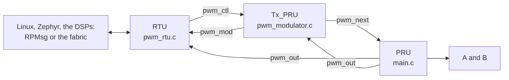

# PWM, two ways

## Introduction

ICSSG0's two slices make the same PWM waveform in two different ways:

- **Slice 0, in software.** PRU0 drives both outputs on its own pins (R30) and times every edge by polling IEP0.
- **Slice 1, in hardware.** The ICSSG's PWM module makes the edges, on IEP1 compare events. PRU1 only schedules the next compare.

Each slice splits its three cores the same way. The RTU talks to the rest of the SoC. The Tx_PRU is the modulator: it turns a request into the parameters of each coming period. The PRU makes the edges.

The layout follows TI's [open-pru](https://github.com/TexasInstruments/open-pru) projects. Each core has its own directory, `firmware/beaglebone-ai64/<core>/`, with a `ti-pru-cgt/` directory for its makefile and linker script. Sources more than one core builds sit in `firmware/`, next to the project's memory map.

## Supported combinations

| Processor | Board | Software |
| --- | --- | --- |
| J721E (TDA4VM) | BeagleBone AI-64 | TI PRU CGT 2.3.3, the PRU Software Support Package at the commit `build.sh` pins, Linux 6.18 (BeagleBoard's or TI's) |

## The waveform

A period of `P` ns, with duty `D` and dead band `d`:

| Output | High from | to |
| --- | --- | --- |
| A | `T0` | `T0 + D` |
| B | `T0 + D + d` | `P - d` |

B is A's complement, with `d` of dead band on each side; at least as much after B, before the next A. `T0` is 40 ns: an IEP compare at count 0 never fires, so the hardware slice's period starts there, and the software slice does the same.

Both slices start with 1 µs of dead band, stepping through 10, 15, and 20 kHz (`AI64_PWM_STEP_HZ`), and at each through 10, 25, 50, 75, and 90% duty (`AI64_PWM_STEP_PCT`), 5 ms a step. The Tx_PRU counts the step in PWM periods, so a step is exactly 50, 75, or 100 periods. `pwm <period_ns> <duty_ns>` fixes the period and duty, and `steps <ms>` and `sweep <ms>` set them moving again. Every time is a multiple of 4 ns, one IEP count, so 15 kHz runs as a 66,664 ns period. Every edge stays 400 ns (`AI64_PWM_EDGE_MIN_NS`) from the next on the same pin, which is the time PRU1 needs to rearm a compare, so 0% and 100% duty are out of range. The RTU clamps what it is asked for and reports what it runs.

| Slice | Pins | Core that drives them |
| --- | --- | --- |
| 0 | A on P8.11 (`PRG0_PRU0_GPO17`), B on P8.12 (`PRG0_PRU0_GPO16`) | PRU0, through R30 |
| 1 | A on P9.12 (`PRG0_PWM2_A0`), B on P9.15 (`PRG0_PWM2_B0`) | the PWM module's set 2, pair 0, on IEP1 |

## The cores

| Core | Source | What it does |
| --- | --- | --- |
| RTU0, RTU1 | `firmware/pwm_rtu.c` | The slice's fabric node (8, `g0rtu0`, and 9, `g0rtu1`). RTU0 also has an RPMsg channel to Linux. Writes requests to `pwm_ctl`, and every 10 ms publishes a `struct ai64_pwm_status` in its fabric page. |
| Tx_PRU0, Tx_PRU1 | `firmware/pwm_modulator.c` | Passes the requested duty through, or sweeps it from its minimum to its maximum and back every `sweep_ms`, a step per period. |
| PRU0 | `firmware/beaglebone-ai64/icss_g0_pru0_fw/main.c` | Spins on IEP0's count and writes R30 at each edge. Counts the edges it was more than 100 ns late for, and keeps the latest. |
| PRU1 | `firmware/beaglebone-ai64/icss_g0_pru1_fw/main.c` | IEP1 counts nanoseconds. CMP0 ends the period, CMP1 toggles A, CMP2 toggles B. When a compare fires, PRU1 clears its status and rearms it for that pin's next edge. |

**Why PRU1 rearms the compares.** On J721E a compare only fires again once software clears its status bit. AM64x has `PWM_EFC_EN` to clear it in hardware; J721E's `ICSSG_SA_MX_REG` has no such bit. An output in the active state only toggles: setting its active level to high or low has no effect, and CMP0 does not bring it back to its initial level. So each pin gets one compare, which PRU1 moves between that pin's rise and its fall. TI's AM65x PWM firmware for the `pwm-pru` Linux driver works the same way, and its 400 ns minimum pulse is the same limit.

**The trip zone.** The PWM set's nine trip inputs are masked (`ICSSG_PWM_TRIP_MASK_ALL`), since nothing here wires one. Unmasked and unconnected, they would hold the set in its trip state and the pins at Z.

## The memory map

`firmware/pwm_map.h` is the map. Each core's `linker.cmd` and the C code both include it. Every core sees its own slice's 8 KiB of data RAM at local `0x0000`, so one map serves both slices, and no slice touches the other's.

| Data RAM | Core | Size |
| --- | --- | --- |
| `0x0000`–`0x07ff` | PRU | 2 KiB |
| `0x0800`–`0x0bff` | Tx_PRU | 1 KiB |
| `0x0c00`–`0x1eff` | RTU, RPMsg and the fabric node included | 4.75 KiB |
| `0x1f00`–`0x1fff` | the IPC block | 256 B |

The 64 KiB of ICSSG0 shared RAM at `0x10000` is free.

The IPC block holds four records (`firmware/pwm_ipc.h`). Each has one writer. A writer fills in the fields before the `seq` that says they changed.

| Offset | Record | Writer | Readers |
| --- | --- | --- | --- |
| `0x1f00` | `pwm_ctl`: the request, already clamped | RTU | Tx_PRU |
| `0x1f40` | `pwm_next`: the coming periods' parameters, a seqlock | Tx_PRU | PRU |
| `0x1f80` | `pwm_out`: what runs now, the period count, the late edges | PRU | RTU, Tx_PRU |
| `0x1fc0` | `pwm_mod`: the request the modulator follows | Tx_PRU | RTU |

The PRU reads `pwm_next` in the middle of a period, so it is a seqlock: the Tx_PRU makes `seq` odd while it writes, and the PRU only takes a record whose `seq` is even and the same before and after.

## Build

From the repo root, `./beagle-linux/scripts/build.sh pru` builds this project and the multicore scheduler into `pru/build/ai64-icssg0-<core><slice>.elf`. Each image's memory use is printed after it links, and a region over 95% fails the build. `TRACE=0 ./beagle-linux/scripts/build.sh pru` builds the trace out of the PRUs and Tx_PRUs.

## Run

`ai64-demo` starts each slice's RTU first, then its Tx_PRU, then its PRU: each waits for the record the one before writes. Then, from Linux:

| What | How |
| --- | --- |
| See all three PWM generators | `sudo ai64 pwm` (the `pwm` window) |
| Slice 0 | in the `linux` window: `rtu0 pwm <period_ns> <duty_ns>`, `rtu0 dead <ns>`, `rtu0 sweep <ms>` (0 stops it), `rtu0 status` |
| Either slice, from any core | `sudo ai64 fabric route <nodes...> g0rtu1 pwm <period_ns> <duty_ns>`, likewise `dead` and `sweep`; the first PWM generator on the route takes it |

## Porting

A different board needs another `firmware/<board>/` directory, with the pins in R30 (slice 0) and the PWM set and pair (slice 1) changed to match.
